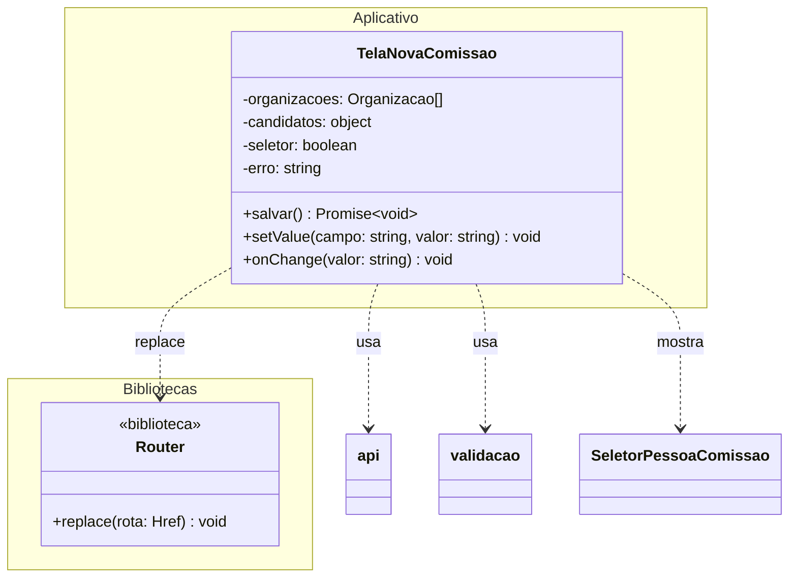
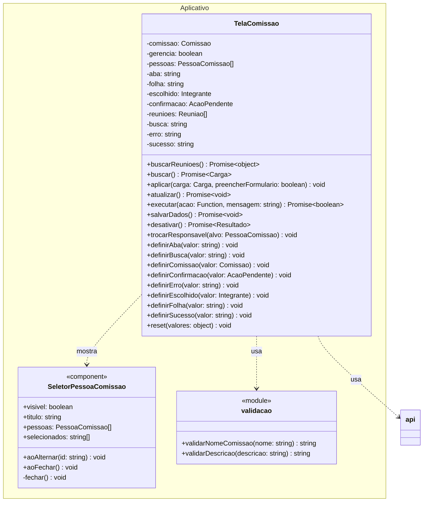
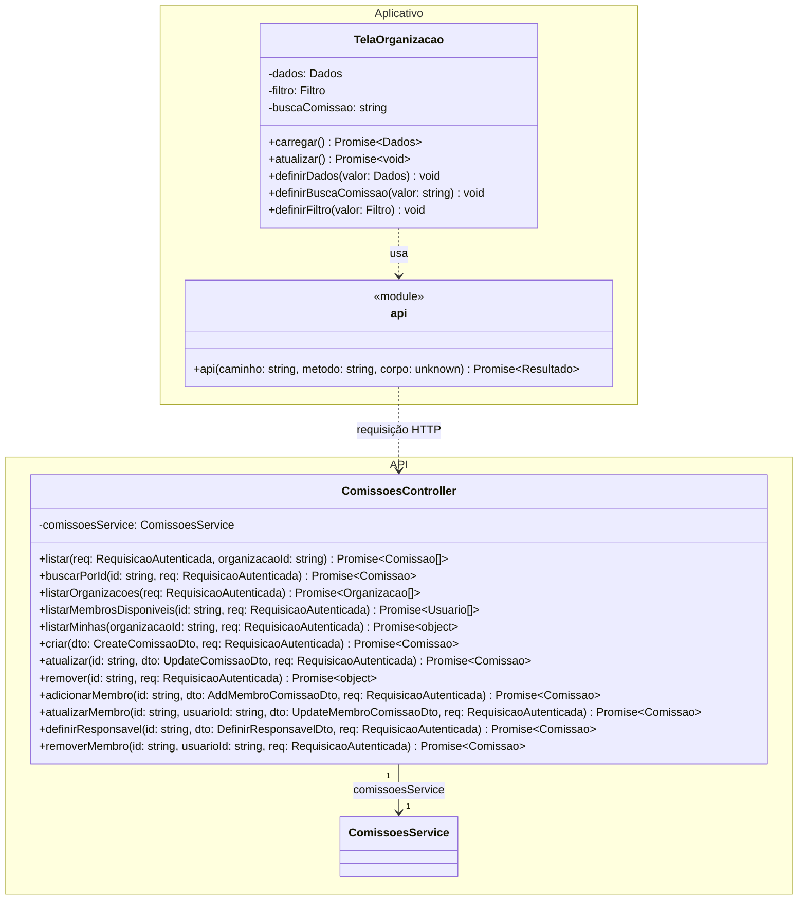
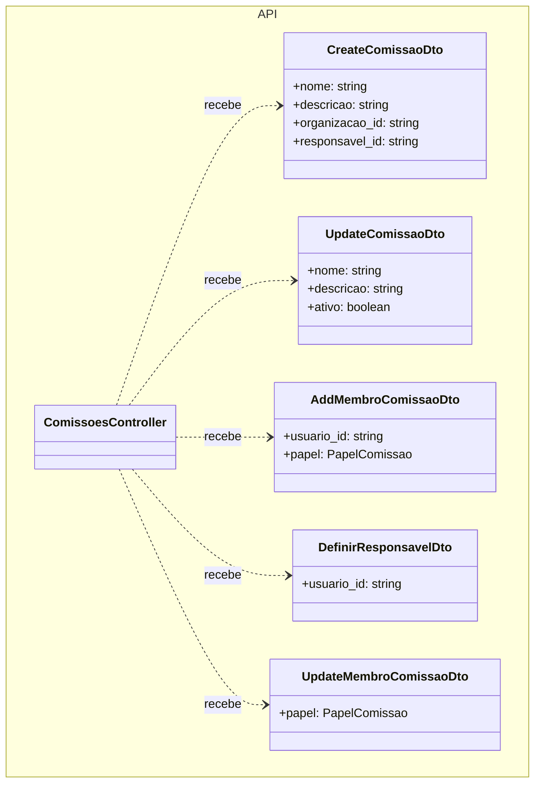
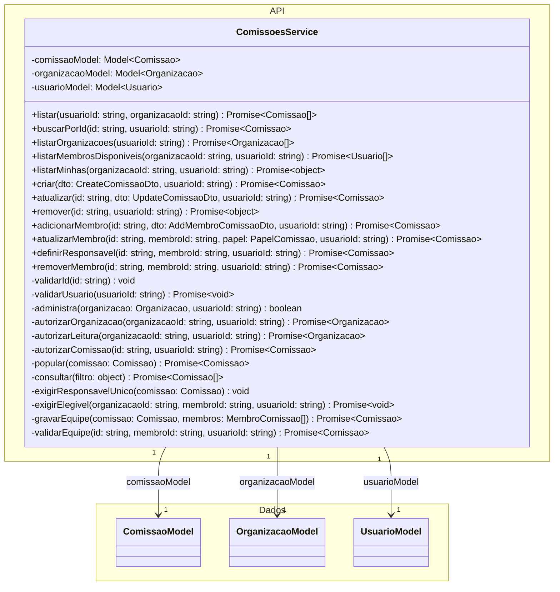
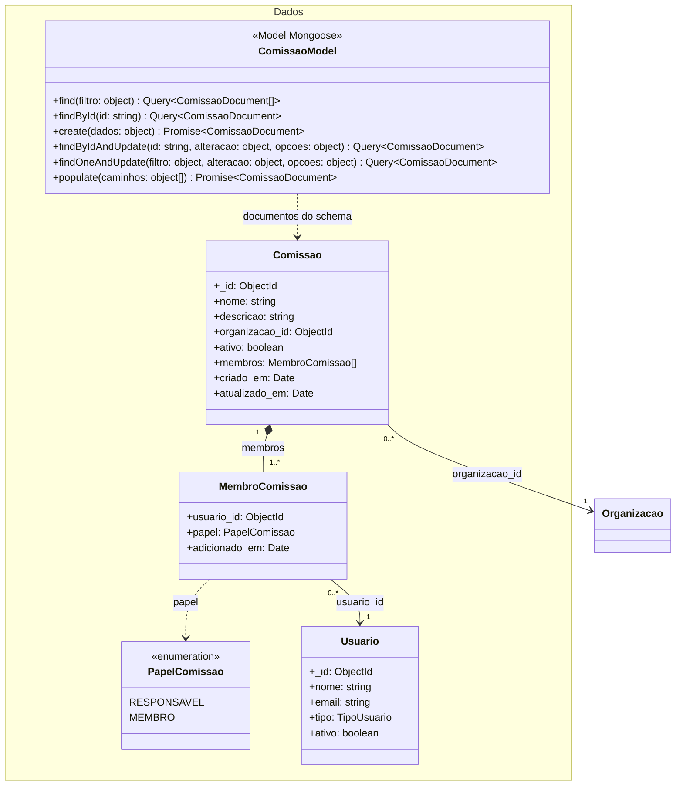
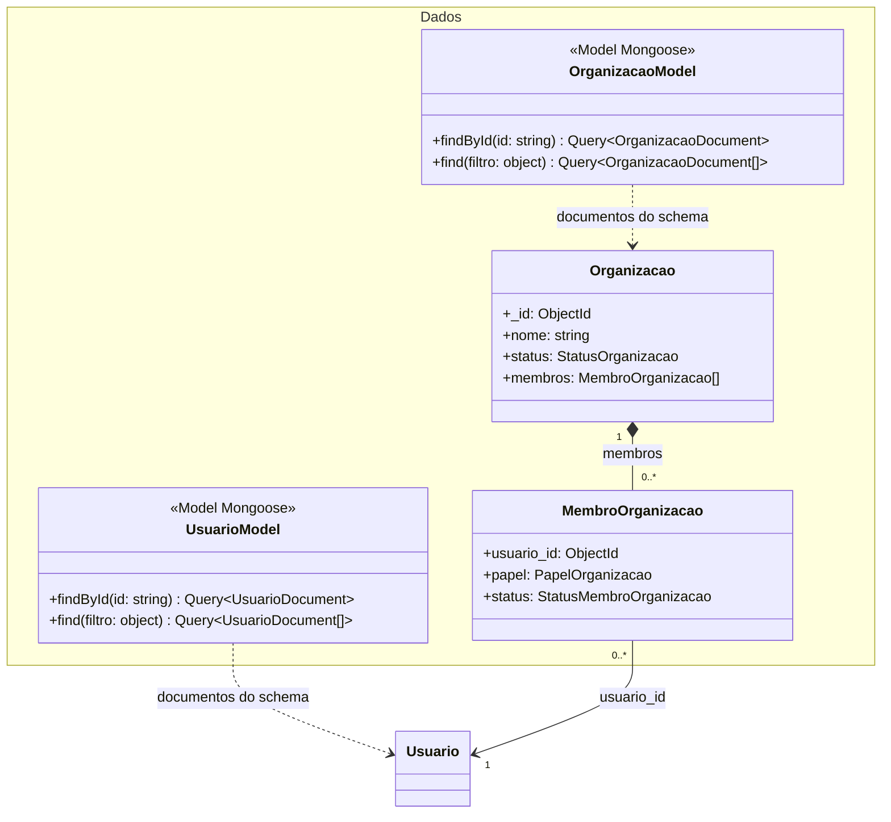

# Diagrama de classes — Cadastro de comissão

> Padrão da disciplina · Módulo COM · Revisado em 27/11/2026

## Resumo

O diagrama mostra as classes que participam do cadastro de comissões, agrupadas em três pacotes, um por camada do sistema: **Aplicativo** (telas, componente e módulos do aplicativo), **API** (controller, service e objetos de entrada) e **Dados** (os models do Mongoose `ComissaoModel`, `OrganizacaoModel` e `UsuarioModel`, marcados `<<Model Mongoose>>`, e os documentos guardados no MongoDB). O `Router` do `expo-router`, chamado diretamente pela tela de cadastro, fica no pacote **Bibliotecas**, marcado `<<biblioteca>>`. Para caber legível na largura da página, o diagrama está dividido em sete partes. Toda linha de vida e todo método dos [Diagramas de sequência](6%20-%20diagramas-sequencia-cadastro-comissao.md) aparecem aqui, numa das partes. Cada atributo traz o seu tipo, e cada método traz o tipo dos parâmetros e do retorno. Toda classe e todo método do diagrama existem no código. Nas telas, os métodos `definir*` são as funções de atualização do `useState`, e `reset`, `setValue` e `onChange` são os do formulário do `react-hook-form` que as sequências chamam.

## Diagrama

Cada classe tem os atributos e os métodos numa única parte, indicada na tabela; nas outras partes em que aparece, por ser ponta de uma ligação, ela vem só com o nome, sem atributos nem métodos, e a linha abaixo da figura diz em que parte está detalhada.

| Parte | Figura | Classes detalhadas |
| ----- | ------ | ------------------ |
| 1 | Figura 2 | `TelaNovaComissao`, `Router` |
| 2 | Figura 3 | `TelaComissao`, `SeletorPessoaComissao`, `validacao` |
| 3 | Figura 4 | `TelaOrganizacao`, `api`, `ComissoesController` |
| 4 | Figura 5 | `CreateComissaoDto`, `UpdateComissaoDto`, `AddMembroComissaoDto`, `DefinirResponsavelDto`, `UpdateMembroComissaoDto` |
| 5 | Figura 6 | `ComissoesService` |
| 6 | Figura 7 | `ComissaoModel`, `Comissao`, `MembroComissao`, `PapelComissao`, `Usuario` |
| 7 | Figura 8 | `OrganizacaoModel`, `UsuarioModel`, `Organizacao`, `MembroOrganizacao` |

### Parte 1 — Tela de nova comissão

Figura 2 — Diagrama de classes do cadastro de comissão, parte 1: tela "Nova comissão" e `Router`. Fonte: equipe Conecta+.

Só com o nome: `validacao` e `SeletorPessoaComissao` (parte 2) e `api` (parte 3).

### Parte 2 — Tela da comissão

Figura 3 — Diagrama de classes do cadastro de comissão, parte 2: tela da comissão, componente `SeletorPessoaComissao` e módulo `validacao`. Fonte: equipe Conecta+.

Só com o nome: `api` (parte 3).

### Parte 3 — Tela da organização, módulo api e controller

Figura 4 — Diagrama de classes do cadastro de comissão, parte 3: tela da organização, módulo `api` e `ComissoesController`. Fonte: equipe Conecta+.

Só com o nome: `ComissoesService` (parte 5).

### Parte 4 — Objetos de entrada

Figura 5 — Diagrama de classes do cadastro de comissão, parte 4: objetos de entrada do controller. Fonte: equipe Conecta+.

Só com o nome: `ComissoesController` (parte 3).

### Parte 5 — Serviço

Figura 6 — Diagrama de classes do cadastro de comissão, parte 5: `ComissoesService`. Fonte: equipe Conecta+.

Só com o nome: `ComissaoModel` (parte 6) e `OrganizacaoModel` e `UsuarioModel` (parte 7).

### Parte 6 — Comissão e equipe

Figura 7 — Diagrama de classes do cadastro de comissão, parte 6: model `ComissaoModel`, documentos `Comissao`, `MembroComissao` e `Usuario` e enumeração `PapelComissao`. Fonte: equipe Conecta+.

Só com o nome: `Organizacao` (parte 7).

### Parte 7 — Organização e usuário

Figura 8 — Diagrama de classes do cadastro de comissão, parte 7: models `OrganizacaoModel` e `UsuarioModel` e documentos `Organizacao` e `MembroOrganizacao`. Fonte: equipe Conecta+.

Só com o nome: `Usuario` (parte 6).

## Como ler as ligações

| Ligação                      | Significado                                                             | Exemplo no diagrama                                                                                          |
| ---------------------------- | ----------------------------------------------------------------------- | ------------------------------------------------------------------------------------------------------------ |
| Losango cheio (composição)   | A parte só existe dentro do todo e é apagada junto com ele.             | `Comissao *-- MembroComissao` (parte 6): cada integrante é gravado dentro do documento da comissão, sem identificador próprio. |
| Seta cheia (associação)      | Uma classe guarda uma referência a outra, que existe por conta própria. | `MembroComissao --> Usuario` (parte 6): `usuario_id` guarda o identificador de um documento de `usuarios`.             |
| Seta tracejada (dependência) | Uma classe usa a outra em uma chamada, sem guardá-la como atributo.     | `TelaNovaComissao ..> Router` (parte 1): a tela abre a comissão criada com `replace`.                                  |

Os números nas pontas são as multiplicidades. Uma `Comissao` tem ao menos um `MembroComissao` (`1..*`), porque o responsável é obrigatório, e pertence a exatamente uma `Organizacao` (`1`); uma organização pode ter qualquer quantidade de comissões (`0..*`). Cada `MembroComissao` aponta para exatamente um `Usuario`, e um usuário pode estar em várias comissões. O `ComissoesService` guarda uma instância de cada model (`1`), injetada pelo NestJS, e cada model lê e grava os documentos do seu schema; `populate` é chamado no documento da comissão já lido.

No código, são opcionais: `descricao`, em `Comissao` e em `CreateComissaoDto`; `nome`, `descricao` e `ativo`, em `UpdateComissaoDto`; e `papel`, em `AddMembroComissaoDto`. `validarNomeComissao` e `validarDescricao` devolvem o texto do erro ou `null` quando o valor é válido. `Organizacao`, `MembroOrganizacao` e `Usuario` aparecem só com os campos que este módulo usa; a descrição completa está nos módulos de [organização](../cadastro-organizacao/README.md) e de [usuário](../cadastro-usuario/README.md).

## Rotas atendidas pelo controller

As rotas HTTP não são métodos; por isso ficam nesta tabela, e não no diagrama.

| Método do controller       | Rota HTTP                                  | Uso                                                                                                   |
| -------------------------- | ------------------------------------------ | ----------------------------------------------------------------------------------------------------- |
| `listar`                   | `GET /comissoes`                           | RF-COM-01, com ou sem `?organizacao_id=`.                                                             |
| `buscarPorId`              | `GET /comissoes/:id`                       | RF-COM-02.                                                                                            |
| `listarOrganizacoes`       | `GET /comissoes/organizacoes`              | RF-COM-02 e RF-COM-03.                                                                                |
| `listarMembrosDisponiveis` | `GET /comissoes/organizacoes/:id/membros`  | RF-COM-02 e RF-COM-03.                                                                                |
| `criar`                    | `POST /comissoes`                          | RF-COM-03.                                                                                            |
| `atualizar`                | `PATCH /comissoes/:id`                     | RF-COM-04 e RF-COM-06.                                                                                |
| `remover`                  | `DELETE /comissoes/:id`                    | RF-COM-05. Apesar do verbo, desativa; não apaga o documento.                                          |
| `adicionarMembro`          | `POST /comissoes/:id/membros`              | RF-COM-07.                                                                                            |
| `definirResponsavel`       | `PATCH /comissoes/:id/responsavel`         | RF-COM-08.                                                                                            |
| `removerMembro`            | `DELETE /comissoes/:id/membros/:usuarioId` | RF-COM-09.                                                                                            |
| `listarMinhas`             | `GET /comissoes/minhas/:organizacaoId`     | Não usada pelo aplicativo. Devolve as comissões de cuja equipe o usuário faz parte, com `meu_papel`.  |
| `atualizarMembro`          | `PATCH /comissoes/:id/membros/:usuarioId`  | Não usada pelo aplicativo. Exige a comissão ativa e a pessoa na equipe (`validarEquipe`). Com `papel = RESPONSAVEL`, chama `definirResponsavel`; com `MEMBRO`, chama `exigirResponsavelUnico`, recusa rebaixar o responsável ("Substitua o responsável antes de alterar seu papel") e, para um membro, devolve a comissão sem gravar nada. |

## Regras representadas

- `MembroComissao` não existe fora de `Comissao`;
- em `membros` há exatamente um item com `papel = RESPONSAVEL` e nenhum `usuario_id` repetido;
- quem entra em `membros` precisa estar ativo e com vínculo `APROVADO` na organização da comissão;
- a troca de responsável regrava a lista inteira numa só operação: o escolhido vira `RESPONSAVEL` e todos os outros viram `MEMBRO`;
- toda mudança de equipe só é gravada se a equipe e a situação não mudaram desde a leitura;
- o aplicativo nunca decide quem pode gerenciar: ele mostra os botões conforme a resposta de `GET /comissoes/organizacoes`, e a API confere de novo em cada operação.

## Rastreabilidade

RF-COM-01 a RF-COM-09; complementado por [Dicionário de classes](3%20-%20dicionario-dados-classes-cadastro-comissao.md) e [Diagramas de sequência](6%20-%20diagramas-sequencia-cadastro-comissao.md).
