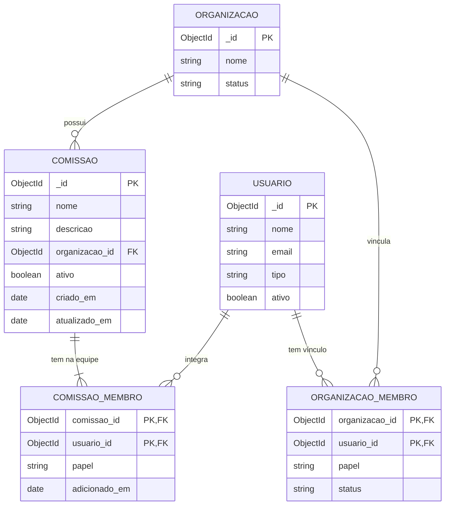

# Diagrama relacional — Cadastro de comissão

> Padrão da disciplina · Módulo COM · Visão lógica dos documentos MongoDB · Revisado em 26/11/2026

## Resumo

O banco é o MongoDB, que não tem tabelas: a equipe de cada comissão fica dentro do documento da comissão, na coleção `comissoes`, e os vínculos das pessoas com a organização ficam dentro do documento da organização, na coleção `organizacoes`. O diagrama abaixo é uma **visão lógica**: ele separa esses dados em entidades para deixar claras as chaves, as cardinalidades e as restrições. As entidades que correspondem a coleções próprias são `COMISSAO`, `ORGANIZACAO` e `USUARIO`.

## Diagrama

Figura 3 — Visão lógica relacional do cadastro de comissão. Fonte: equipe Conecta+.

## Como as entidades lógicas viram documentos

| Entidade lógica      | Onde fica de verdade           | Observação                                                                                         |
| -------------------- | ------------------------------ | -------------------------------------------------------------------------------------------------- |
| `COMISSAO`           | coleção `comissoes`            | Documento principal deste módulo.                                                                  |
| `COMISSAO_MEMBRO`    | `comissoes.membros[]`          | Subdocumento sem identificador próprio; a chave lógica é a comissão mais o usuário.               |
| `ORGANIZACAO`        | coleção `organizacoes`         | Mantida pelo módulo de organização; aqui só é lida.                                                |
| `ORGANIZACAO_MEMBRO` | `organizacoes.membros[]`       | Subdocumento com o vínculo da pessoa; aqui só é lido, para conferir permissões e elegibilidade.    |
| `USUARIO`            | coleção `usuarios`             | Mantida pelo módulo de usuário; aqui só é lida.                                                    |

Como `COMISSAO_MEMBRO` mora dentro da comissão, `comissao_id` aparece no diagrama como parte da chave, mas não existe como campo gravado: ele vem do documento que contém a lista. O mesmo vale para `organizacao_id` em `ORGANIZACAO_MEMBRO`.

## Cardinalidades

- uma organização tem zero ou mais comissões; cada comissão pertence a exatamente uma organização;
- uma comissão tem um ou mais integrantes, porque o responsável é obrigatório;
- um usuário pode integrar zero ou mais comissões, no máximo uma vez em cada;
- uma organização tem zero ou mais vínculos; um usuário pode ter vínculo com zero ou mais organizações.

## Regras de integridade

- em cada comissão, exatamente um `COMISSAO_MEMBRO` tem `papel = RESPONSAVEL`;
- um usuário aparece no máximo uma vez em `COMISSAO_MEMBRO` da mesma comissão;
- quem entra em `COMISSAO_MEMBRO` tem, no momento da inclusão, um `ORGANIZACAO_MEMBRO` com `status = APROVADO` na organização da comissão e `USUARIO.ativo` verdadeiro;
- só gravam em `COMISSAO` e em `COMISSAO_MEMBRO` os usuários com `ORGANIZACAO_MEMBRO.papel = ADMIN` e `status = APROVADO` numa `ORGANIZACAO` com `status = APROVADA`;
- o MongoDB não confere chaves estrangeiras: quem garante que `organizacao_id` e `usuario_id` apontam para documentos existentes é o serviço, no momento da gravação.

O detalhe de cada campo e de cada restrição está no [dicionário relacional](4%20-%20dicionario-dados-relacional-cadastro-comissao.md).

## Rastreabilidade

RF-COM-01 a RF-COM-09; detalhado em [Dicionário relacional](4%20-%20dicionario-dados-relacional-cadastro-comissao.md).
