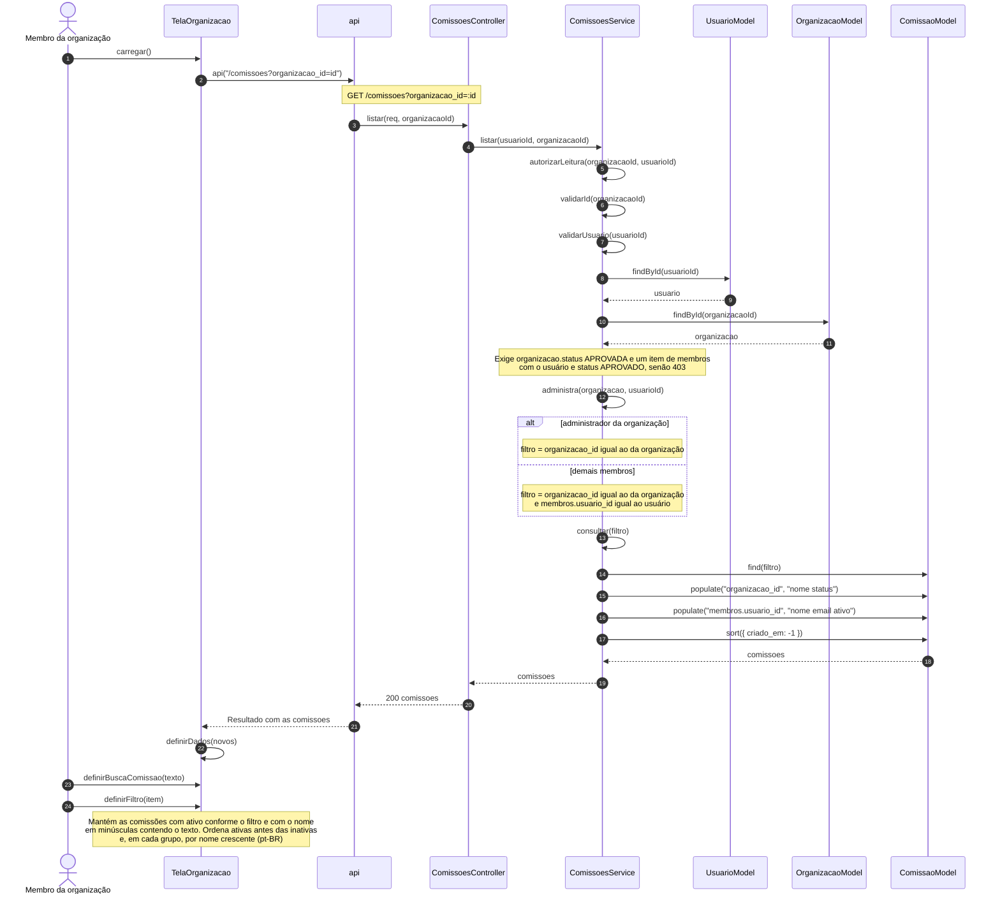
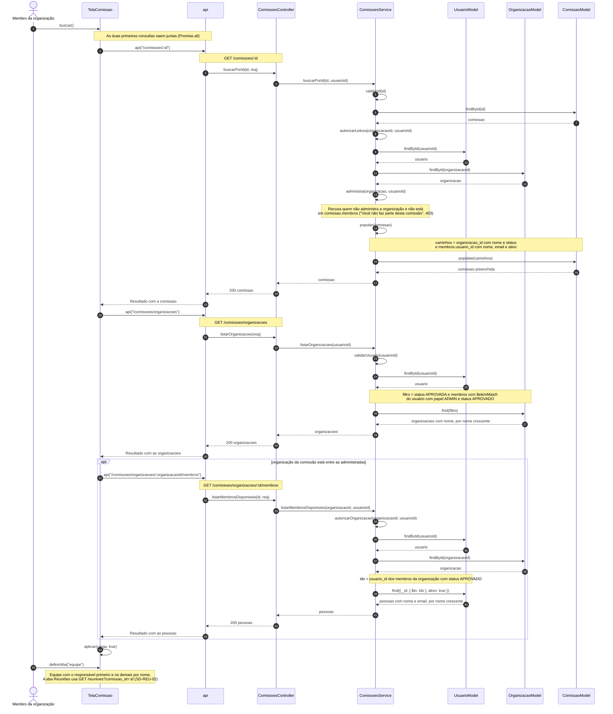
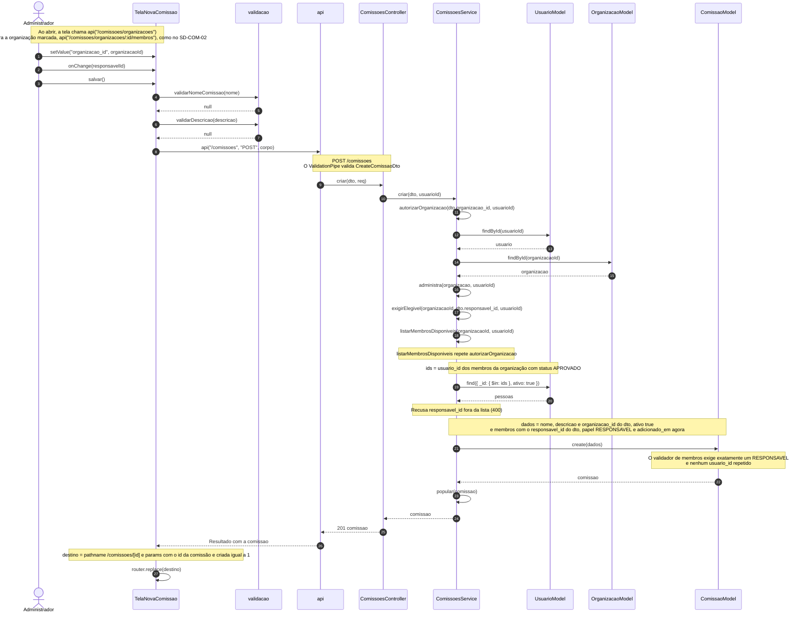
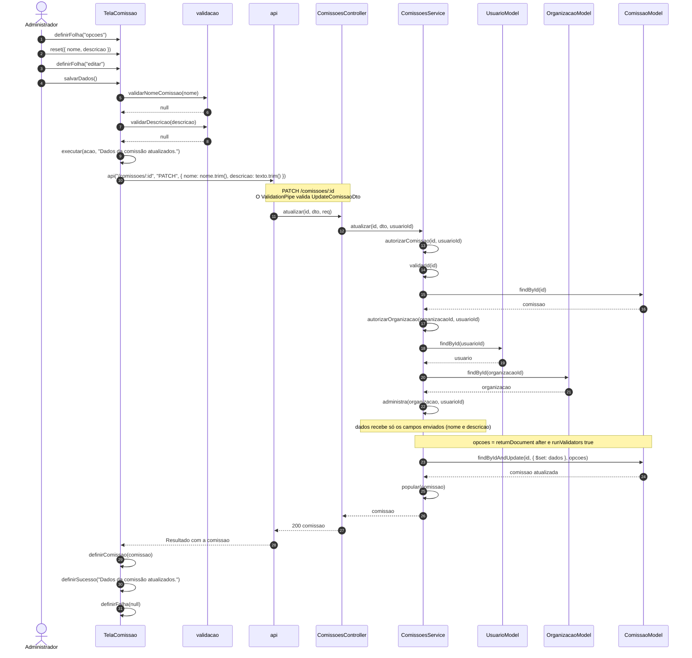
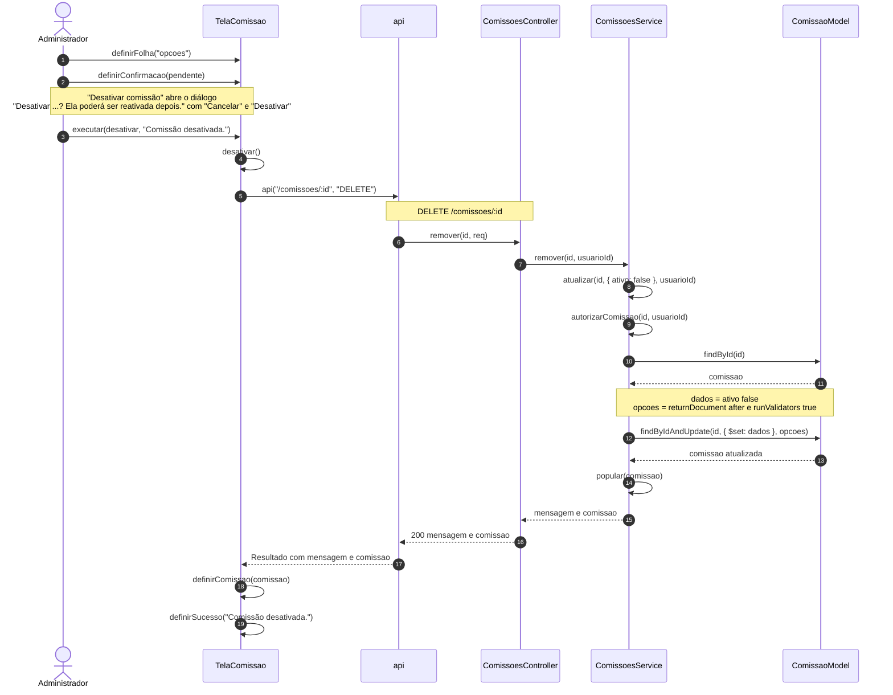
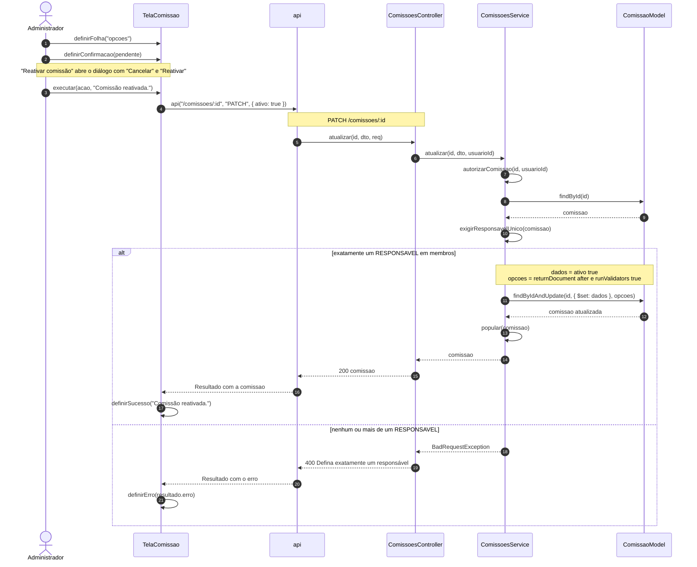
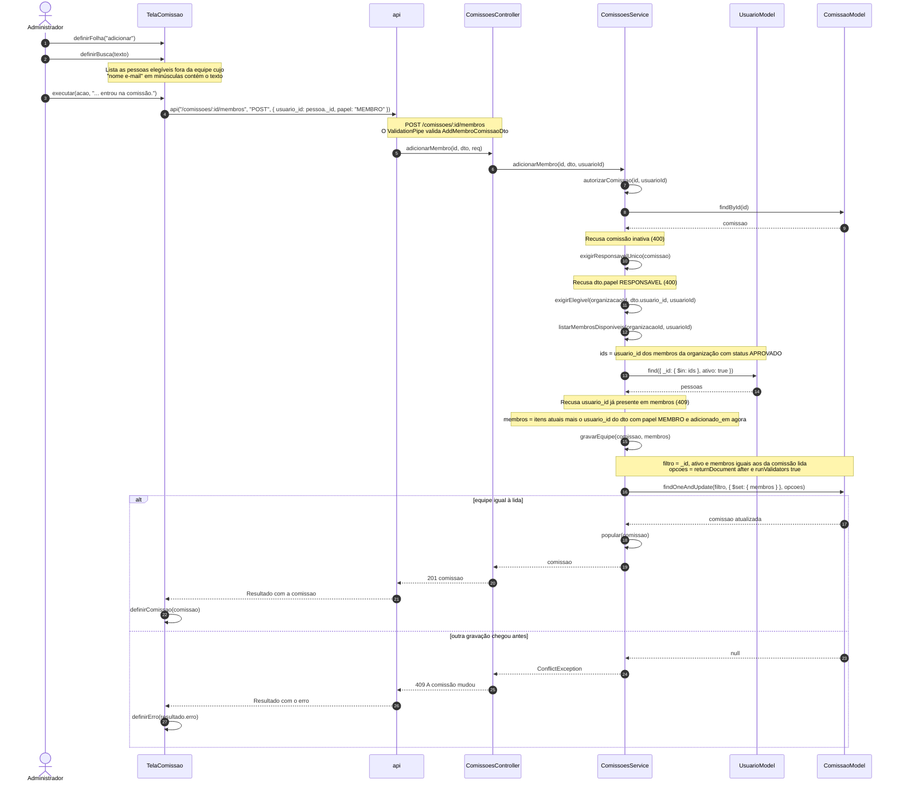
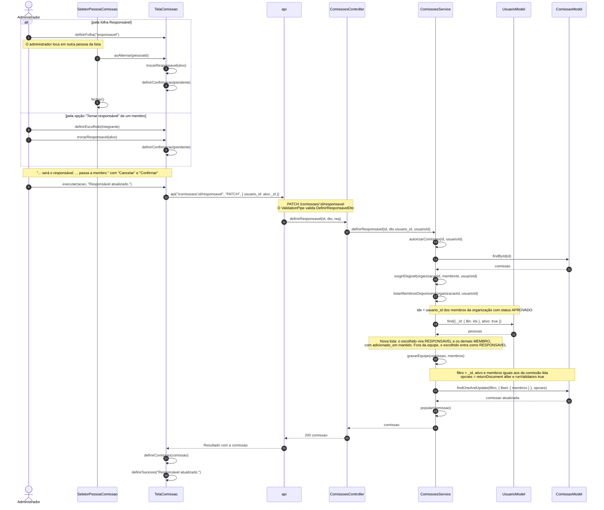
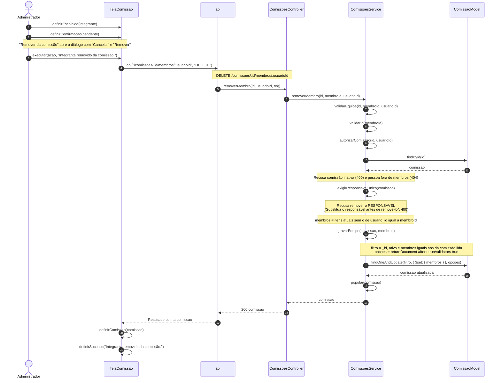

# Diagramas de sequência — Cadastro de comissão

> Padrão da disciplina · Módulo COM · Revisado em 26/11/2026

## Resumo

Há um diagrama para cada requisito de [Requisitos funcionais](2%20-%20requisitos-funcionais-cadastro-comissao.md), com o mesmo número. As linhas de vida são classes e módulos que existem no código: as telas do aplicativo, o componente `SeletorPessoaComissao`, os módulos `validacao` e `api`, o `ComissoesController`, o `ComissoesService` e os models do Mongoose. Toda mensagem é a chamada de um método existente, com seus parâmetros, e as mensagens são numeradas na ordem em que acontecem. Regras que não são métodos, como a montagem de um filtro, aparecem em notas.

Em todos os diagramas, a chamada do módulo `api` ao controller é uma requisição HTTP que passa antes por `ApiKeyGuard`, `JwtAuthGuard` e `UsuarioComumGuard`; a rota está indicada na nota. As funções `autorizarLeitura`, `autorizarOrganizacao` e `autorizarComissao` conferem a conta do usuário (`UsuarioModel.findById`) e a organização (`OrganizacaoModel.findById`); essas buscas aparecem por extenso nos diagramas SD-COM-01 a SD-COM-04 e, nos seguintes, ficam dentro da chamada de `autorizarComissao`.

## SD-COM-01 — Listar e filtrar comissões

## SD-COM-02 — Consultar comissão

## SD-COM-03 — Cadastrar comissão

## SD-COM-04 — Editar comissão

## SD-COM-05 — Desativar comissão

## SD-COM-06 — Reativar comissão

## SD-COM-07 — Adicionar integrante

## SD-COM-08 — Substituir responsável

## SD-COM-09 — Remover integrante

## Rastreabilidade

SD-COM-01 a SD-COM-09 correspondem, na mesma ordem, a UC-COM-01 a UC-COM-09 e a RF-COM-01 a RF-COM-09.
