# Diagrama de classes — Cadastro de organização

> Padrão da disciplina · Módulo ORG · Revisado em 26/11/2026

## Resumo

O diagrama mostra as classes que participam do cadastro de organização, agrupadas em três pacotes, um por camada do sistema: **Aplicativo** (telas, componente de confirmação e módulos do aplicativo), **API** (controller, serviço, guardas de acesso e objetos de entrada) e **Dados** (documentos guardados no MongoDB e enumerações). Cada atributo traz o seu tipo, e cada método traz o tipo dos parâmetros e do retorno. Toda classe e todo método do diagrama existem no código. As telas são componentes de função do React: os atributos são os estados mais relevantes e os métodos são as funções internas que o usuário dispara.

## Diagrama

```mermaid
classDiagram
    direction LR

    namespace Aplicativo {
        class TelaCadastroOrganizacao {
            -erro: string
            -enviada: DadosOrganizacao
            +enviar() Promise~void~
        }
        class TelaEntrarComCodigo {
            -erro: string
            -enviado: Pedido
            +enviar() Promise~void~
        }
        class TelaOrganizacoes {
            -organizacoes: Organizacao[]
            -busca: string
            -respondendo: string
            +carregar(continuar: Function) Promise~void~
            +atualizar() Promise~void~
            +responder(organizacao: Organizacao, aceitar: boolean) Promise~void~
        }
        class TelaOrganizacao {
            -dados: Dados
            -busca: string
            -email: string
            -menu: Membro
            -confirmacao: Pendente
            +carregar() Promise~Dados~
            +atualizar() Promise~void~
            +aprovar(membro: Membro) Promise~void~
            +pedir(pendente: Pendente) void
            +confirmar() Promise~void~
            +convidar() Promise~void~
            +copiarCodigo() Promise~void~
            +pedirNovoCodigo() void
            +opcoesDe(membro: Membro) object[]
            +caminho(usuarioId: string, sufixo: string) string
        }
        class TelaGerenciarOrganizacoes {
            -organizacoes: Organizacao[]
            -busca: string
            -editandoId: string
            -acaoPendente: AcaoPendente
            +carregar(termoBusca: string) Promise~void~
            +atualizar(id: string, dados: Organizacao) Promise~boolean~
            +salvarEdicao() Promise~void~
            +excluir(organizacao: Organizacao) Promise~void~
            +confirmarAcao() Promise~void~
        }
        class TelaInicio {
            -organizacoes: Organizacao[]
            -convitesAbertos: boolean
            +carregar(continuar: Function) Promise~void~
            +responder(convite: Convite, aceito: boolean) Promise~void~
        }
        class Confirmacao {
            <<component>>
            +mensagem: string
            +rotuloConfirmar: string
            +perigo: boolean
            +carregando: boolean
            +confirmar() void
            +cancelar() void
        }
        class api {
            <<module>>
            +api(caminho: string, metodo: string, corpo: unknown) Promise~Resultado~
        }
        class validacao {
            <<module>>
            +validarNomeOrganizacao(nome: string) string
            +validarCidade(cidade: string) string
            +validarDescricao(descricao: string) string
            +validarCodigo(texto: string) string
            +mascararCodigo(texto: string) string
            +validarEmail(email: string) string
        }
    }

    namespace API {
        class OrganizacoesController {
            -organizacoesService: OrganizacoesService
            +criar(createOrganizacaoDto: CreateOrganizacaoDto, requisicao: RequisicaoAutenticada) Promise~object~
            +listar(requisicao: RequisicaoAutenticada, busca: string) Promise~object[]~
            +buscarPorId(id: string, requisicao: RequisicaoAutenticada) Promise~Organizacao~
            +atualizar(id: string, updateOrganizacaoDto: UpdateOrganizacaoDto) Promise~Organizacao~
            +remover(id: string) Promise~object~
            +entrarComCodigo(entrarDto: EntrarComCodigoDto, requisicao: RequisicaoAutenticada) Promise~object~
            +gerarNovoCodigo(id: string, requisicao: RequisicaoAutenticada) Promise~object~
            +removerMembro(id: string, usuarioId: string, requisicao: RequisicaoAutenticada) Promise~object~
            +atualizarStatusMembro(id: string, usuarioId: string, updateStatusDto: UpdateStatusMembroDto, requisicao: RequisicaoAutenticada) Promise~object~
            +alterarPapelMembro(id: string, usuarioId: string, updatePapelDto: UpdatePapelMembroDto, requisicao: RequisicaoAutenticada) Promise~object~
            +convidarMembro(id: string, convidarDto: ConvidarMembroDto, requisicao: RequisicaoAutenticada) Promise~object~
            +responderConvite(id: string, responderDto: ResponderConviteDto, requisicao: RequisicaoAutenticada) Promise~object~
        }
        class OrganizacoesService {
            -organizacaoModel: Model~Organizacao~
            -usuarioModel: Model~Usuario~
            -comissaoModel: Model~Comissao~
            +criar(createOrganizacaoDto: CreateOrganizacaoDto, usuarioId: string) Promise~object~
            +listar(tipoUsuario: TipoUsuario, usuarioId: string, busca: string) Promise~object[]~
            +buscarPorId(id: string, solicitanteId: string) Promise~Organizacao~
            +atualizar(id: string, updateOrganizacaoDto: UpdateOrganizacaoDto) Promise~Organizacao~
            +remover(id: string) Promise~object~
            +entrarComCodigo(codigo: string, usuarioId: string) Promise~object~
            +adicionarMembro(id: string, usuarioId: string) Promise~object~
            +gerarNovoCodigo(id: string, solicitanteId: string) Promise~object~
            +atualizarStatusMembro(id: string, usuarioId: string, updateStatusDto: UpdateStatusMembroDto, solicitanteId: string) Promise~object~
            +removerMembro(id: string, usuarioId: string, solicitanteId: string) Promise~object~
            +alterarPapelMembro(id: string, usuarioId: string, updatePapelDto: UpdatePapelMembroDto, solicitanteId: string) Promise~object~
            +convidarMembro(id: string, convidarDto: ConvidarMembroDto, solicitanteId: string) Promise~object~
            +responderConvite(id: string, usuarioId: string, responderDto: ResponderConviteDto) Promise~object~
            -detalhes(id: string) Promise~Organizacao~
            -reabrirSolicitacao(id: string, usuarioId: string) Promise~object~
            -vinculoDe(organizacao: Organizacao, usuarioId: string) MembroOrganizacao
            -administradorAprovado(solicitanteId: string) object
            -codigoRepetido(erro: unknown) boolean
            -escaparRegex(texto: string) string
            -exigirAdministrador(id: string, usuarioId: string) Promise~Organizacao~
            -exigirOrganizacaoAprovada(organizacao: Organizacao) void
            -exigirNomeDisponivel(nome: string, ignorarId: string) Promise~void~
            -validarId(id: string) void
        }
        class JwtAuthGuard {
            +canActivate(context: ExecutionContext) Promise~boolean~
        }
        class UsuarioAtivoGuard {
            -usuarios: Model~Usuario~
            +canActivate(context: ExecutionContext) Promise~boolean~
        }
        class UsuarioComumGuard {
            +canActivate(context: ExecutionContext) boolean
        }
        class AdminSistemaGuard {
            +canActivate(context: ExecutionContext) boolean
        }
        class CreateOrganizacaoDto {
            +nome: string
            +cidade: string
            +descricao: string
        }
        class UpdateOrganizacaoDto {
            +nome: string
            +cidade: string
            +descricao: string
            +status: StatusOrganizacao
        }
        class EntrarComCodigoDto {
            +codigo: string
        }
        class ConvidarMembroDto {
            +email: string
        }
        class ResponderConviteDto {
            +aceitar: boolean
        }
        class UpdateStatusMembroDto {
            +status: StatusMembroOrganizacao
        }
        class UpdatePapelMembroDto {
            +papel: PapelOrganizacao
        }
    }

    namespace Dados {
        class Organizacao {
            +_id: ObjectId
            +nome: string
            +cidade: string
            +descricao: string
            +status: StatusOrganizacao
            +criada_por: ObjectId
            +codigo_acesso: string
            +membros: MembroOrganizacao[]
            +criado_em: Date
            +atualizado_em: Date
        }
        class MembroOrganizacao {
            +usuario_id: ObjectId
            +papel: PapelOrganizacao
            +status: StatusMembroOrganizacao
            +solicitado_em: Date
            +aprovado_em: Date
        }
        class Usuario {
            +_id: ObjectId
            +nome: string
            +email: string
            +tipo: TipoUsuario
            +ativo: boolean
        }
        class Comissao {
            +_id: ObjectId
            +nome: string
            +organizacao_id: ObjectId
            +membros: MembroComissao[]
            +ativo: boolean
        }
        class StatusOrganizacao {
            <<enumeration>>
            PENDENTE
            APROVADA
            REVOGADA
        }
        class PapelOrganizacao {
            <<enumeration>>
            ADMIN
            MEMBRO
        }
        class StatusMembroOrganizacao {
            <<enumeration>>
            PENDENTE
            APROVADO
            REJEITADO
            CONVIDADO
        }
        class TipoUsuario {
            <<enumeration>>
            USUARIO
            ADMIN_SISTEMA
        }
    }

    TelaCadastroOrganizacao ..> api : usa
    TelaCadastroOrganizacao ..> validacao : usa
    TelaEntrarComCodigo ..> api : usa
    TelaEntrarComCodigo ..> validacao : usa
    TelaOrganizacoes ..> api : usa
    TelaOrganizacao ..> api : usa
    TelaOrganizacao ..> validacao : usa
    TelaOrganizacao ..> Confirmacao : usa
    TelaGerenciarOrganizacoes ..> api : usa
    TelaGerenciarOrganizacoes ..> validacao : usa
    TelaGerenciarOrganizacoes ..> Confirmacao : usa
    TelaInicio ..> api : usa
    api ..> OrganizacoesController : requisição HTTP

    OrganizacoesController --> "1" OrganizacoesService : organizacoesService
    OrganizacoesController ..> JwtAuthGuard : protegido por
    OrganizacoesController ..> UsuarioAtivoGuard : protegido por
    OrganizacoesController ..> UsuarioComumGuard : protegido por
    OrganizacoesController ..> AdminSistemaGuard : protegido por
    OrganizacoesController ..> CreateOrganizacaoDto : recebe
    OrganizacoesController ..> UpdateOrganizacaoDto : recebe
    OrganizacoesController ..> EntrarComCodigoDto : recebe
    OrganizacoesController ..> ConvidarMembroDto : recebe
    OrganizacoesController ..> ResponderConviteDto : recebe
    OrganizacoesController ..> UpdateStatusMembroDto : recebe
    OrganizacoesController ..> UpdatePapelMembroDto : recebe
    OrganizacoesService ..> Organizacao : lê e grava
    OrganizacoesService ..> Usuario : confere a conta
    OrganizacoesService ..> Comissao : apaga ou tira da equipe
    UsuarioAtivoGuard ..> Usuario : relê a conta

    Organizacao "1" *-- "1..*" MembroOrganizacao : membros
    Organizacao "0..*" --> "1" Usuario : criada_por
    MembroOrganizacao "0..*" --> "1" Usuario : usuario_id
    Comissao "0..*" --> "1" Organizacao : organizacao_id
    Organizacao ..> StatusOrganizacao : status
    MembroOrganizacao ..> PapelOrganizacao : papel
    MembroOrganizacao ..> StatusMembroOrganizacao : status
    Usuario ..> TipoUsuario : tipo
```

Figura 2 — Diagrama de classes do cadastro de organização, por camada. Fonte: equipe Conecta+.

## Como ler as ligações

| Ligação                      | Significado                                                             | Exemplo no diagrama                                                                                                        |
| ---------------------------- | ----------------------------------------------------------------------- | -------------------------------------------------------------------------------------------------------------------------- |
| Losango cheio (composição)   | A parte só existe dentro do todo e é apagada junto com ele.             | `Organizacao *-- MembroOrganizacao`: o vínculo é gravado dentro do documento da organização e não tem identificador próprio. |
| Seta cheia (associação)      | Uma classe guarda uma referência a outra, que existe por conta própria. | `MembroOrganizacao --> Usuario`: `usuario_id` guarda o identificador de um documento de `usuarios`.                         |
| Seta tracejada (dependência) | Uma classe usa a outra em uma chamada, sem guardá-la como atributo.     | `OrganizacoesService ..> Comissao`: o serviço apaga comissões ou tira uma pessoa da equipe delas.                         |

Os números nas pontas são as multiplicidades. Uma `Organizacao` tem ao menos um vínculo (`1..*`), porque nasce com o do criador e nunca fica sem administrador; cada vínculo aponta para exatamente um `Usuario` (`1`), e um usuário pode ter vínculos com várias organizações (`0..*`). Cada `Comissao` pertence a uma única organização.

No código, os atributos opcionais são `descricao`, em `Organizacao`, e `aprovado_em`, em `MembroOrganizacao`. `codigo_acesso` é obrigatório, mas não sai nas consultas comuns (`select: false`). A obrigatoriedade de cada atributo está no [dicionário de classes](3%20-%20dicionario-dados-classes-cadastro-organizacao.md). `MembroComissao` pertence ao módulo de comissões e não é detalhado aqui.

## Rotas atendidas pelo controller

As rotas HTTP não são métodos; por isso ficam nesta tabela, e não no diagrama. Todas passam por `ApiKeyGuard` (global), `JwtAuthGuard` e `UsuarioAtivoGuard`.

| Método do controller    | Rota HTTP                                          | Guarda adicional    | Requisito |
| ----------------------- | -------------------------------------------------- | ------------------- | --------- |
| `criar`                 | `POST /organizacoes`                               | `UsuarioComumGuard` | RF-ORG-01 |
| `listar`                | `GET /organizacoes?busca=`                         | —                   | RF-ORG-02 |
| `buscarPorId`           | `GET /organizacoes/:id`                            | —                   | RF-ORG-14 |
| `atualizar`             | `PATCH /organizacoes/:id`                          | `AdminSistemaGuard` | RF-ORG-03, RF-ORG-04, RF-ORG-05 |
| `remover`               | `DELETE /organizacoes/:id`                         | `AdminSistemaGuard` | RF-ORG-06 |
| `entrarComCodigo`       | `POST /organizacoes/entrar`                        | `UsuarioComumGuard` | RF-ORG-07 |
| `convidarMembro`        | `POST /organizacoes/:id/convites`                  | `UsuarioComumGuard` | RF-ORG-08 |
| `atualizarStatusMembro` | `PATCH /organizacoes/:id/membros/:usuarioId`       | `UsuarioComumGuard` | RF-ORG-09 |
| `gerarNovoCodigo`       | `POST /organizacoes/:id/codigo`                    | `UsuarioComumGuard` | RF-ORG-10 |
| `responderConvite`      | `PATCH /organizacoes/:id/convite`                  | `UsuarioComumGuard` | RF-ORG-11 |
| `alterarPapelMembro`    | `PATCH /organizacoes/:id/membros/:usuarioId/papel` | `UsuarioComumGuard` | RF-ORG-12 |
| `removerMembro`         | `DELETE /organizacoes/:id/membros/:usuarioId`      | `UsuarioComumGuard` | RF-ORG-13 |

## Regras representadas

- `MembroOrganizacao` não existe fora de `Organizacao`;
- cada usuário aparece no máximo uma vez em `membros` da mesma organização;
- toda organização tem ao menos um vínculo com papel `ADMIN` e situação `APROVADO`;
- o papel na organização (`PapelOrganizacao`) é independente do tipo da conta (`TipoUsuario`): as rotas que criam ou mudam vínculos recusam a conta `ADMIN_SISTEMA`, que por isso não cadastra organização, não pede entrada nem recebe convite;
- o aplicativo não decide a situação da organização nem do vínculo: ele mostra o que a API devolve.

## Rastreabilidade

RF-ORG-01 a RF-ORG-14; complementado por [Dicionário de classes](3%20-%20dicionario-dados-classes-cadastro-organizacao.md) e [Diagramas de sequência](6%20-%20diagramas-sequencia-cadastro-organizacao.md).
