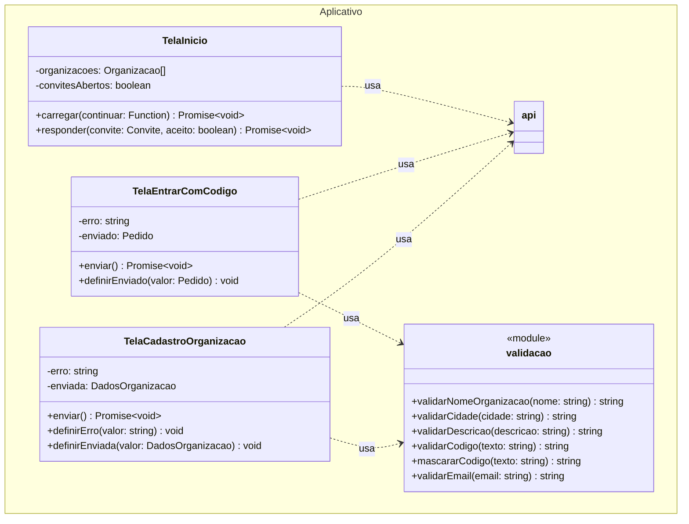
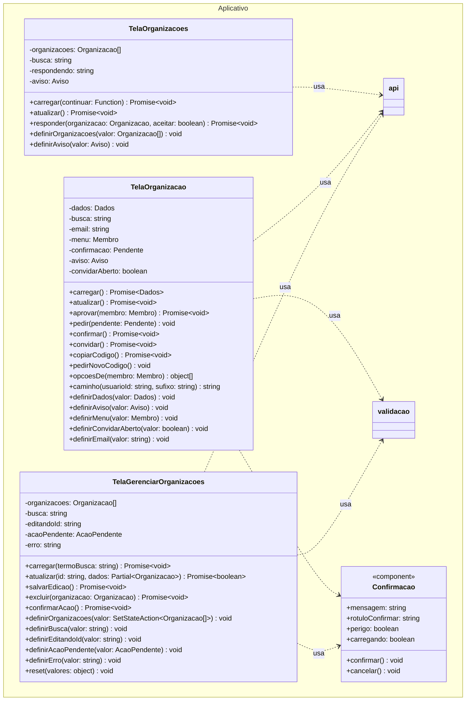
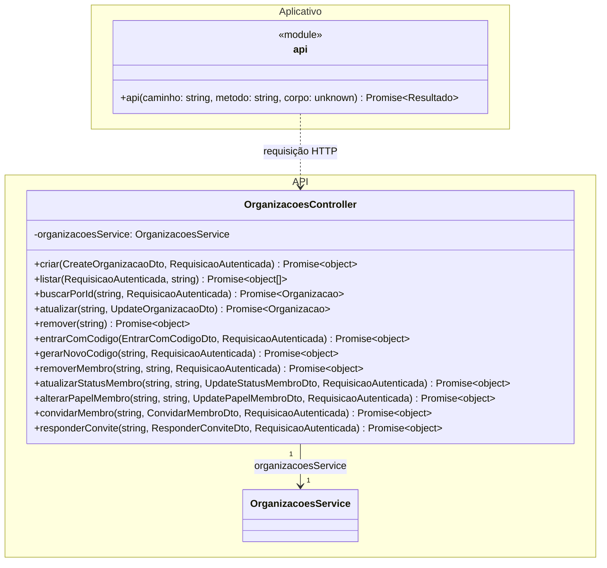
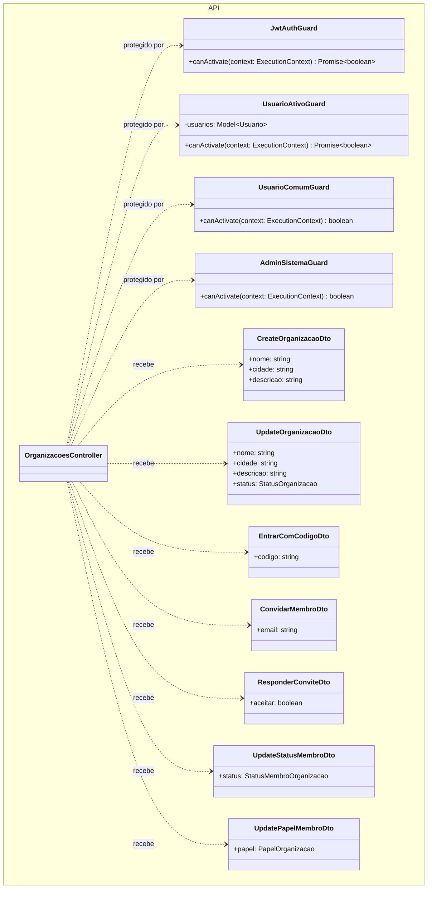
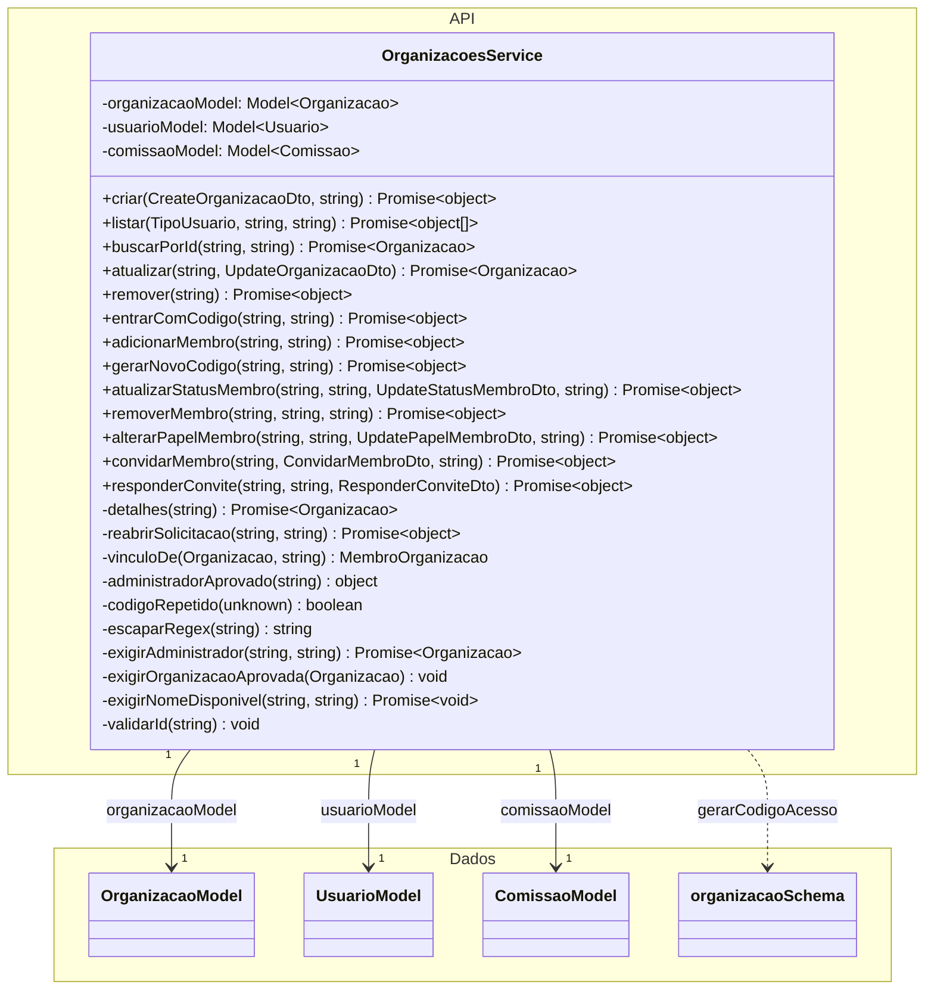
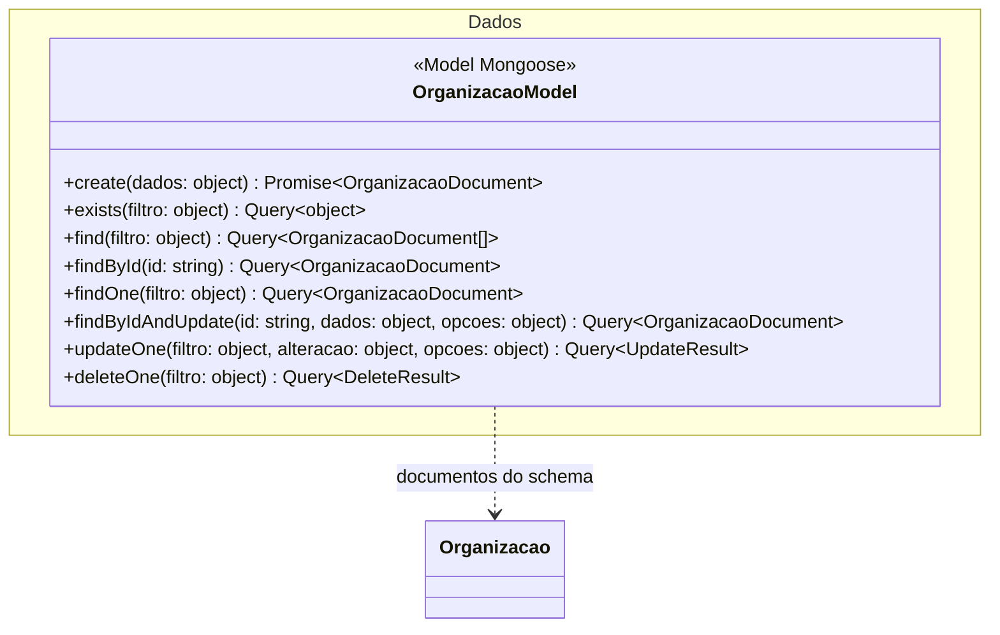
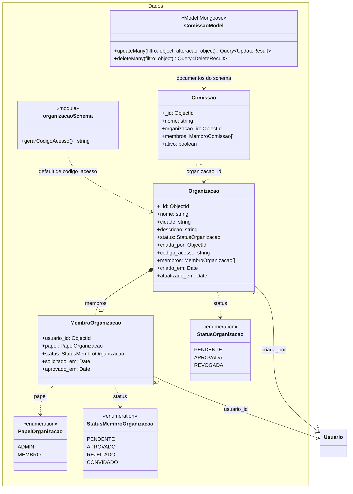
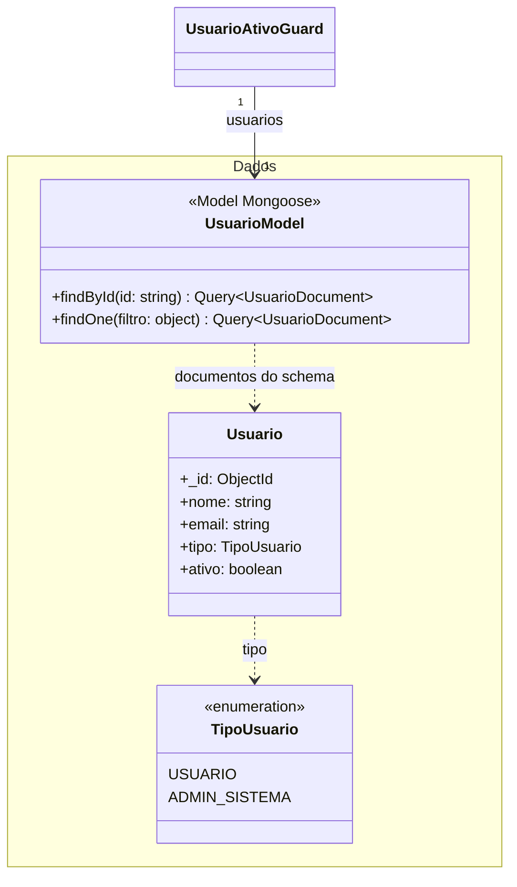

# Diagrama de classes — Cadastro de organização

> Padrão da disciplina · Módulo ORG · Revisado em 27/11/2026

## Resumo

O diagrama mostra as classes que participam do cadastro de organização, agrupadas em três pacotes, um por camada do sistema: **Aplicativo** (telas, componente de confirmação e módulos do aplicativo), **API** (controller, serviço, guardas de acesso e objetos de entrada) e **Dados** (os models do Mongoose `OrganizacaoModel`, `UsuarioModel` e `ComissaoModel`, marcados `<<Model Mongoose>>`, o módulo `organizacaoSchema`, os documentos guardados no MongoDB e as enumerações). Para caber legível na largura da página, o diagrama está dividido em oito partes. Toda linha de vida e todo método dos [Diagramas de sequência](6%20-%20diagramas-sequencia-cadastro-organizacao.md) aparecem aqui, numa das partes. Cada atributo traz o seu tipo, e cada método traz o tipo dos parâmetros e do retorno. Toda classe e todo método do diagrama existem no código. As telas são componentes de função do React: os atributos são os estados mais relevantes e os métodos são as funções internas que o usuário dispara, as funções de atualização do `useState` (`definir*`) chamadas nas sequências e, em `TelaGerenciarOrganizacoes`, o `reset` do formulário de edição.

## Diagrama

Cada classe tem os atributos e os métodos numa única parte, indicada na tabela; nas outras partes em que aparece, por ser ponta de uma ligação, ela vem só com o nome, sem atributos nem métodos, e a linha abaixo da figura diz em que parte está detalhada.

No `OrganizacoesController` e no `OrganizacoesService`, os parâmetros dos métodos aparecem só com o tipo, na ordem do código, porque as assinaturas com os nomes passam da largura da página; o nome de cada parâmetro está no [dicionário de classes](3%20-%20dicionario-dados-classes-cadastro-organizacao.md#operações-do-organizacoescontroller).

| Parte | Figura | Classes detalhadas |
| ----- | ------ | ------------------ |
| 1 | Figura 2 | `TelaCadastroOrganizacao`, `TelaEntrarComCodigo`, `TelaInicio`, `validacao` |
| 2 | Figura 3 | `TelaOrganizacoes`, `TelaOrganizacao`, `TelaGerenciarOrganizacoes`, `Confirmacao` |
| 3 | Figura 4 | `api`, `OrganizacoesController` |
| 4 | Figura 5 | `JwtAuthGuard`, `UsuarioAtivoGuard`, `UsuarioComumGuard`, `AdminSistemaGuard`, `CreateOrganizacaoDto`, `UpdateOrganizacaoDto`, `EntrarComCodigoDto`, `ConvidarMembroDto`, `ResponderConviteDto`, `UpdateStatusMembroDto`, `UpdatePapelMembroDto` |
| 5 | Figura 6 | `OrganizacoesService` |
| 6 | Figura 7 | `OrganizacaoModel` |
| 7 | Figura 8 | `ComissaoModel`, `Comissao`, `organizacaoSchema`, `Organizacao`, `MembroOrganizacao`, `StatusOrganizacao`, `PapelOrganizacao`, `StatusMembroOrganizacao` |
| 8 | Figura 9 | `UsuarioModel`, `Usuario`, `TipoUsuario` |

### Parte 1 — Telas de cadastro, de entrada e inicial

Figura 2 — Diagrama de classes do cadastro de organização, parte 1: telas de cadastro, de entrada com código e inicial e módulo `validacao`. Fonte: equipe Conecta+.

Só com o nome: `api` (parte 3).

### Parte 2 — Telas de organizações e de gerenciamento

Figura 3 — Diagrama de classes do cadastro de organização, parte 2: telas "Organizações", da organização e "Gerenciar organizações" e componente `Confirmacao`. Fonte: equipe Conecta+.

Só com o nome: `validacao` (parte 1) e `api` (parte 3).

### Parte 3 — Módulo api e controller

Figura 4 — Diagrama de classes do cadastro de organização, parte 3: módulo `api` e `OrganizacoesController`. Fonte: equipe Conecta+.

Só com o nome: `OrganizacoesService` (parte 5).

### Parte 4 — Guardas e objetos de entrada

Figura 5 — Diagrama de classes do cadastro de organização, parte 4: guardas de acesso e objetos de entrada do controller. Fonte: equipe Conecta+.

Só com o nome: `OrganizacoesController` (parte 3). A ligação de `UsuarioAtivoGuard` com `UsuarioModel` está na parte 8.

### Parte 5 — Serviço

Figura 6 — Diagrama de classes do cadastro de organização, parte 5: `OrganizacoesService`. Fonte: equipe Conecta+.

Só com o nome: `OrganizacaoModel` (parte 6), `ComissaoModel` e `organizacaoSchema` (parte 7) e `UsuarioModel` (parte 8).

### Parte 6 — Model da organização

Figura 7 — Diagrama de classes do cadastro de organização, parte 6: model `OrganizacaoModel`. Fonte: equipe Conecta+.

Só com o nome: `Organizacao` (parte 7).

### Parte 7 — Organização, vínculos e comissão

Figura 8 — Diagrama de classes do cadastro de organização, parte 7: documentos `Organizacao`, `MembroOrganizacao` e `Comissao`, model `ComissaoModel`, módulo `organizacaoSchema` e enumerações. Fonte: equipe Conecta+.

Só com o nome: `Usuario` (parte 8).

### Parte 8 — Usuário

Figura 9 — Diagrama de classes do cadastro de organização, parte 8: model `UsuarioModel`, documento `Usuario` e enumeração `TipoUsuario`. Fonte: equipe Conecta+.

Só com o nome: `UsuarioAtivoGuard` (parte 4).

## Como ler as ligações

| Ligação                      | Significado                                                             | Exemplo no diagrama                                                                                                        |
| ---------------------------- | ----------------------------------------------------------------------- | -------------------------------------------------------------------------------------------------------------------------- |
| Losango cheio (composição)   | A parte só existe dentro do todo e é apagada junto com ele.             | `Organizacao *-- MembroOrganizacao` (parte 7): o vínculo é gravado dentro do documento da organização e não tem identificador próprio. |
| Seta cheia (associação)      | Uma classe guarda uma referência a outra, que existe por conta própria. | `MembroOrganizacao --> Usuario` (parte 7): `usuario_id` guarda o identificador de um documento de `usuarios`.                         |
| Seta tracejada (dependência) | Uma classe usa a outra em uma chamada, sem guardá-la como atributo.     | `OrganizacoesService ..> organizacaoSchema` (parte 5): o serviço sorteia um código com `gerarCodigoAcesso`.                          |

Os números nas pontas são as multiplicidades. Uma `Organizacao` tem ao menos um vínculo (`1..*`), porque nasce com o do criador e nunca fica sem administrador; cada vínculo aponta para exatamente um `Usuario` (`1`), e um usuário pode ter vínculos com várias organizações (`0..*`). Cada `Comissao` pertence a uma única organização. O `OrganizacoesService` guarda uma instância de cada model (`1`), injetada pelo NestJS, e o `UsuarioAtivoGuard` guarda o `UsuarioModel`; cada model lê e grava os documentos do seu schema. O `ComissaoModel` é usado aqui só para apagar as comissões de uma organização excluída e para tirar das comissões quem perde o vínculo.

No código, os atributos opcionais são `descricao`, em `Organizacao`, e `aprovado_em`, em `MembroOrganizacao`. `codigo_acesso` é obrigatório, mas não sai nas consultas comuns (`select: false`). A obrigatoriedade de cada atributo está no [dicionário de classes](3%20-%20dicionario-dados-classes-cadastro-organizacao.md). `MembroComissao` pertence ao módulo de comissões e não é detalhado aqui.

## Rotas atendidas pelo controller

As rotas HTTP não são métodos; por isso ficam nesta tabela, e não no diagrama. Todas passam por `ApiKeyGuard` (global), `JwtAuthGuard` e `UsuarioAtivoGuard`.

| Método do controller    | Rota HTTP                                          | Guarda adicional    | Requisito |
| ----------------------- | -------------------------------------------------- | ------------------- | --------- |
| `criar`                 | `POST /organizacoes`                               | `UsuarioComumGuard` | RF-ORG-01 |
| `listar`                | `GET /organizacoes?busca=`                         | —                   | RF-ORG-02 |
| `buscarPorId`           | `GET /organizacoes/:id`                            | —                   | RF-ORG-14 |
| `atualizar`             | `PATCH /organizacoes/:id`                          | `AdminSistemaGuard` | RF-ORG-03, RF-ORG-04, RF-ORG-05 |
| `remover`               | `DELETE /organizacoes/:id`                         | `AdminSistemaGuard` | RF-ORG-06 |
| `entrarComCodigo`       | `POST /organizacoes/entrar`                        | `UsuarioComumGuard` | RF-ORG-07 |
| `convidarMembro`        | `POST /organizacoes/:id/convites`                  | `UsuarioComumGuard` | RF-ORG-08 |
| `atualizarStatusMembro` | `PATCH /organizacoes/:id/membros/:usuarioId`       | `UsuarioComumGuard` | RF-ORG-09 |
| `gerarNovoCodigo`       | `POST /organizacoes/:id/codigo`                    | `UsuarioComumGuard` | RF-ORG-10 |
| `responderConvite`      | `PATCH /organizacoes/:id/convite`                  | `UsuarioComumGuard` | RF-ORG-11 |
| `alterarPapelMembro`    | `PATCH /organizacoes/:id/membros/:usuarioId/papel` | `UsuarioComumGuard` | RF-ORG-12 |
| `removerMembro`         | `DELETE /organizacoes/:id/membros/:usuarioId`      | `UsuarioComumGuard` | RF-ORG-13 |

## Regras representadas

- `MembroOrganizacao` não existe fora de `Organizacao`;
- cada usuário aparece no máximo uma vez em `membros` da mesma organização;
- toda organização tem ao menos um vínculo com papel `ADMIN` e situação `APROVADO`;
- o papel na organização (`PapelOrganizacao`) é independente do tipo da conta (`TipoUsuario`): as rotas que criam ou mudam vínculos recusam a conta `ADMIN_SISTEMA`, que por isso não cadastra organização, não pede entrada nem recebe convite;
- o aplicativo não decide a situação da organização nem do vínculo: ele mostra o que a API devolve.

## Rastreabilidade

RF-ORG-01 a RF-ORG-14; complementado por [Dicionário de classes](3%20-%20dicionario-dados-classes-cadastro-organizacao.md) e [Diagramas de sequência](6%20-%20diagramas-sequencia-cadastro-organizacao.md).
