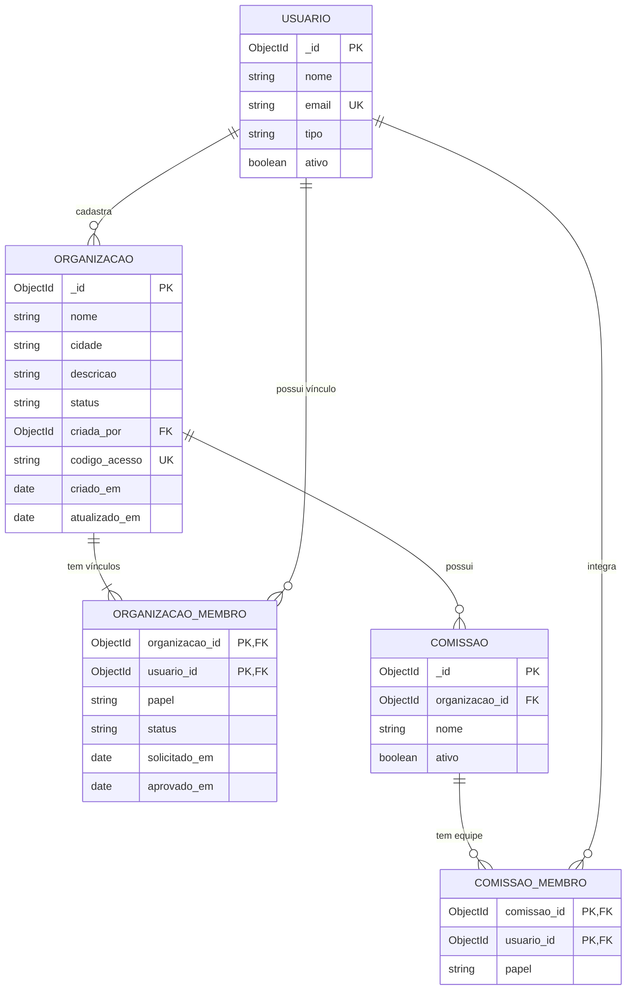

# Diagrama relacional — Cadastro de organização

> Padrão da disciplina · Módulo ORG · Visão lógica dos documentos MongoDB · Revisado em 27/11/2026

## Resumo

O banco é o MongoDB, que não tem tabelas: os vínculos das pessoas com a organização ficam dentro do documento da organização, na coleção `organizacoes`, e a equipe de cada comissão fica dentro do documento da comissão, em `comissoes`. O diagrama abaixo é uma **visão lógica**: ele separa esses dados em entidades para deixar claras as chaves, as cardinalidades e as restrições. Das cinco entidades, três correspondem a coleções (`ORGANIZACAO`, `USUARIO` e `COMISSAO`); as outras duas são listas embutidas.

## Diagrama

Figura 3 — Visão lógica relacional do cadastro de organização. Fonte: equipe Conecta+.

## Como as entidades lógicas viram documentos

| Entidade lógica      | Onde fica de verdade          | Observação                                                                                                     |
| -------------------- | ----------------------------- | -------------------------------------------------------------------------------------------------------------- |
| `ORGANIZACAO`        | coleção `organizacoes`        | Documento principal do módulo.                                                                                 |
| `ORGANIZACAO_MEMBRO` | `organizacoes.membros[]`      | Subdocumento sem `_id`; a chave lógica é a organização mais o usuário. `organizacao_id` não é gravado: é o documento que contém a lista. |
| `USUARIO`            | coleção `usuarios`            | Do módulo de cadastro de usuário; aqui aparecem só os campos que este módulo lê.                               |
| `COMISSAO`           | coleção `comissoes`           | Do módulo de comissões; aparece porque é apagada na exclusão da organização.                                   |
| `COMISSAO_MEMBRO`    | `comissoes.membros[]`         | Subdocumento da comissão; aparece porque a remoção de um membro da organização retira a pessoa daqui.          |

## Relacionamentos

- `USUARIO` cadastra `ORGANIZACAO` (`criada_por`): um usuário pode cadastrar várias organizações; cada organização tem um único autor.
- `ORGANIZACAO` tem `ORGANIZACAO_MEMBRO` (um para um ou mais): toda organização nasce com o vínculo de quem a cadastrou e nunca fica sem um administrador.
- `USUARIO` possui `ORGANIZACAO_MEMBRO` (`usuario_id`): uma pessoa pode ter vínculo com várias organizações, um por organização.
- `ORGANIZACAO` possui `COMISSAO` (`organizacao_id`): uma organização tem zero ou mais comissões.
- `COMISSAO` tem `COMISSAO_MEMBRO`, e `USUARIO` integra `COMISSAO_MEMBRO`: a equipe da comissão, descrita no módulo de comissões.

## Regras de integridade

- um usuário aparece uma única vez em `ORGANIZACAO_MEMBRO` da mesma organização;
- cada organização tem ao menos um `ORGANIZACAO_MEMBRO` com `papel = ADMIN` e `status = APROVADO`;
- `ORGANIZACAO.codigo_acesso` é único entre todas as organizações;
- `ORGANIZACAO.nome` é único sem diferenciar maiúsculas, conferido pelo serviço antes de gravar;
- `ORGANIZACAO_MEMBRO.aprovado_em` só existe quando `status = APROVADO`;
- a exclusão de `ORGANIZACAO` apaga os seus `ORGANIZACAO_MEMBRO` (estão no mesmo documento) e as suas `COMISSAO`;
- a remoção de um `ORGANIZACAO_MEMBRO` comum retira o mesmo usuário de `COMISSAO_MEMBRO` em todas as comissões da organização.

## Rastreabilidade

RF-ORG-01 a RF-ORG-14; detalhado em [Dicionário relacional](4%20-%20dicionario-dados-relacional-cadastro-organizacao.md).
