# Diagramas de sequência — Cadastro de organização

> Padrão da disciplina · Módulo ORG · Revisado em 27/11/2026

## Resumo

Há um diagrama para cada requisito de [Requisitos funcionais](2%20-%20requisitos-funcionais-cadastro-organizacao.md), com o mesmo número. As linhas de vida são classes e módulos que existem no código e estão no [Diagrama de classes](3%20-%20diagrama-classes-cadastro-organizacao.md): as telas do aplicativo, o componente `Confirmacao`, os módulos `api` e `validacao`, o `OrganizacoesController`, o `OrganizacoesService`, o módulo `organizacaoSchema` e os models do Mongoose (`OrganizacaoModel`, `UsuarioModel` e `ComissaoModel`). Toda mensagem é a chamada de um método existente, com seus parâmetros, e as mensagens são numeradas na ordem em que acontecem. Regras que não são métodos, como comparar situações, aparecem em notas; os métodos encadeados na consulta (`select`, `populate`, `sort` e `lean`) também, porque pertencem à `Query` devolvida pelo model. Os retornos são identificadores; uma nota diz o que cada um traz quando isso não é evidente.

Em todos os diagramas, a chamada do módulo `api` ao controller é uma requisição HTTP que passa antes por `ApiKeyGuard`, `JwtAuthGuard` e `UsuarioAtivoGuard` e, conforme a rota, por `UsuarioComumGuard` ou `AdminSistemaGuard`; a rota está indicada na nota. Quando um guarda recusa a requisição, o controller não é chamado. O `resultado` devolvido pelo módulo `api` é o tipo `Resultado`: `ok` verdadeiro com `dados`, ou `ok` falso com `erro`.

Para caber na largura da página, cada diagrama está dividido em partes, uma por camada: a parte no aplicativo (ator, telas, componentes e módulo `api`), a parte na API (`api`, controller e serviço) e a parte no serviço e nos dados (serviço, models e módulos que ele chama). A linha de vida da fronteira aparece nas duas partes vizinhas, a numeração das mensagens continua de uma parte para outra e uma nota indica em que parte estão as mensagens puladas. No SD-ORG-09 e no SD-ORG-12, em que as chamadas ao controller e ao serviço são longas, a parte da API se divide em duas: uma até o controller e outra do controller ao serviço.

## SD-ORG-01 — Cadastrar organização

### SD-ORG-01 — parte 1 de 3: no aplicativo

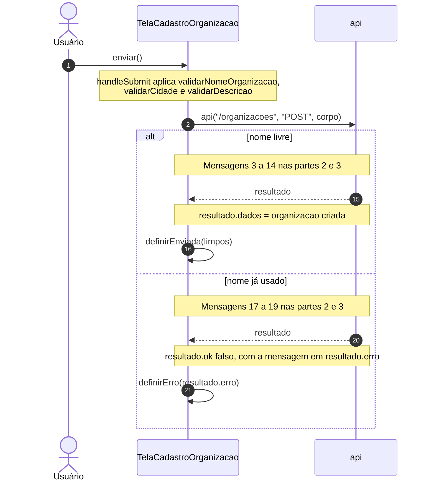

Figura 11 — Diagrama de sequência SD-ORG-01 (Cadastrar organização), parte 1 de 3: no aplicativo. Fonte: equipe Conecta+.

### SD-ORG-01 — parte 2 de 3: na API

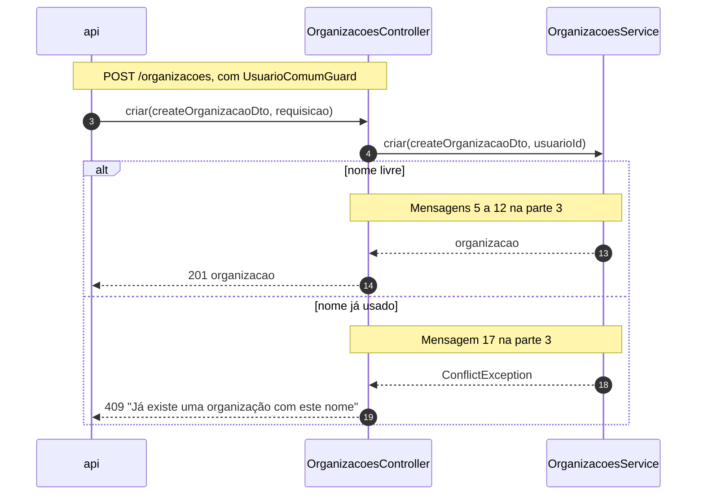

Figura 12 — Diagrama de sequência SD-ORG-01 (Cadastrar organização), parte 2 de 3: na API. Fonte: equipe Conecta+.

### SD-ORG-01 — parte 3 de 3: no serviço e nos dados

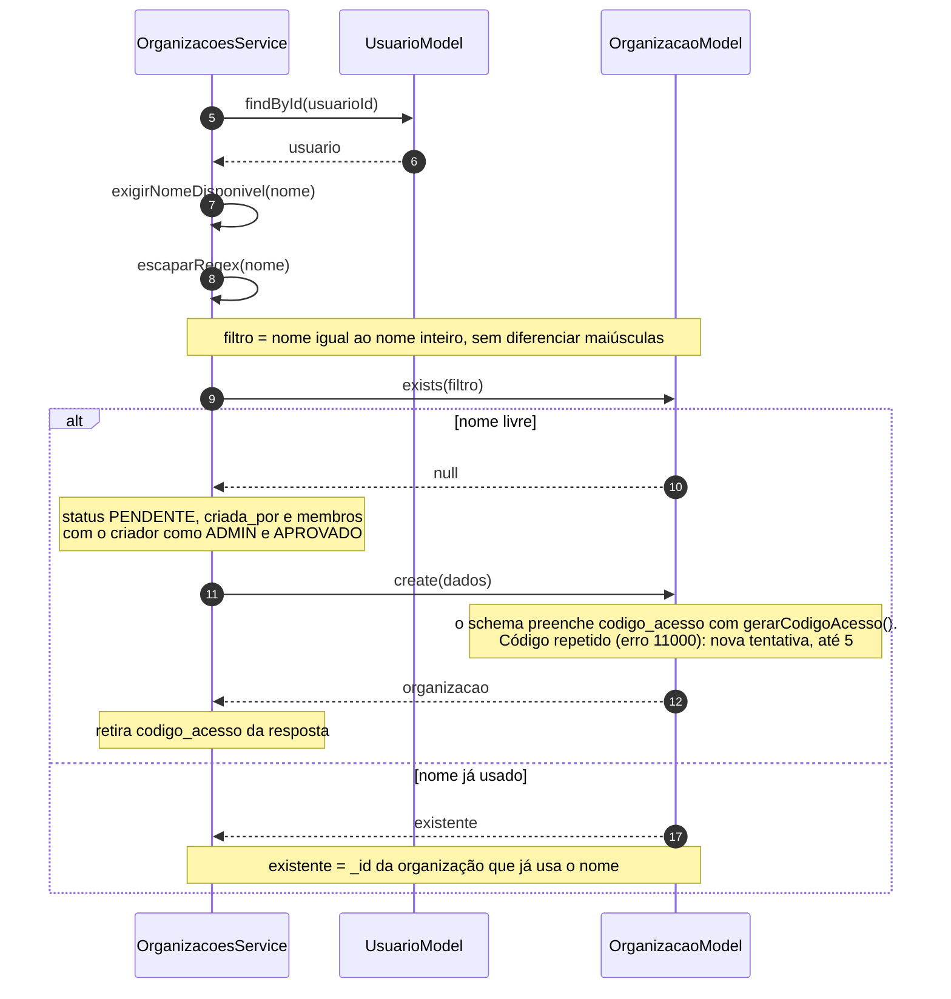

Figura 13 — Diagrama de sequência SD-ORG-01 (Cadastrar organização), parte 3 de 3: no serviço e nos dados. Fonte: equipe Conecta+.

## SD-ORG-02 — Consultar organizações

Usuário, na aba "Organizações":

### SD-ORG-02 (usuário) — parte 1 de 3: no aplicativo

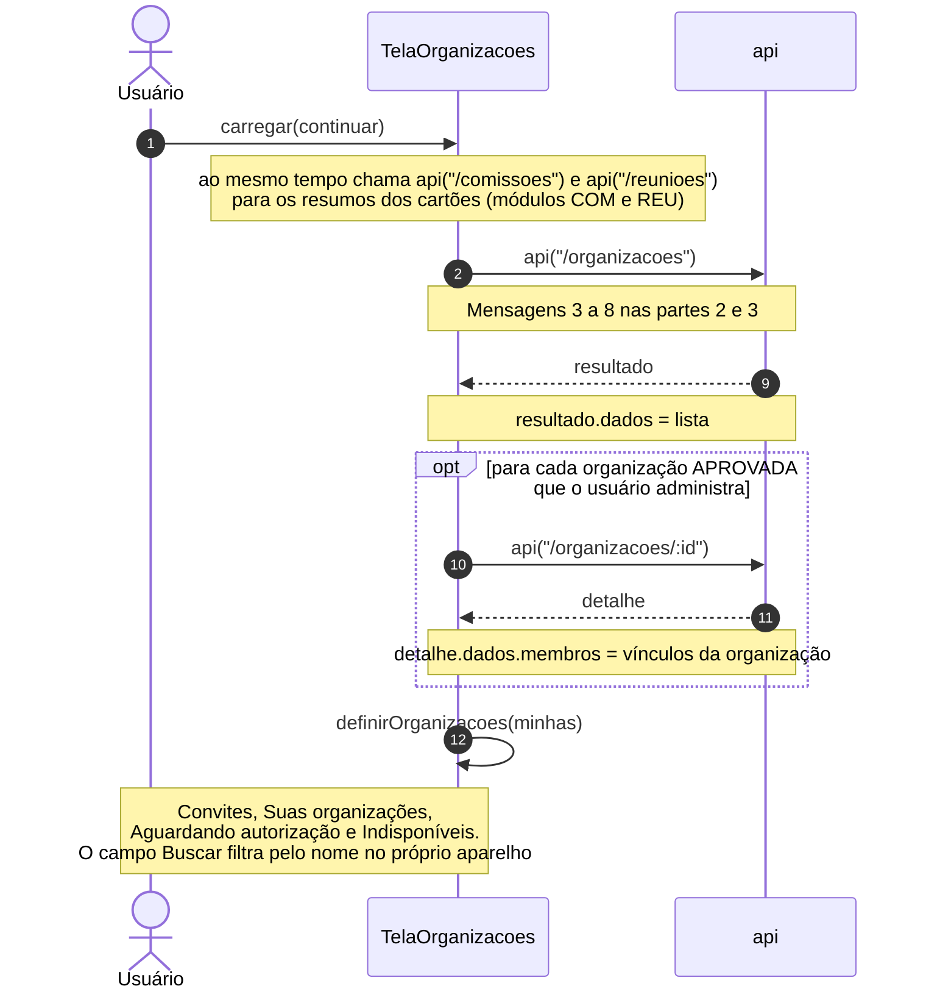

Figura 14 — Diagrama de sequência SD-ORG-02 (Consultar organizações, usuário), parte 1 de 3: no aplicativo. Fonte: equipe Conecta+.

### SD-ORG-02 (usuário) — parte 2 de 3: na API

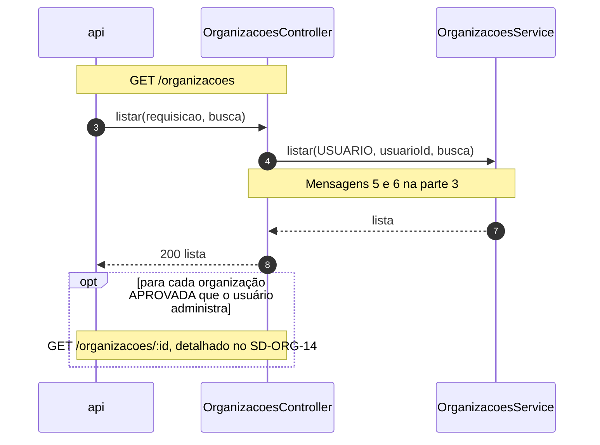

Figura 15 — Diagrama de sequência SD-ORG-02 (Consultar organizações, usuário), parte 2 de 3: na API. Fonte: equipe Conecta+.

### SD-ORG-02 (usuário) — parte 3 de 3: no serviço e nos dados

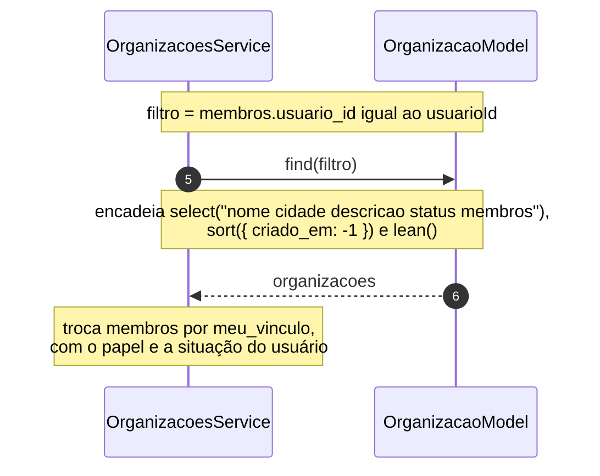

Figura 16 — Diagrama de sequência SD-ORG-02 (Consultar organizações, usuário), parte 3 de 3: no serviço e nos dados. Fonte: equipe Conecta+.

Administrador do sistema, na tela "Gerenciar organizações":

### SD-ORG-02 (administrador do sistema) — parte 1 de 3: no aplicativo

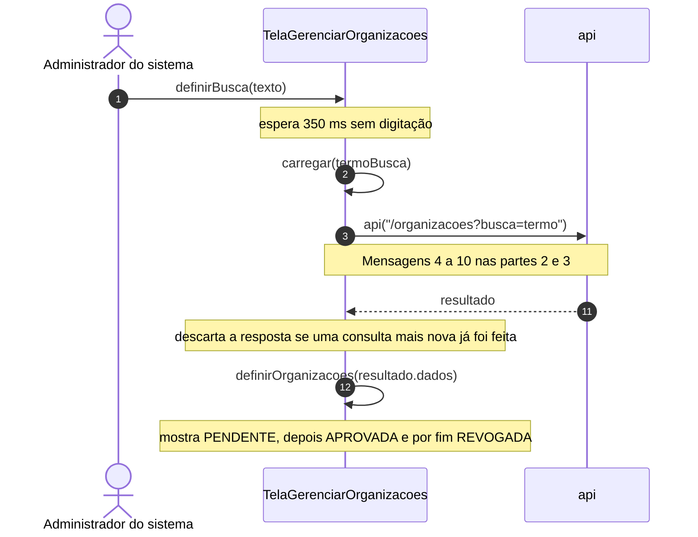

Figura 17 — Diagrama de sequência SD-ORG-02 (Consultar organizações, administrador do sistema), parte 1 de 3: no aplicativo. Fonte: equipe Conecta+.

### SD-ORG-02 (administrador do sistema) — parte 2 de 3: na API

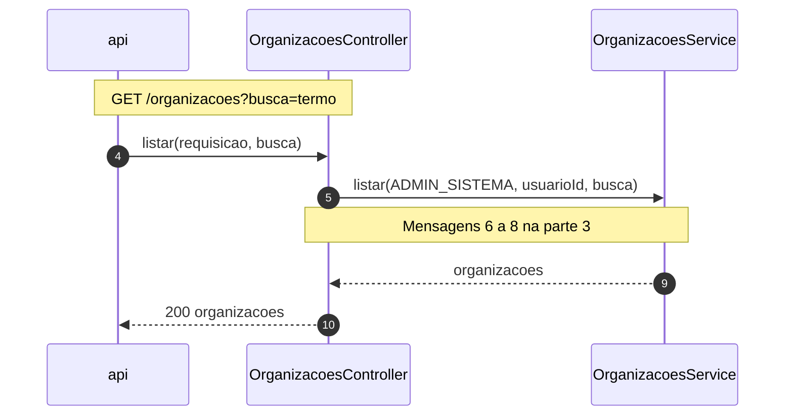

Figura 18 — Diagrama de sequência SD-ORG-02 (Consultar organizações, administrador do sistema), parte 2 de 3: na API. Fonte: equipe Conecta+.

### SD-ORG-02 (administrador do sistema) — parte 3 de 3: no serviço e nos dados

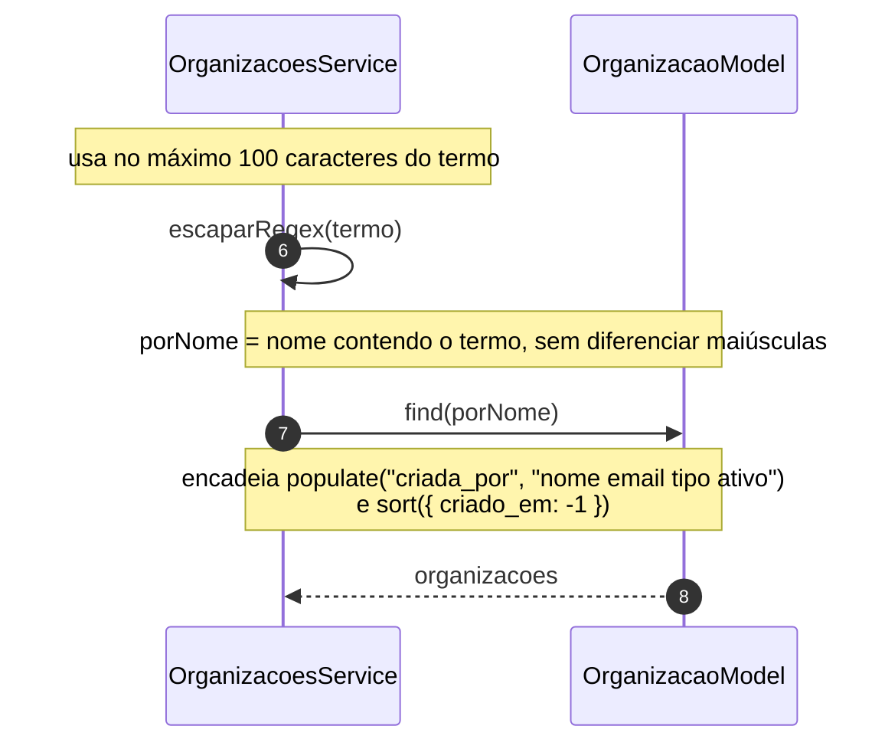

Figura 19 — Diagrama de sequência SD-ORG-02 (Consultar organizações, administrador do sistema), parte 3 de 3: no serviço e nos dados. Fonte: equipe Conecta+.

## SD-ORG-03 — Aprovar organização

### SD-ORG-03 — parte 1 de 3: no aplicativo

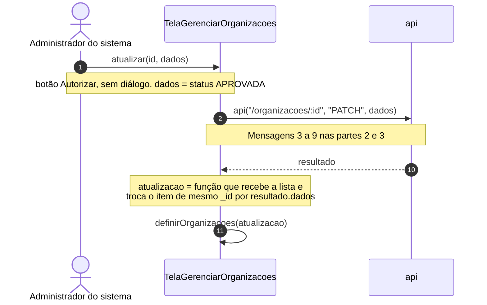

Figura 20 — Diagrama de sequência SD-ORG-03 (Aprovar organização), parte 1 de 3: no aplicativo. Fonte: equipe Conecta+.

### SD-ORG-03 — parte 2 de 3: na API

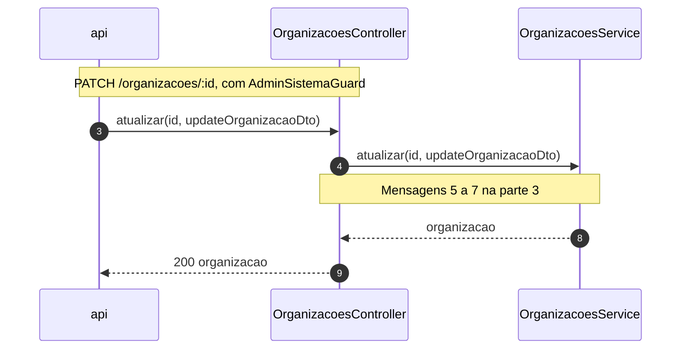

Figura 21 — Diagrama de sequência SD-ORG-03 (Aprovar organização), parte 2 de 3: na API. Fonte: equipe Conecta+.

### SD-ORG-03 — parte 3 de 3: no serviço e nos dados

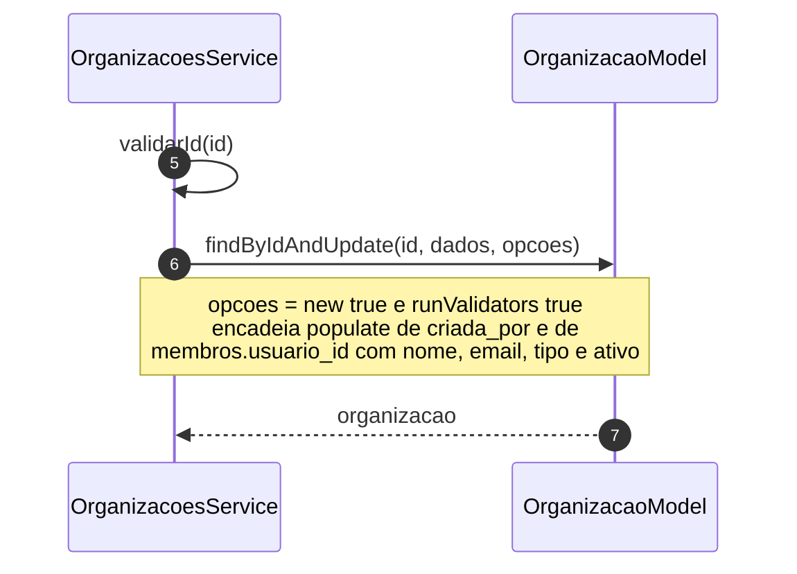

Figura 22 — Diagrama de sequência SD-ORG-03 (Aprovar organização), parte 3 de 3: no serviço e nos dados. Fonte: equipe Conecta+.

## SD-ORG-04 — Revogar organização

### SD-ORG-04 — parte 1 de 3: no aplicativo

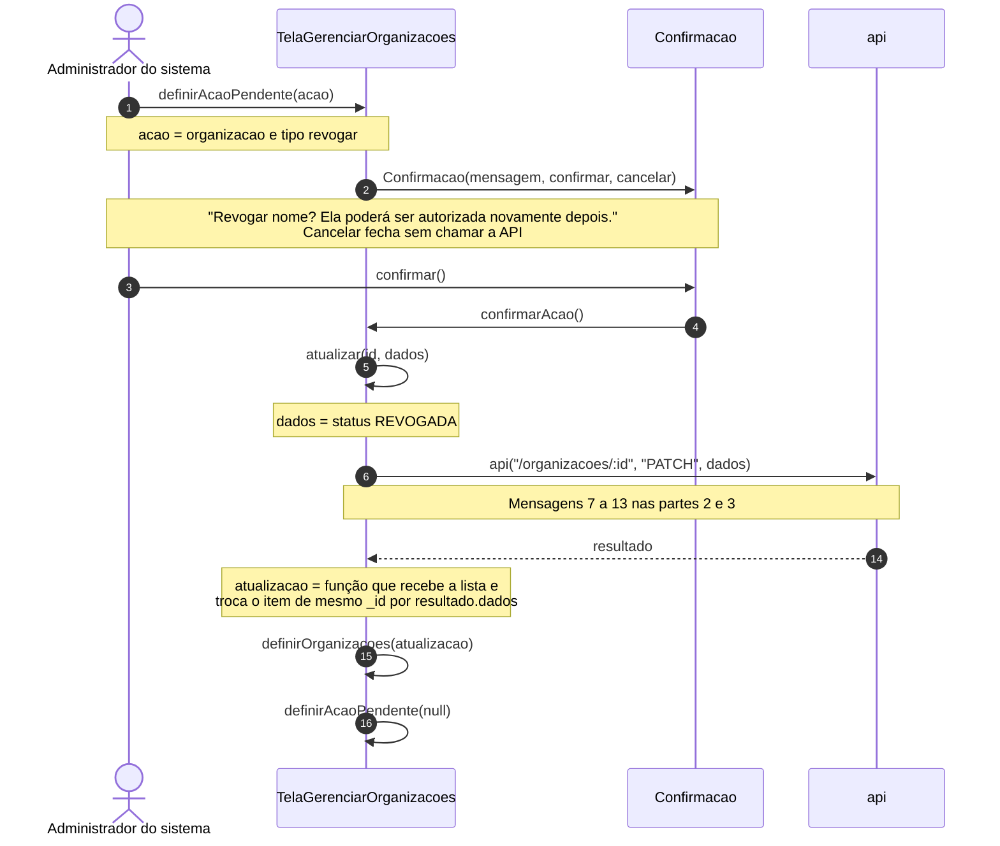

Figura 23 — Diagrama de sequência SD-ORG-04 (Revogar organização), parte 1 de 3: no aplicativo. Fonte: equipe Conecta+.

### SD-ORG-04 — parte 2 de 3: na API


Figura 24 — Diagrama de sequência SD-ORG-04 (Revogar organização), parte 2 de 3: na API. Fonte: equipe Conecta+.

### SD-ORG-04 — parte 3 de 3: no serviço e nos dados


Figura 25 — Diagrama de sequência SD-ORG-04 (Revogar organização), parte 3 de 3: no serviço e nos dados. Fonte: equipe Conecta+.

## SD-ORG-05 — Editar organização

### SD-ORG-05 — parte 1 de 3: no aplicativo

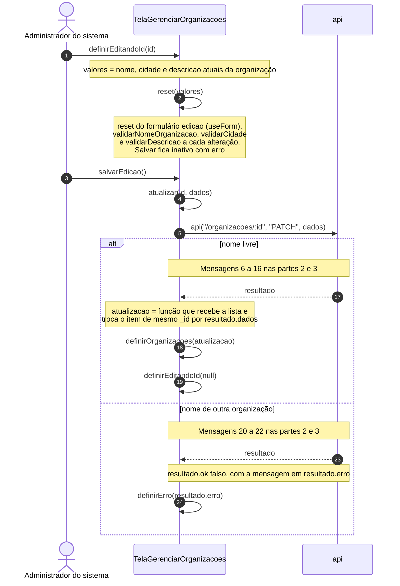

Figura 26 — Diagrama de sequência SD-ORG-05 (Editar organização), parte 1 de 3: no aplicativo. Fonte: equipe Conecta+.

### SD-ORG-05 — parte 2 de 3: na API

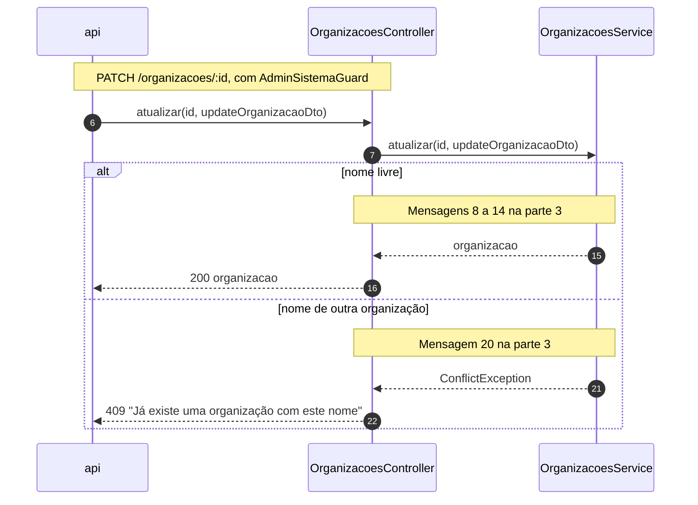

Figura 27 — Diagrama de sequência SD-ORG-05 (Editar organização), parte 2 de 3: na API. Fonte: equipe Conecta+.

### SD-ORG-05 — parte 3 de 3: no serviço e nos dados

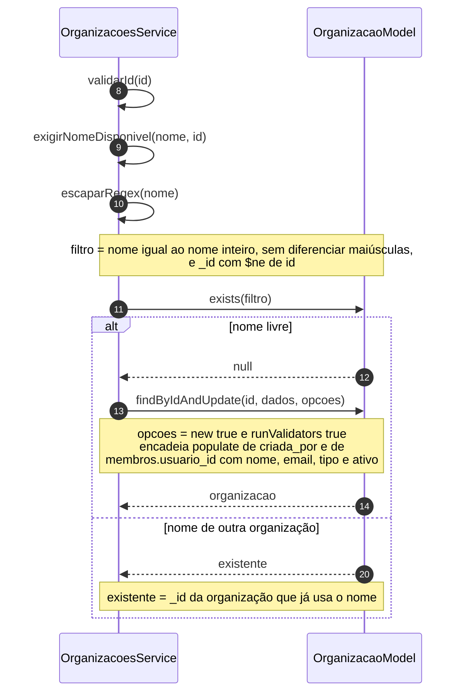

Figura 28 — Diagrama de sequência SD-ORG-05 (Editar organização), parte 3 de 3: no serviço e nos dados. Fonte: equipe Conecta+.

## SD-ORG-06 — Excluir organização

### SD-ORG-06 — parte 1 de 3: no aplicativo

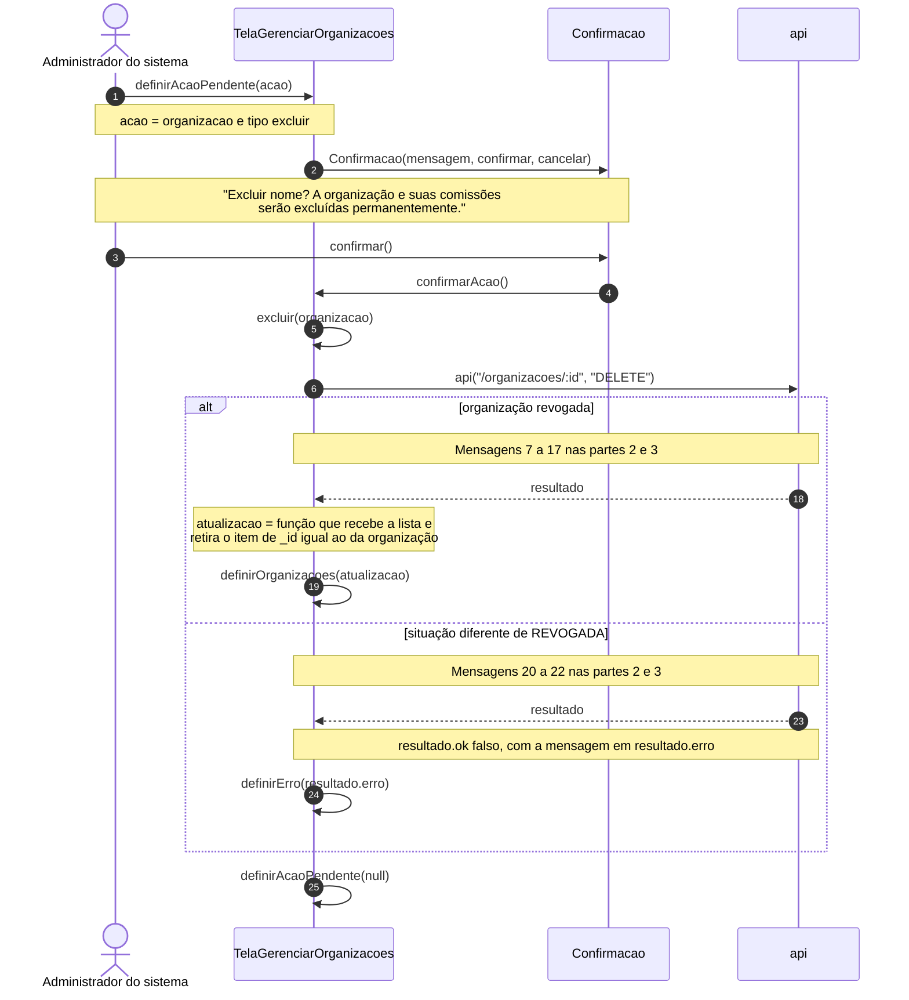

Figura 29 — Diagrama de sequência SD-ORG-06 (Excluir organização), parte 1 de 3: no aplicativo. Fonte: equipe Conecta+.

### SD-ORG-06 — parte 2 de 3: na API

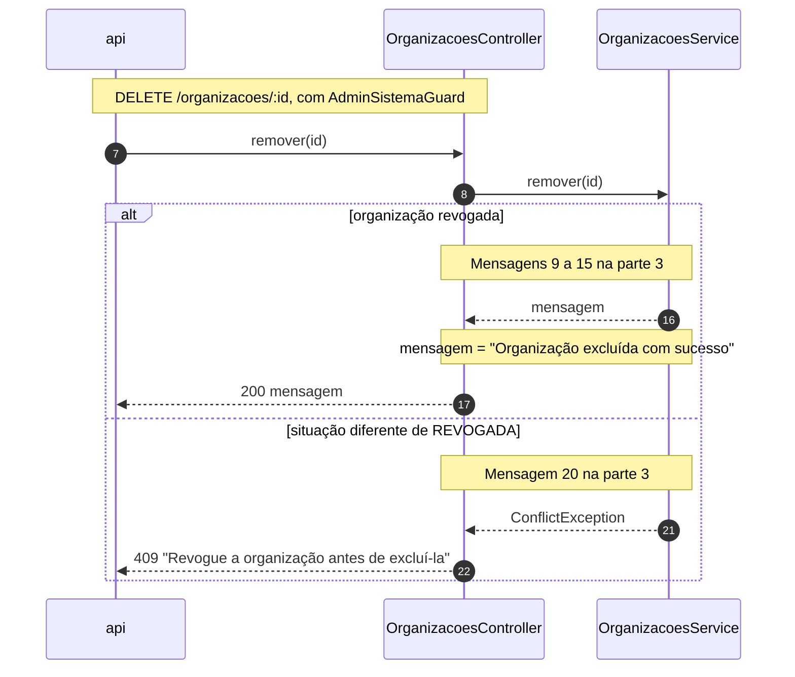

Figura 30 — Diagrama de sequência SD-ORG-06 (Excluir organização), parte 2 de 3: na API. Fonte: equipe Conecta+.

### SD-ORG-06 — parte 3 de 3: no serviço e nos dados

```mermaid
sequenceDiagram
    autonumber 9
    participant S as OrganizacoesService
    participant M as OrganizacaoModel
    participant CM as ComissaoModel
    S->>S: validarId(id)
    S->>M: findById(id)
    M-->>S: organizacao
    S->>M: deleteOne(filtro)
    Note over S,M: filtro = _id igual a id e status REVOGADA
    alt organização revogada
        M-->>S: resultado
        Note over S,M: resultado.deletedCount = 1
        S->>CM: deleteMany(filtroComissoes)
        Note over S,CM: filtroComissoes = organizacao_id igual a id
        CM-->>S: resultadoComissoes
    else situação diferente de REVOGADA
        autonumber 20
        M-->>S: resultado
        Note over S,M: resultado.deletedCount = 0
    end
```

Figura 31 — Diagrama de sequência SD-ORG-06 (Excluir organização), parte 3 de 3: no serviço e nos dados. Fonte: equipe Conecta+.

## SD-ORG-07 — Entrar por código

### SD-ORG-07 — parte 1 de 3: no aplicativo

```mermaid
sequenceDiagram
    autonumber 1
    actor U as Usuário
    participant T as TelaEntrarComCodigo
    participant A as api
    U->>T: enviar()
    Note over T: mascararCodigo deixa o texto no formato ABCDE-FGHIJ<br/>e validarCodigo exige 10 caracteres
    T->>A: api("/organizacoes/entrar", "POST", corpo)
    Note over T,A: Mensagens 3 a 20 nas partes 2 e 3
    autonumber 21
    A-->>T: resultado
    Note over T,A: resultado.dados = pedido
    T->>T: definirEnviado(resultado.dados)
```

Figura 32 — Diagrama de sequência SD-ORG-07 (Entrar por código), parte 1 de 3: no aplicativo. Fonte: equipe Conecta+.

### SD-ORG-07 — parte 2 de 3: na API

```mermaid
sequenceDiagram
    autonumber 3
    participant A as api
    participant C as OrganizacoesController
    participant S as OrganizacoesService
    Note over A,C: POST /organizacoes/entrar, com UsuarioComumGuard
    A->>C: entrarComCodigo(entrarDto, requisicao)
    C->>S: entrarComCodigo(codigo, usuarioId)
    Note over C,S: Mensagens 5 a 18 na parte 3
    autonumber 19
    S-->>C: pedido
    Note over C,S: pedido = mensagem, membro e organizacao
    C-->>A: 201 pedido
```

Figura 33 — Diagrama de sequência SD-ORG-07 (Entrar por código), parte 2 de 3: na API. Fonte: equipe Conecta+.

### SD-ORG-07 — parte 3 de 3: no serviço e nos dados

```mermaid
sequenceDiagram
    autonumber 5
    participant S as OrganizacoesService
    participant M as OrganizacaoModel
    participant UM as UsuarioModel
    Note over S: maiúsculas, só letras e números.<br/>Sem 10 caracteres, responde Código inválido (404)
    S->>M: findOne(filtro)
    Note over S,M: filtro = codigo_acesso igual ao normalizado e status APROVADA<br/>encadeia select("nome")
    M-->>S: organizacao
    S->>S: adicionarMembro(id, usuarioId)
    S->>M: findById(id)
    M-->>S: organizacao
    S->>S: exigirOrganizacaoAprovada(organizacao)
    S->>UM: findById(usuarioId)
    UM-->>S: usuario
    Note over S,UM: sem conta ou com ativo false,<br/>responde Usuário não encontrado (404)
    S->>S: vinculoDe(organizacao, usuarioId)
    Note over S: vínculo CONVIDADO, PENDENTE ou APROVADO: 409
    alt sem vínculo
        Note over S,M: filtro = _id, status APROVADA e<br/>membros.usuario_id com $ne do usuário<br/>membro = usuario_id, papel MEMBRO,<br/>status PENDENTE e solicitado_em<br/>alteracao = $push de membro em membros
        S->>M: updateOne(filtro, alteracao)
        M-->>S: resultado
        Note over S,M: resultado.modifiedCount = 1
    else vínculo REJEITADO
        S->>S: reabrirSolicitacao(id, usuarioId)
        Note over S,M: filtro = _id, status APROVADA e membros<br/>com $elemMatch do usuário em REJEITADO<br/>alteracao = $set de status PENDENTE e<br/>solicitado_em no item alvo e $unset de aprovado_em<br/>opcoes = arrayFilters com o item do usuário em REJEITADO
        S->>M: updateOne(filtro, alteracao, opcoes)
        M-->>S: resultado
        Note over S,M: resultado.modifiedCount = 1
    end
```

Figura 34 — Diagrama de sequência SD-ORG-07 (Entrar por código), parte 3 de 3: no serviço e nos dados. Fonte: equipe Conecta+.

## SD-ORG-08 — Convidar usuário

### SD-ORG-08 — parte 1 de 3: no aplicativo

```mermaid
sequenceDiagram
    autonumber 1
    actor U as Administrador da organização
    participant T as TelaOrganizacao
    participant V as validacao
    participant A as api
    U->>T: definirConvidarAberto(true)
    U->>T: convidar()
    T->>V: validarEmail(email)
    V-->>T: null
    Note over T,V: com texto de erro, a folha mostra o erro e nada é enviado
    T->>A: api("/organizacoes/:id/convites", "POST", corpo)
    Note over T,A: Mensagens 6 a 19 nas partes 2 e 3
    autonumber 20
    A-->>T: resultado
    Note over T,A: resultado.dados.usuario.nome = nome do convidado
    T->>T: definirConvidarAberto(false)
    T->>T: definirEmail("")
    Note over T: aviso = tom "sucesso" e mensagem "Convite enviado para nome."
    T->>T: definirAviso(aviso)
    T->>T: carregar()
    T->>T: definirDados(novos)
```

Figura 35 — Diagrama de sequência SD-ORG-08 (Convidar usuário), parte 1 de 3: no aplicativo. Fonte: equipe Conecta+.

### SD-ORG-08 — parte 2 de 3: na API

```mermaid
sequenceDiagram
    autonumber 6
    participant A as api
    participant C as OrganizacoesController
    participant S as OrganizacoesService
    Note over A,C: POST /organizacoes/:id/convites, com UsuarioComumGuard
    A->>C: convidarMembro(id, convidarDto, requisicao)
    C->>S: convidarMembro(id, convidarDto, solicitanteId)
    Note over C,S: Mensagens 8 a 17 na parte 3
    autonumber 18
    S-->>C: convite
    Note over C,S: convite = mensagem e usuario
    C-->>A: 201 convite
```

Figura 36 — Diagrama de sequência SD-ORG-08 (Convidar usuário), parte 2 de 3: na API. Fonte: equipe Conecta+.

### SD-ORG-08 — parte 3 de 3: no serviço e nos dados

```mermaid
sequenceDiagram
    autonumber 8
    participant S as OrganizacoesService
    participant M as OrganizacaoModel
    participant UM as UsuarioModel
    S->>S: exigirAdministrador(id, solicitanteId)
    S->>M: findById(id)
    M-->>S: organizacao
    S->>S: exigirOrganizacaoAprovada(organizacao)
    S->>UM: findOne(filtro)
    Note over S,UM: filtro = email informado e ativo true
    UM-->>S: convidado
    Note over S: conta inexistente ou ADMIN_SISTEMA: 404
    S->>S: vinculoDe(organizacao, convidadoId)
    Note over S: vínculo APROVADO, PENDENTE ou CONVIDADO: 409
    alt sem vínculo
        Note over S,M: filtro = _id, status APROVADA, membros.usuario_id com $ne<br/>do convidado e $and com o solicitante ADMIN e APROVADO<br/>alteracao = $push em membros do convidado com<br/>papel MEMBRO, status CONVIDADO e solicitado_em
        S->>M: updateOne(filtro, alteracao)
    else vínculo REJEITADO
        Note over S,M: filtro = _id, status APROVADA e $and com o solicitante<br/>ADMIN e APROVADO e com o convidado em REJEITADO<br/>alteracao = $set de status CONVIDADO e<br/>solicitado_em no item alvo e $unset de aprovado_em<br/>opcoes = arrayFilters com o item do convidado em REJEITADO
        S->>M: updateOne(filtro, alteracao, opcoes)
    end
    M-->>S: resultado
    Note over S,M: resultado.modifiedCount = 1
```

Figura 37 — Diagrama de sequência SD-ORG-08 (Convidar usuário), parte 3 de 3: no serviço e nos dados. Fonte: equipe Conecta+.

## SD-ORG-09 — Analisar solicitação de entrada

### SD-ORG-09 — parte 1 de 4: no aplicativo

```mermaid
sequenceDiagram
    autonumber 1
    actor U as Administrador da organização
    participant T as TelaOrganizacao
    participant A as api
    U->>T: aprovar(membro)
    Note over U,T: Para recusar, pedir(pendente) abre o<br/>diálogo "Recusar o pedido de nome?"<br/>e confirmar() envia status REJEITADO pela mesma rota
    T->>T: caminho(usuarioId, "")
    T->>A: api("/organizacoes/:id/membros/:usuarioId", "PATCH", corpo)
    alt vínculo e permissões sem mudança
        Note over T,A: Mensagens 4 a 15 nas partes 2, 3 e 4
        autonumber 16
        A-->>T: resultado
        Note over T: aviso = tom "sucesso" e mensagem "nome agora é membro."
        T->>T: definirAviso(aviso)
        T->>T: carregar()
        T->>T: definirDados(novos)
    else outro administrador decidiu antes
        Note over T,A: Mensagens 20 a 22 nas partes 2, 3 e 4
        autonumber 23
        A-->>T: resultado
        Note over T: aviso = tom "erro" e mensagem resultado.erro
        T->>T: definirAviso(aviso)
    end
```

Figura 38 — Diagrama de sequência SD-ORG-09 (Analisar solicitação de entrada), parte 1 de 4: no aplicativo. Fonte: equipe Conecta+.

### SD-ORG-09 — parte 2 de 4: na API, até o controller

```mermaid
sequenceDiagram
    autonumber 4
    participant A as api
    participant C as OrganizacoesController
    Note over A,C: PATCH /organizacoes/:id/membros/:usuarioId,<br/>com UsuarioComumGuard
    A->>C: atualizarStatusMembro(id, usuarioId, updateStatusDto, requisicao)
    alt vínculo e permissões sem mudança
        Note over A,C: Mensagens 5 a 14 nas partes 3 e 4
        autonumber 15
        C-->>A: 200 decisao
    else outro administrador decidiu antes
        Note over A,C: Mensagens 20 e 21 nas partes 3 e 4
        autonumber 22
        C-->>A: 409 "A solicitação ou as permissões foram alteradas. Atualize a lista"
    end
```

Figura 39 — Diagrama de sequência SD-ORG-09 (Analisar solicitação de entrada), parte 2 de 4: na API, até o controller. Fonte: equipe Conecta+.

### SD-ORG-09 — parte 3 de 4: na API, do controller ao serviço

```mermaid
sequenceDiagram
    autonumber 5
    participant C as OrganizacoesController
    participant S as OrganizacoesService
    C->>S: atualizarStatusMembro(id, usuarioId, updateStatusDto, solicitanteId)
    alt vínculo e permissões sem mudança
        Note over C,S: Mensagens 6 a 13 na parte 4
        autonumber 14
        S-->>C: decisao
        Note over C,S: decisao = mensagem, usuario_id e status
    else outro administrador decidiu antes
        Note over C,S: Mensagem 20 na parte 4
        autonumber 21
        S-->>C: ConflictException
    end
```

Figura 40 — Diagrama de sequência SD-ORG-09 (Analisar solicitação de entrada), parte 3 de 4: na API, do controller ao serviço. Fonte: equipe Conecta+.

### SD-ORG-09 — parte 4 de 4: no serviço e nos dados

```mermaid
sequenceDiagram
    autonumber 6
    participant S as OrganizacoesService
    participant M as OrganizacaoModel
    S->>S: validarId(id)
    S->>S: validarId(usuarioId)
    S->>S: exigirAdministrador(id, solicitanteId)
    S->>M: findById(id)
    M-->>S: organizacao
    S->>S: exigirOrganizacaoAprovada(organizacao)
    Note over S: aceita vínculo PENDENTE, ou REJEITADO<br/>quando a decisão é APROVADO.<br/>Outro caso: Esta solicitação já foi analisada (409)
    Note over S,M: filtro = _id, status APROVADA e $and com o solicitante<br/>ADMIN e APROVADO e com o alvo na situação lida<br/>alteracao = $set de status e aprovado_em no item alvo,<br/>ou, na recusa, $set de status e $unset de aprovado_em<br/>opcoes = arrayFilters com o item do alvo na situação lida
    S->>M: updateOne(filtro, alteracao, opcoes)
    alt vínculo e permissões sem mudança
        M-->>S: resultado
        Note over S,M: resultado.modifiedCount = 1
    else outro administrador decidiu antes
        autonumber 20
        M-->>S: resultado
        Note over S,M: resultado.modifiedCount = 0
    end
```

Figura 41 — Diagrama de sequência SD-ORG-09 (Analisar solicitação de entrada), parte 4 de 4: no serviço e nos dados. Fonte: equipe Conecta+.

## SD-ORG-10 — Gerar novo código de acesso

### SD-ORG-10 — parte 1 de 3: no aplicativo

```mermaid
sequenceDiagram
    autonumber 1
    actor U as Administrador da organização
    participant T as TelaOrganizacao
    participant D as Confirmacao
    participant A as api
    U->>T: pedirNovoCodigo()
    T->>T: definirConvidarAberto(false)
    T->>T: pedir(pendente)
    T->>D: Confirmacao(mensagem, confirmar, cancelar)
    Note over U,D: "Gerar um novo código? O código atual deixa de funcionar."
    U->>D: confirmar()
    D->>T: confirmar()
    T->>A: api("/organizacoes/:id/codigo", "POST", {})
    Note over T,A: Mensagens 8 a 18 nas partes 2 e 3
    autonumber 19
    A-->>T: resultado
    Note over T: aviso = tom "sucesso" e mensagem "Novo código gerado."
    T->>T: definirAviso(aviso)
    T->>T: carregar()
    T->>T: definirDados(novos)
    T->>T: definirConvidarAberto(true)
    Note over U,T: a folha Convidar reabre com o novo código, e a faixa<br/>Novo código gerado. fica na tela da organização
```

Figura 42 — Diagrama de sequência SD-ORG-10 (Gerar novo código de acesso), parte 1 de 3: no aplicativo. Fonte: equipe Conecta+.

### SD-ORG-10 — parte 2 de 3: na API

```mermaid
sequenceDiagram
    autonumber 8
    participant A as api
    participant C as OrganizacoesController
    participant S as OrganizacoesService
    Note over A,C: POST /organizacoes/:id/codigo, com UsuarioComumGuard
    A->>C: gerarNovoCodigo(id, requisicao)
    C->>S: gerarNovoCodigo(id, solicitanteId)
    Note over C,S: Mensagens 10 a 16 na parte 3
    autonumber 17
    S-->>C: novoCodigo
    Note over C,S: novoCodigo = mensagem e codigo_acesso
    C-->>A: 201 novoCodigo
```

Figura 43 — Diagrama de sequência SD-ORG-10 (Gerar novo código de acesso), parte 2 de 3: na API. Fonte: equipe Conecta+.

### SD-ORG-10 — parte 3 de 3: no serviço e nos dados

```mermaid
sequenceDiagram
    autonumber 10
    participant S as OrganizacoesService
    participant G as organizacaoSchema
    participant M as OrganizacaoModel
    S->>S: exigirAdministrador(id, solicitanteId)
    S->>M: findById(id)
    M-->>S: organizacao
    loop até 5 tentativas, enquanto o código sorteado já existir
        S->>G: gerarCodigoAcesso()
        G-->>S: codigo
        Note over S,G: codigo = 10 caracteres sorteados com randomInt
        Note over S,M: filtro = _id igual a id e $and com<br/>o solicitante ADMIN e APROVADO<br/>alteracao = $set de codigo_acesso igual a codigo
        S->>M: updateOne(filtro, alteracao)
        M-->>S: resultado
        Note over S,M: resultado.modifiedCount = 1, ou erro 11000<br/>quando outro documento já tem o código
    end
```

Figura 44 — Diagrama de sequência SD-ORG-10 (Gerar novo código de acesso), parte 3 de 3: no serviço e nos dados. Fonte: equipe Conecta+.

## SD-ORG-11 — Responder convite

### SD-ORG-11 — parte 1 de 3: no aplicativo

```mermaid
sequenceDiagram
    autonumber 1
    actor U as Usuário convidado
    participant T as TelaOrganizacoes
    participant A as api
    U->>T: responder(organizacao, aceitar)
    Note over U,T: Na tela inicial, TelaInicio.responder(convite, aceito)<br/>chama a mesma rota
    T->>A: api("/organizacoes/:id/convite", "PATCH", corpo)
    Note over T,A: Mensagens 3 a 14 nas partes 2 e 3
    autonumber 15
    A-->>T: resultado
    Note over T: aviso = tom "sucesso" e mensagem "Agora você é membro de nome."
    T->>T: definirAviso(aviso)
    T->>T: carregar()
```

Figura 45 — Diagrama de sequência SD-ORG-11 (Responder convite), parte 1 de 3: no aplicativo. Fonte: equipe Conecta+.

### SD-ORG-11 — parte 2 de 3: na API

```mermaid
sequenceDiagram
    autonumber 3
    participant A as api
    participant C as OrganizacoesController
    participant S as OrganizacoesService
    Note over A,C: PATCH /organizacoes/:id/convite, com UsuarioComumGuard
    A->>C: responderConvite(id, responderDto, requisicao)
    C->>S: responderConvite(id, usuarioId, responderDto)
    Note over C,S: Mensagens 5 a 12 na parte 3
    autonumber 13
    S-->>C: resposta
    Note over C,S: resposta = mensagem e aceito
    C-->>A: 200 resposta
```

Figura 46 — Diagrama de sequência SD-ORG-11 (Responder convite), parte 2 de 3: na API. Fonte: equipe Conecta+.

### SD-ORG-11 — parte 3 de 3: no serviço e nos dados

```mermaid
sequenceDiagram
    autonumber 5
    participant S as OrganizacoesService
    participant M as OrganizacaoModel
    S->>S: validarId(id)
    S->>M: findById(id)
    M-->>S: organizacao
    S->>S: vinculoDe(organizacao, usuarioId)
    Note over S: exige vínculo CONVIDADO, senão Convite não encontrado (404)
    alt aceitar verdadeiro
        S->>S: exigirOrganizacaoAprovada(organizacao)
        Note over S,M: filtro = _id, status APROVADA e membros<br/>com $elemMatch do usuário em CONVIDADO<br/>alteracao = $set de status APROVADO e aprovado_em no item alvo<br/>opcoes = arrayFilters com o item do usuário em CONVIDADO
        S->>M: updateOne(filtro, alteracao, opcoes)
    else aceitar falso
        Note over S,M: filtro = _id e membros com $elemMatch do usuário em CONVIDADO<br/>alteracao = $pull em membros do item do usuário em CONVIDADO
        S->>M: updateOne(filtro, alteracao)
    end
    M-->>S: resultado
    Note over S,M: resultado.modifiedCount = 1
```

Figura 47 — Diagrama de sequência SD-ORG-11 (Responder convite), parte 3 de 3: no serviço e nos dados. Fonte: equipe Conecta+.

## SD-ORG-12 — Alterar papel do membro

### SD-ORG-12 — parte 1 de 4: no aplicativo

```mermaid
sequenceDiagram
    autonumber 1
    actor U as Administrador da organização
    participant T as TelaOrganizacao
    participant D as Confirmacao
    participant A as api
    U->>T: definirMenu(membro)
    T->>T: opcoesDe(membro)
    Note over T: com um só administrador, a linha dele não tem opções
    U->>T: pedir(pendente)
    T->>D: Confirmacao(mensagem, confirmar, cancelar)
    Note over U,D: "Tornar nome administrador?", "Tornar nome membro comum?"<br/>ou "Deixar de ser administrador? Você continuará como membro."
    U->>D: confirmar()
    D->>T: confirmar()
    T->>T: caminho(usuarioId, "/papel")
    T->>A: api("/organizacoes/:id/membros/:usuarioId/papel", "PATCH", corpo)
    alt papéis sem mudança no meio do caminho
        Note over T,A: Mensagens 9 a 20 nas partes 2, 3 e 4
        autonumber 21
        A-->>T: resultado
        Note over T: aviso = tom "sucesso" e mensagem "nome agora é administrador."
        T->>T: definirAviso(aviso)
        T->>T: carregar()
        T->>T: definirDados(novos)
    else outro administrador mudou os papéis antes
        Note over T,A: Mensagens 25 a 27 nas partes 2, 3 e 4
        autonumber 28
        A-->>T: resultado
        Note over T: aviso = tom "erro" e mensagem resultado.erro
        T->>T: definirAviso(aviso)
    end
```

Figura 48 — Diagrama de sequência SD-ORG-12 (Alterar papel do membro), parte 1 de 4: no aplicativo. Fonte: equipe Conecta+.

### SD-ORG-12 — parte 2 de 4: na API, até o controller

```mermaid
sequenceDiagram
    autonumber 9
    participant A as api
    participant C as OrganizacoesController
    Note over A,C: PATCH /organizacoes/:id/membros/:usuarioId/papel,<br/>com UsuarioComumGuard
    A->>C: alterarPapelMembro(id, usuarioId, updatePapelDto, requisicao)
    alt papéis sem mudança no meio do caminho
        Note over A,C: Mensagens 10 a 19 nas partes 3 e 4
        autonumber 20
        C-->>A: 200 papelAlterado
    else outro administrador mudou os papéis antes
        Note over A,C: Mensagens 25 e 26 nas partes 3 e 4
        autonumber 27
        C-->>A: 409 "Os papéis ou as permissões mudaram. Atualize a lista"
    end
```

Figura 49 — Diagrama de sequência SD-ORG-12 (Alterar papel do membro), parte 2 de 4: na API, até o controller. Fonte: equipe Conecta+.

### SD-ORG-12 — parte 3 de 4: na API, do controller ao serviço

```mermaid
sequenceDiagram
    autonumber 10
    participant C as OrganizacoesController
    participant S as OrganizacoesService
    C->>S: alterarPapelMembro(id, usuarioId, updatePapelDto, solicitanteId)
    alt papéis sem mudança no meio do caminho
        Note over C,S: Mensagens 11 a 18 na parte 4
        autonumber 19
        S-->>C: papelAlterado
        Note over C,S: papelAlterado = mensagem, usuario_id e papel
    else outro administrador mudou os papéis antes
        Note over C,S: Mensagem 25 na parte 4
        autonumber 26
        S-->>C: ConflictException
    end
```

Figura 50 — Diagrama de sequência SD-ORG-12 (Alterar papel do membro), parte 3 de 4: na API, do controller ao serviço. Fonte: equipe Conecta+.

### SD-ORG-12 — parte 4 de 4: no serviço e nos dados

```mermaid
sequenceDiagram
    autonumber 11
    participant S as OrganizacoesService
    participant M as OrganizacaoModel
    S->>S: validarId(usuarioId)
    S->>S: exigirAdministrador(id, solicitanteId)
    S->>M: findById(id)
    M-->>S: organizacao
    S->>S: exigirOrganizacaoAprovada(organizacao)
    S->>S: vinculoDe(organizacao, usuarioId)
    Note over S: exige alvo APROVADO e papel diferente.<br/>Ao rebaixar, exige outro ADMIN e APROVADO
    Note over S,M: filtro = _id, status APROVADA e $and com<br/>condicoes: solicitante ADMIN e APROVADO,<br/>alvo APROVADO com o papel lido e,<br/>ao rebaixar, outro ADMIN e APROVADO<br/>alteracao = $set do novo papel no item alvo<br/>opcoes = arrayFilters com o item do alvo em APROVADO
    S->>M: updateOne(filtro, alteracao, opcoes)
    alt papéis sem mudança no meio do caminho
        M-->>S: resultado
        Note over S,M: resultado.modifiedCount = 1
    else outro administrador mudou os papéis antes
        autonumber 25
        M-->>S: resultado
        Note over S,M: resultado.modifiedCount = 0
    end
```

Figura 51 — Diagrama de sequência SD-ORG-12 (Alterar papel do membro), parte 4 de 4: no serviço e nos dados. Fonte: equipe Conecta+.

## SD-ORG-13 — Remover vínculo de membro

### SD-ORG-13 — parte 1 de 3: no aplicativo

```mermaid
sequenceDiagram
    autonumber 1
    actor U as Administrador da organização
    participant T as TelaOrganizacao
    participant D as Confirmacao
    participant A as api
    U->>T: definirMenu(membro)
    U->>T: pedir(pendente)
    T->>D: Confirmacao(mensagem, confirmar, cancelar)
    Note over U,D: "Remover o acesso de nome?<br/>A pessoa também sairá das comissões.",<br/>"Cancelar o convite de nome?" ou "Excluir o pedido de nome?"
    U->>D: confirmar()
    D->>T: confirmar()
    T->>T: caminho(usuarioId, "")
    T->>A: api("/organizacoes/:id/membros/:usuarioId", "DELETE")
    Note over T,A: Mensagens 8 a 21 nas partes 2 e 3
    autonumber 22
    A-->>T: resultado
    Note over T: aviso = tom "sucesso" e mensagem "Acesso de nome removido."
    T->>T: definirAviso(aviso)
    T->>T: carregar()
    T->>T: definirDados(novos)
```

Figura 52 — Diagrama de sequência SD-ORG-13 (Remover vínculo de membro), parte 1 de 3: no aplicativo. Fonte: equipe Conecta+.

### SD-ORG-13 — parte 2 de 3: na API

```mermaid
sequenceDiagram
    autonumber 8
    participant A as api
    participant C as OrganizacoesController
    participant S as OrganizacoesService
    Note over A,C: DELETE /organizacoes/:id/membros/:usuarioId,<br/>com UsuarioComumGuard
    A->>C: removerMembro(id, usuarioId, requisicao)
    C->>S: removerMembro(id, usuarioId, solicitanteId)
    Note over C,S: Mensagens 10 a 19 na parte 3
    autonumber 20
    S-->>C: mensagem
    C-->>A: 200 mensagem
```

Figura 53 — Diagrama de sequência SD-ORG-13 (Remover vínculo de membro), parte 2 de 3: na API. Fonte: equipe Conecta+.

### SD-ORG-13 — parte 3 de 3: no serviço e nos dados

```mermaid
sequenceDiagram
    autonumber 10
    participant S as OrganizacoesService
    participant M as OrganizacaoModel
    participant CM as ComissaoModel
    S->>S: validarId(usuarioId)
    S->>S: exigirAdministrador(id, solicitanteId)
    S->>M: findById(id)
    M-->>S: organizacao
    S->>S: exigirOrganizacaoAprovada(organizacao)
    S->>S: vinculoDe(organizacao, usuarioId)
    Note over S: recusa vínculo ADMIN (403) e vínculo PENDENTE (409)
    opt o vínculo ainda existe
        Note over S,M: filtro = _id, status APROVADA e $and com o solicitante<br/>ADMIN e APROVADO e com o alvo MEMBRO na situação lida<br/>alteracao = $pull em membros do item com o usuario_id do alvo
        S->>M: updateOne(filtro, alteracao)
        M-->>S: resultado
        Note over S,M: resultado.modifiedCount = 1
    end
    Note over S,CM: filtro = organizacao_id igual a id<br/>alteracao = $pull em membros do item com o usuario_id do alvo
    S->>CM: updateMany(filtro, alteracao)
    CM-->>S: resultado
```

Figura 54 — Diagrama de sequência SD-ORG-13 (Remover vínculo de membro), parte 3 de 3: no serviço e nos dados. Fonte: equipe Conecta+.

## SD-ORG-14 — Consultar membros da organização

### SD-ORG-14 — parte 1 de 3: no aplicativo

```mermaid
sequenceDiagram
    autonumber 1
    actor U as Administrador da organização
    participant T as TelaOrganizacao
    participant A as api
    U->>T: carregar()
    Note over T: ao mesmo tempo chama<br/>api("/comissoes?organizacao_id=id") e api("/reunioes")<br/>para as comissões da organização (módulos COM e REU)
    T->>A: api("/organizacoes")
    Note over T,A: lista do usuário, como no SD-ORG-02
    A-->>T: lista
    Note over T,A: lista.dados = organizações com o meu_vinculo do usuário
    Note over T: segue só se o vínculo do usuário é ADMIN e APROVADO<br/>numa organização APROVADA
    T->>A: api("/organizacoes/:id")
    Note over T,A: Mensagens 5 a 14 nas partes 2 e 3
    autonumber 15
    A-->>T: detalhe
    T->>T: definirDados(novos)
    Note over U,T: Pedidos de acesso, na ordem gravada, e Administradores,<br/>Membros, Convites enviados e Pedidos recusados,<br/>em ordem alfabética. O campo Buscar filtra nome e<br/>e-mail no aparelho, menos nos Pedidos de acesso
```

Figura 55 — Diagrama de sequência SD-ORG-14 (Consultar membros da organização), parte 1 de 3: no aplicativo. Fonte: equipe Conecta+.

### SD-ORG-14 — parte 2 de 3: na API

```mermaid
sequenceDiagram
    autonumber 5
    participant A as api
    participant C as OrganizacoesController
    participant S as OrganizacoesService
    Note over A,C: GET /organizacoes/:id
    A->>C: buscarPorId(id, requisicao)
    C->>S: buscarPorId(id, solicitanteId)
    Note over C,S: Mensagens 7 a 12 na parte 3
    autonumber 13
    S-->>C: detalhada
    C-->>A: 200 detalhada
```

Figura 56 — Diagrama de sequência SD-ORG-14 (Consultar membros da organização), parte 2 de 3: na API. Fonte: equipe Conecta+.

### SD-ORG-14 — parte 3 de 3: no serviço e nos dados

```mermaid
sequenceDiagram
    autonumber 7
    participant S as OrganizacoesService
    participant M as OrganizacaoModel
    S->>S: exigirAdministrador(id, solicitanteId)
    S->>M: findById(id)
    M-->>S: organizacao
    S->>S: detalhes(id)
    S->>M: findById(id)
    Note over S,M: encadeia select("+codigo_acesso") e populate de criada_por<br/>e de membros.usuario_id com nome, email, tipo e ativo
    M-->>S: detalhada
    Note over S,M: detalhada = organizacao com os<br/>membros preenchidos e o codigo_acesso
```

Figura 57 — Diagrama de sequência SD-ORG-14 (Consultar membros da organização), parte 3 de 3: no serviço e nos dados. Fonte: equipe Conecta+.

## Rastreabilidade

SD-ORG-01 a SD-ORG-14 correspondem, na mesma ordem, a UC-ORG-01 a UC-ORG-14 e a RF-ORG-01 a RF-ORG-14.
