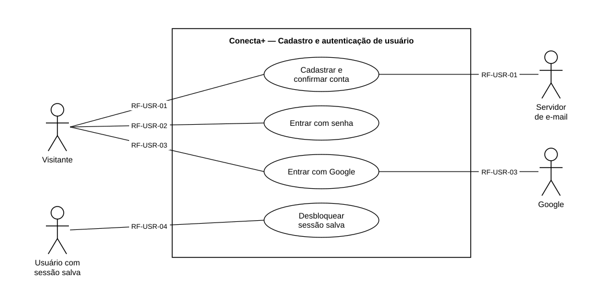

# Casos de uso — Cadastro de usuário

> Padrão da disciplina · Módulo USR · Revisado em 27/11/2026

## Resumo

Este documento mostra quem cria a conta, quem entra no aplicativo e quem desbloqueia a sessão salva ao abri-lo, e o que cada um pode fazer. Cada caso de uso é descrito em detalhe, como requisito funcional no formulário padrão, em [Requisitos funcionais](2%20-%20requisitos-funcionais-cadastro-usuario.md). A participação do usuário nas organizações (pedido de acesso por código, convite, decisão do administrador, papel e remoção) está documentada no módulo [Cadastro de organização](../cadastro-organizacao/README.md).

## Diagrama de casos de uso

Figura 1 — Diagrama de casos de uso do cadastro e da autenticação de usuário. Fonte: equipe Conecta+.

Cada linha entre um ator e um caso de uso leva o código do requisito funcional que o descreve.

## Atores

**Visitante.** É qualquer pessoa que abre o aplicativo sem estar conectada. Pode criar uma conta com nome, e-mail e senha e confirmá-la com o código recebido por e-mail, entrar com e-mail e senha e entrar com a conta Google. Não vê organizações, comissões nem reuniões antes de entrar. O administrador do sistema também é um visitante até entrar: ele usa o mesmo login com e-mail e senha, mas a conta dele não é criada pelo cadastro: o servidor a cria ao iniciar, com os dados configurados no ambiente, quando ainda não existe nenhum administrador do sistema nem outra conta com o e-mail configurado.

**Usuário com sessão salva.** É a pessoa que já entrou neste aparelho, com senha ou com Google, e cuja sessão continua guardada nele quando o aplicativo é aberto. Antes de ver qualquer tela, confirma a identidade com a biometria, o Face ID ou o PIN do próprio aparelho; se não conseguir, pode tentar de novo ou desistir da sessão e entrar com a senha. Não vê organizações, comissões nem reuniões enquanto não confirma. Em aparelho sem bloqueio de tela e na web, o aplicativo não pede a confirmação. Quando a sessão já venceu, deixa de ser este ator e volta a ser visitante.

**Servidor de e-mail.** É o sistema externo que entrega a mensagem com o código de confirmação do cadastro. A API não espera a entrega para responder; se ela falhar, a conta ainda não confirmada é apagada.

**Google.** É o sistema externo que confirma a identidade da pessoa e devolve à API o token com o e-mail, o nome e o identificador da conta Google.

## Relacionamentos entre casos de uso

Não há generalização entre atores nem `«include»` ou `«extend»` entre os casos de uso deste módulo: cada caso de uso é iniciado por uma ação própria do ator, e os dois sistemas externos participam como atores secundários. Visitante e usuário com sessão salva podem ser a mesma pessoa em momentos diferentes, mas um não faz o que o outro faz: o desbloqueio só aparece a quem tem sessão salva, e o cadastro e o login só aparecem a quem não tem. No desbloqueio (UC-USR-04), o botão "Entrar com senha" usa o encerramento da sessão do módulo [Configurações de usuário](../configuracoes-usuario/README.md) (RF-CFG-06) e leva à tela de login (UC-USR-02).

## Requisitos funcionais de usuário

| Caso de uso | Requisito | Nome                              | Ator principal           |
| ----------- | --------- | --------------------------------- | ------------------------ |
| UC-USR-01   | RF-USR-01 | Cadastrar e confirmar conta local | Visitante                |
| UC-USR-02   | RF-USR-02 | Autenticar com senha              | Visitante                |
| UC-USR-03   | RF-USR-03 | Autenticar com Google             | Visitante                |
| UC-USR-04   | RF-USR-04 | Desbloquear sessão salva          | Usuário com sessão salva |

**Requisito RF-USR-01 — Cadastrar e confirmar conta local.** O sistema deve permitir ao visitante criar uma conta com nome, e-mail e uma senha forte e, em seguida, confirmar o e-mail digitando o código de 7 caracteres enviado para ele. A conta só pode ser usada para entrar depois dessa confirmação.

**Requisito RF-USR-02 — Autenticar com senha.** O sistema deve permitir ao visitante entrar no aplicativo com o e-mail e a senha de uma conta ativa e já confirmada, mantendo a pessoa conectada até a sessão expirar ou a conta deixar de estar disponível.

**Requisito RF-USR-03 — Autenticar com Google.** O sistema deve permitir ao visitante entrar com a conta Google, criando a conta no primeiro acesso ou ligando a conta Google à conta que já existe com o mesmo e-mail.

**Requisito RF-USR-04 — Desbloquear sessão salva.** O sistema deve pedir ao usuário com sessão salva, ao abrir o aplicativo, a confirmação de identidade do aparelho (biometria, Face ID ou PIN) antes de mostrar qualquer tela e, se a confirmação falhar, deve permitir tentar de novo ou encerrar a sessão e entrar com a senha.

## Não implementado

- Entrar pela biometria do aparelho depois do primeiro acesso, sugerido na avaliação do Incremento 1: atendido em parte desde 27/11/2026 pelo RF-USR-04, com o desbloqueio na abertura incluído pelo João. A biometria desbloqueia a sessão que ficou salva no aparelho, mas não substitui o login: quando o token vence (1 hora depois do login), a pessoa entra de novo com senha ou com Google.
- Pedir um novo código de confirmação do cadastro: não implementado. Se o código expirar, a conta fica sem confirmação e o mesmo e-mail não pode ser usado num novo cadastro; ela só é confirmada se a pessoa entrar com a conta Google do mesmo e-mail (RF-USR-03).
