# Diagrama de classes — Cadastro de usuário

> Padrão da disciplina · Módulo USR · Revisado em 27/11/2026

## Resumo

O diagrama mostra as classes que participam do cadastro e da autenticação, agrupadas em três pacotes, um por camada do sistema: **Aplicativo** (telas, o componente de navegação `Navegacao` e a tela de desbloqueio `DesbloqueioSessao`, contextos de sessão, tema e aviso e módulos do aplicativo), **API** (controllers, services, guards e objetos de entrada) e **Dados** (o model do Mongoose `UsuarioModel`, marcado `<<Model Mongoose>>`, e o documento guardado no MongoDB). As bibliotecas chamadas diretamente nos [Diagramas de sequência](6%20-%20diagramas-sequencia-cadastro-usuario.md) ficam no pacote **Bibliotecas**, marcadas `<<biblioteca>>` ou `<<API do navegador>>`, só com os métodos chamados. Para caber legível na largura da página, o diagrama está dividido em onze partes. Toda linha de vida e todo método das sequências aparecem aqui, numa das partes. Cada atributo traz o seu tipo, e cada método traz o tipo dos parâmetros e do retorno. Toda classe e todo método do diagrama existem no código; das classes que também servem a outros módulos, como `AuthService` e `Usuario`, aparecem só os métodos e atributos usados aqui. Nas telas, nos componentes e nos contextos, os métodos `definir*` são as funções de atualização do `useState`; em `DesbloqueioSessao`, `nome`, `aoLiberar` e `aoEntrarComSenha` são as propriedades recebidas de `Navegacao`, e `pedindo` é guardado com `useRef`; `desbloqueio` e `etapa` aparecem como `string` porque, no código, o tipo de cada um é uma união de textos fixos, descrita no dicionário. As classes dos vínculos do usuário com organizações (`Organizacao`, `MembroOrganizacao`, `OrganizacoesService` e as telas de organização) estão documentadas no módulo [Cadastro de organização](../cadastro-organizacao/README.md).

## Diagrama

Cada classe tem os atributos e os métodos numa única parte, indicada na tabela; nas outras partes em que aparece, por ser ponta de uma ligação, ela vem só com o nome, sem atributos nem métodos, e a linha abaixo da figura diz em que parte está detalhada.

| Parte | Figura | Classes detalhadas |
| ----- | ------ | ------------------ |
| 1 | Figura 2 | `TelaCadastro`, `TelaVerificarCadastro` |
| 2 | Figura 3 | `TelaLogin` |
| 3 | Figura 4 | `GoogleCallbackWeb`, `google`, `api` |
| 4 | Figura 5 | `Navegacao`, `DesbloqueioSessao`, `SessaoProvider`, `autenticacaoLocal` |
| 5 | Figura 6 | `TemaProvider`, `ToastProvider`, `validacao` |
| 6 | Figura 7 | `JwtAuthGuard`, `UsuariosController`, `CreateUsuarioDto` |
| 7 | Figura 8 | `ApiKeyGuard`, `AuthController`, `VerificarCadastroDto`, `LoginDto`, `GoogleLoginDto` |
| 8 | Figura 9 | `AuthService` |
| 9 | Figura 10 | `UsuariosService`, `UsuarioModel` |
| 10 | Figura 11 | `Usuario`, `TipoUsuario`, `TemaUsuario`, `ProvedorAutenticacao` |
| 11 | Figura 12 | `Router`, `Location`, `GoogleSignin`, `bcrypt`, `JwtService`, `Transporter`, `fetch` |

### Parte 1 — Telas de cadastro

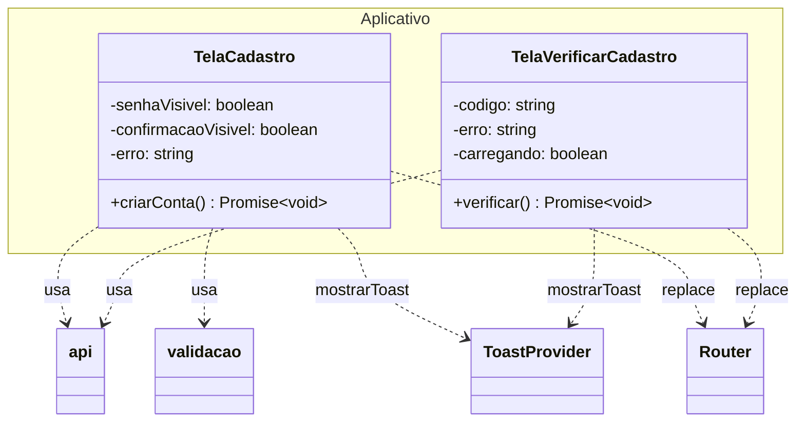

Figura 2 — Diagrama de classes do cadastro e da autenticação, parte 1: telas de cadastro. Fonte: equipe Conecta+.

Só com o nome: `api` (parte 3), `validacao` e `ToastProvider` (parte 5) e `Router` (parte 11).

### Parte 2 — Tela de login

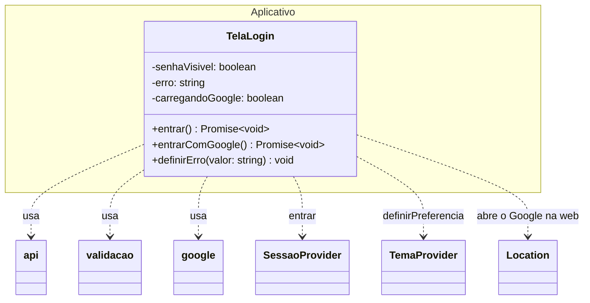

Figura 3 — Diagrama de classes do cadastro e da autenticação, parte 2: tela de login. Fonte: equipe Conecta+.

Só com o nome: `api` e `google` (parte 3), `SessaoProvider` (parte 4), `validacao` e `TemaProvider` (parte 5) e `Location` (parte 11).

### Parte 3 — Retorno do Google e módulos de comunicação

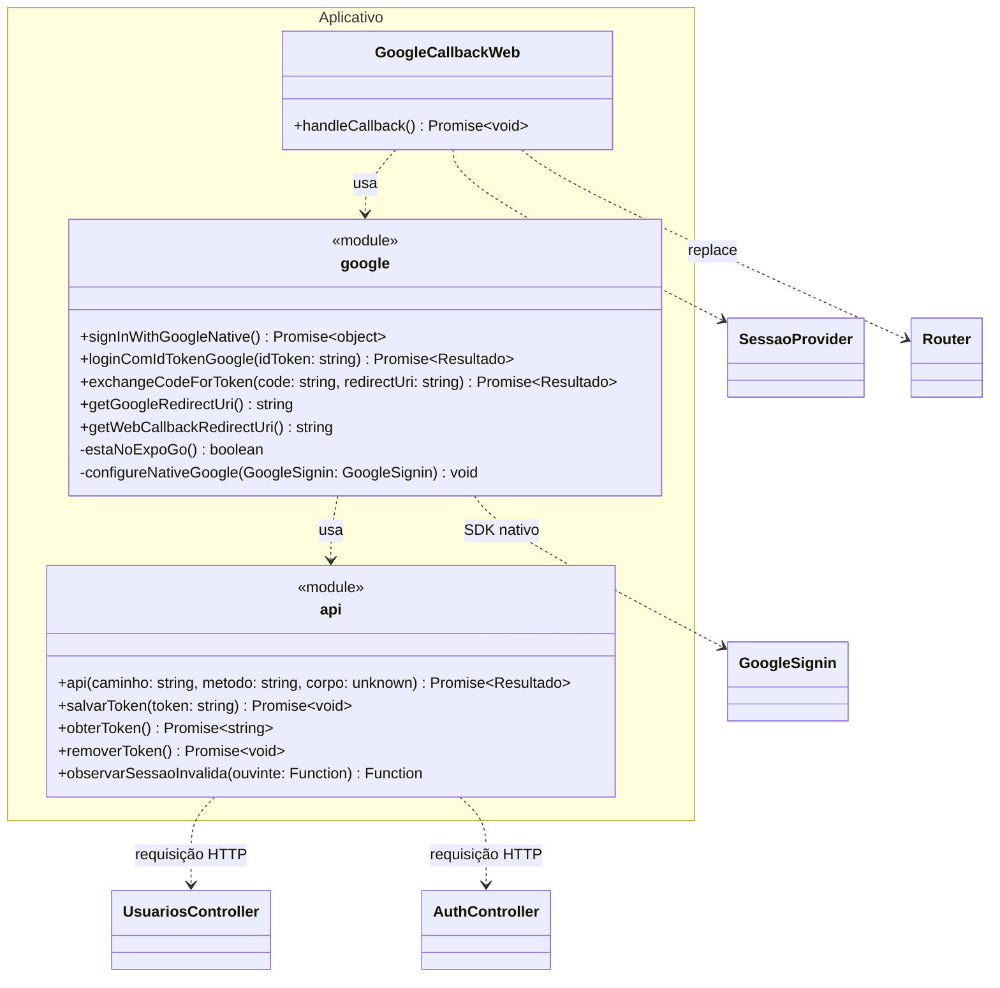

Figura 4 — Diagrama de classes do cadastro e da autenticação, parte 3: retorno do Google na web e módulos `google` e `api`. Fonte: equipe Conecta+.

Só com o nome: `SessaoProvider` (parte 4), `UsuariosController` (parte 6), `AuthController` (parte 7) e `Router` e `GoogleSignin` (parte 11).

### Parte 4 — Navegação, desbloqueio e sessão

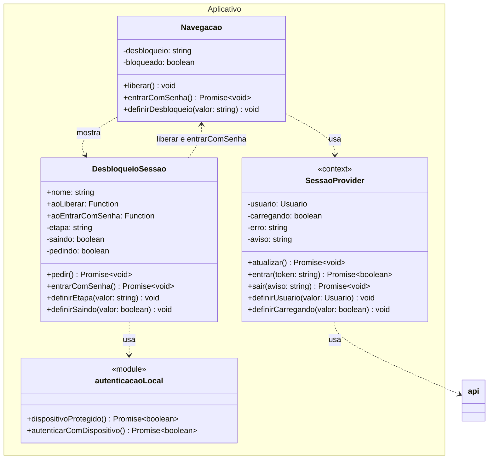

Figura 5 — Diagrama de classes do cadastro e da autenticação, parte 4: navegação, desbloqueio da sessão salva e contexto da sessão. Fonte: equipe Conecta+.

Só com o nome: `api` (parte 3).

### Parte 5 — Tema, aviso e validação

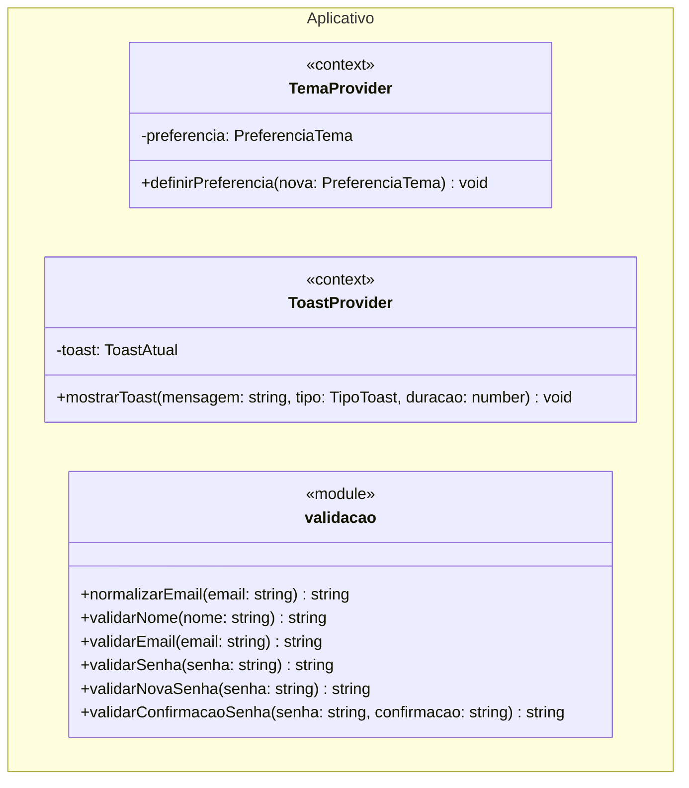

Figura 6 — Diagrama de classes do cadastro e da autenticação, parte 5: contextos de tema e de aviso e módulo `validacao`. Fonte: equipe Conecta+.

As ligações que chegam a essas classes estão nas partes 1 e 2, nas telas que as usam.

### Parte 6 — Guarda do token e controller de usuários

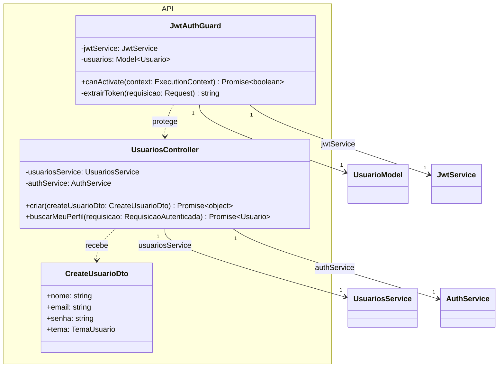

Figura 7 — Diagrama de classes do cadastro e da autenticação, parte 6: guarda do token, controller de usuários e objeto de entrada do cadastro. Fonte: equipe Conecta+.

Só com o nome: `AuthService` (parte 8), `UsuariosService` e `UsuarioModel` (parte 9) e `JwtService` (parte 11).

### Parte 7 — Guarda da chave e controller de autenticação

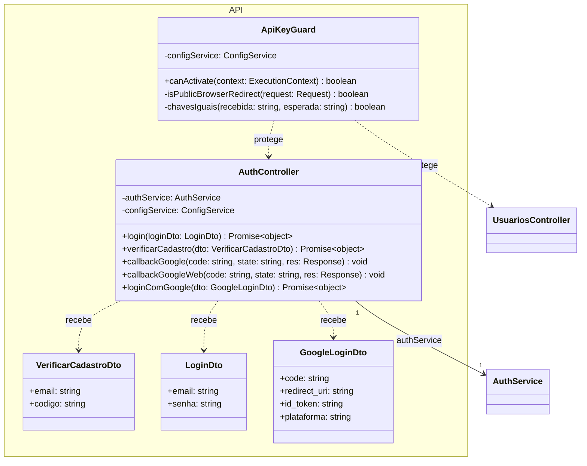

Figura 8 — Diagrama de classes do cadastro e da autenticação, parte 7: guarda da chave do aplicativo, controller de autenticação e objetos de entrada. Fonte: equipe Conecta+.

Só com o nome: `UsuariosController` (parte 6) e `AuthService` (parte 8).

### Parte 8 — Serviço de autenticação

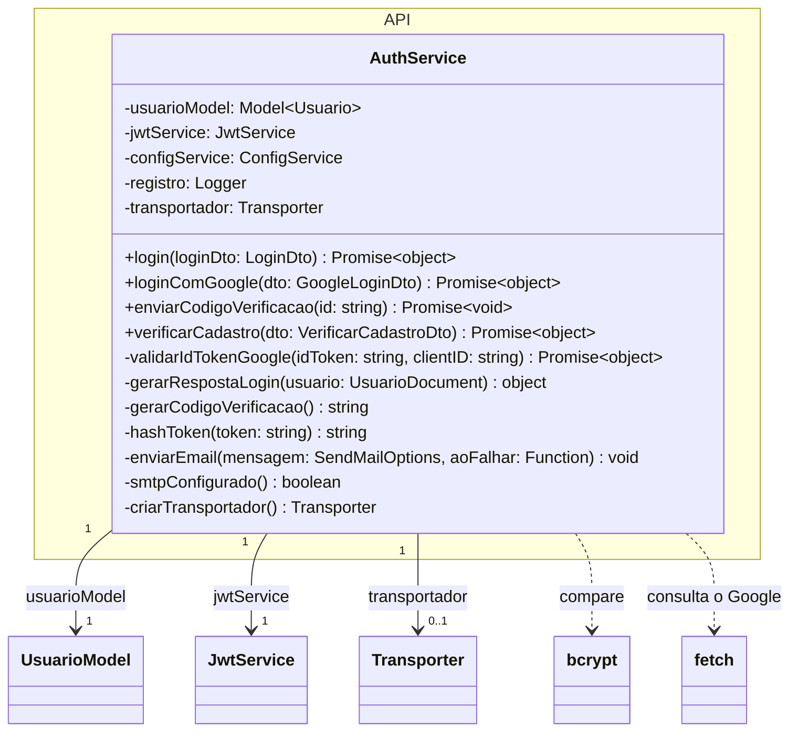

Figura 9 — Diagrama de classes do cadastro e da autenticação, parte 8: serviço de autenticação. Fonte: equipe Conecta+.

Só com o nome: `UsuarioModel` (parte 9) e `JwtService`, `Transporter`, `bcrypt` e `fetch` (parte 11).

### Parte 9 — Serviço de usuários e model do Mongoose

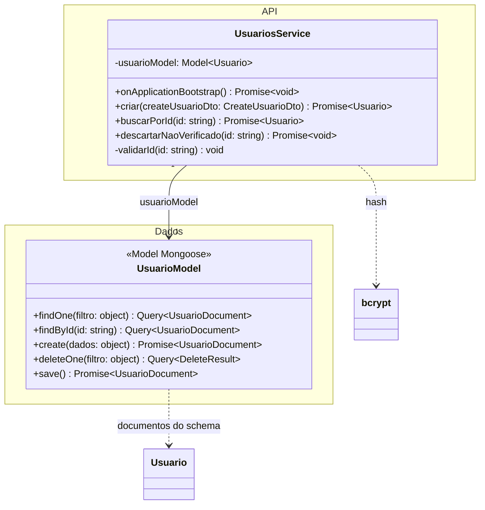

Figura 10 — Diagrama de classes do cadastro e da autenticação, parte 9: serviço de usuários e model `UsuarioModel`. Fonte: equipe Conecta+.

Só com o nome: `Usuario` (parte 10) e `bcrypt` (parte 11).

### Parte 10 — Documento do usuário e enumerações

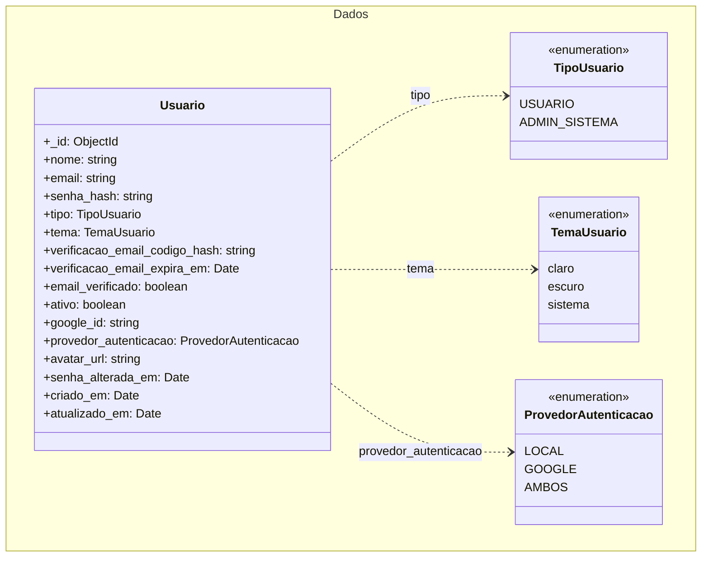

Figura 11 — Diagrama de classes do cadastro e da autenticação, parte 10: documento `Usuario` e enumerações. Fonte: equipe Conecta+.

### Parte 11 — Bibliotecas

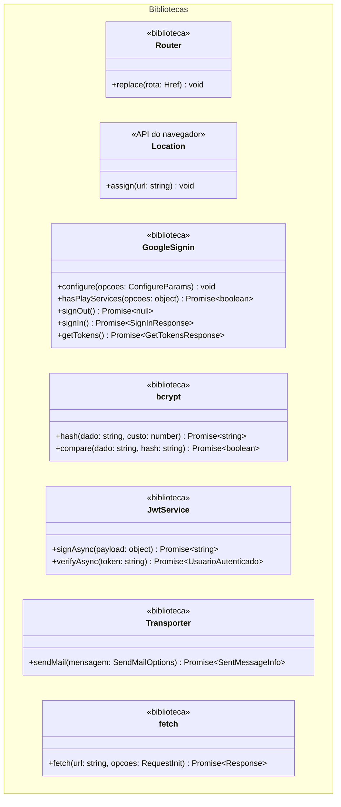

Figura 12 — Diagrama de classes do cadastro e da autenticação, parte 11: bibliotecas e API do navegador, só com os métodos chamados. Fonte: equipe Conecta+.

As ligações que chegam a essas classes estão nas partes 1 a 3, 6, 8 e 9.

## Como ler as ligações

| Ligação                      | Significado                                                             | Exemplo no diagrama                                                                                           |
| ---------------------------- | ----------------------------------------------------------------------- | ------------------------------------------------------------------------------------------------------------- |
| Seta cheia (associação)      | Uma classe guarda uma referência a outra, que existe por conta própria. | `UsuariosController --> AuthService` (parte 6): o controller guarda o serviço no atributo `authService`.                |
| Seta tracejada (dependência) | Uma classe usa a outra numa chamada, sem guardá-la como atributo.       | `UsuariosService ..> bcrypt` (parte 9), `TelaLogin ..> api` (parte 2).                                                             |

Os números nas pontas das associações são as multiplicidades: cada controller tem exatamente uma instância de cada serviço (`1`), e cada serviço é usado por um controller (`1`). `UsuariosService`, `AuthService` e `JwtAuthGuard` guardam o mesmo `UsuarioModel`, injetado pelo NestJS, e o `AuthService` guarda no máximo um `Transporter` (`0..1`), criado na primeira mensagem. O `UsuarioModel` lê e grava os documentos do schema `Usuario`; `save()` é chamado no documento devolvido por `findOne` ou `findById`. Não há herança nem composição entre as classes deste diagrama: `Usuario` não tem subdocumentos.

No código, os atributos opcionais são `senha_hash`, `verificacao_email_codigo_hash`, `verificacao_email_expira_em`, `google_id`, `avatar_url` e `senha_alterada_em`, em `Usuario`; `tema`, em `CreateUsuarioDto`; e todos os campos de `GoogleLoginDto`. Os métodos de `validacao` devolvem o texto do erro ou `null` quando o valor é válido. A obrigatoriedade de cada atributo está no [dicionário de classes](3%20-%20dicionario-dados-classes-cadastro-usuario.md).

## Rotas atendidas pelos controllers

As rotas HTTP não são métodos; por isso ficam nesta tabela, e não no diagrama.

| Controller               | Método                  | Rota HTTP                                           | Requisito |
| ------------------------ | ----------------------- | --------------------------------------------------- | --------- |
| `UsuariosController`     | `criar`                 | `POST /usuarios`                                    | RF-USR-01 |
| `AuthController`         | `verificarCadastro`     | `POST /auth/verificar-cadastro`                     | RF-USR-01 |
| `AuthController`         | `login`                 | `POST /auth/login`                                  | RF-USR-02 |
| `UsuariosController`     | `buscarMeuPerfil`       | `GET /usuarios/me`                                  | RF-USR-02 |
| `AuthController`         | `loginComGoogle`        | `POST /auth/google`                                 | RF-USR-03 |
| `AuthController`         | `callbackGoogleWeb`     | `GET /auth/google/callback-web`                     | RF-USR-03 |
| `AuthController`         | `callbackGoogle`        | `GET /auth/google/callback` (não usada pelo app)    | RF-USR-03 |

## Regras representadas

- uma conta tem senha local, conta Google ou as duas, conforme `provedor_autenticacao`;
- `TipoUsuario` só distingue o usuário comum do administrador do sistema; quem administra uma organização é definido pelo vínculo, no módulo ORG;
- o token de acesso não é uma classe nem é guardado no banco: ele é emitido pelo `AuthService` e guardado pelo módulo `api` no aparelho;
- o aplicativo nunca decide sozinho se a sessão vale: ele confirma com `GET /usuarios/me`;
- com a sessão salva, `Navegacao` só monta as telas depois que `DesbloqueioSessao` chama `liberar`; a confirmação de identidade fica no aparelho, e nada dela é enviado à API.

## Rastreabilidade

RF-USR-01 a RF-USR-04; complementado por [Dicionário de classes](3%20-%20dicionario-dados-classes-cadastro-usuario.md) e [Diagramas de sequência](6%20-%20diagramas-sequencia-cadastro-usuario.md).
