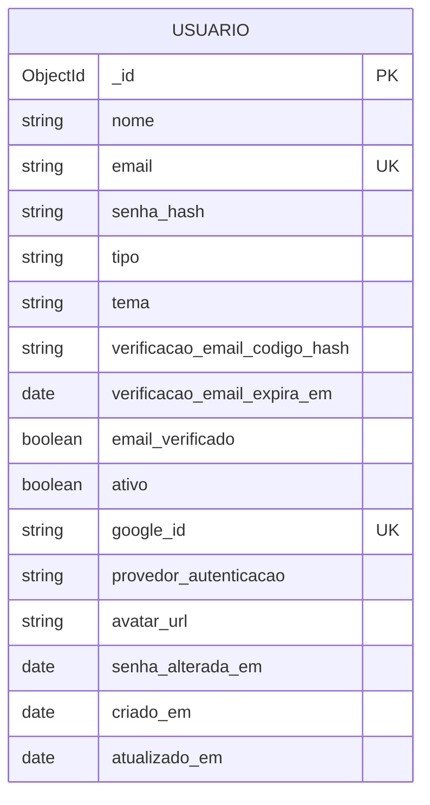

# Diagrama relacional — Cadastro de usuário

> Padrão da disciplina · Módulo USR · Visão lógica dos documentos MongoDB · Revisado em 26/11/2026

## Resumo

O banco é o MongoDB, que não tem tabelas. O cadastro e a autenticação usam uma única coleção, `usuarios`, com um documento por conta; ela não tem listas nem documentos embutidos. O diagrama abaixo é a **visão lógica** dessa coleção como entidade, com a chave primária e os campos únicos. As outras coleções que apontam para `USUARIO` (por exemplo, os vínculos com organizações, em `organizacoes.membros[]`) estão no módulo [Cadastro de organização](../cadastro-organizacao/README.md) e nos demais módulos que as usam.

## Diagrama

Figura 3 — Visão lógica relacional da conta de usuário. Fonte: equipe Conecta+.

## Como a entidade lógica vira documento

| Entidade lógica | Onde fica de verdade | Observação                                                                                                                                  |
| --------------- | -------------------- | ------------------------------------------------------------------------------------------------------------------------------------------- |
| `USUARIO`       | coleção `usuarios`   | Um documento por conta. `UK` marca os campos com índice único: `email` em todas as contas e `google_id` só nas contas que o têm.            |

## Regras de integridade

- cada e-mail pertence a uma única conta, e cada conta Google (`google_id`) a uma única conta;
- o e-mail é guardado em minúsculas e sem espaços nas pontas, então variações de maiúsculas contam como o mesmo e-mail;
- `verificacao_email_codigo_hash` e `verificacao_email_expira_em` existem juntos, do cadastro local até a confirmação pelo código; se a conta for confirmada pelo login Google, eles continuam gravados;
- só uma conta criada pelo Google (`provedor_autenticacao = GOOGLE`) pode estar sem `senha_hash`.

O detalhe de cada campo e de cada regra, com o mecanismo que a garante, está no [dicionário relacional](4%20-%20dicionario-dados-relacional-cadastro-usuario.md).

## Rastreabilidade

RF-USR-01 a RF-USR-03; detalhado em [Dicionário relacional](4%20-%20dicionario-dados-relacional-cadastro-usuario.md).
