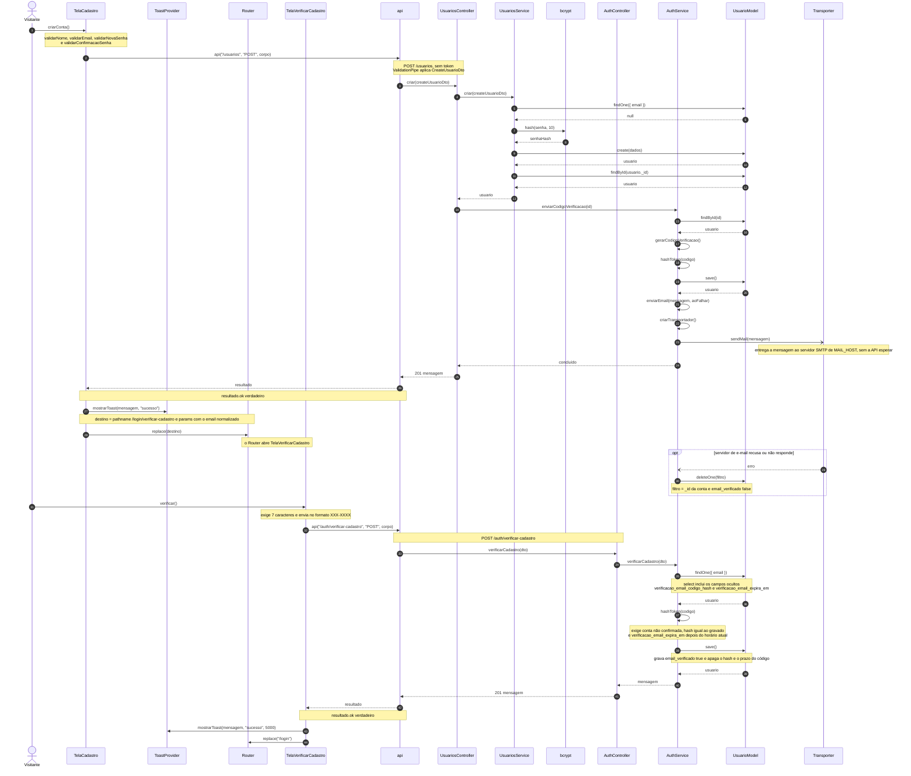
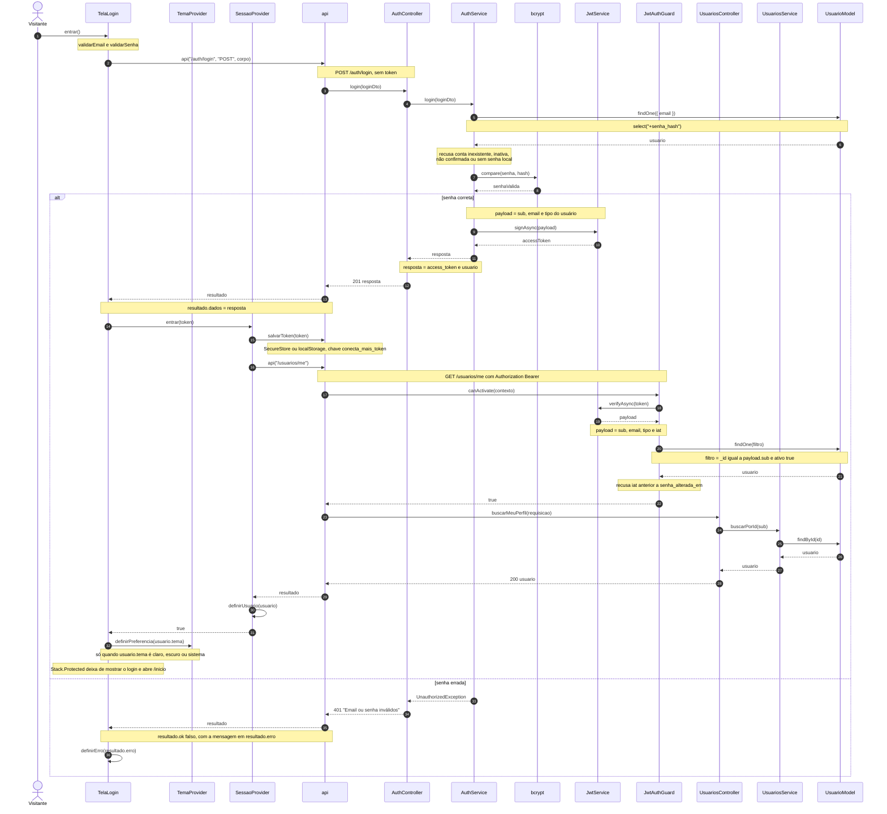
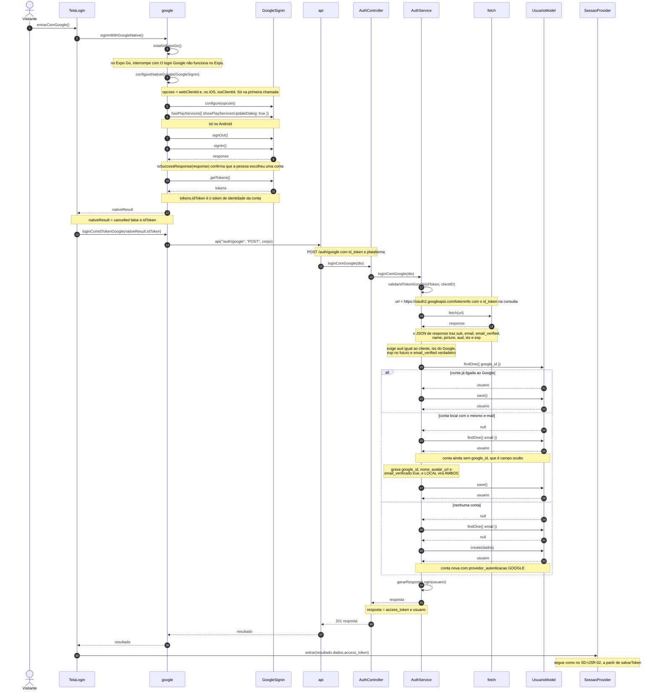
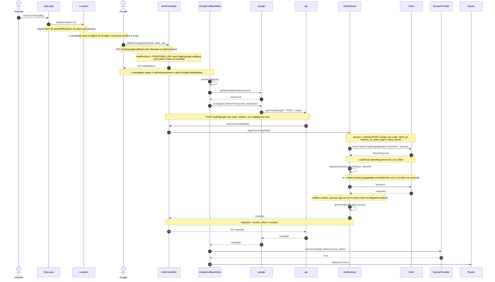

# Diagramas de sequência — Cadastro de usuário

> Padrão da disciplina · Módulo USR · Revisado em 27/11/2026

## Resumo

Há um diagrama para cada requisito de [Requisitos funcionais](2%20-%20requisitos-funcionais-cadastro-usuario.md), com o mesmo número. As linhas de vida são classes e módulos que existem no código e estão no [Diagrama de classes](3%20-%20diagrama-classes-cadastro-usuario.md): as telas do aplicativo, os contextos `SessaoProvider`, `TemaProvider` e `ToastProvider`, os módulos `api` e `google`, os controllers, os services, o `JwtAuthGuard`, o model do Mongoose `UsuarioModel` e as bibliotecas chamadas diretamente (`Router`, `Location`, `GoogleSignin`, `bcrypt`, `JwtService`, `Transporter` e `fetch`). O Google, no login pela web, é um sistema externo e aparece como ator. Toda mensagem é a chamada de um método existente, com seus parâmetros, e as mensagens são numeradas na ordem em que acontecem. Regras que não são métodos, como comparações de situação, aparecem em notas, assim como as rotas HTTP. Os retornos são identificadores; uma nota diz o que cada um traz quando isso não é evidente.

Em todos os diagramas, a chamada do módulo `api` ao controller é uma requisição HTTP que passa antes pelo `ApiKeyGuard`; o SD-USR-02 mostra em detalhe o `JwtAuthGuard`, que protege `GET /usuarios/me`. O `resultado` devolvido pelo módulo `api` é o tipo `Resultado`: `ok` verdadeiro com `dados`, ou `ok` falso com `erro`. Os diagramas dos vínculos do usuário com organizações estão no módulo [Cadastro de organização](../cadastro-organizacao/README.md).

## SD-USR-01 — Cadastrar e confirmar conta local

## SD-USR-02 — Autenticar com senha

## SD-USR-03 — Autenticar com Google

No aplicativo instalado (Android e iOS):

No navegador:

## Rastreabilidade

SD-USR-01 a SD-USR-03 correspondem, na mesma ordem, a UC-USR-01 a UC-USR-03 e a RF-USR-01 a RF-USR-03.
