# Diagrama de classes — Configurações de usuário

> Padrão da disciplina · Módulo CFG · Revisado em 27/11/2026

## Resumo

O diagrama mostra as classes que participam das configurações da conta, agrupadas em três pacotes, um por camada do sistema: **Aplicativo** (telas, contextos e módulos do aplicativo), **API** (controllers, services, guard e objetos de entrada) e **Dados** (o model do Mongoose `UsuarioModel`, marcado `<<Model Mongoose>>`, o documento guardado no MongoDB e seus enums). As bibliotecas chamadas diretamente nos [Diagramas de sequência](6%20-%20diagramas-sequencia-configuracoes-usuario.md) (`Router`, `SecureStore`, `bcrypt`, `crypto` e `Transporter`) ficam fora dos pacotes, marcadas `<<biblioteca>>`, só com os métodos chamados. Toda linha de vida e todo método das sequências aparecem aqui. Cada atributo traz o seu tipo, e cada método traz o tipo dos parâmetros e do retorno. Toda classe e todo método do diagrama existem no código. Nas telas e nos contextos, os atributos são os estados guardados pelo componente (`useState`, `useRef` ou valor calculado) e os métodos são as funções declaradas dentro do componente ou no mesmo arquivo; os métodos `definir*` são as funções de atualização do `useState`, e `ouvinte` é a função que o `SessaoContext` registra com `observarSessaoInvalida`.

## Diagrama

```mermaid
classDiagram
    direction LR

    namespace Aplicativo {
        class TelaPerfil {
            -perfil: Perfil
            -preferenciaSelecionada: PreferenciaTema
            -editandoNome: boolean
            -escolhendoTema: boolean
            -confirmandoSaida: boolean
            -salvandoTema: boolean
            -aviso: Aviso
            -avisoNome: Aviso
            +carregarPerfil(ativa: function) Promise~void~
            +abrirEdicaoNome() void
            +salvarNome() Promise~void~
            +selecionarTema(novaPreferencia: PreferenciaTema) Promise~void~
            +abrirProtegida(destino: Href) Promise~void~
            +sair() Promise~void~
            +definirPerfil(valor: Perfil) void
            +definirAviso(valor: Aviso) void
            +definirAvisoNome(valor: Aviso) void
            +definirEditandoNome(valor: boolean) void
            +definirEscolhendoTema(valor: boolean) void
            +definirConfirmandoSaida(valor: boolean) void
            +definirPreferenciaSelecionada(valor: PreferenciaTema) void
            +definirSalvandoTema(valor: boolean) void
        }
        class TelaTrocarEmail {
            -etapa: Etapa
            -atual: string
            -novo: string
            -codigo: string
            -reenviado: boolean
            +enviarCodigo() Promise~void~
            +solicitar(email: string) Promise~boolean~
            +reenviar() Promise~void~
            +confirmar() Promise~void~
            +voltar() void
            +definirEtapa(valor: Etapa) void
        }
        class TelaAlterarSenha {
            -erro: string
            +salvar() Promise~void~
            +voltar() void
        }
        class TelaRecuperarConta {
            -etapa: Etapa
            -email: string
            -codigo: string
            -token: string
            -reenviado: boolean
            +solicitar() Promise~void~
            +reenviar() Promise~void~
            +verificarCodigo() Promise~void~
            +redefinir() Promise~void~
            +voltar() void
            +definirEtapa(valor: Etapa) void
            +definirToken(valor: string) void
        }
        class SessaoContext {
            -usuario: Usuario
            -carregando: boolean
            -erro: string
            -aviso: string
            -geracao: number
            +atualizar() Promise~void~
            +entrar(token: string) Promise~boolean~
            +sair(aviso: string) Promise~void~
            +definirUsuario(valor: Usuario) void
            +definirAviso(valor: string) void
            +ouvinte() void
        }
        class ToastContext {
            -toast: ToastAtual
            +mostrarToast(mensagem: string, tipo: TipoToast, duracao: number) void
        }
        class TemaContext {
            -preferencia: PreferenciaTema
            -tema: Tema
            +definirPreferencia(preferencia: PreferenciaTema) void
            +ehPreferenciaTema(valor: unknown) boolean
            -lerPreferencia() Promise~string~
            -gravarPreferencia(preferencia: PreferenciaTema) Promise~void~
        }
        class CampoTexto {
            +rotulo: string
            +erro: string
            +ajuda: string
            +dica: string
        }
        class validacao {
            <<module>>
            +validarNome(nome: string) string
            +validarEmail(email: string) string
            +validarSenha(senha: string) string
            +validarNovaSenha(senha: string) string
            +validarConfirmacaoSenha(senha: string, confirmacao: string) string
            +normalizarEmail(email: string) string
        }
        class api {
            <<module>>
            +api(caminho: string, metodo: string, corpo: unknown) Promise~Resultado~
            +salvarToken(token: string) Promise~void~
            +obterToken() Promise~string~
            +removerToken() Promise~void~
            +observarSessaoInvalida(ouvinte: function) function
        }
        class autenticacaoLocal {
            <<module>>
            +dispositivoProtegido() Promise~boolean~
            +autenticarComDispositivo() Promise~boolean~
        }
    }

    namespace API {
        class UsuariosController {
            -usuariosService: UsuariosService
            -authService: AuthService
            +buscarMeuPerfil(requisicao: RequisicaoAutenticada) Promise~Usuario~
            +atualizarMeuPerfil(requisicao: RequisicaoAutenticada, atualizarPerfilDto: AtualizarPerfilDto) Promise~Usuario~
            +solicitarAlteracaoEmail(requisicao: RequisicaoAutenticada, dto: SolicitarAlteracaoEmailDto) Promise~object~
            +confirmarAlteracaoEmail(requisicao: RequisicaoAutenticada, dto: ConfirmarAlteracaoEmailDto) Promise~object~
            +alterarMinhaSenha(requisicao: RequisicaoAutenticada, alterarSenhaDto: AlterarSenhaDto) Promise~object~
        }
        class UsuariosService {
            -usuarioModel: Model~UsuarioDocument~
            +buscarPorId(id: string) Promise~Usuario~
            +atualizarPerfil(id: string, atualizarPerfilDto: AtualizarPerfilDto) Promise~Usuario~
            +alterarSenha(id: string, alterarSenhaDto: AlterarSenhaDto) Promise~object~
            -validarId(id: string) void
        }
        class AuthController {
            -authService: AuthService
            +recuperarConta(recuperarContaDto: RecuperarContaDto) Promise~object~
            +verificarRecuperacao(dto: VerificarRecuperacaoDto) Promise~object~
            +redefinirSenha(redefinirSenhaDto: RedefinirSenhaDto) Promise~object~
        }
        class AuthService {
            -usuarioModel: Model~UsuarioDocument~
            -transportador: Transporter
            +solicitarAlteracaoEmail(id: string, novoEmail: string) Promise~object~
            +confirmarAlteracaoEmail(id: string, emailInformado: string, codigoInformado: string) Promise~object~
            +solicitarRecuperacao(recuperarContaDto: RecuperarContaDto) Promise~object~
            +verificarRecuperacao(dto: VerificarRecuperacaoDto) Promise~object~
            +redefinirSenha(redefinirSenhaDto: RedefinirSenhaDto) Promise~object~
            -gerarCodigoVerificacao() string
            -hashToken(token: string) string
            -enviarEmail(mensagem: SendMailOptions, aoFalhar: function) void
            -smtpConfigurado() boolean
            -criarTransportador() Transporter
        }
        class JwtAuthGuard {
            -jwtService: JwtService
            -usuarios: Model~UsuarioDocument~
            +canActivate(context: ExecutionContext) Promise~boolean~
            -extrairToken(requisicao: Request) string
        }
        class AtualizarPerfilDto {
            +nome: string
            +email: string
            +tema: TemaUsuario
        }
        class AlterarSenhaDto {
            +senha_atual: string
            +nova_senha: string
        }
        class SolicitarAlteracaoEmailDto {
            +email: string
        }
        class ConfirmarAlteracaoEmailDto {
            +email: string
            +codigo: string
        }
        class RecuperarContaDto {
            +email: string
        }
        class VerificarRecuperacaoDto {
            +email: string
            +codigo: string
        }
        class RedefinirSenhaDto {
            +token: string
            +nova_senha: string
        }
    }

    namespace Dados {
        class UsuarioModel {
            <<Model Mongoose>>
            +findById(id: string) Query~UsuarioDocument~
            +findOne(filtro: object) Query~UsuarioDocument~
            +save() Promise~UsuarioDocument~
        }
        class Usuario {
            +_id: ObjectId
            +nome: string
            +email: string
            -senha_hash: string
            +senha_alterada_em: Date
            +tipo: TipoUsuario
            +tema: TemaUsuario
            -reset_senha_codigo_hash: string
            -reset_senha_token_hash: string
            -reset_senha_expira_em: Date
            -email_pendente: string
            -email_pendente_codigo_hash: string
            -email_pendente_expira_em: Date
            +email_verificado: boolean
            +ativo: boolean
            +provedor_autenticacao: ProvedorAutenticacao
            +criado_em: Date
            +atualizado_em: Date
        }
        class TemaUsuario {
            <<enumeration>>
            claro
            escuro
            sistema
        }
        class TipoUsuario {
            <<enumeration>>
            USUARIO
            ADMIN_SISTEMA
        }
        class ProvedorAutenticacao {
            <<enumeration>>
            LOCAL
            GOOGLE
            AMBOS
        }
    }

    class Router {
        <<biblioteca>>
        +push(rota: Href) void
    }
    class SecureStore {
        <<biblioteca>>
        +setItemAsync(chave: string, valor: string) Promise~void~
        +deleteItemAsync(chave: string) Promise~void~
    }
    class bcrypt {
        <<biblioteca>>
        +hash(dado: string, custo: number) Promise~string~
        +compare(dado: string, hash: string) Promise~boolean~
    }
    class crypto {
        <<biblioteca>>
        +randomBytes(tamanho: number) Buffer
    }
    class Transporter {
        <<biblioteca>>
        +sendMail(mensagem: SendMailOptions) Promise~SentMessageInfo~
    }

    TelaPerfil ..> api : usa
    TelaPerfil ..> autenticacaoLocal : usa
    TelaPerfil ..> TemaContext : usa
    TelaPerfil ..> SessaoContext : usa
    TelaPerfil ..> validacao : usa
    TelaPerfil ..> ToastContext : mostrarToast
    TelaPerfil ..> Router : push
    TelaTrocarEmail ..> api : usa
    TelaTrocarEmail ..> SessaoContext : usa
    TelaTrocarEmail ..> validacao : usa
    TelaAlterarSenha ..> api : usa
    TelaAlterarSenha ..> SessaoContext : usa
    TelaAlterarSenha ..> validacao : usa
    TelaAlterarSenha ..> CampoTexto : usa
    TelaRecuperarConta ..> api : usa
    TelaRecuperarConta ..> autenticacaoLocal : usa
    TelaRecuperarConta ..> validacao : usa
    TelaRecuperarConta ..> CampoTexto : usa
    SessaoContext ..> api : usa
    api ..> SessaoContext : chama o ouvinte
    api ..> SecureStore : guarda e apaga o token
    TemaContext ..> SecureStore : grava a preferência
    api ..> UsuariosController : requisição HTTP
    api ..> AuthController : requisição HTTP

    UsuariosController --> "1" UsuariosService : usuariosService
    UsuariosController --> "1" AuthService : authService
    AuthController --> "1" AuthService : authService
    UsuariosController ..> JwtAuthGuard : protegido por
    UsuariosController ..> AtualizarPerfilDto : recebe
    UsuariosController ..> AlterarSenhaDto : recebe
    UsuariosController ..> SolicitarAlteracaoEmailDto : recebe
    UsuariosController ..> ConfirmarAlteracaoEmailDto : recebe
    AuthController ..> RecuperarContaDto : recebe
    AuthController ..> VerificarRecuperacaoDto : recebe
    AuthController ..> RedefinirSenhaDto : recebe
    UsuariosService --> "1" UsuarioModel : usuarioModel
    AuthService --> "1" UsuarioModel : usuarioModel
    JwtAuthGuard --> "1" UsuarioModel : usuarios
    UsuariosService ..> bcrypt : compare e hash
    AuthService ..> bcrypt : hash
    AuthService ..> crypto : randomBytes
    AuthService --> "0..1" Transporter : transportador
    UsuarioModel ..> Usuario : documentos do schema
    Usuario ..> TemaUsuario : tema
    Usuario ..> TipoUsuario : tipo
    Usuario ..> ProvedorAutenticacao : provedor_autenticacao
```

Figura 2 — Diagrama de classes das configurações de usuário, por camada. Fonte: equipe Conecta+.

## Como ler as ligações

| Ligação                      | Significado                                                                        | Exemplo no diagrama                                                                                          |
| ---------------------------- | ---------------------------------------------------------------------------------- | ------------------------------------------------------------------------------------------------------------ |
| Seta cheia (associação)      | Uma classe guarda uma referência a outra, que existe por conta própria.            | `UsuariosController --> "1" UsuariosService`: o controller recebe uma única instância do serviço no construtor. |
| Seta tracejada (dependência) | Uma classe usa a outra em uma chamada, sem guardá-la como atributo.                | `TelaAlterarSenha ..> SessaoContext`: a tela chama `sair` depois da troca de senha.                           |

O número na ponta da associação é a multiplicidade: cada controller tem exatamente uma instância de cada serviço (`1`), criada pela injeção de dependências do NestJS. Os services e o `JwtAuthGuard` guardam o mesmo `UsuarioModel`, e o `AuthService` guarda no máximo um `Transporter` (`0..1`), criado no primeiro envio. O `UsuarioModel` lê e grava os documentos do schema `Usuario`; `save()` é chamado no documento devolvido por `findById` ou `findOne`, que nos diagramas de sequência aparece como a linha de vida "UsuarioModel (documento usuario)".

Não há composição neste módulo. Os dados temporários da troca de e-mail e da recuperação são campos soltos do próprio documento `Usuario`, e não subdocumentos; o [diagrama relacional](4%20-%20diagrama-relacional-configuracoes-usuario.md) os separa apenas como visão lógica.

Os atributos com `-` em `Usuario` são os campos com `select: false` no schema: o Mongoose só os lê quando o serviço pede, com `select('+campo')`, e eles nunca aparecem nas respostas da API. Os DTOs repetem os nomes dos campos da API em `snake_case`. Os métodos que devolvem `Promise~object~` devolvem um objeto simples, como `{ mensagem }`, `{ mensagem, email }` ou `{ token }`, detalhado no [dicionário de classes](3%20-%20dicionario-dados-classes-configuracoes-usuario.md).

`CampoTexto` é o componente de campo de texto usado nas telas; aparece no diagrama por causa do atributo `ajuda`, que mostra a regra da senha abaixo do campo "Nova senha".

## Rotas atendidas pelos controllers

As rotas HTTP não são métodos; por isso ficam nesta tabela, e não no diagrama.

| Método do controller                         | Rota HTTP                           | Exige JWT |
| -------------------------------------------- | ----------------------------------- | --------- |
| `UsuariosController.buscarMeuPerfil`         | `GET /usuarios/me`                  | Sim       |
| `UsuariosController.atualizarMeuPerfil`      | `PATCH /usuarios/me`                | Sim       |
| `UsuariosController.solicitarAlteracaoEmail` | `POST /usuarios/me/email/solicitar` | Sim       |
| `UsuariosController.confirmarAlteracaoEmail` | `POST /usuarios/me/email/confirmar` | Sim       |
| `UsuariosController.alterarMinhaSenha`       | `PATCH /usuarios/me/senha`          | Sim       |
| `AuthController.recuperarConta`              | `POST /auth/recuperar-conta`        | Não       |
| `AuthController.verificarRecuperacao`        | `POST /auth/verificar-recuperacao`  | Não       |
| `AuthController.redefinirSenha`              | `POST /auth/redefinir-senha`        | Não       |

Todas exigem o cabeçalho `X-API-Key`, conferido pelo `ApiKeyGuard` registrado para a API inteira.

## Regras representadas

- o usuário só lê e altera a própria conta: os controllers usam o `sub` do token, e não um identificador vindo da tela;
- `AuthService` concentra tudo o que envolve código enviado por e-mail: troca de e-mail e recuperação;
- `JwtAuthGuard` consulta `Usuario` em toda requisição autenticada e recusa a conta inativa e o token emitido antes de `senha_alterada_em`;
- o aplicativo nunca guarda a senha: guarda só o token da sessão (`conecta_mais_token`) e a preferência de tema (`conecta_mais_tema`).

## Rastreabilidade

RF-CFG-01 a RF-CFG-06; complementado por [Dicionário de classes](3%20-%20dicionario-dados-classes-configuracoes-usuario.md) e [Diagramas de sequência](6%20-%20diagramas-sequencia-configuracoes-usuario.md).
