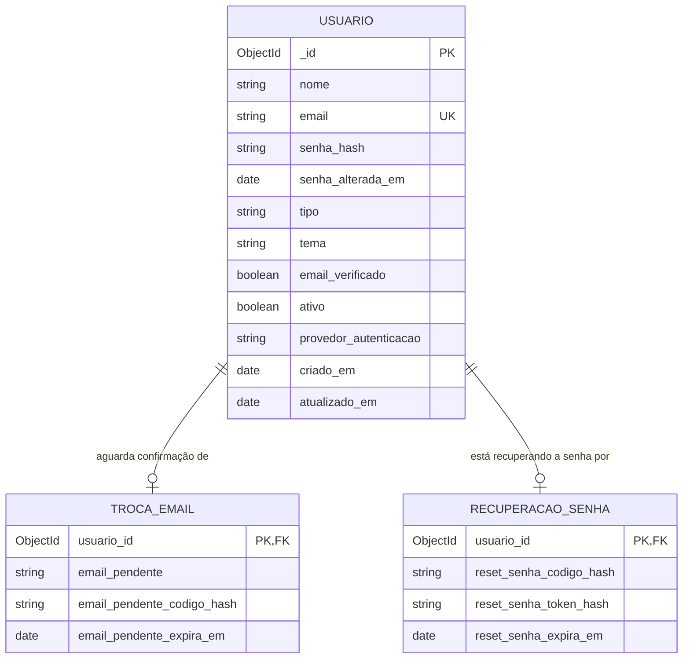

# Diagrama relacional — Configurações de usuário

> Padrão da disciplina · Módulo CFG · Visão lógica dos documentos MongoDB · Revisado em 26/11/2026

## Resumo

O banco é o MongoDB, que não tem tabelas: todos os dados deste módulo ficam no documento da conta, na coleção `usuarios`. O diagrama abaixo é uma **visão lógica**: ele separa em entidades próprias os grupos de campos temporários da troca de e-mail e da recuperação de senha, para deixar claras as chaves, as cardinalidades e as restrições. Só `USUARIO` corresponde a uma coleção. O aplicativo também guarda dois valores no aparelho, fora do MongoDB, descritos no [dicionário relacional](4%20-%20dicionario-dados-relacional-configuracoes-usuario.md).

## Diagrama

Figura 3 — Visão lógica relacional das configurações de usuário. Fonte: equipe Conecta+.

## Como as entidades lógicas viram documentos

| Entidade lógica     | Onde fica de verdade                                                                                     | Observação                                                                                       |
| ------------------- | -------------------------------------------------------------------------------------------------------- | ------------------------------------------------------------------------------------------------ |
| `USUARIO`           | coleção `usuarios`                                                                                       | Documento principal, um por conta.                                                               |
| `TROCA_EMAIL`       | campos `email_pendente`, `email_pendente_codigo_hash` e `email_pendente_expira_em` do documento em `usuarios` | Existe enquanto há uma troca de e-mail pedida e ainda não confirmada; no máximo uma por conta.   |
| `RECUPERACAO_SENHA` | campos `reset_senha_codigo_hash`, `reset_senha_token_hash` e `reset_senha_expira_em` do documento em `usuarios` | Existe enquanto há uma recuperação pedida e ainda não concluída; no máximo uma por conta.        |

`TROCA_EMAIL` e `RECUPERACAO_SENHA` não são subdocumentos: são campos soltos no primeiro nível do documento da conta. Por isso `usuario_id` aparece no diagrama como chave, mas não existe como campo gravado: ele é o `_id` do documento que contém os campos.

Os campos do cadastro e do login com Google que ficam no mesmo documento (`verificacao_email_codigo_hash`, `verificacao_email_expira_em`, `google_id` e `avatar_url`) não são usados por este módulo e estão no módulo [Cadastro de usuário](../cadastro-usuario/README.md).

## Regras de integridade

- `email` é único entre todas as contas, sempre em minúsculas;
- `TROCA_EMAIL.email_pendente` não pode ser igual ao `email` da própria conta nem ao de outra conta, conferido no pedido e de novo na confirmação;
- em `TROCA_EMAIL` e em `RECUPERACAO_SENHA`, o código só é aceito antes do horário guardado na validade; depois de usado, é apagado;
- em `RECUPERACAO_SENHA`, o código e o token não existem juntos: a verificação do código apaga o código e grava o token, e um novo pedido apaga o token e grava outro código;
- `senha_hash` e os campos de código e token guardam só hashes, nunca o valor digitado;
- `senha_alterada_em` é substituído a cada troca ou redefinição pelo horário do servidor naquele momento, e o servidor recusa os tokens emitidos antes dele.

## Rastreabilidade

RF-CFG-01 a RF-CFG-06; detalhado em [Dicionário relacional](4%20-%20dicionario-dados-relacional-configuracoes-usuario.md).
