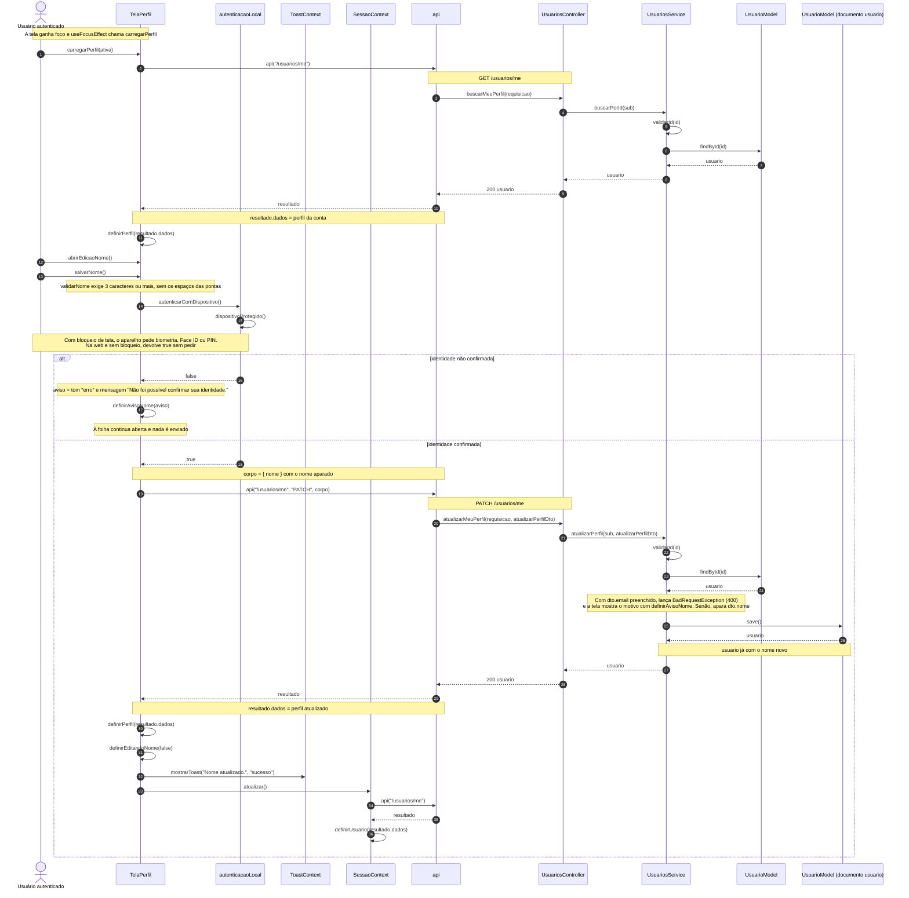
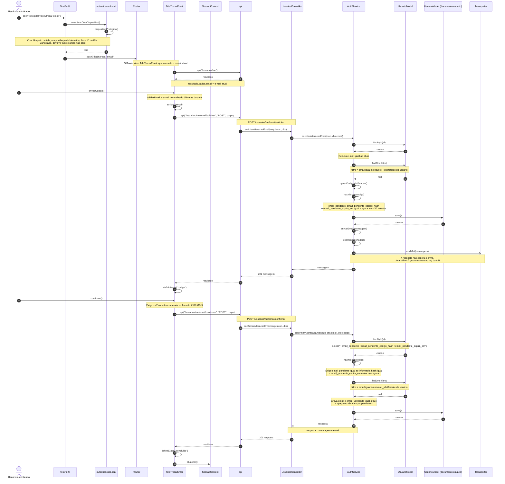
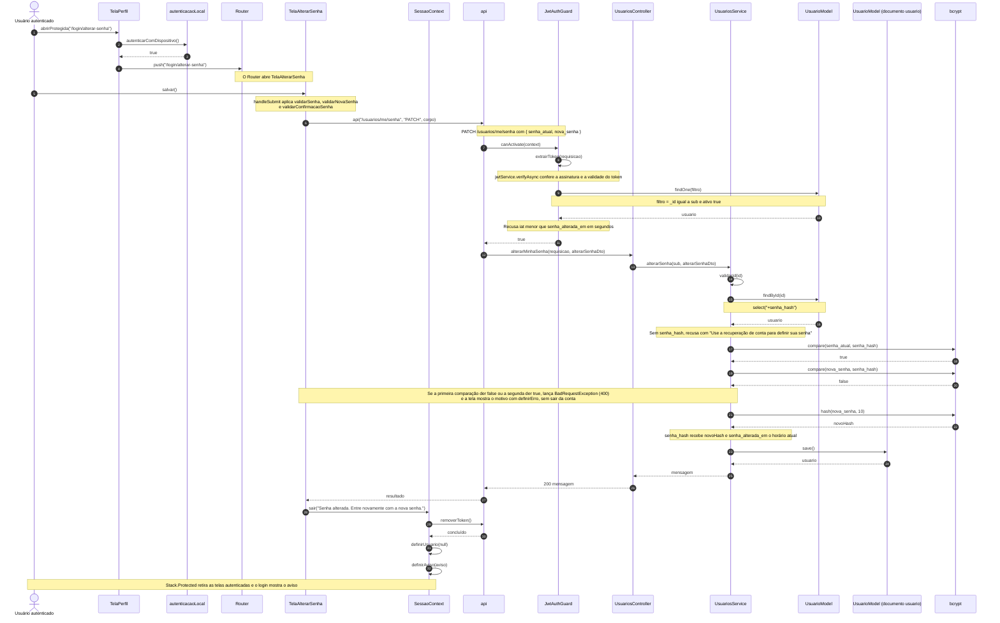
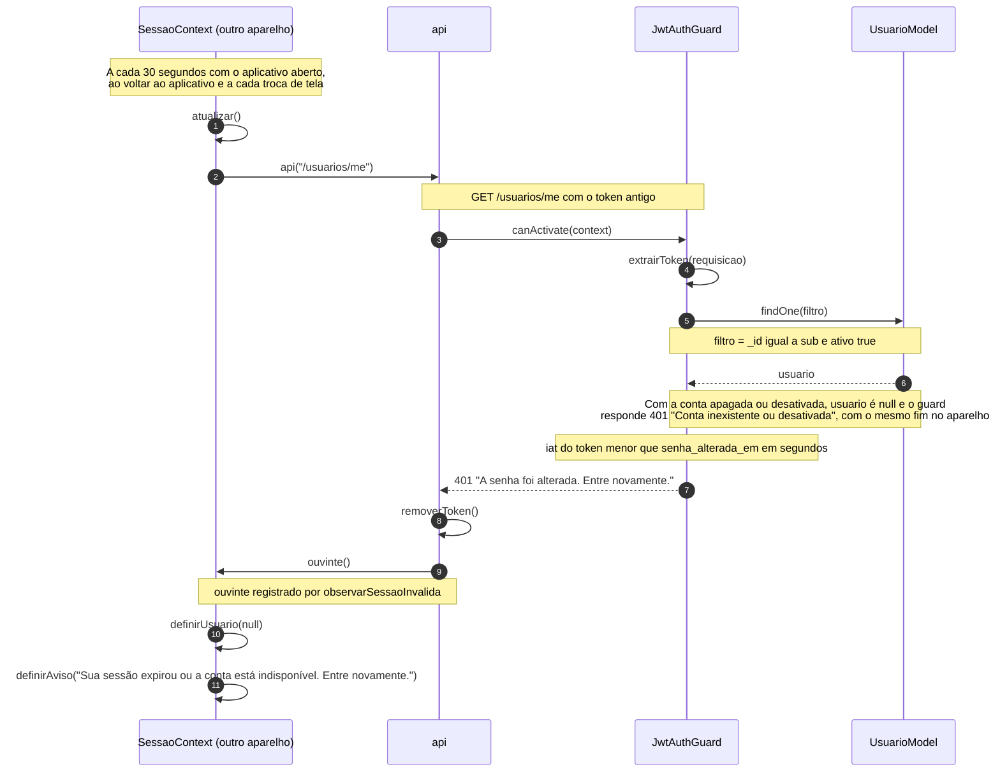
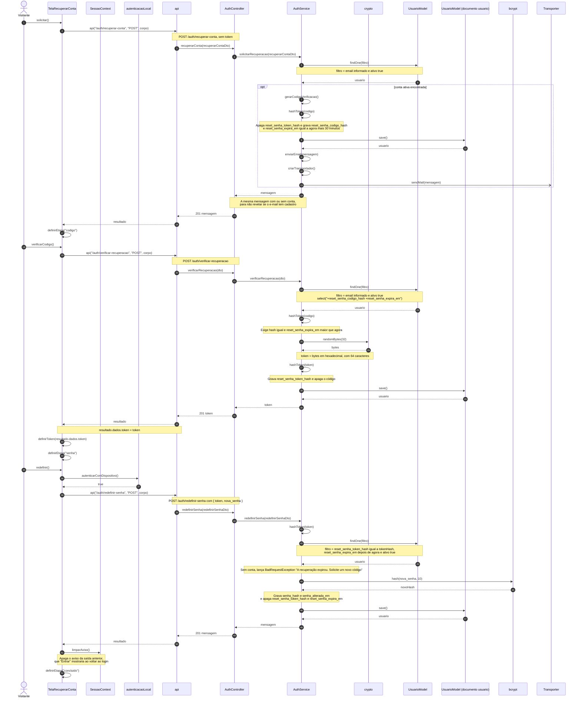
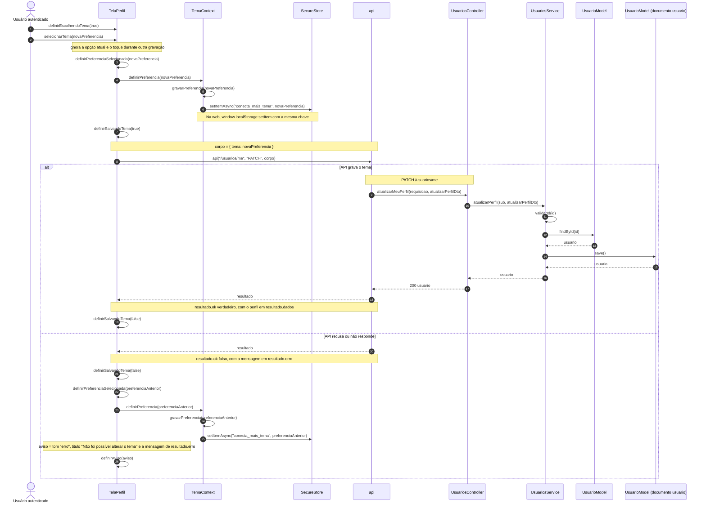
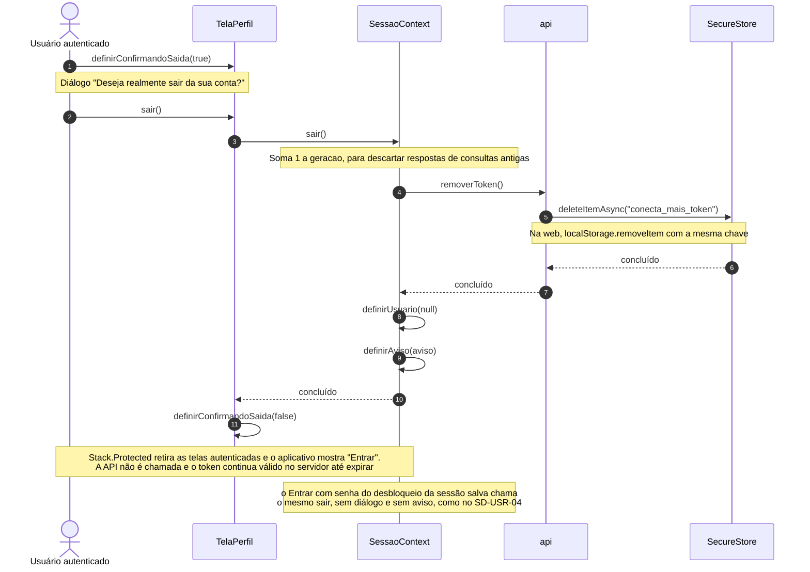

# Diagramas de sequência — Configurações de usuário

> Padrão da disciplina · Módulo CFG · Revisado em 27/11/2026

## Resumo

Há um diagrama para cada requisito de [Requisitos funcionais](2%20-%20requisitos-funcionais-configuracoes-usuario.md), com o mesmo número. As linhas de vida são classes e módulos que existem no código e estão no [Diagrama de classes](3%20-%20diagrama-classes-configuracoes-usuario.md): as telas do aplicativo, os contextos (`SessaoContext`, `TemaContext` e `ToastContext`), os módulos `api` e `autenticacaoLocal`, os controllers, os services, o guard, o model `UsuarioModel` e as bibliotecas chamadas diretamente (`Router`, `SecureStore`, `bcrypt`, `crypto` e `Transporter`). A linha de vida "UsuarioModel (documento usuario)" é o documento devolvido pelo model, no qual o service chama `save()`. Toda mensagem é a chamada de um método existente, com seus parâmetros, e as mensagens são numeradas na ordem em que acontecem. Regras que não são métodos, como comparar um código com o hash guardado, aparecem em notas. Os retornos são identificadores; uma nota diz o que cada um traz quando isso não é evidente.

Em todos os diagramas, a chamada do módulo `api` ao controller é uma requisição HTTP que passa antes pelo `ApiKeyGuard`; nas rotas `/usuarios/me…`, passa também pelo `JwtAuthGuard`, desenhado só no SD-CFG-03, onde ele decide o resultado. A rota está indicada na nota. O `resultado` devolvido pelo módulo `api` é o tipo `Resultado`: `ok` verdadeiro com `dados`, ou `ok` falso com `erro`.

## SD-CFG-01 — Alterar nome do perfil

## SD-CFG-02 — Trocar e-mail

## SD-CFG-03 — Alterar senha

Sessão aberta antes da troca, em outro aparelho:

## SD-CFG-04 — Recuperar conta

## SD-CFG-05 — Escolher tema

## SD-CFG-06 — Encerrar sessão

## Rastreabilidade

SD-CFG-01 a SD-CFG-06 correspondem, na mesma ordem, a UC-CFG-01 a UC-CFG-06 e a RF-CFG-01 a RF-CFG-06.
