# Diagrama de classes — Informações do sistema

> Padrão da disciplina · Módulo SIS · Revisado em 27/11/2026

## Resumo

O diagrama mostra as classes que participam das informações do sistema, agrupadas em três pacotes, um por camada: **Aplicativo** (telas, os componentes da própria tela "Sistema", os componentes de diálogo e de campo de texto e os módulos `api`, `ToastContext` e `versao`), **API** (guards, controller, serviço e o objeto de entrada do reset) e **Dados** (os models do Mongoose `UsuarioModel`, `OrganizacaoModel`, `ComissaoModel` e `ReuniaoModel`, marcados `<<Model Mongoose>>`, e os documentos guardados no MongoDB que o serviço conta, cria ou apaga). As bibliotecas chamadas diretamente nos [Diagramas de sequência](6%20-%20diagramas-sequencia-informacao-sistemas.md) (`Router`, `os`, `bcrypt` e, do Mongoose e do driver do MongoDB, `Connection`, `Db` e `Collection`) ficam fora dos pacotes, marcadas `<<biblioteca>>`, só com os métodos chamados. Toda linha de vida e todo método das sequências aparecem aqui. Cada atributo traz o seu tipo, e cada método traz o tipo dos parâmetros e do retorno. Toda classe e todo método do diagrama existem no código. Na `TelaSistema`, os métodos `definir*` são as funções de atualização do `useState`; o `ItemMenu` é o item "Sistema" da tela inicial. O único objeto de entrada é o `ResetarSistemaDto`, corpo do reset; as outras rotas não recebem corpo. O módulo não cria coleção própria.

## Diagrama

O diagrama está dividido em 13 partes, para que cada uma caiba na largura da página sem ser reduzida. Cada classe aparece completa, com atributos e métodos, em uma única parte. Quando uma ligação chega a uma classe detalhada em outra parte, essa classe é repetida só com o nome, e o texto abaixo da figura diz em que parte ela está completa. As partes 1 a 4 são do pacote **Aplicativo**, as partes 5 a 7 do pacote **API** e as partes 8 a 11 do pacote **Dados**, que também tem o `Contador`, na parte 12; as bibliotecas, fora dos pacotes, estão nas partes 12 e 13. As partes 3 e 7 não têm ligações próprias: as classes delas aparecem uma abaixo da outra, e as ligações estão nas partes indicadas abaixo de cada figura.

### Parte 1 — Tela inicial

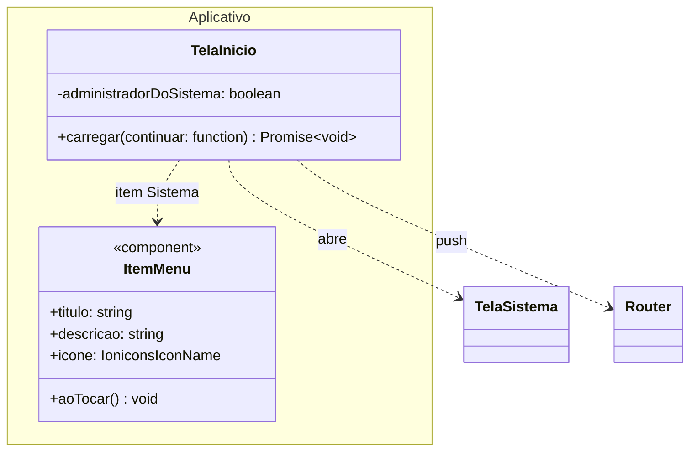

Figura 2 — Diagrama de classes das informações do sistema, parte 1: tela inicial e item "Sistema". Fonte: equipe Conecta+.

Só com o nome nesta parte: `TelaSistema` (parte 2); `Router` (parte 12).

### Parte 2 — Tela "Sistema"

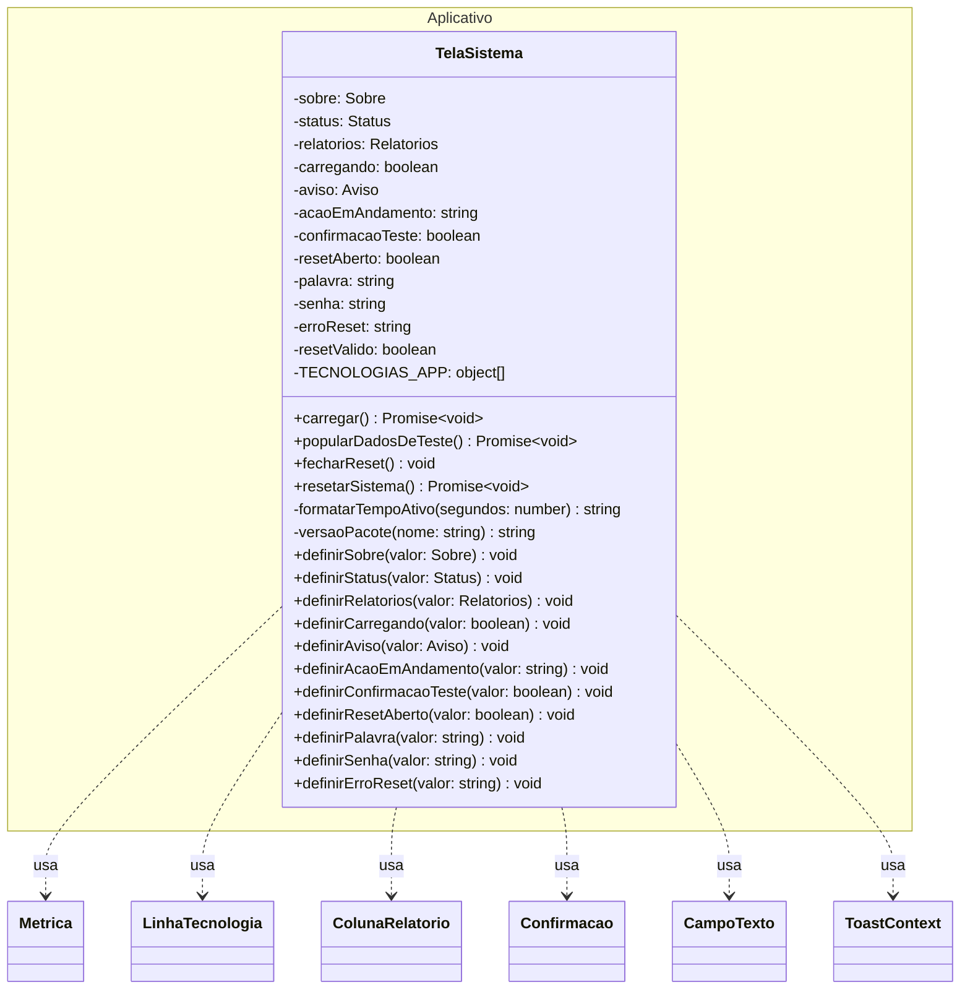

Figura 2 — Diagrama de classes das informações do sistema, parte 2: tela "Sistema". Fonte: equipe Conecta+.

Só com o nome nesta parte: `Metrica`, `LinhaTecnologia`, `ColunaRelatorio`, `Confirmacao`, `CampoTexto` e `ToastContext` (parte 3). Ligações em outras partes: `TelaSistema` (partes 1 e 4).

### Parte 3 — Componentes da tela "Sistema"

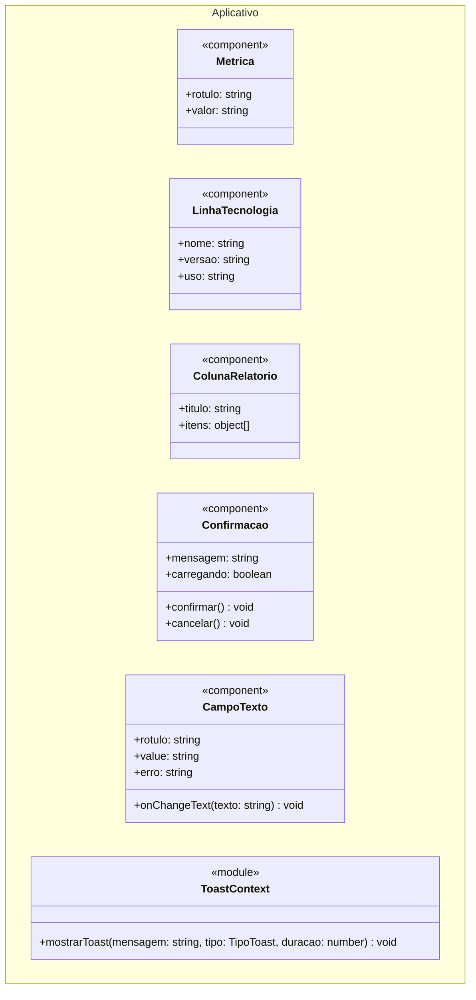

Figura 2 — Diagrama de classes das informações do sistema, parte 3: componentes da tela "Sistema" e `ToastContext`. Fonte: equipe Conecta+.

Ligações em outras partes: `Metrica`, `LinhaTecnologia`, `ColunaRelatorio`, `Confirmacao`, `CampoTexto` e `ToastContext` (parte 2).

### Parte 4 — Módulos `api` e `versao`

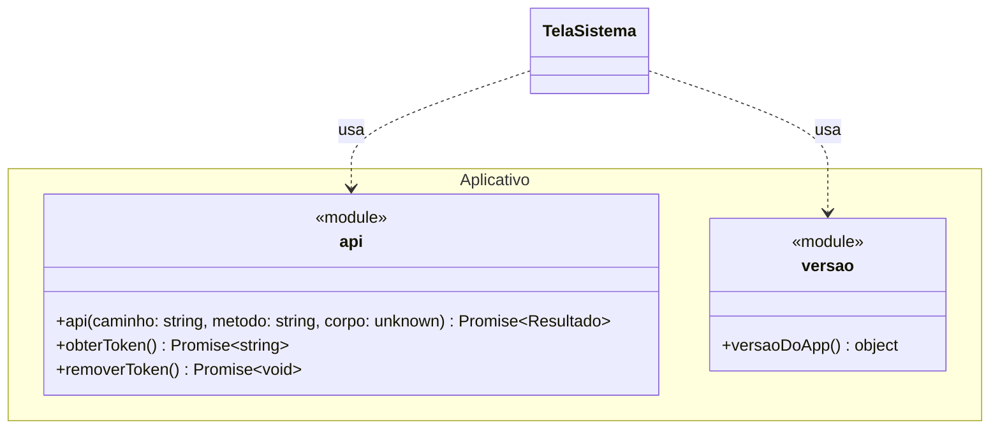

Figura 2 — Diagrama de classes das informações do sistema, parte 4: módulos `api` e `versao`. Fonte: equipe Conecta+.

Só com o nome nesta parte: `TelaSistema` (parte 2). Ligações em outras partes: `api` (parte 5).

### Parte 5 — Controller

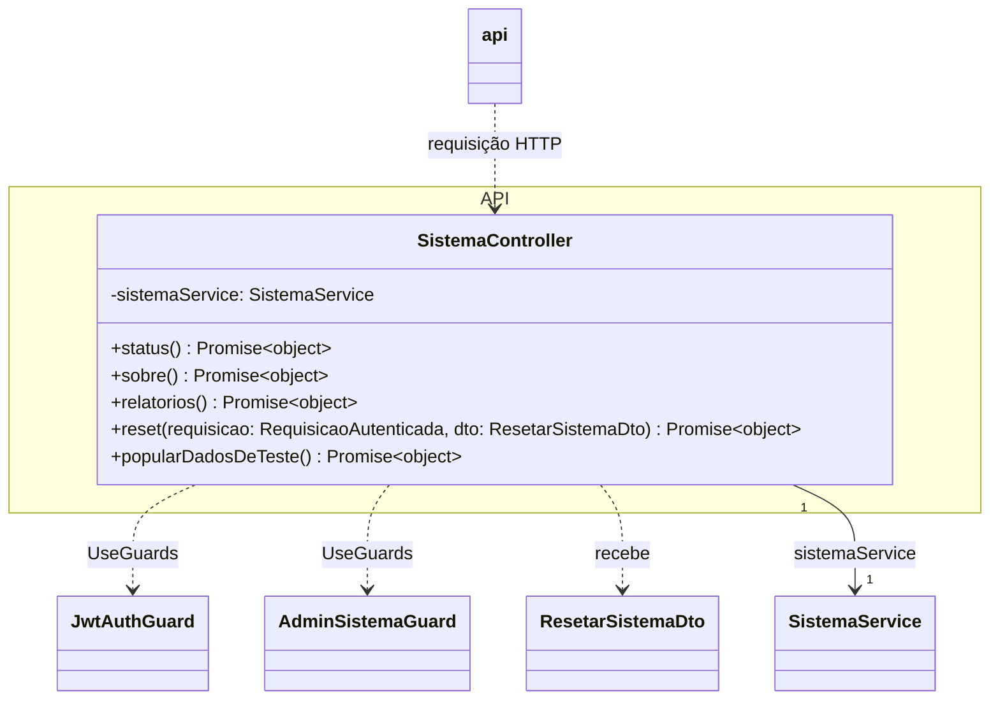

Figura 2 — Diagrama de classes das informações do sistema, parte 5: controller. Fonte: equipe Conecta+.

Só com o nome nesta parte: `api` (parte 4); `SistemaService` (parte 6); `JwtAuthGuard`, `AdminSistemaGuard` e `ResetarSistemaDto` (parte 7).

### Parte 6 — Serviço

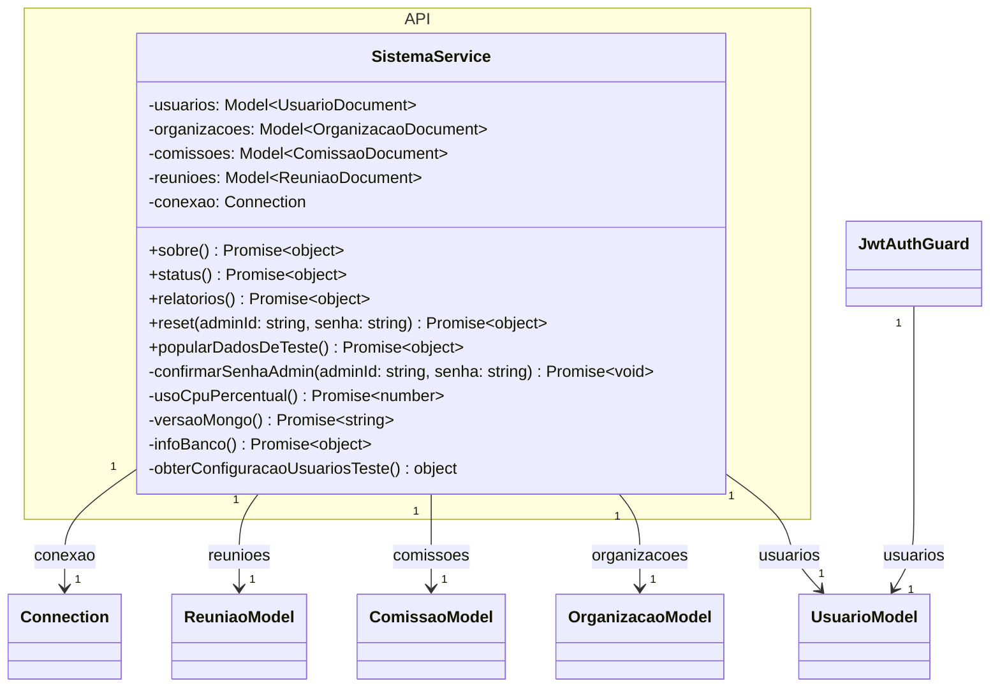

Figura 2 — Diagrama de classes das informações do sistema, parte 6: serviço. Fonte: equipe Conecta+.

Só com o nome nesta parte: `JwtAuthGuard` (parte 7); `ReuniaoModel` (parte 8); `ComissaoModel` (parte 9); `OrganizacaoModel` (parte 10); `UsuarioModel` (parte 11); `Connection` (parte 12). Ligações em outras partes: `SistemaService` (partes 5 e 13).

### Parte 7 — Guards e DTO do reset

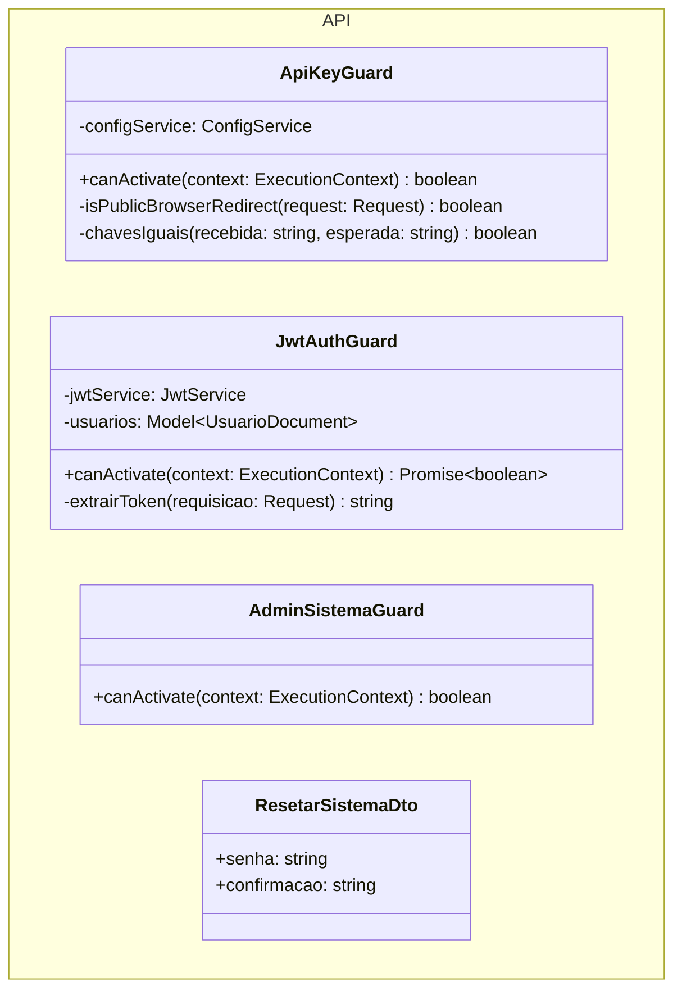

Figura 2 — Diagrama de classes das informações do sistema, parte 7: guards e DTO do reset. Fonte: equipe Conecta+.

Ligações em outras partes: `JwtAuthGuard` (partes 5 e 6); `AdminSistemaGuard` e `ResetarSistemaDto` (parte 5).

### Parte 8 — Reunião e ata

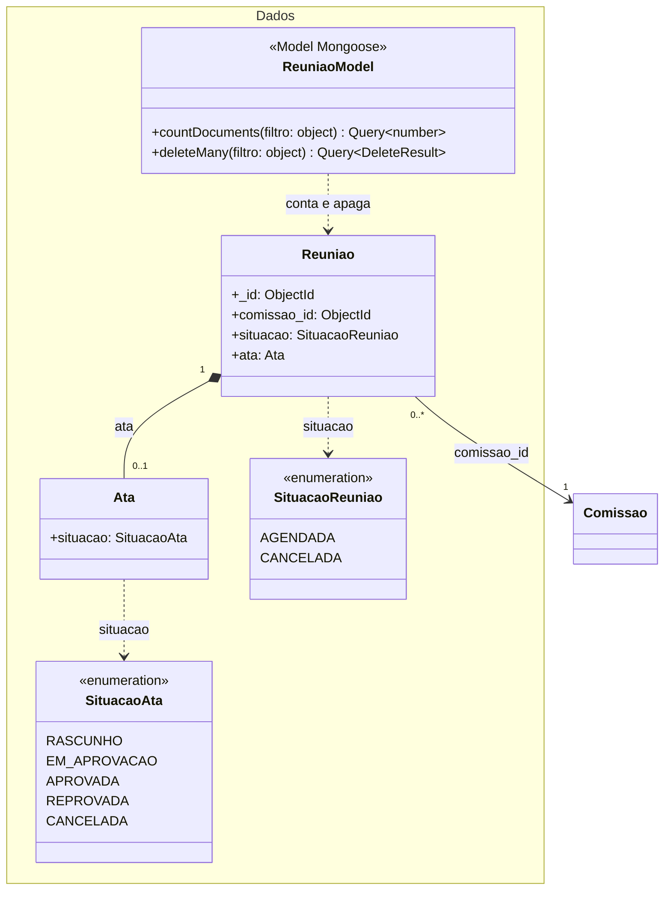

Figura 2 — Diagrama de classes das informações do sistema, parte 8: model, documentos e enums da reunião e da ata. Fonte: equipe Conecta+.

Só com o nome nesta parte: `Comissao` (parte 9). Ligações em outras partes: `ReuniaoModel` (parte 6).

### Parte 9 — Comissão

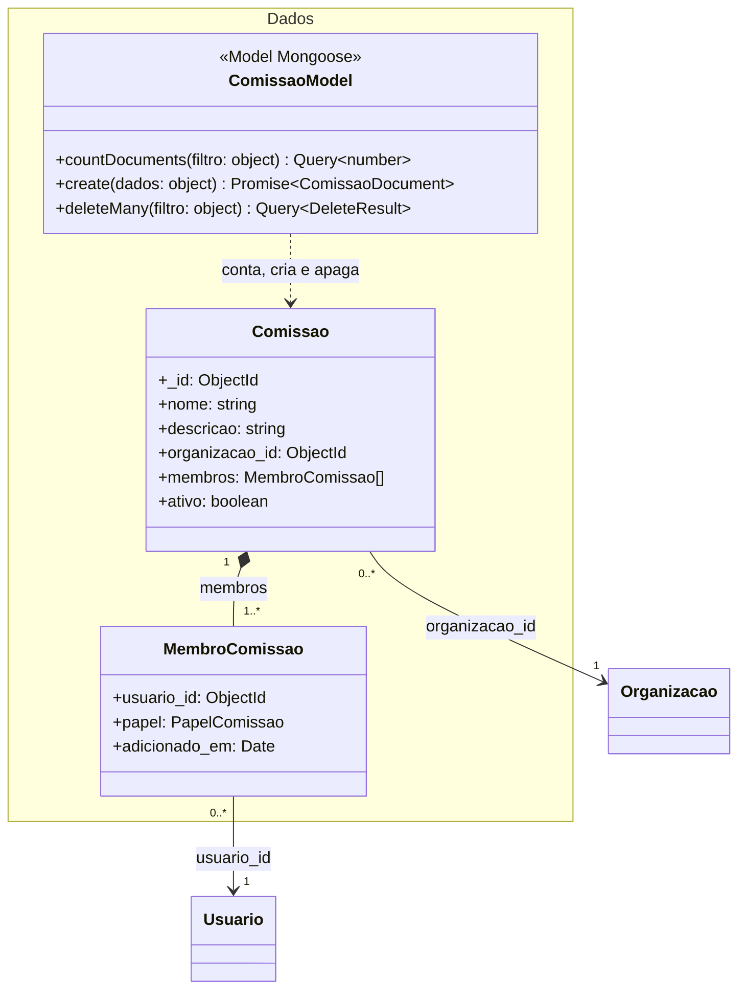

Figura 2 — Diagrama de classes das informações do sistema, parte 9: model e documentos da comissão. Fonte: equipe Conecta+.

Só com o nome nesta parte: `Organizacao` (parte 10); `Usuario` (parte 11). Ligações em outras partes: `ComissaoModel` (parte 6); `Comissao` (parte 8).

### Parte 10 — Organização

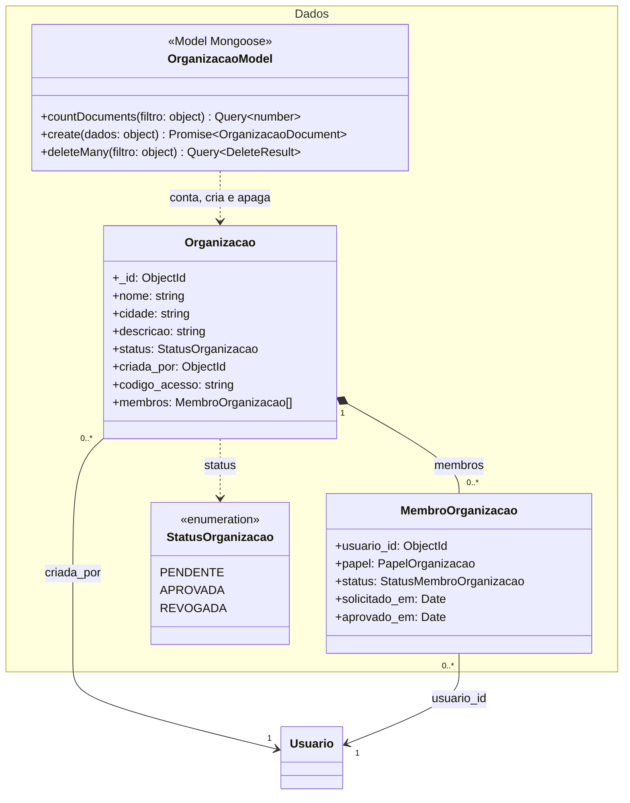

Figura 2 — Diagrama de classes das informações do sistema, parte 10: model, documentos e enum da organização. Fonte: equipe Conecta+.

Só com o nome nesta parte: `Usuario` (parte 11). Ligações em outras partes: `OrganizacaoModel` (parte 6); `Organizacao` (parte 9).

### Parte 11 — Usuário e notificação

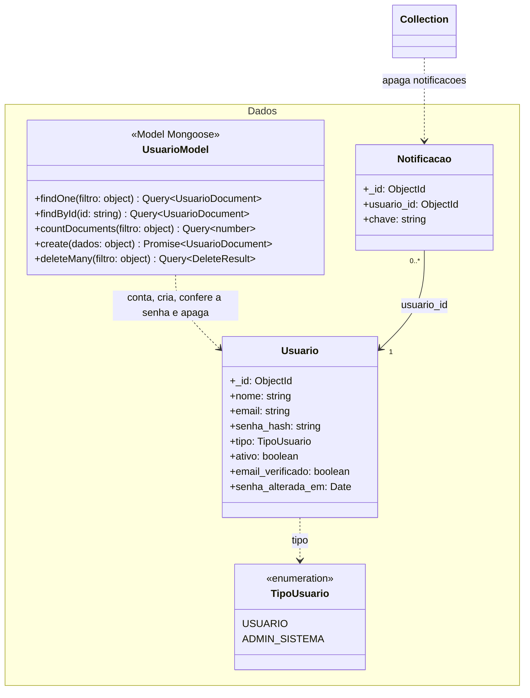

Figura 2 — Diagrama de classes das informações do sistema, parte 11: model, documento e enum do usuário e documento da notificação. Fonte: equipe Conecta+.

Só com o nome nesta parte: `Collection` (parte 12). Ligações em outras partes: `UsuarioModel` (parte 6); `Usuario` (partes 9 e 10).

### Parte 12 — Conexão com o MongoDB, contador e `Router`

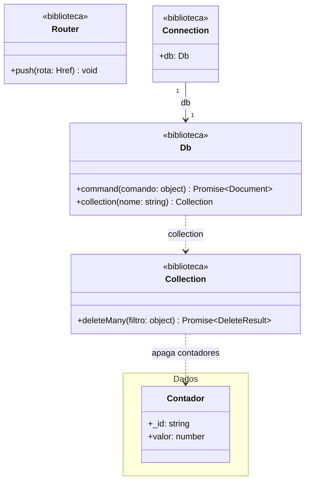

Figura 2 — Diagrama de classes das informações do sistema, parte 12: bibliotecas `Router`, `Connection`, `Db` e `Collection` e documento do contador. Fonte: equipe Conecta+.

Ligações em outras partes: `Router` (parte 1); `Connection` (parte 6); `Collection` (parte 11).

### Parte 13 — Bibliotecas `os` e `bcrypt`

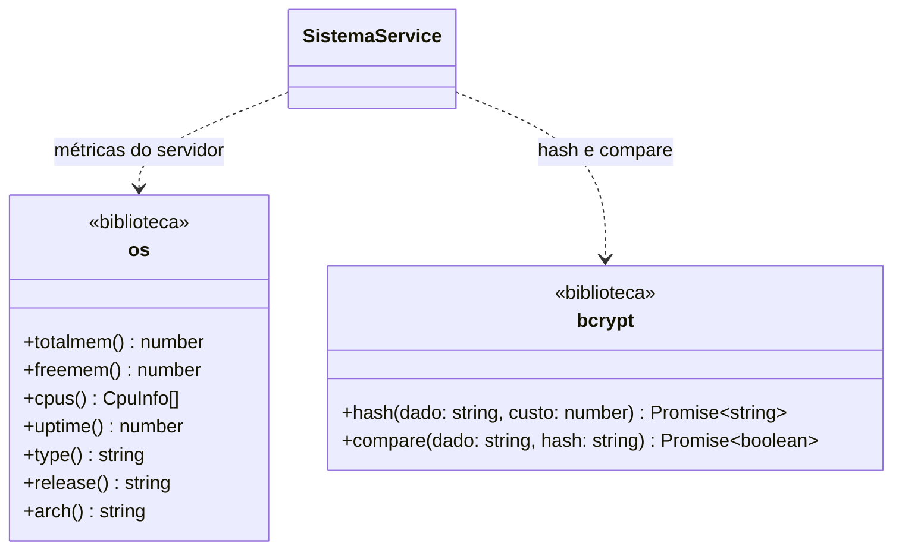

Figura 2 — Diagrama de classes das informações do sistema, parte 13: bibliotecas `os` e `bcrypt`. Fonte: equipe Conecta+.

Só com o nome nesta parte: `SistemaService` (parte 6).

## Como ler as ligações

| Ligação                      | Significado                                                             | Exemplo no diagrama                                                                                                      |
| ---------------------------- | ----------------------------------------------------------------------- | ------------------------------------------------------------------------------------------------------------------------ |
| Losango cheio (composição)   | A parte só existe dentro do todo e é apagada junto com ele.             | `Reuniao *-- Ata` (parte 8): a ata fica dentro do documento da reunião e some quando o reset apaga a reunião.             |
| Seta cheia (associação)      | Uma classe guarda uma referência a outra, que existe por conta própria. | `Comissao --> Organizacao` (parte 9): `organizacao_id` guarda o identificador de um documento de `organizacoes`.          |
| Seta tracejada (dependência) | Uma classe usa a outra em uma chamada, sem guardá-la como atributo.     | `SistemaService ..> os` (parte 13): o serviço lê memória, processadores e tempo ativo do computador a cada consulta.     |

Os números nas pontas são as multiplicidades. Por exemplo, uma `Comissao` tem pelo menos um membro (`1..*`), porque o schema exige exatamente um `RESPONSAVEL`; uma `Organizacao` pode ter nenhum ou muitos membros (`0..*`); uma `Reuniao` tem no máximo uma ata atual (`0..1`). O `SistemaService` guarda uma instância de cada model e a `Connection` (`1`), injetadas pelo NestJS; cada model conta, cria e apaga os documentos do seu schema.

`SistemaService` não usa um model para `Contador`, para `Notificacao` nem para os arquivos do GridFS: apaga as coleções `contadores`, `notificacoes`, `anexos.files` e `anexos.chunks` pela conexão do Mongoose, chamando `conexao.db.collection(nome).deleteMany({})`: `db` é o `Db` do driver do MongoDB, `collection` devolve a `Collection` e `deleteMany` apaga os documentos dela. O mesmo `Db` envia ao MongoDB os comandos `ping`, `dbStats` e `buildInfo` com `command`. Por isso as ligações com `Contador` e `Notificacao` são de dependência, a partir da `Collection`, e os arquivos do GridFS, que não têm classe no código, aparecem apenas no [diagrama relacional](4%20-%20diagrama-relacional-informacao-sistemas.md). A `Ata` aparece só com o campo `situacao`, o único que este módulo usa.

Os métodos do controller e do serviço devolvem objetos montados na hora, sem classe própria no código; por isso o retorno aparece como `Promise<object>`. Os campos de cada objeto estão no [dicionário de classes](3%20-%20dicionario-dados-classes-informacao-sistemas.md). `Sobre`, `Status`, `Relatorios` e `Aviso`, na `TelaSistema`, são tipos TypeScript do aplicativo, também descritos lá. `Metrica`, `LinhaTecnologia` e `ColunaRelatorio` são componentes declarados no mesmo arquivo da `TelaSistema`; `formatarTempoAtivo`, `versaoPacote` e `TECNOLOGIAS_APP` também ficam nesse arquivo, fora do componente. O `ResetarSistemaDto` é validado pelo `ValidationPipe` antes do controller; o controller repassa ao serviço só a `senha` e o `sub` da requisição.

Os guards não chamam uns aos outros: o NestJS executa o método `canActivate` de cada um, na ordem `ApiKeyGuard`, `JwtAuthGuard`, `AdminSistemaGuard`, antes de chamar o controller. `JwtAuthGuard` e `AdminSistemaGuard` estão declarados no decorador `@UseGuards` do `SistemaController`, por isso aparecem como dependências dele. `ApiKeyGuard` vale para toda a API, registrado como `APP_GUARD` em `AppModule`, e por isso não tem ligação com uma classe deste módulo.

## Rotas atendidas pelo controller

As rotas HTTP não são métodos; por isso ficam nesta tabela, e não no diagrama.

| Método do controller  | Rota HTTP                     |
| --------------------- | ----------------------------- |
| `status`              | `GET /sistema/status`         |
| `sobre`               | `GET /sistema/sobre`          |
| `relatorios`          | `GET /sistema/relatorios`     |
| `reset`               | `POST /sistema/reset`         |
| `popularDadosDeTeste` | `POST /sistema/popular-teste` |

## Regras representadas

- só a conta com `tipo` igual a `ADMIN_SISTEMA` passa pelo `AdminSistemaGuard`;
- `SistemaService` lê e grava diretamente nas coleções de outros módulos; ele não tem schema próprio;
- o reset só chega ao serviço quando o corpo traz `confirmacao` igual a "RESET" e uma `senha` em texto, e só apaga algo depois que `confirmarSenhaAdmin` confere essa senha com o `senha_hash` da conta;
- o reset apaga `Organizacao`, `Comissao`, `Reuniao`, `Contador`, `Notificacao` e os arquivos do GridFS por inteiro, com tudo o que está dentro deles, e de `Usuario` só as contas cujo `tipo` não é `ADMIN_SISTEMA`;
- o aplicativo nunca calcula os totais: ele mostra o que a API devolve; só as versões das bibliotecas do aplicativo e a versão do aplicativo são lidas no próprio aparelho.

## Rastreabilidade

RF-SIS-01 a RF-SIS-05; complementado por [Dicionário de classes](3%20-%20dicionario-dados-classes-informacao-sistemas.md) e [Diagramas de sequência](6%20-%20diagramas-sequencia-informacao-sistemas.md).
