# Diagrama de classes — Informações do sistema

> Padrão da disciplina · Módulo SIS · Revisado em 27/11/2026

## Resumo

O diagrama mostra as classes que participam das informações do sistema, agrupadas em três pacotes, um por camada: **Aplicativo** (telas, os componentes da própria tela "Sistema", os componentes de diálogo e de campo de texto e os módulos `api`, `ToastContext` e `versao`), **API** (guards, controller, serviço e o objeto de entrada do reset) e **Dados** (documentos guardados no MongoDB que o serviço conta, cria ou apaga). Cada atributo traz o seu tipo, e cada método traz o tipo dos parâmetros e do retorno. Toda classe e todo método do diagrama existem no código. O único objeto de entrada é o `ResetarSistemaDto`, corpo do reset; as outras rotas não recebem corpo. O módulo não cria coleção própria.

## Diagrama

```mermaid
classDiagram
    direction LR

    namespace Aplicativo {
        class TelaInicio {
            -administradorDoSistema: boolean
            +carregar(continuar: function) Promise~void~
        }
        class TelaSistema {
            -sobre: Sobre
            -status: Status
            -relatorios: Relatorios
            -carregando: boolean
            -aviso: Aviso
            -acaoEmAndamento: string
            -confirmacaoTeste: boolean
            -resetAberto: boolean
            -palavra: string
            -senha: string
            -erroReset: string
            -resetValido: boolean
            -TECNOLOGIAS_APP: object[]
            +carregar() Promise~void~
            +popularDadosDeTeste() Promise~void~
            +fecharReset() void
            +resetarSistema() Promise~void~
            -formatarTempoAtivo(segundos: number) string
            -versaoPacote(nome: string) string
        }
        class Metrica {
            <<component>>
            +rotulo: string
            +valor: string
        }
        class LinhaTecnologia {
            <<component>>
            +nome: string
            +versao: string
            +uso: string
        }
        class ColunaRelatorio {
            <<component>>
            +titulo: string
            +itens: object[]
        }
        class Confirmacao {
            <<component>>
            +mensagem: string
            +carregando: boolean
            +confirmar() void
            +cancelar() void
        }
        class CampoTexto {
            <<component>>
            +rotulo: string
            +value: string
            +erro: string
            +onChangeText(texto: string) void
        }
        class api {
            <<module>>
            +api(caminho: string, metodo: string, corpo: unknown) Promise~Resultado~
            +obterToken() Promise~string~
            +removerToken() Promise~void~
        }
        class ToastContext {
            <<module>>
            +mostrarToast(mensagem: string, tipo: TipoToast, duracao: number) void
        }
        class versao {
            <<module>>
            +versaoDoApp() object
        }
    }

    namespace API {
        class ApiKeyGuard {
            -configService: ConfigService
            +canActivate(context: ExecutionContext) boolean
            -isPublicBrowserRedirect(request: Request) boolean
            -chavesIguais(recebida: string, esperada: string) boolean
        }
        class JwtAuthGuard {
            -jwtService: JwtService
            -usuarios: Model~Usuario~
            +canActivate(context: ExecutionContext) Promise~boolean~
            -extrairToken(requisicao: Request) string
        }
        class AdminSistemaGuard {
            +canActivate(context: ExecutionContext) boolean
        }
        class SistemaController {
            -sistemaService: SistemaService
            +status() Promise~object~
            +sobre() Promise~object~
            +relatorios() Promise~object~
            +reset(requisicao: RequisicaoAutenticada, dto: ResetarSistemaDto) Promise~object~
            +popularDadosDeTeste() Promise~object~
        }
        class ResetarSistemaDto {
            +senha: string
            +confirmacao: string
        }
        class SistemaService {
            -usuarios: Model~Usuario~
            -organizacoes: Model~Organizacao~
            -comissoes: Model~Comissao~
            -reunioes: Model~Reuniao~
            -conexao: Connection
            +sobre() Promise~object~
            +status() Promise~object~
            +relatorios() Promise~object~
            +reset(adminId: string, senha: string) Promise~object~
            +popularDadosDeTeste() Promise~object~
            -confirmarSenhaAdmin(adminId: string, senha: string) Promise~void~
            -usoCpuPercentual() Promise~number~
            -versaoMongo() Promise~string~
            -infoBanco() Promise~object~
            -obterConfiguracaoUsuariosTeste() object
        }
    }

    namespace Dados {
        class Usuario {
            +_id: ObjectId
            +nome: string
            +email: string
            +senha_hash: string
            +tipo: TipoUsuario
            +ativo: boolean
            +email_verificado: boolean
            +senha_alterada_em: Date
        }
        class Organizacao {
            +_id: ObjectId
            +nome: string
            +cidade: string
            +descricao: string
            +status: StatusOrganizacao
            +criada_por: ObjectId
            +codigo_acesso: string
            +membros: MembroOrganizacao[]
        }
        class MembroOrganizacao {
            +usuario_id: ObjectId
            +papel: PapelOrganizacao
            +status: StatusMembroOrganizacao
            +solicitado_em: Date
            +aprovado_em: Date
        }
        class Comissao {
            +_id: ObjectId
            +nome: string
            +descricao: string
            +organizacao_id: ObjectId
            +membros: MembroComissao[]
            +ativo: boolean
        }
        class MembroComissao {
            +usuario_id: ObjectId
            +papel: PapelComissao
            +adicionado_em: Date
        }
        class Reuniao {
            +_id: ObjectId
            +comissao_id: ObjectId
            +situacao: SituacaoReuniao
            +ata: Ata
        }
        class Ata {
            +situacao: SituacaoAta
        }
        class Contador {
            +_id: string
            +valor: number
        }
        class Notificacao {
            +_id: ObjectId
            +usuario_id: ObjectId
            +chave: string
        }
        class TipoUsuario {
            <<enumeration>>
            USUARIO
            ADMIN_SISTEMA
        }
        class StatusOrganizacao {
            <<enumeration>>
            PENDENTE
            APROVADA
            REVOGADA
        }
        class SituacaoReuniao {
            <<enumeration>>
            AGENDADA
            CANCELADA
        }
        class SituacaoAta {
            <<enumeration>>
            RASCUNHO
            EM_APROVACAO
            APROVADA
            REPROVADA
            CANCELADA
        }
    }

    TelaInicio ..> TelaSistema : abre
    TelaSistema ..> Metrica : usa
    TelaSistema ..> LinhaTecnologia : usa
    TelaSistema ..> ColunaRelatorio : usa
    TelaSistema ..> Confirmacao : usa
    TelaSistema ..> CampoTexto : usa
    TelaSistema ..> ToastContext : usa
    TelaSistema ..> versao : usa
    TelaSistema ..> api : usa
    api ..> SistemaController : requisição HTTP
    SistemaController ..> JwtAuthGuard : UseGuards
    SistemaController ..> AdminSistemaGuard : UseGuards
    SistemaController ..> ResetarSistemaDto : recebe
    JwtAuthGuard ..> Usuario : confere a conta

    SistemaController --> "1" SistemaService : sistemaService
    SistemaService ..> Usuario : conta, cria, confere a senha e apaga
    SistemaService ..> Organizacao : conta, cria e apaga
    SistemaService ..> Comissao : conta, cria e apaga
    SistemaService ..> Reuniao : conta e apaga
    SistemaService ..> Contador : apaga pela conexão
    SistemaService ..> Notificacao : apaga pela conexão

    Organizacao "1" *-- "0..*" MembroOrganizacao : membros
    Comissao "1" *-- "1..*" MembroComissao : membros
    Reuniao "1" *-- "0..1" Ata : ata
    Organizacao "0..*" --> "1" Usuario : criada_por
    MembroOrganizacao "0..*" --> "1" Usuario : usuario_id
    MembroComissao "0..*" --> "1" Usuario : usuario_id
    Comissao "0..*" --> "1" Organizacao : organizacao_id
    Reuniao "0..*" --> "1" Comissao : comissao_id
    Notificacao "0..*" --> "1" Usuario : usuario_id
    Usuario ..> TipoUsuario : tipo
    Organizacao ..> StatusOrganizacao : status
    Reuniao ..> SituacaoReuniao : situacao
    Ata ..> SituacaoAta : situacao
```

Figura 2 — Diagrama de classes das informações do sistema, por camada. Fonte: equipe Conecta+.

## Como ler as ligações

| Ligação                      | Significado                                                             | Exemplo no diagrama                                                                                                      |
| ---------------------------- | ----------------------------------------------------------------------- | ------------------------------------------------------------------------------------------------------------------------ |
| Losango cheio (composição)   | A parte só existe dentro do todo e é apagada junto com ele.             | `Reuniao *-- Ata`: a ata fica dentro do documento da reunião e some quando o reset apaga a reunião.                       |
| Seta cheia (associação)      | Uma classe guarda uma referência a outra, que existe por conta própria. | `Comissao --> Organizacao`: `organizacao_id` guarda o identificador de um documento de `organizacoes`.                    |
| Seta tracejada (dependência) | Uma classe usa a outra em uma chamada, sem guardá-la como atributo.     | `SistemaService ..> Reuniao`: o serviço só chama `countDocuments` e `deleteMany` no model das reuniões.                  |

Os números nas pontas são as multiplicidades. Por exemplo, uma `Comissao` tem pelo menos um membro (`1..*`), porque o schema exige exatamente um `RESPONSAVEL`; uma `Organizacao` pode ter nenhum ou muitos membros (`0..*`); uma `Reuniao` tem no máximo uma ata atual (`0..1`).

`SistemaService` não usa um model para `Contador`, para `Notificacao` nem para os arquivos do GridFS: apaga as coleções `contadores`, `notificacoes`, `anexos.files` e `anexos.chunks` pela conexão do Mongoose, chamando `conexao.db.collection(nome).deleteMany({})`. A mesma conexão envia ao MongoDB os comandos `ping`, `dbStats` e `buildInfo`. Por isso as ligações com `Contador` e `Notificacao` são de dependência, e os arquivos do GridFS, que não têm classe no código, aparecem apenas no [diagrama relacional](4%20-%20diagrama-relacional-informacao-sistemas.md). A `Ata` aparece só com o campo `situacao`, o único que este módulo usa.

Os métodos do controller e do serviço devolvem objetos montados na hora, sem classe própria no código; por isso o retorno aparece como `Promise<object>`. Os campos de cada objeto estão no [dicionário de classes](3%20-%20dicionario-dados-classes-informacao-sistemas.md). `Sobre`, `Status`, `Relatorios` e `Aviso`, na `TelaSistema`, são tipos TypeScript do aplicativo, também descritos lá. `Metrica`, `LinhaTecnologia` e `ColunaRelatorio` são componentes declarados no mesmo arquivo da `TelaSistema`; `formatarTempoAtivo`, `versaoPacote` e `TECNOLOGIAS_APP` também ficam nesse arquivo, fora do componente. O `ResetarSistemaDto` é validado pelo `ValidationPipe` antes do controller; o controller repassa ao serviço só a `senha` e o `sub` da requisição.

Os guards não chamam uns aos outros: o NestJS executa o método `canActivate` de cada um, na ordem `ApiKeyGuard`, `JwtAuthGuard`, `AdminSistemaGuard`, antes de chamar o controller. `JwtAuthGuard` e `AdminSistemaGuard` estão declarados no decorador `@UseGuards` do `SistemaController`, por isso aparecem como dependências dele. `ApiKeyGuard` vale para toda a API, registrado como `APP_GUARD` em `AppModule`, e por isso não tem ligação com uma classe deste módulo.

## Rotas atendidas pelo controller

As rotas HTTP não são métodos; por isso ficam nesta tabela, e não no diagrama.

| Método do controller  | Rota HTTP                     |
| --------------------- | ----------------------------- |
| `status`              | `GET /sistema/status`         |
| `sobre`               | `GET /sistema/sobre`          |
| `relatorios`          | `GET /sistema/relatorios`     |
| `reset`               | `POST /sistema/reset`         |
| `popularDadosDeTeste` | `POST /sistema/popular-teste` |

## Regras representadas

- só a conta com `tipo` igual a `ADMIN_SISTEMA` passa pelo `AdminSistemaGuard`;
- `SistemaService` lê e grava diretamente nas coleções de outros módulos; ele não tem schema próprio;
- o reset só chega ao serviço quando o corpo traz `confirmacao` igual a "RESET" e uma `senha` em texto, e só apaga algo depois que `confirmarSenhaAdmin` confere essa senha com o `senha_hash` da conta;
- o reset apaga `Organizacao`, `Comissao`, `Reuniao` e `Notificacao` por inteiro, com tudo o que está dentro delas, e de `Usuario` só as contas cujo `tipo` não é `ADMIN_SISTEMA`;
- o aplicativo nunca calcula os totais: ele mostra o que a API devolve; só as versões das bibliotecas do aplicativo e a versão do aplicativo são lidas no próprio aparelho.

## Rastreabilidade

RF-SIS-01 a RF-SIS-05; complementado por [Dicionário de classes](3%20-%20dicionario-dados-classes-informacao-sistemas.md) e [Diagramas de sequência](6%20-%20diagramas-sequencia-informacao-sistemas.md).
