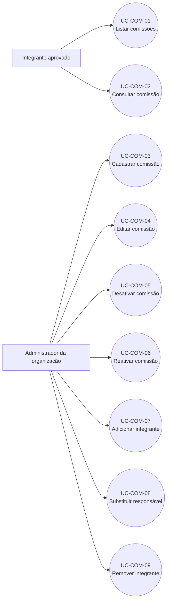

# Casos de uso — Cadastro de comissão

> Padrão do Incremento 1 · Fontes: FRONTEND `792fab4` e BACKEND `6f2ffc4`

## Resumo

Este documento descreve como integrantes autorizados consultam comissões e como administradores aprovados da organização criam, editam, ativam e gerenciam a equipe. Toda comissão deve possuir exatamente um responsável.

## Diagrama geral

## Resumo dos casos de uso

| ID        | Nome                       | Ator principal               | Resultado                               |
| --------- | -------------------------- | ---------------------------- | --------------------------------------- |
| UC-COM-01 | Listar e filtrar comissões | Integrante aprovado          | Lista permitida exibida.                |
| UC-COM-02 | Consultar comissão         | Integrante aprovado          | Dados e equipe exibidos.                |
| UC-COM-03 | Cadastrar comissão         | Administrador da organização | Comissão ativa com um responsável.      |
| UC-COM-04 | Editar comissão            | Administrador da organização | Dados atualizados.                      |
| UC-COM-05 | Desativar comissão         | Administrador da organização | Comissão inativa, sem apagar dados.     |
| UC-COM-06 | Reativar comissão          | Administrador da organização | Comissão novamente ativa.               |
| UC-COM-07 | Adicionar integrante       | Administrador da organização | Novo membro inserido.                   |
| UC-COM-08 | Substituir responsável     | Administrador da organização | Novo responsável definido atomicamente. |
| UC-COM-09 | Remover integrante         | Administrador da organização | Membro comum removido.                  |

## Especificações

### UC-COM-01 — Listar e filtrar comissões

| Campo                       | Especificação                                                                                                                                                                          |
| --------------------------- | -------------------------------------------------------------------------------------------------------------------------------------------------------------------------------------- |
| **Resumo**                  | Consultar as comissões acessíveis e aplicar busca e filtro de situação.                                                                                                                |
| **Ator principal**          | Integrante aprovado.                                                                                                                                                                   |
| **Gatilho**                 | Abrir a tela de comissões.                                                                                                                                                             |
| **Pré-condições**           | Conta ativa, JWT válido e vínculo aprovado.                                                                                                                                            |
| **Fluxo principal**         | 1. O app solicita `GET /comissoes`. 2. O backend limita o resultado às organizações permitidas. 3. A tela aplica texto de busca e filtro ativa/inativa. 4. A lista é exibida. |
| **Alternativas e exceções** | Sem resultado: estado vazio. Token inválido: HTTP 401. Sem vínculo: lista vazia.                                                                                                       |
| **Pós-condições**           | Nenhum dado é alterado.                                                                                                                                                                |
| **Rastreabilidade**         | RF-COM-01 · SD-COM-01 · CT-COM-01.                                                                                                                                                     |

### UC-COM-02 — Consultar comissão

| Campo                       | Especificação                                                                                                                                    |
| --------------------------- | ------------------------------------------------------------------------------------------------------------------------------------------------ |
| **Resumo**                  | Visualizar dados, situação e equipe de uma comissão permitida.                                                                                   |
| **Ator principal**          | Integrante aprovado.                                                                                                                             |
| **Gatilho**                 | Selecionar uma comissão.                                                                                                                         |
| **Pré-condições**           | Comissão existente e usuário autorizado na organização.                                                                                          |
| **Fluxo principal**         | 1. O app envia `GET /comissoes/:id`. 2. O backend valida ID e autorização. 3. Retorna comissão e membros. 4. A tela apresenta os dados. |
| **Alternativas e exceções** | ID inexistente: 404. Sem autorização: 403.                                                                                                       |
| **Pós-condições**           | Nenhum dado é alterado.                                                                                                                          |
| **Rastreabilidade**         | RF-COM-02 · SD-COM-02 · CT-COM-02.                                                                                                               |

### UC-COM-03 — Cadastrar comissão

| Campo                       | Especificação                                                                                                                                                                                                                                |
| --------------------------- | -------------------------------------------------------------------------------------------------------------------------------------------------------------------------------------------------------------------------------------------- |
| **Resumo**                  | Criar uma comissão em organização aprovada.                                                                                                                                                                                                  |
| **Ator principal**          | Administrador aprovado da organização.                                                                                                                                                                                                       |
| **Gatilho**                 | Confirmar o formulário de nova comissão.                                                                                                                                                                                                     |
| **Pré-condições**           | Organização aprovada; responsável ativo e aprovado nela.                                                                                                                                                                                     |
| **Fluxo principal**         | 1. Informa nome, descrição opcional, organização e responsável. 2. O app envia `POST /comissoes`. 3. O backend valida DTO, organização e responsável. 4. Grava a comissão ativa com o responsável. 5. Retorna a comissão criada. |
| **Alternativas e exceções** | Campo inválido: 400. Sem permissão: 403. Organização ou responsável inválido: 404/409.                                                                                                                                                       |
| **Pós-condições**           | Comissão persistida com exatamente um `RESPONSAVEL`.                                                                                                                                                                                         |
| **Rastreabilidade**         | RF-COM-03 · SD-COM-03 · CT-COM-03.                                                                                                                                                                                                           |

### UC-COM-04 — Editar comissão

| Campo                       | Especificação                                                                                                                                               |
| --------------------------- | ----------------------------------------------------------------------------------------------------------------------------------------------------------- |
| **Resumo**                  | Alterar nome e descrição.                                                                                                                                   |
| **Ator principal**          | Administrador aprovado da organização.                                                                                                                      |
| **Gatilho**                 | Salvar o formulário de edição.                                                                                                                              |
| **Pré-condições**           | Comissão existente e autorização administrativa.                                                                                                            |
| **Fluxo principal**         | 1. O app envia `PATCH /comissoes/:id`. 2. O backend valida os campos e a permissão. 3. Atualiza somente os campos enviados. 4. Retorna a comissão. |
| **Alternativas e exceções** | Dados inválidos: 400. Sem autorização: 403. Não encontrada: 404.                                                                                            |
| **Pós-condições**           | Dados e `atualizado_em` alterados.                                                                                                                          |
| **Rastreabilidade**         | RF-COM-04 · SD-COM-04 · CT-COM-04.                                                                                                                          |

### UC-COM-05 — Desativar comissão

| Campo                       | Especificação                                                                                                                                        |
| --------------------------- | ---------------------------------------------------------------------------------------------------------------------------------------------------- |
| **Resumo**                  | Fazer exclusão lógica, preservando equipe e histórico.                                                                                               |
| **Ator principal**          | Administrador aprovado da organização.                                                                                                               |
| **Gatilho**                 | Confirmar a ação **Desativar**.                                                                                                                      |
| **Pré-condições**           | Comissão ativa e autorização administrativa.                                                                                                         |
| **Fluxo principal**         | 1. O app solicita confirmação. 2. Envia `PATCH /comissoes/:id` com `ativo=false`. 3. O backend grava a situação. 4. A tela informa sucesso. |
| **Alternativas e exceções** | Cancelamento: nenhuma chamada. Sem permissão: 403.                                                                                                   |
| **Pós-condições**           | Comissão inativa; equipe preservada e bloqueada para edição.                                                                                         |
| **Rastreabilidade**         | RF-COM-05 · SD-COM-05 · CT-COM-05.                                                                                                                   |

### UC-COM-06 — Reativar comissão

| Campo                       | Especificação                                                                                                             |
| --------------------------- | ------------------------------------------------------------------------------------------------------------------------- |
| **Resumo**                  | Tornar ativa uma comissão desativada.                                                                                     |
| **Ator principal**          | Administrador aprovado da organização.                                                                                    |
| **Gatilho**                 | Selecionar **Reativar**.                                                                                                  |
| **Pré-condições**           | Comissão inativa e organização aprovada.                                                                                  |
| **Fluxo principal**         | 1. O app envia `PATCH /comissoes/:id` com `ativo=true`. 2. O backend valida e grava. 3. A tela atualiza a situação. |
| **Alternativas e exceções** | Organização não aprovada ou sem permissão: operação recusada.                                                             |
| **Pós-condições**           | Comissão ativa e equipe novamente gerenciável.                                                                            |
| **Rastreabilidade**         | RF-COM-06 · SD-COM-06 · CT-COM-06.                                                                                        |

### UC-COM-07 — Adicionar integrante

| Campo                       | Especificação                                                                                                                                                                          |
| --------------------------- | -------------------------------------------------------------------------------------------------------------------------------------------------------------------------------------- |
| **Resumo**                  | Adicionar como `MEMBRO` um usuário elegível.                                                                                                                                           |
| **Ator principal**          | Administrador aprovado da organização.                                                                                                                                                 |
| **Gatilho**                 | Selecionar um usuário e confirmar.                                                                                                                                                     |
| **Pré-condições**           | Comissão ativa; alvo ativo, aprovado na organização e fora da equipe.                                                                                                                  |
| **Fluxo principal**         | 1. O app envia `POST /comissoes/:id/membros`. 2. O backend valida elegibilidade e duplicidade. 3. Atualiza a equipe por comparação do estado anterior. 4. Retorna a comissão. |
| **Alternativas e exceções** | Duplicado/concorrência: 409. Papel `RESPONSAVEL`: 400; deve usar UC-COM-08.                                                                                                            |
| **Pós-condições**           | Alvo incluído como `MEMBRO`; responsável preservado.                                                                                                                                   |
| **Rastreabilidade**         | RF-COM-07 · SD-COM-07 · CT-COM-07.                                                                                                                                                     |

### UC-COM-08 — Substituir responsável

| Campo                       | Especificação                                                                                                                                                                                            |
| --------------------------- | -------------------------------------------------------------------------------------------------------------------------------------------------------------------------------------------------------- |
| **Resumo**                  | Trocar o responsável sem deixar a comissão sem responsável ou com dois.                                                                                                                                  |
| **Ator principal**          | Administrador aprovado da organização.                                                                                                                                                                   |
| **Gatilho**                 | Selecionar **Definir responsável**.                                                                                                                                                                      |
| **Pré-condições**           | Comissão ativa; novo responsável ativo e aprovado na organização.                                                                                                                                        |
| **Fluxo principal**         | 1. O app envia `PATCH /comissoes/:id/responsavel`. 2. O backend promove o alvo e inclui-o se necessário. 3. Rebaixa o responsável anterior para `MEMBRO` na mesma escrita. 4. Retorna a equipe. |
| **Alternativas e exceções** | Alvo inelegível: 400/404. Estado alterado simultaneamente: 409.                                                                                                                                          |
| **Pós-condições**           | Exatamente um membro possui papel `RESPONSAVEL`.                                                                                                                                                         |
| **Rastreabilidade**         | RF-COM-08 · SD-COM-08 · CT-COM-08.                                                                                                                                                                       |

### UC-COM-09 — Remover integrante

| Campo                       | Especificação                                                                                                                                      |
| --------------------------- | -------------------------------------------------------------------------------------------------------------------------------------------------- |
| **Resumo**                  | Retirar um membro comum da comissão.                                                                                                               |
| **Ator principal**          | Administrador aprovado da organização.                                                                                                             |
| **Gatilho**                 | Confirmar **Remover**.                                                                                                                             |
| **Pré-condições**           | Comissão ativa; alvo pertence à equipe como `MEMBRO`.                                                                                              |
| **Fluxo principal**         | 1. O app confirma a ação. 2. Envia `DELETE /comissoes/:id/membros/:usuarioId`. 3. O backend remove o membro. 4. A tela atualiza a equipe. |
| **Alternativas e exceções** | Responsável não pode ser removido: deve ser substituído antes. Concorrência: 409.                                                                  |
| **Pós-condições**           | Vínculo com a comissão removido; conta e vínculo organizacional preservados.                                                                       |
| **Rastreabilidade**         | RF-COM-09 · SD-COM-09 · CT-COM-09.                                                                                                                 |
