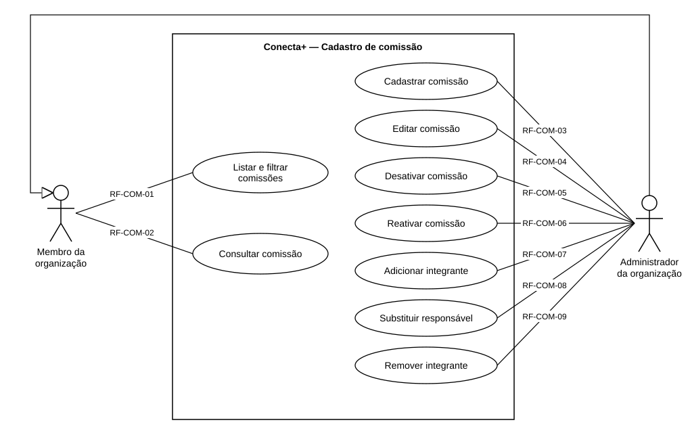

# Casos de uso — Cadastro de comissão

> Padrão da disciplina · Módulo COM · Revisado em 26/11/2026

## Resumo

Este documento mostra quem usa o cadastro de comissões e o que cada pessoa pode fazer. Cada caso de uso é descrito em detalhe, como requisito funcional no formulário padrão, em [Requisitos funcionais](2%20-%20requisitos-funcionais-cadastro-comissao.md).

## Diagrama de casos de uso

Figura 1 — Diagrama de casos de uso do cadastro de comissão. Fonte: equipe Conecta+.

Cada linha entre um ator e um caso de uso leva o código do requisito funcional que o descreve.

## Atores

**Membro da organização.** É o usuário comum que tem vínculo aprovado numa organização aprovada, seja qual for o seu papel nela. Pode listar e abrir as comissões de cuja equipe faz parte, como responsável ou como membro, e ver as reuniões e a equipe de cada uma. Não vê as comissões das quais não faz parte e não altera nenhuma comissão.

**Administrador da organização.** É o membro com papel de administrador, com vínculo aprovado, numa organização aprovada. A seta de generalização indica que ele faz tudo o que o membro da organização faz e, além disso, vê todas as comissões da organização, mesmo aquelas de cuja equipe não participa. Só ele cadastra, edita, desativa e reativa comissões, adiciona e remove integrantes e troca o responsável. Ele não vê nem altera comissões de organizações que não administra.

O responsável da comissão não aparece como ator porque, neste módulo, só consulta a comissão, como qualquer integrante; o papel de responsável é usado nos módulos de reuniões e de atas. O administrador do sistema também não aparece: o sistema recusa qualquer ação de comissão feita por essa conta.

## Relacionamentos entre casos de uso

- **Generalização entre atores:** o administrador da organização herda os casos de uso do membro da organização (listar e consultar comissões).
- Não há «include» nem «extend»: cada caso de uso é iniciado diretamente pelo ator, na tela da organização (listar e cadastrar) ou na tela da comissão (os demais).

## Requisitos funcionais de usuário

| Caso de uso | Requisito | Nome                       | Ator principal               |
| ----------- | --------- | -------------------------- | ---------------------------- |
| UC-COM-01   | RF-COM-01 | Listar e filtrar comissões | Membro da organização        |
| UC-COM-02   | RF-COM-02 | Consultar comissão         | Membro da organização        |
| UC-COM-03   | RF-COM-03 | Cadastrar comissão         | Administrador da organização |
| UC-COM-04   | RF-COM-04 | Editar comissão            | Administrador da organização |
| UC-COM-05   | RF-COM-05 | Desativar comissão         | Administrador da organização |
| UC-COM-06   | RF-COM-06 | Reativar comissão          | Administrador da organização |
| UC-COM-07   | RF-COM-07 | Adicionar integrante       | Administrador da organização |
| UC-COM-08   | RF-COM-08 | Substituir responsável     | Administrador da organização |
| UC-COM-09   | RF-COM-09 | Remover integrante         | Administrador da organização |

**Requisito RF-COM-01 — Listar e filtrar comissões.** O sistema deve permitir ao membro da organização ver a lista das comissões de que faz parte, e ao administrador ver todas as comissões da organização, procurando pelo nome e, no caso do administrador, separando as ativas das inativas.

**Requisito RF-COM-02 — Consultar comissão.** O sistema deve permitir ao integrante da comissão e ao administrador da organização abrir a comissão e ver, em duas abas, as reuniões dela e a equipe, com o responsável no topo.

**Requisito RF-COM-03 — Cadastrar comissão.** O sistema deve permitir ao administrador da organização criar uma comissão com nome, descrição opcional e um responsável escolhido entre as pessoas aprovadas na organização.

**Requisito RF-COM-04 — Editar comissão.** O sistema deve permitir ao administrador da organização alterar o nome e a descrição da comissão.

**Requisito RF-COM-05 — Desativar comissão.** O sistema deve permitir ao administrador da organização desativar a comissão, depois de confirmar, sem apagar a equipe nem as reuniões dela.

**Requisito RF-COM-06 — Reativar comissão.** O sistema deve permitir ao administrador da organização reativar, depois de confirmar, uma comissão desativada que tenha exatamente um responsável.

**Requisito RF-COM-07 — Adicionar integrante.** O sistema deve permitir ao administrador da organização incluir na equipe de uma comissão ativa, como membro, uma pessoa aprovada na organização que ainda não faça parte dela.

**Requisito RF-COM-08 — Substituir responsável.** O sistema deve permitir ao administrador da organização escolher, depois de confirmar, outro responsável para a comissão; o anterior continua na equipe como membro, e a comissão nunca fica sem responsável nem com dois.

**Requisito RF-COM-09 — Remover integrante.** O sistema deve permitir ao administrador da organização retirar um membro da equipe, depois de confirmar; o responsável só pode sair depois de ser substituído.
