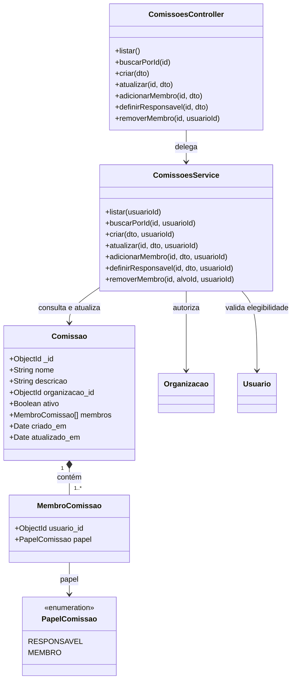

# Diagrama de classes — Cadastro de comissão

> Padrão do Incremento 1 · Classes efetivamente envolvidas na branch `homolog`.

## Resumo

O controller recebe as requisições, o service aplica autorização e regras de equipe, e o documento `Comissao` persiste membros embutidos. `Organizacao` e `Usuario` são consultados para validar autorização e elegibilidade.

## Diagrama

## Regras representadas

- cada comissão pertence a uma organização;
- `membros.usuario_id` não se repete;
- existe exatamente um `RESPONSAVEL`;
- a substituição do responsável promove o alvo e rebaixa o anterior na mesma escrita.

## Rastreabilidade

RF-COM-01 a RF-COM-09 e dicionário de classes do módulo.
