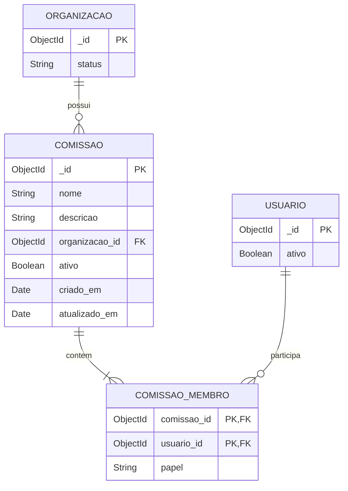

# Diagrama relacional — Cadastro de comissão

> Padrão do Incremento 1 · Visão lógica relacional de documentos MongoDB.

## Resumo

No MongoDB, `membros` é um array embutido em `comissoes`. O diagrama separa esse array apenas para explicitar cardinalidade, chaves e restrições.

## Diagrama

## Mapeamento físico

| Visão lógica        | MongoDB                                 |
| ------------------- | --------------------------------------- |
| `COMISSAO`          | coleção `comissoes`                     |
| `COMISSAO_MEMBRO`   | subdocumentos `comissoes.membros[]`     |
| FK `organizacao_id` | `ObjectId` referenciando `organizacoes` |
| FK `usuario_id`     | `ObjectId` referenciando `usuarios`     |

## Rastreabilidade

RF-COM-01 a RF-COM-09 e dicionário relacional do módulo.
