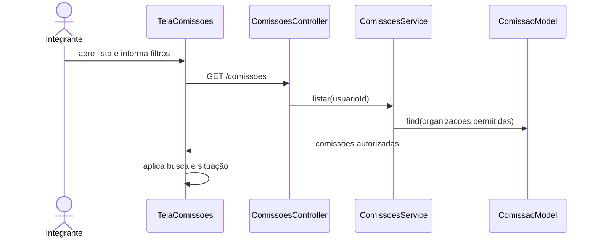
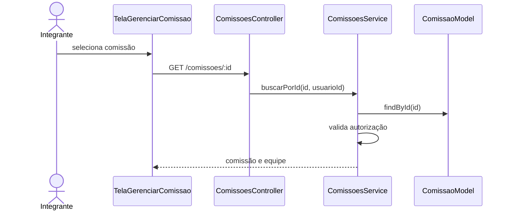
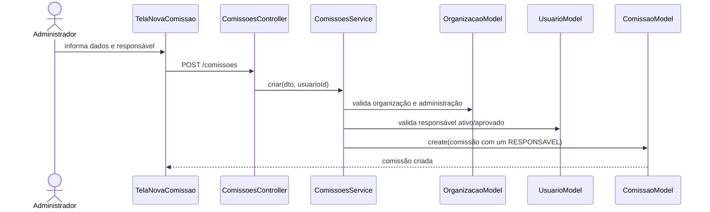
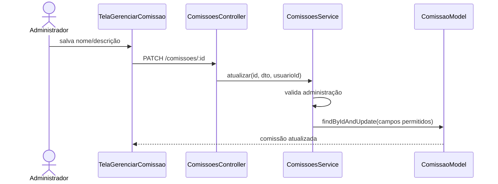
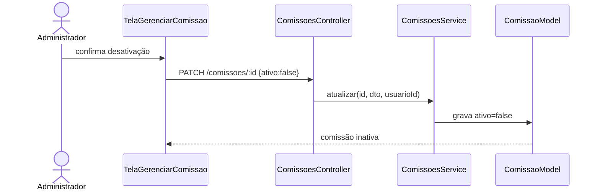
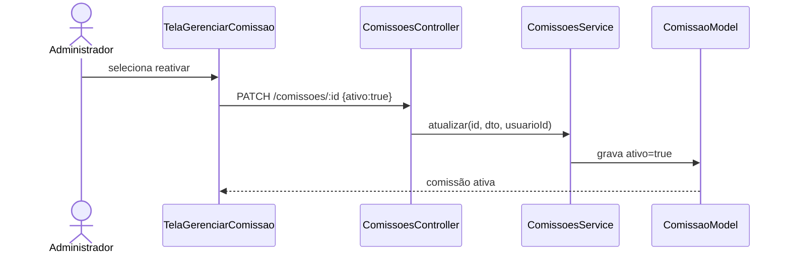
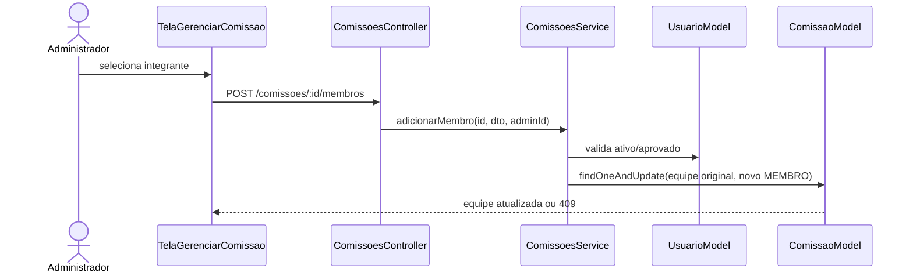
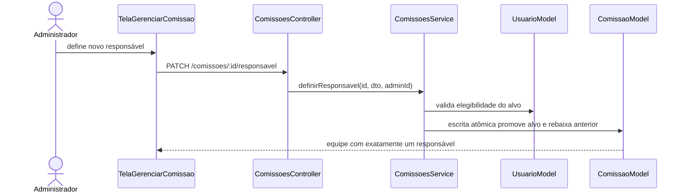
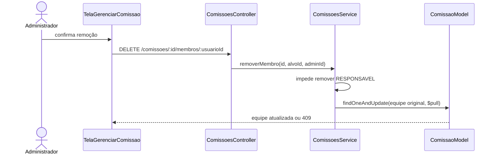

# Diagramas de sequência — Cadastro de comissão

> Padrão do Incremento 1 · Módulo COM

## Resumo

Cada diagrama usa participantes reais: tela Expo, `ComissoesController`, `ComissoesService` e models Mongoose.

## SD-COM-01 — Listar e filtrar comissões

## SD-COM-02 — Consultar comissão

## SD-COM-03 — Cadastrar comissão

## SD-COM-04 — Editar comissão

## SD-COM-05 — Desativar comissão

## SD-COM-06 — Reativar comissão

## SD-COM-07 — Adicionar integrante

## SD-COM-08 — Substituir responsável

## SD-COM-09 — Remover integrante

## Rastreabilidade

SD-COM-01 a SD-COM-09 correspondem a RF-COM-01 a RF-COM-09.
