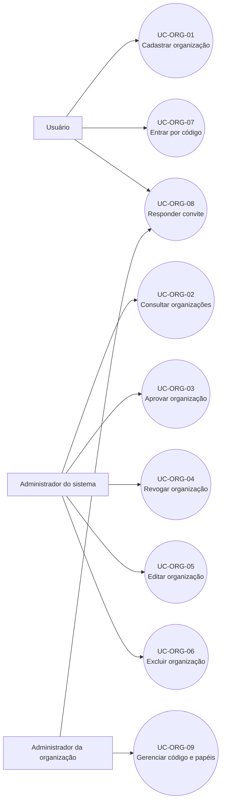

# Casos de uso — Cadastro de organização

> Padrão do Incremento 1 · Fontes: FRONTEND `792fab4` e BACKEND `6f2ffc4`

## Resumo

Este documento descreve o cadastro, a análise e a manutenção de organizações, além dos meios de entrada, convite e administração dos vínculos. O administrador do sistema controla a situação global; o administrador da organização controla código, convites e papéis internos.

## Diagrama geral

## Resumo dos casos de uso

| ID        | Nome                         | Ator principal               | Resultado                                     |
| --------- | ---------------------------- | ---------------------------- | --------------------------------------------- |
| UC-ORG-01 | Cadastrar organização        | Usuário                      | Organização pendente e criador administrador. |
| UC-ORG-02 | Consultar organizações       | Usuário/Admin do sistema     | Lista limitada ao escopo do ator.             |
| UC-ORG-03 | Aprovar organização          | Admin do sistema             | Organização liberada.                         |
| UC-ORG-04 | Revogar organização          | Admin do sistema             | Organização bloqueada.                        |
| UC-ORG-05 | Editar organização           | Admin do sistema             | Dados corrigidos.                             |
| UC-ORG-06 | Excluir organização          | Admin do sistema             | Organização revogada e comissões removidas.   |
| UC-ORG-07 | Entrar por código            | Usuário                      | Solicitação pendente criada ou reaberta.      |
| UC-ORG-08 | Convidar e responder convite | Admin da organização/Usuário | Convite criado e aceito ou recusado.          |
| UC-ORG-09 | Gerenciar código e papéis    | Admin da organização         | Código renovado ou papel alterado.            |

## Especificações

### UC-ORG-01 — Cadastrar organização

| Campo                       | Especificação                                                                                                                                                                                                                     |
| --------------------------- | --------------------------------------------------------------------------------------------------------------------------------------------------------------------------------------------------------------------------------- |
| **Resumo**                  | Cadastrar organização para análise do administrador do sistema.                                                                                                                                                                   |
| **Ator principal**          | Usuário autenticado.                                                                                                                                                                                                              |
| **Gatilho**                 | Confirmar o formulário de cadastro.                                                                                                                                                                                               |
| **Pré-condições**           | Conta ativa, tipo `USUARIO` e nome ainda não utilizado.                                                                                                                                                                           |
| **Fluxo principal**         | 1. Informa nome, cidade e descrição opcional. 2. O app envia `POST /organizacoes`. 3. O backend valida e gera código único. 4. Grava situação `PENDENTE` e o criador como `ADMIN/APROVADO`. 5. Retorna a organização. |
| **Alternativas e exceções** | Dados inválidos: 400. Nome duplicado: 409.                                                                                                                                                                                        |
| **Pós-condições**           | Organização na fila de análise e vínculo administrativo criado.                                                                                                                                                                   |
| **Rastreabilidade**         | RF-ORG-01 · SD-ORG-01 · CT-ORG-01.                                                                                                                                                                                                |

### UC-ORG-02 — Consultar organizações

| Campo                       | Especificação                                                                                                                                                                                                      |
| --------------------------- | ------------------------------------------------------------------------------------------------------------------------------------------------------------------------------------------------------------------ |
| **Resumo**                  | Pesquisar organizações por nome ou cidade dentro do escopo do ator.                                                                                                                                                |
| **Ator principal**          | Usuário ou administrador do sistema.                                                                                                                                                                               |
| **Gatilho**                 | Abrir a lista ou informar busca.                                                                                                                                                                                   |
| **Pré-condições**           | JWT válido e conta ativa.                                                                                                                                                                                          |
| **Fluxo principal**         | 1. O app envia `GET /organizacoes?busca=termo`. 2. O backend escapa a busca e aplica filtro sem diferenciar maiúsculas. 3. Admin global recebe todas; usuário recebe seus vínculos. 4. A lista é exibida. |
| **Alternativas e exceções** | Busca vazia lista o escopo completo. Sem resultado exibe estado vazio.                                                                                                                                             |
| **Pós-condições**           | Nenhum dado alterado.                                                                                                                                                                                              |
| **Rastreabilidade**         | RF-ORG-02 · SD-ORG-02 · CT-ORG-02.                                                                                                                                                                                 |

### UC-ORG-03 — Aprovar organização

| Campo                       | Especificação                                                                                                                                         |
| --------------------------- | ----------------------------------------------------------------------------------------------------------------------------------------------------- |
| **Resumo**                  | Autorizar uma organização pendente ou reativar uma revogada.                                                                                          |
| **Ator principal**          | Administrador do sistema.                                                                                                                             |
| **Gatilho**                 | Confirmar **Aprovar**.                                                                                                                                |
| **Pré-condições**           | Organização existente e JWT de `ADMIN_SISTEMA`.                                                                                                       |
| **Fluxo principal**         | 1. O app envia `PATCH /organizacoes/:id` com `status=APROVADA`. 2. Guards validam o ator. 3. O service grava a situação. 4. A tela atualiza. |
| **Alternativas e exceções** | Sem permissão: 403. Organização inexistente: 404.                                                                                                     |
| **Pós-condições**           | Organização aceita acessos e comissões.                                                                                                               |
| **Rastreabilidade**         | RF-ORG-03 · SD-ORG-03 · CT-ORG-03.                                                                                                                    |

### UC-ORG-04 — Revogar organização

| Campo                       | Especificação                                                                                                                                                         |
| --------------------------- | --------------------------------------------------------------------------------------------------------------------------------------------------------------------- |
| **Resumo**                  | Recusar ou suspender uma organização.                                                                                                                                 |
| **Ator principal**          | Administrador do sistema.                                                                                                                                             |
| **Gatilho**                 | Confirmar **Revogar**.                                                                                                                                                |
| **Pré-condições**           | Organização existente e ainda não revogada.                                                                                                                           |
| **Fluxo principal**         | 1. A interface pede confirmação. 2. Envia `PATCH /organizacoes/:id` com `status=REVOGADA`. 3. O backend autoriza e grava. 4. A lista mostra a nova situação. |
| **Alternativas e exceções** | Cancelamento não envia requisição. Sem permissão: 403.                                                                                                                |
| **Pós-condições**           | Novos acessos e gestão de comissões bloqueados; exclusão passa a ser permitida.                                                                                       |
| **Rastreabilidade**         | RF-ORG-04 · SD-ORG-03 · CT-ORG-04.                                                                                                                                    |

### UC-ORG-05 — Editar organização

| Campo                       | Especificação                                                                                                                                                    |
| --------------------------- | ---------------------------------------------------------------------------------------------------------------------------------------------------------------- |
| **Resumo**                  | Corrigir nome, cidade ou descrição.                                                                                                                              |
| **Ator principal**          | Administrador do sistema.                                                                                                                                        |
| **Gatilho**                 | Salvar a edição.                                                                                                                                                 |
| **Pré-condições**           | Organização existente; novo nome disponível.                                                                                                                     |
| **Fluxo principal**         | 1. O app envia `PATCH /organizacoes/:id`. 2. O backend valida os campos e a unicidade. 3. Grava somente os campos informados. 4. Retorna a organização. |
| **Alternativas e exceções** | Nome duplicado: 409. Campo inválido: 400.                                                                                                                        |
| **Pós-condições**           | Dados atualizados para todos os usuários.                                                                                                                        |
| **Rastreabilidade**         | RF-ORG-05 · SD-ORG-03 · CT-ORG-05.                                                                                                                               |

### UC-ORG-06 — Excluir organização

| Campo                       | Especificação                                                                                                                                                                      |
| --------------------------- | ---------------------------------------------------------------------------------------------------------------------------------------------------------------------------------- |
| **Resumo**                  | Excluir definitivamente organização já revogada.                                                                                                                                   |
| **Ator principal**          | Administrador do sistema.                                                                                                                                                          |
| **Gatilho**                 | Confirmar a exclusão destrutiva.                                                                                                                                                   |
| **Pré-condições**           | Organização com situação `REVOGADA`.                                                                                                                                               |
| **Fluxo principal**         | 1. A interface solicita confirmação. 2. Envia `DELETE /organizacoes/:id`. 3. O backend confere a situação. 4. Exclui organização e suas comissões. 5. Retorna sucesso. |
| **Alternativas e exceções** | Cancelamento: nenhuma chamada. Não revogada: 400. Não encontrada: 404.                                                                                                             |
| **Pós-condições**           | Organização, vínculos e comissões deixam de existir.                                                                                                                               |
| **Rastreabilidade**         | RF-ORG-06 · SD-ORG-04 · CT-ORG-06.                                                                                                                                                 |

### UC-ORG-07 — Entrar por código

| Campo                       | Especificação                                                                                                                                                                     |
| --------------------------- | --------------------------------------------------------------------------------------------------------------------------------------------------------------------------------- |
| **Resumo**                  | Solicitar entrada por código de dez caracteres.                                                                                                                                   |
| **Ator principal**          | Usuário autenticado.                                                                                                                                                              |
| **Gatilho**                 | Informar código e confirmar.                                                                                                                                                      |
| **Pré-condições**           | Organização `APROVADA` e código atual.                                                                                                                                            |
| **Fluxo principal**         | 1. O app envia `POST /organizacoes/entrar`. 2. O backend normaliza e localiza o código. 3. Cria vínculo `MEMBRO/PENDENTE` ou reabre rejeitado. 4. Retorna a organização. |
| **Alternativas e exceções** | Código inválido: 404. Já membro, pendente ou convidado: 409.                                                                                                                      |
| **Pós-condições**           | Solicitação disponível para análise do administrador.                                                                                                                             |
| **Rastreabilidade**         | RF-ORG-07 · SD-ORG-05 · CT-ORG-07.                                                                                                                                                |

### UC-ORG-08 — Convidar e responder convite

| Campo                       | Especificação                                                                                                                                                                                              |
| --------------------------- | ---------------------------------------------------------------------------------------------------------------------------------------------------------------------------------------------------------- |
| **Resumo**                  | Convidar usuário cadastrado e permitir que ele aceite ou recuse.                                                                                                                                           |
| **Ator principal**          | Administrador aprovado da organização; convidado na resposta.                                                                                                                                              |
| **Gatilho**                 | Admin informa e-mail; convidado seleciona uma resposta.                                                                                                                                                    |
| **Pré-condições**           | Organização aprovada; alvo ativo, tipo `USUARIO` e sem vínculo incompatível.                                                                                                                               |
| **Fluxo principal**         | 1. Admin envia `POST /organizacoes/:id/convites`. 2. Backend grava `MEMBRO/CONVIDADO`. 3. Convidado envia `PATCH /organizacoes/:id/convite`. 4. Aceite grava `APROVADO`; recusa remove o vínculo. |
| **Alternativas e exceções** | E-mail inexistente: 404. Vínculo existente ou estado alterado: 409.                                                                                                                                        |
| **Pós-condições**           | Vínculo aprovado ou removido conforme a resposta.                                                                                                                                                          |
| **Rastreabilidade**         | RF-ORG-08 · SD-ORG-06 · CT-ORG-08.                                                                                                                                                                         |

### UC-ORG-09 — Gerenciar código e papéis

| Campo                       | Especificação                                                                                                                                                                                                                          |
| --------------------------- | -------------------------------------------------------------------------------------------------------------------------------------------------------------------------------------------------------------------------------------- |
| **Resumo**                  | Renovar o código de acesso ou promover/rebaixar membro aprovado.                                                                                                                                                                       |
| **Ator principal**          | Administrador aprovado da organização.                                                                                                                                                                                                 |
| **Gatilho**                 | Selecionar **Gerar novo código** ou alterar papel.                                                                                                                                                                                     |
| **Pré-condições**           | Organização aprovada; no papel, alvo aprovado.                                                                                                                                                                                         |
| **Fluxo principal**         | 1. Para código, envia `POST /organizacoes/:id/codigo` e substitui o valor anterior. 2. Para papel, envia `PATCH /organizacoes/:id/membros/:usuarioId/papel`. 3. O backend valida autorização e mantém ao menos um administrador. |
| **Alternativas e exceções** | Último administrador não pode ser rebaixado. Alvo inelegível: 400/404.                                                                                                                                                                 |
| **Pós-condições**           | Código anterior invalidado ou papel atualizado sem deixar a organização sem admin.                                                                                                                                                     |
| **Rastreabilidade**         | RF-ORG-09 · SD-ORG-08 · CT-ORG-09.                                                                                                                                                                                                     |
