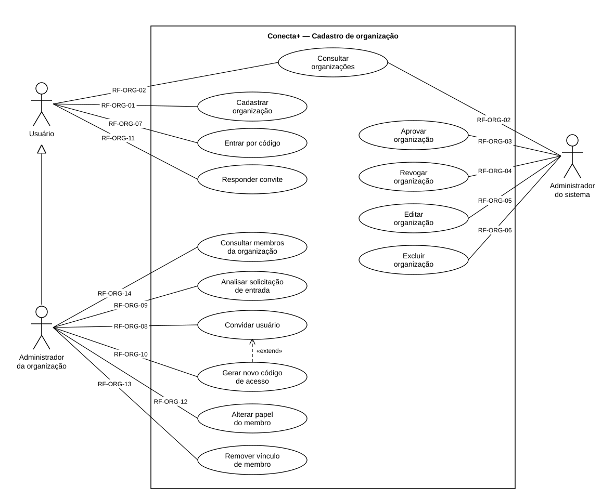

# Casos de uso — Cadastro de organização

> Padrão da disciplina · Módulo ORG · Revisado em 26/11/2026

## Resumo

Este documento mostra quem usa as organizações e o que cada pessoa pode fazer. Cada caso de uso é descrito em detalhe, como requisito funcional no formulário padrão, em [Requisitos funcionais](2%20-%20requisitos-funcionais-cadastro-organizacao.md).

## Diagrama de casos de uso

Figura 1 — Diagrama de casos de uso do cadastro de organização. Fonte: equipe Conecta+.

Cada linha entre um ator e um caso de uso leva o código do requisito funcional que o descreve.

## Atores

**Usuário.** É qualquer pessoa com conta ativa do tipo `USUARIO`. Pode cadastrar uma organização, que fica aguardando autorização; ver as organizações com que tem algum vínculo (membro, pedido em análise, pedido recusado ou convite); pedir entrada numa organização autorizada usando o código de acesso; e aceitar ou recusar os convites que recebeu. Não vê organizações com que não tem vínculo, não vê a lista de membros nem o código de acesso, e não sai sozinho de uma organização: quem retira um vínculo é o administrador dela.

**Administrador da organização.** É o usuário cujo vínculo com a organização tem papel `ADMIN` e situação `APROVADO`; quem cadastra a organização já começa assim. A seta de generalização indica que ele faz tudo o que o usuário faz e, além disso, gerencia a organização que administra: consulta os membros e o código de acesso, aprova ou recusa pedidos de entrada (inclusive aprova depois um pedido recusado), convida usuários pelo e-mail da conta, gera um novo código, promove membros a administrador ou devolve administradores ao papel de membro e remove vínculos de membros comuns. Essas ações só valem enquanto a organização está autorizada. Ele não pode remover outro administrador sem antes torná-lo membro, nem deixar a organização sem nenhum administrador, nem autorizar, revogar, editar ou excluir a própria organização.

**Administrador do sistema.** É a conta do tipo `ADMIN_SISTEMA`. Vê todas as organizações, em qualquer situação, e as busca pelo nome; autoriza organizações pendentes ou revogadas, revoga, corrige nome, cidade e descrição e exclui as que estão revogadas. Não cadastra organizações, não pede entrada, não recebe convites e não gerencia membros: o sistema recusa essas ações para a conta dele.

## Relacionamentos entre casos de uso

- **«extend» de Gerar novo código de acesso para Convidar usuário:** o código atual e o botão "Gerar novo código" aparecem dentro da folha "Convidar", abaixo do convite por e-mail, como a outra forma de chamar alguém para a organização.
- **Generalização entre atores:** o administrador da organização herda os casos de uso do usuário. O administrador do sistema não é especialização de nenhum dos dois.
- **Consultar organizações** é usado pelo usuário e pelo administrador do sistema; cada um vê um escopo diferente, descrito no RF-ORG-02.

## Requisitos funcionais de usuário

| Caso de uso | Requisito | Nome                             | Ator principal                     |
| ----------- | --------- | -------------------------------- | ---------------------------------- |
| UC-ORG-01   | RF-ORG-01 | Cadastrar organização            | Usuário                            |
| UC-ORG-02   | RF-ORG-02 | Consultar organizações           | Usuário e administrador do sistema |
| UC-ORG-03   | RF-ORG-03 | Aprovar organização              | Administrador do sistema           |
| UC-ORG-04   | RF-ORG-04 | Revogar organização              | Administrador do sistema           |
| UC-ORG-05   | RF-ORG-05 | Editar organização               | Administrador do sistema           |
| UC-ORG-06   | RF-ORG-06 | Excluir organização              | Administrador do sistema           |
| UC-ORG-07   | RF-ORG-07 | Entrar por código                | Usuário                            |
| UC-ORG-08   | RF-ORG-08 | Convidar usuário                 | Administrador da organização       |
| UC-ORG-09   | RF-ORG-09 | Analisar solicitação de entrada  | Administrador da organização       |
| UC-ORG-10   | RF-ORG-10 | Gerar novo código de acesso      | Administrador da organização       |
| UC-ORG-11   | RF-ORG-11 | Responder convite                | Usuário                            |
| UC-ORG-12   | RF-ORG-12 | Alterar papel do membro          | Administrador da organização       |
| UC-ORG-13   | RF-ORG-13 | Remover vínculo de membro        | Administrador da organização       |
| UC-ORG-14   | RF-ORG-14 | Consultar membros da organização | Administrador da organização       |

**Requisito RF-ORG-01 — Cadastrar organização.** O sistema deve permitir ao usuário cadastrar uma organização com nome, cidade e uma descrição opcional, que fica aguardando a autorização do administrador do sistema e tem quem a cadastrou como primeiro administrador.

**Requisito RF-ORG-02 — Consultar organizações.** O sistema deve permitir ao usuário ver as organizações com que tem vínculo, agrupadas pela situação, e ao administrador do sistema ver e buscar pelo nome todas as organizações cadastradas.

**Requisito RF-ORG-03 — Aprovar organização.** O sistema deve permitir ao administrador do sistema autorizar uma organização pendente ou revogada, para que ela passe a aceitar membros e comissões.

**Requisito RF-ORG-04 — Revogar organização.** O sistema deve permitir ao administrador do sistema, depois de confirmar, revogar uma organização, bloqueando o seu uso sem apagar os dados.

**Requisito RF-ORG-05 — Editar organização.** O sistema deve permitir ao administrador do sistema corrigir o nome, a cidade e a descrição de uma organização, sem repetir o nome de outra.

**Requisito RF-ORG-06 — Excluir organização.** O sistema deve permitir ao administrador do sistema, depois de confirmar, excluir definitivamente uma organização revogada, junto com as suas comissões.

**Requisito RF-ORG-07 — Entrar por código.** O sistema deve permitir ao usuário pedir entrada numa organização autorizada digitando o código de acesso de 10 caracteres; o pedido fica aguardando a análise de um administrador.

**Requisito RF-ORG-08 — Convidar usuário.** O sistema deve permitir ao administrador da organização convidar um usuário já cadastrado, informando o e-mail da conta dele.

**Requisito RF-ORG-09 — Analisar solicitação de entrada.** O sistema deve permitir ao administrador da organização aprovar ou, depois de confirmar, recusar um pedido de entrada, e também aprovar depois um pedido que tinha recusado.

**Requisito RF-ORG-10 — Gerar novo código de acesso.** O sistema deve permitir ao administrador da organização ver e copiar o código de acesso e, depois de confirmar, trocá-lo por um novo, invalidando o anterior.

**Requisito RF-ORG-11 — Responder convite.** O sistema deve permitir ao usuário convidado aceitar o convite, tornando-se membro, ou recusá-lo.

**Requisito RF-ORG-12 — Alterar papel do membro.** O sistema deve permitir ao administrador da organização, depois de confirmar, promover um membro a administrador ou devolver um administrador ao papel de membro, inclusive a si mesmo, desde que a organização continue com ao menos um administrador; assim o administrador pode ser trocado.

**Requisito RF-ORG-13 — Remover vínculo de membro.** O sistema deve permitir ao administrador da organização, depois de confirmar, remover o acesso de um membro comum, cancelar um convite enviado ou excluir um pedido recusado; quem perde o acesso sai também das comissões da organização.

**Requisito RF-ORG-14 — Consultar membros da organização.** O sistema deve permitir ao administrador da organização ver os pedidos de acesso, os administradores, os membros, os convites enviados e os pedidos recusados, e buscar pessoas pelo nome ou pelo e-mail.
