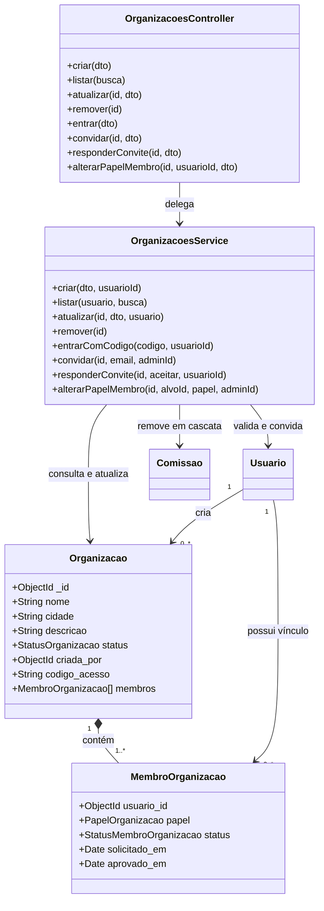

# Diagrama de classes — Cadastro de organização

> Padrão do Incremento 1 · Classes confirmadas no código auditado.

## Resumo

`OrganizacoesController` delega regras ao `OrganizacoesService`. A organização contém seus vínculos como subdocumentos e referencia o usuário criador.

## Diagrama

## Regras representadas

- o criador inicia como `ADMIN/APROVADO`;
- o código de dez caracteres é único e oculto por padrão;
- os papéis internos não alteram o tipo global do usuário;
- uma organização mantém ao menos um administrador aprovado.

## Rastreabilidade

RF-ORG-01 a RF-ORG-09 e dicionário de classes do módulo.
