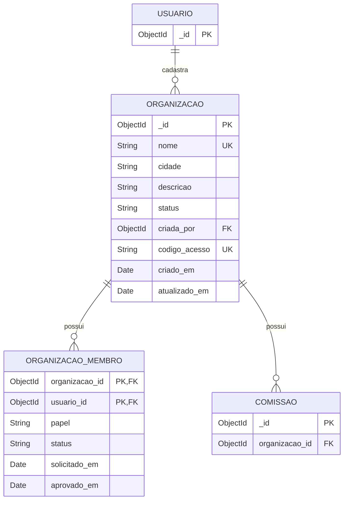

# Diagrama relacional — Cadastro de organização

> Padrão do Incremento 1 · Módulo ORG · Visão lógica sobre MongoDB

## Resumo

Representa organizações, vínculos embutidos, criador e comissões associadas em forma relacional para facilitar a leitura.

## Relacionamentos

- `ORGANIZACAO.criada_por → USUARIO._id`: um usuário pode cadastrar várias organizações.
- `ORGANIZACAO_MEMBRO.organizacao_id → ORGANIZACAO._id`: uma organização tem vários vínculos de membro.
- `ORGANIZACAO_MEMBRO` é uma representação lógica: no MongoDB, esses campos ficam embutidos em `organizacoes.membros[]`.
- `COMISSAO.organizacao_id → ORGANIZACAO._id`: uma organização tem várias comissões, e a exclusão da organização revogada (RF-06) apaga as comissões ligadas a ela.
