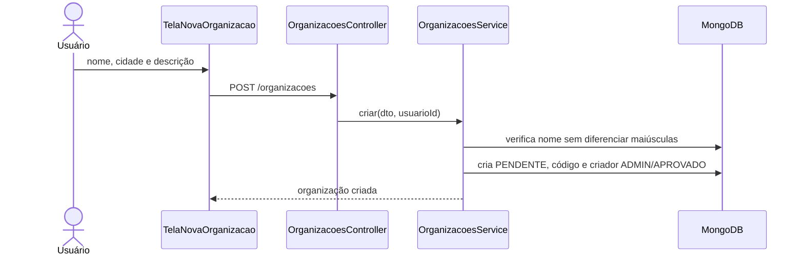
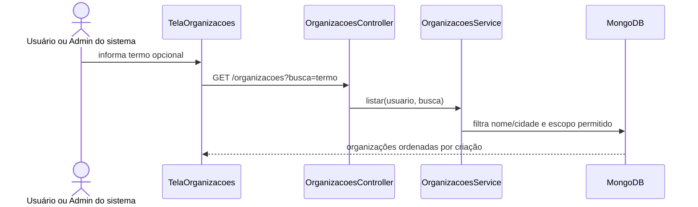
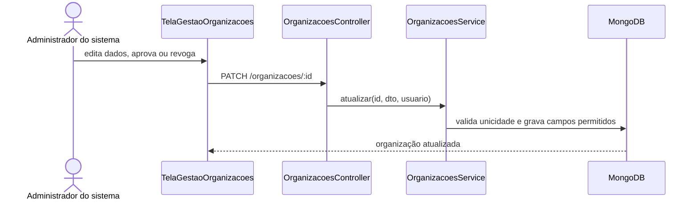
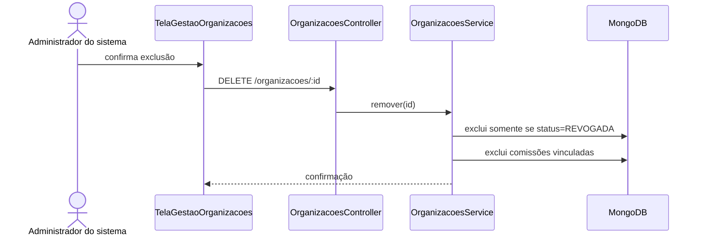
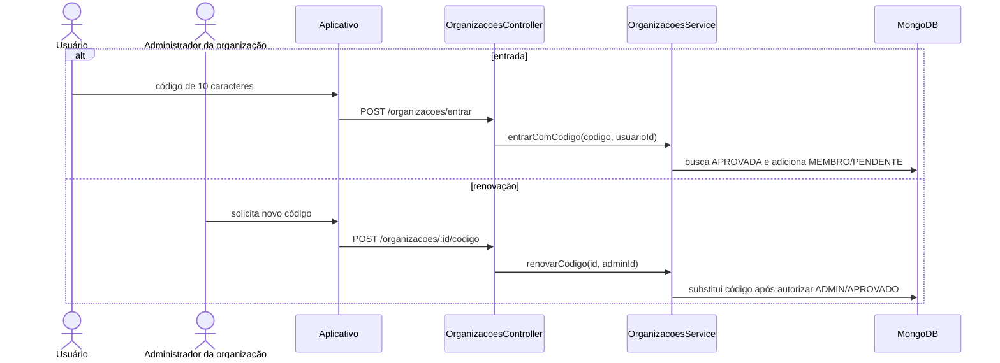
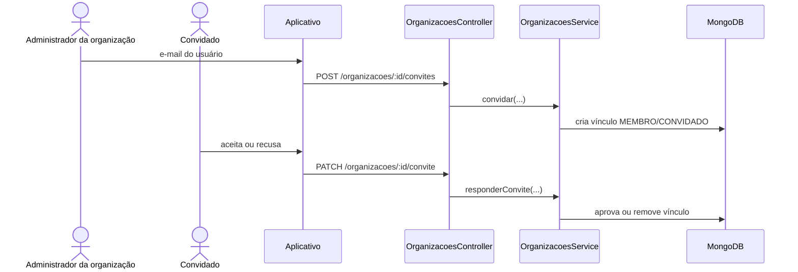
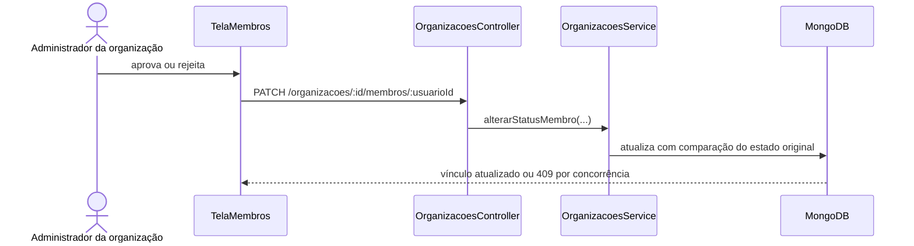
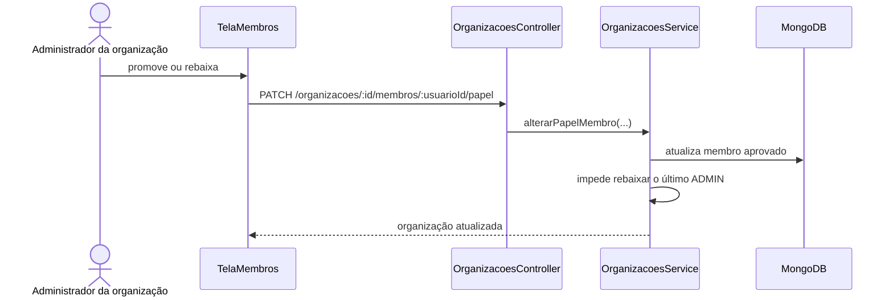

# Diagramas de sequência — Cadastro de organização

Os participantes nomeiam classes reais da branch `homolog`. O aplicativo chama o controller; o controller delega ao service; o service consulta o MongoDB via Mongoose.

## SD-ORG-01 — Cadastrar organização

## SD-ORG-02 — Consultar e pesquisar

## SD-ORG-03 — Alterar dados ou situação

## SD-ORG-04 — Excluir revogada

## SD-ORG-05 — Entrar e renovar código

## SD-ORG-06 — Convidar e responder

## SD-ORG-07 — Analisar solicitação

## SD-ORG-08 — Alterar papel

