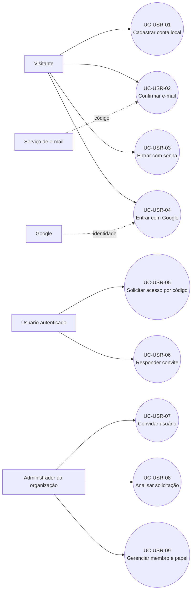

# Casos de uso — Cadastro e acesso de usuário

## Especificação resumida

| Caso      | Ator              | Pré-condição                                            | Fluxo/pós-condição                                                                      | Exceções principais                                                                     |
| --------- | ----------------- | ------------------------------------------------------- | --------------------------------------------------------------------------------------- | --------------------------------------------------------------------------------------- |
| UC-USR-01 | Visitante         | e-mail não cadastrado                                   | informa nome/e-mail/senha/confirmação; cria conta `LOCAL`, não verificada; envia código | entrada inválida `400`, duplicidade `409`, falha SMTP `503` e conta provisória removida |
| UC-USR-02 | Visitante         | conta local não verificada e código válido por 30 min   | informa `XXX-XXXX`; define `email_verificado=true` e remove código                      | inválido/expirado `400`                                                                 |
| UC-USR-03 | Visitante         | conta ativa, verificada, com senha local                | valida bcrypt e recebe JWT de 1 h                                                       | credenciais genéricas inválidas `401`                                                   |
| UC-USR-04 | Visitante         | conta Google com e-mail verificado                      | OAuth/OIDC cria ou vincula conta e recebe JWT                                           | token, audience, issuer ou expiração inválidos `400`                                    |
| UC-USR-05 | Usuário           | organização aprovada e código atual                     | cria/reabre vínculo `PENDENTE`                                                          | código inválido `404`, vínculo incompatível `409`                                       |
| UC-USR-06 | Convidado         | vínculo `CONVIDADO`                                     | aceita como `APROVADO` ou recusa removendo vínculo                                      | convite inexistente/alterado `404/409`                                                  |
| UC-USR-07 | Admin organização | organização aprovada; usuário comum ativo               | convite por e-mail cria vínculo `CONVIDADO`                                             | não encontrado `404`; já membro/pendente/convidado `409`                                |
| UC-USR-08 | Admin organização | vínculo alvo `PENDENTE` ou `REJEITADO` para reaprovação | grava `APROVADO`/`REJEITADO` e data                                                     | permissão/estado concorrente `403/409`                                                  |
| UC-USR-09 | Admin organização | alvo aprovado                                           | promove/rebaixa ou remove membro comum; remoção limpa comissões                         | não remove admin; não rebaixa último admin                                              |
