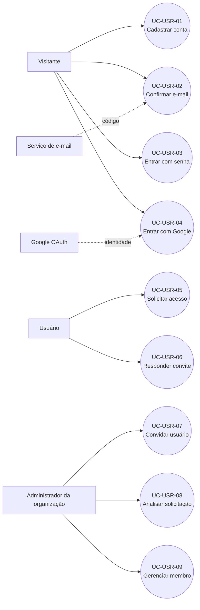

# Casos de uso — Cadastro de usuário

> Padrão do Incremento 1 · Fonte: FRONTEND `homolog` (`792fab4`) e BACKEND `homolog` (`6f2ffc4`)

## Resumo

Este documento descreve criação e confirmação de conta, autenticação local ou Google e os fluxos pelos quais usuários entram e são administrados em organizações.

## Diagrama geral

## Resumo dos casos de uso

| ID        | Nome                 | Ator principal       | Resultado                                    |
| --------- | -------------------- | -------------------- | -------------------------------------------- |
| UC-USR-01 | Cadastrar conta      | Visitante            | Conta local não confirmada e código enviado. |
| UC-USR-02 | Confirmar e-mail     | Visitante            | Conta habilitada para login.                 |
| UC-USR-03 | Entrar com senha     | Visitante            | JWT e perfil devolvidos.                     |
| UC-USR-04 | Entrar com Google    | Visitante            | Conta criada/vinculada e JWT devolvido.      |
| UC-USR-05 | Solicitar acesso     | Usuário              | Vínculo pendente criado.                     |
| UC-USR-06 | Responder convite    | Usuário convidado    | Vínculo aprovado ou removido.                |
| UC-USR-07 | Convidar usuário     | Admin da organização | Vínculo convidado criado.                    |
| UC-USR-08 | Analisar solicitação | Admin da organização | Solicitação aprovada ou rejeitada.           |
| UC-USR-09 | Gerenciar membro     | Admin da organização | Papel alterado ou membro removido.           |

## Especificações

### UC-USR-01 — Cadastrar conta

| Campo                       | Especificação                                                                                                                                                                                                                                                                     |
| --------------------------- | --------------------------------------------------------------------------------------------------------------------------------------------------------------------------------------------------------------------------------------------------------------------------------- |
| **Resumo**                  | Criar conta local e iniciar confirmação do e-mail.                                                                                                                                                                                                                                |
| **Ator principal**          | Visitante.                                                                                                                                                                                                                                                                        |
| **Atores secundários**      | Serviço de e-mail.                                                                                                                                                                                                                                                                |
| **Gatilho**                 | Confirmar o formulário de cadastro.                                                                                                                                                                                                                                               |
| **Pré-condições**           | E-mail ainda não cadastrado.                                                                                                                                                                                                                                                      |
| **Fluxo principal**         | 1. Informa nome, e-mail, senha e confirmação. 2. O app valida com `react-hook-form` e envia `POST /usuarios`. 3. O backend normaliza o e-mail e grava hash bcrypt. 4. Gera código, armazena somente SHA-256 por 30 minutos e envia por e-mail. 5. Abre a confirmação. |
| **Alternativas e exceções** | Entrada inválida: 400. E-mail duplicado: 409. Falha SMTP: 503 e conta provisória removida.                                                                                                                                                                                        |
| **Pós-condições**           | Conta `LOCAL`, ativa e ainda não verificada.                                                                                                                                                                                                                                      |
| **Rastreabilidade**         | RF-USR-01 · SD-USR-01 · CT-USR-01.                                                                                                                                                                                                                                                |

### UC-USR-02 — Confirmar e-mail

| Campo                       | Especificação                                                                                                                                                           |
| --------------------------- | ----------------------------------------------------------------------------------------------------------------------------------------------------------------------- |
| **Resumo**                  | Confirmar a posse do endereço informado.                                                                                                                                |
| **Ator principal**          | Visitante cadastrado.                                                                                                                                                   |
| **Gatilho**                 | Informar o código recebido.                                                                                                                                             |
| **Pré-condições**           | Conta não verificada e código vigente.                                                                                                                                  |
| **Fluxo principal**         | 1. O app envia `POST /auth/verificar-cadastro`. 2. O backend compara o hash e a expiração. 3. Define `email_verificado=true`. 4. Remove os campos temporários. |
| **Alternativas e exceções** | Código incorreto ou expirado: 400. Reenvio gera novo código e invalida o anterior.                                                                                      |
| **Pós-condições**           | Conta habilitada para autenticação local.                                                                                                                               |
| **Rastreabilidade**         | RF-USR-01 · SD-USR-01 · CT-USR-02.                                                                                                                                      |

### UC-USR-03 — Entrar com senha

| Campo                       | Especificação                                                                                                                                                                                                |
| --------------------------- | ------------------------------------------------------------------------------------------------------------------------------------------------------------------------------------------------------------ |
| **Resumo**                  | Autenticar conta local com e-mail e senha.                                                                                                                                                                   |
| **Ator principal**          | Visitante.                                                                                                                                                                                                   |
| **Gatilho**                 | Confirmar a tela de login.                                                                                                                                                                                   |
| **Pré-condições**           | Conta ativa, e-mail confirmado e senha local.                                                                                                                                                                |
| **Fluxo principal**         | 1. Envia `POST /auth/login`. 2. O backend busca campos protegidos e executa `bcrypt.compare`. 3. Emite JWT de uma hora. 4. O app consulta `GET /usuarios/me` e salva token no armazenamento seguro. |
| **Alternativas e exceções** | Credenciais, conta ou confirmação inválidas recebem resposta genérica 401.                                                                                                                                   |
| **Pós-condições**           | Sessão autenticada e perfil carregado.                                                                                                                                                                       |
| **Rastreabilidade**         | RF-USR-02 · SD-USR-02 · CT-USR-03.                                                                                                                                                                           |

### UC-USR-04 — Entrar com Google

| Campo                       | Especificação                                                                                                                                                                                                   |
| --------------------------- | --------------------------------------------------------------------------------------------------------------------------------------------------------------------------------------------------------------- |
| **Resumo**                  | Autenticar via Google no Expo Go/web ou integração nativa disponível.                                                                                                                                           |
| **Ator principal**          | Visitante.                                                                                                                                                                                                      |
| **Atores secundários**      | Google OAuth/OIDC.                                                                                                                                                                                              |
| **Gatilho**                 | Selecionar **Entrar com Google**.                                                                                                                                                                               |
| **Pré-condições**           | Conta Google com e-mail verificado e cliente configurado.                                                                                                                                                       |
| **Fluxo principal**         | 1. O app obtém `id_token` ou authorization code. 2. Envia `POST /auth/google`. 3. O backend valida emissor, audiência, expiração e e-mail. 4. Cria ou vincula por `google_id`/e-mail. 5. Emite JWT. |
| **Alternativas e exceções** | Cancelamento não cria sessão. Token inválido ou cliente incorreto: 400.                                                                                                                                         |
| **Pós-condições**           | Conta `GOOGLE` ou `AMBOS` autenticada.                                                                                                                                                                          |
| **Rastreabilidade**         | RF-USR-03 · SD-USR-03 · CT-USR-04.                                                                                                                                                                              |

### UC-USR-05 — Solicitar acesso por código

| Campo                       | Especificação                                                                                                                                                     |
| --------------------------- | ----------------------------------------------------------------------------------------------------------------------------------------------------------------- |
| **Resumo**                  | Solicitar participação em organização aprovada.                                                                                                                   |
| **Ator principal**          | Usuário autenticado.                                                                                                                                              |
| **Gatilho**                 | Informar código da organização.                                                                                                                                   |
| **Pré-condições**           | Código atual e ausência de vínculo incompatível.                                                                                                                  |
| **Fluxo principal**         | 1. Envia `POST /organizacoes/entrar`. 2. O backend localiza organização aprovada. 3. Cria ou reabre vínculo `MEMBRO/PENDENTE`. 4. A tela exibe o estado. |
| **Alternativas e exceções** | Código inexistente: 404. Já membro, pendente ou convidado: 409.                                                                                                   |
| **Pós-condições**           | Solicitação disponível para análise.                                                                                                                              |
| **Rastreabilidade**         | RF-USR-04 · SD-USR-04 · CT-USR-05.                                                                                                                                |

### UC-USR-06 — Responder convite

| Campo                       | Especificação                                                                                                                                                                           |
| --------------------------- | --------------------------------------------------------------------------------------------------------------------------------------------------------------------------------------- |
| **Resumo**                  | Aceitar ou recusar convite pendente.                                                                                                                                                    |
| **Ator principal**          | Usuário convidado.                                                                                                                                                                      |
| **Gatilho**                 | Selecionar **Aceitar** ou **Recusar**.                                                                                                                                                  |
| **Pré-condições**           | Vínculo `CONVIDADO` existente.                                                                                                                                                          |
| **Fluxo principal**         | 1. Envia `PATCH /organizacoes/:id/convite` com `aceitar`. 2. O backend confere o estado. 3. Aceite grava `APROVADO` e data; recusa remove o vínculo. 4. Retorna a organização. |
| **Alternativas e exceções** | Convite inexistente: 404. Alteração simultânea: 409.                                                                                                                                    |
| **Pós-condições**           | Usuário aprovado ou desvinculado.                                                                                                                                                       |
| **Rastreabilidade**         | RF-USR-05 · SD-USR-05 · CT-USR-06.                                                                                                                                                      |

### UC-USR-07 — Convidar usuário

| Campo                       | Especificação                                                                                                                                                               |
| --------------------------- | --------------------------------------------------------------------------------------------------------------------------------------------------------------------------- |
| **Resumo**                  | Convidar por e-mail uma conta já cadastrada.                                                                                                                                |
| **Ator principal**          | Administrador aprovado da organização.                                                                                                                                      |
| **Gatilho**                 | Informar e-mail e confirmar convite.                                                                                                                                        |
| **Pré-condições**           | Organização aprovada; alvo ativo, comum e sem vínculo incompatível.                                                                                                         |
| **Fluxo principal**         | 1. Envia `POST /organizacoes/:id/convites`. 2. O backend autoriza o administrador e busca o e-mail. 3. Grava vínculo `MEMBRO/CONVIDADO`. 4. Retorna a organização. |
| **Alternativas e exceções** | Usuário inexistente: 404. Vínculo já existente: 409.                                                                                                                        |
| **Pós-condições**           | Convite visível para o destinatário.                                                                                                                                        |
| **Rastreabilidade**         | RF-USR-05 · SD-USR-05 · CT-USR-07.                                                                                                                                          |

### UC-USR-08 — Analisar solicitação

| Campo                       | Especificação                                                                                                                                                                    |
| --------------------------- | -------------------------------------------------------------------------------------------------------------------------------------------------------------------------------- |
| **Resumo**                  | Aprovar ou rejeitar solicitação de entrada.                                                                                                                                      |
| **Ator principal**          | Administrador aprovado da organização.                                                                                                                                           |
| **Gatilho**                 | Selecionar uma decisão.                                                                                                                                                          |
| **Pré-condições**           | Vínculo `PENDENTE`, ou `REJEITADO` para reaprovação.                                                                                                                             |
| **Fluxo principal**         | 1. Envia `PATCH /organizacoes/:id/membros/:usuarioId`. 2. O backend verifica permissão e estado original. 3. Grava `APROVADO` ou `REJEITADO`. 4. Retorna a organização. |
| **Alternativas e exceções** | Sem permissão: 403. Estado concorrente: 409.                                                                                                                                     |
| **Pós-condições**           | Situação e data de aprovação atualizadas.                                                                                                                                        |
| **Rastreabilidade**         | RF-USR-06 · SD-USR-06 · CT-USR-08.                                                                                                                                               |

### UC-USR-09 — Gerenciar membro

| Campo                       | Especificação                                                                                                                                                                                                                                       |
| --------------------------- | --------------------------------------------------------------------------------------------------------------------------------------------------------------------------------------------------------------------------------------------------- |
| **Resumo**                  | Promover, rebaixar ou remover membro aprovado.                                                                                                                                                                                                      |
| **Ator principal**          | Administrador aprovado da organização.                                                                                                                                                                                                              |
| **Gatilho**                 | Alterar papel ou confirmar remoção.                                                                                                                                                                                                                 |
| **Pré-condições**           | Alvo aprovado; remoção permitida apenas para `MEMBRO`.                                                                                                                                                                                              |
| **Fluxo principal**         | 1. Para papel, envia `PATCH /organizacoes/:id/membros/:usuarioId/papel`. 2. Para remoção, envia `DELETE /organizacoes/:id/membros/:usuarioId`. 3. O backend preserva ao menos um admin e, na remoção, limpa comissões. 4. Retorna sucesso. |
| **Alternativas e exceções** | Último admin não pode ser rebaixado. Admin não pode ser removido pelo fluxo comum.                                                                                                                                                                  |
| **Pós-condições**           | Papel atualizado ou vínculo organizacional e vínculos de comissão removidos.                                                                                                                                                                        |
| **Rastreabilidade**         | RF-USR-07 · SD-USR-07 · CT-USR-09.                                                                                                                                                                                                                  |
