# Diagrama de classes — Cadastro de usuário

> Padrão da disciplina · Módulo USR · Revisado em 26/11/2026

## Resumo

O diagrama mostra as classes que participam do cadastro e da autenticação, agrupadas em três pacotes, um por camada do sistema: **Aplicativo** (telas, contexto de sessão e módulos do aplicativo), **API** (controllers, services, guards e objetos de entrada) e **Dados** (documento guardado no MongoDB). Cada atributo traz o seu tipo, e cada método traz o tipo dos parâmetros e do retorno. Toda classe e todo método do diagrama existem no código; das classes que também servem a outros módulos, como `AuthService`, aparecem só os métodos usados aqui. As classes dos vínculos do usuário com organizações (`Organizacao`, `MembroOrganizacao`, `OrganizacoesService` e as telas de organização) estão documentadas no módulo [Cadastro de organização](../cadastro-organizacao/README.md).

## Diagrama

```mermaid
classDiagram
    direction LR

    namespace Aplicativo {
        class TelaCadastro {
            -senhaVisivel: boolean
            -confirmacaoVisivel: boolean
            -erro: string
            +criarConta() Promise~void~
        }
        class TelaVerificarCadastro {
            -codigo: string
            -erro: string
            -carregando: boolean
            +verificar() Promise~void~
        }
        class TelaLogin {
            -senhaVisivel: boolean
            -erro: string
            -carregandoGoogle: boolean
            +entrar() Promise~void~
            +entrarComGoogle() Promise~void~
        }
        class GoogleCallbackWeb {
            +handleCallback() Promise~void~
        }
        class SessaoProvider {
            <<context>>
            -usuario: Usuario
            -carregando: boolean
            -erro: string
            -aviso: string
            +atualizar() Promise~void~
            +entrar(token: string) Promise~boolean~
            +sair(aviso: string) Promise~void~
        }
        class api {
            <<module>>
            +api(caminho: string, metodo: string, corpo: unknown) Promise~Resultado~
            +salvarToken(token: string) Promise~void~
            +obterToken() Promise~string~
            +removerToken() Promise~void~
            +observarSessaoInvalida(ouvinte: Function) Function
        }
        class google {
            <<module>>
            +signInWithGoogleNative() Promise~object~
            +loginComIdTokenGoogle(idToken: string) Promise~Resultado~
            +exchangeCodeForToken(code: string, redirectUri: string) Promise~Resultado~
            +getGoogleRedirectUri() string
            +getWebCallbackRedirectUri() string
        }
        class validacao {
            <<module>>
            +normalizarEmail(email: string) string
            +validarNome(nome: string) string
            +validarEmail(email: string) string
            +validarSenha(senha: string) string
            +validarNovaSenha(senha: string) string
            +validarConfirmacaoSenha(senha: string, confirmacao: string) string
        }
    }

    namespace API {
        class UsuariosController {
            -usuariosService: UsuariosService
            -authService: AuthService
            +criar(createUsuarioDto: CreateUsuarioDto) Promise~object~
            +buscarMeuPerfil(requisicao: RequisicaoAutenticada) Promise~Usuario~
        }
        class AuthController {
            -authService: AuthService
            -configService: ConfigService
            +login(loginDto: LoginDto) Promise~object~
            +verificarCadastro(dto: VerificarCadastroDto) Promise~object~
            +callbackGoogle(code: string, state: string, res: Response) void
            +callbackGoogleWeb(code: string, state: string, res: Response) void
            +loginComGoogle(dto: GoogleLoginDto) Promise~object~
        }
        class UsuariosService {
            -usuarioModel: Model~Usuario~
            +onApplicationBootstrap() Promise~void~
            +criar(createUsuarioDto: CreateUsuarioDto) Promise~Usuario~
            +buscarPorId(id: string) Promise~Usuario~
            +descartarNaoVerificado(id: string) Promise~void~
            -validarId(id: string) void
        }
        class AuthService {
            -usuarioModel: Model~Usuario~
            -jwtService: JwtService
            -configService: ConfigService
            -transportador: Transporter
            +login(loginDto: LoginDto) Promise~object~
            +loginComGoogle(dto: GoogleLoginDto) Promise~object~
            +enviarCodigoVerificacao(id: string) Promise~void~
            +verificarCadastro(dto: VerificarCadastroDto) Promise~object~
            -validarIdTokenGoogle(idToken: string, clientID: string) Promise~object~
            -gerarRespostaLogin(usuario: UsuarioDocument) object
            -gerarCodigoVerificacao() string
            -hashToken(token: string) string
            -enviarEmail(mensagem: SendMailOptions, aoFalhar: Function) void
            -smtpConfigurado() boolean
            -criarTransportador() Transporter
        }
        class ApiKeyGuard {
            -configService: ConfigService
            +canActivate(context: ExecutionContext) boolean
            -isPublicBrowserRedirect(request: Request) boolean
            -chavesIguais(recebida: string, esperada: string) boolean
        }
        class JwtAuthGuard {
            -jwtService: JwtService
            -usuarios: Model~Usuario~
            +canActivate(context: ExecutionContext) Promise~boolean~
            -extrairToken(requisicao: Request) string
        }
        class CreateUsuarioDto {
            +nome: string
            +email: string
            +senha: string
            +tema: TemaUsuario
        }
        class VerificarCadastroDto {
            +email: string
            +codigo: string
        }
        class LoginDto {
            +email: string
            +senha: string
        }
        class GoogleLoginDto {
            +code: string
            +redirect_uri: string
            +id_token: string
            +plataforma: string
        }
    }

    namespace Dados {
        class Usuario {
            +_id: ObjectId
            +nome: string
            +email: string
            +senha_hash: string
            +tipo: TipoUsuario
            +tema: TemaUsuario
            +verificacao_email_codigo_hash: string
            +verificacao_email_expira_em: Date
            +email_verificado: boolean
            +ativo: boolean
            +google_id: string
            +provedor_autenticacao: ProvedorAutenticacao
            +avatar_url: string
            +senha_alterada_em: Date
            +criado_em: Date
            +atualizado_em: Date
        }
        class TipoUsuario {
            <<enumeration>>
            USUARIO
            ADMIN_SISTEMA
        }
        class TemaUsuario {
            <<enumeration>>
            claro
            escuro
            sistema
        }
        class ProvedorAutenticacao {
            <<enumeration>>
            LOCAL
            GOOGLE
            AMBOS
        }
    }

    TelaCadastro ..> api : usa
    TelaCadastro ..> validacao : usa
    TelaVerificarCadastro ..> api : usa
    TelaLogin ..> api : usa
    TelaLogin ..> validacao : usa
    TelaLogin ..> google : usa
    TelaLogin ..> SessaoProvider : entrar
    GoogleCallbackWeb ..> google : usa
    GoogleCallbackWeb ..> SessaoProvider : entrar
    SessaoProvider ..> api : usa
    google ..> api : usa
    api ..> UsuariosController : requisição HTTP
    api ..> AuthController : requisição HTTP

    UsuariosController "1" --> "1" UsuariosService : usuariosService
    UsuariosController "1" --> "1" AuthService : authService
    AuthController "1" --> "1" AuthService : authService
    UsuariosController ..> CreateUsuarioDto : recebe
    AuthController ..> VerificarCadastroDto : recebe
    AuthController ..> LoginDto : recebe
    AuthController ..> GoogleLoginDto : recebe
    ApiKeyGuard ..> UsuariosController : protege
    ApiKeyGuard ..> AuthController : protege
    JwtAuthGuard ..> UsuariosController : protege
    JwtAuthGuard ..> Usuario : confere a conta
    UsuariosService ..> Usuario : lê e grava
    AuthService ..> Usuario : lê e grava
    Usuario ..> TipoUsuario : tipo
    Usuario ..> TemaUsuario : tema
    Usuario ..> ProvedorAutenticacao : provedor_autenticacao
```

Figura 2 — Diagrama de classes do cadastro e da autenticação, por camada. Fonte: equipe Conecta+.

## Como ler as ligações

| Ligação                      | Significado                                                             | Exemplo no diagrama                                                                                           |
| ---------------------------- | ----------------------------------------------------------------------- | ------------------------------------------------------------------------------------------------------------- |
| Seta cheia (associação)      | Uma classe guarda uma referência a outra, que existe por conta própria. | `UsuariosController --> AuthService`: o controller guarda o serviço no atributo `authService`.                |
| Seta tracejada (dependência) | Uma classe usa a outra numa chamada, sem guardá-la como atributo.       | `AuthService ..> Usuario`, `TelaLogin ..> api`.                                                                |

Os números nas pontas das associações são as multiplicidades: cada controller tem exatamente uma instância de cada serviço (`1`), e cada serviço é usado por um controller (`1`). Não há herança nem composição entre as classes deste diagrama: `Usuario` não tem subdocumentos.

No código, os atributos opcionais são `senha_hash`, `verificacao_email_codigo_hash`, `verificacao_email_expira_em`, `google_id`, `avatar_url` e `senha_alterada_em`, em `Usuario`; `tema`, em `CreateUsuarioDto`; e todos os campos de `GoogleLoginDto`. Os métodos de `validacao` devolvem o texto do erro ou `null` quando o valor é válido. A obrigatoriedade de cada atributo está no [dicionário de classes](3%20-%20dicionario-dados-classes-cadastro-usuario.md).

## Rotas atendidas pelos controllers

As rotas HTTP não são métodos; por isso ficam nesta tabela, e não no diagrama.

| Controller               | Método                  | Rota HTTP                                           | Requisito |
| ------------------------ | ----------------------- | --------------------------------------------------- | --------- |
| `UsuariosController`     | `criar`                 | `POST /usuarios`                                    | RF-USR-01 |
| `AuthController`         | `verificarCadastro`     | `POST /auth/verificar-cadastro`                     | RF-USR-01 |
| `AuthController`         | `login`                 | `POST /auth/login`                                  | RF-USR-02 |
| `UsuariosController`     | `buscarMeuPerfil`       | `GET /usuarios/me`                                  | RF-USR-02 |
| `AuthController`         | `loginComGoogle`        | `POST /auth/google`                                 | RF-USR-03 |
| `AuthController`         | `callbackGoogleWeb`     | `GET /auth/google/callback-web`                     | RF-USR-03 |
| `AuthController`         | `callbackGoogle`        | `GET /auth/google/callback` (não usada pelo app)    | RF-USR-03 |

## Regras representadas

- uma conta tem senha local, conta Google ou as duas, conforme `provedor_autenticacao`;
- `TipoUsuario` só distingue o usuário comum do administrador do sistema; quem administra uma organização é definido pelo vínculo, no módulo ORG;
- o token de acesso não é uma classe nem é guardado no banco: ele é emitido pelo `AuthService` e guardado pelo módulo `api` no aparelho;
- o aplicativo nunca decide sozinho se a sessão vale: ele confirma com `GET /usuarios/me`.

## Rastreabilidade

RF-USR-01 a RF-USR-03; complementado por [Dicionário de classes](3%20-%20dicionario-dados-classes-cadastro-usuario.md) e [Diagramas de sequência](6%20-%20diagramas-sequencia-cadastro-usuario.md).
