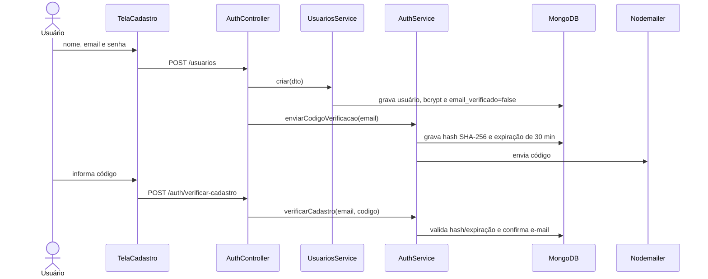
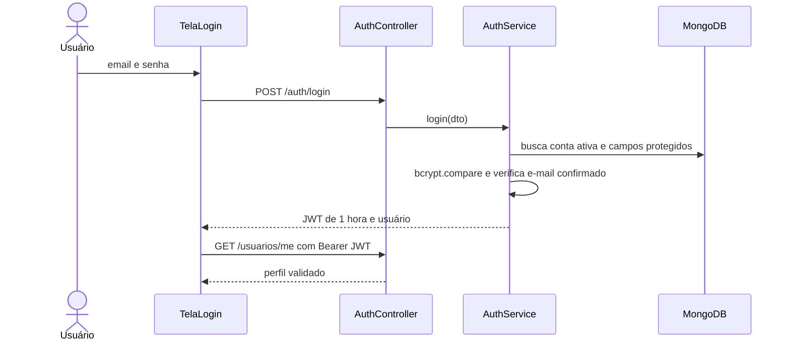
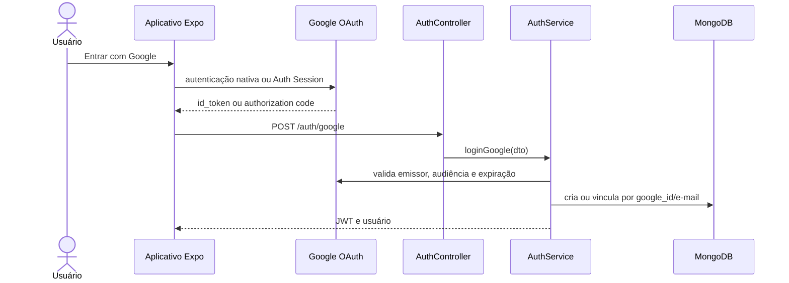
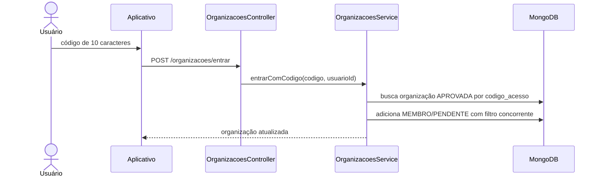
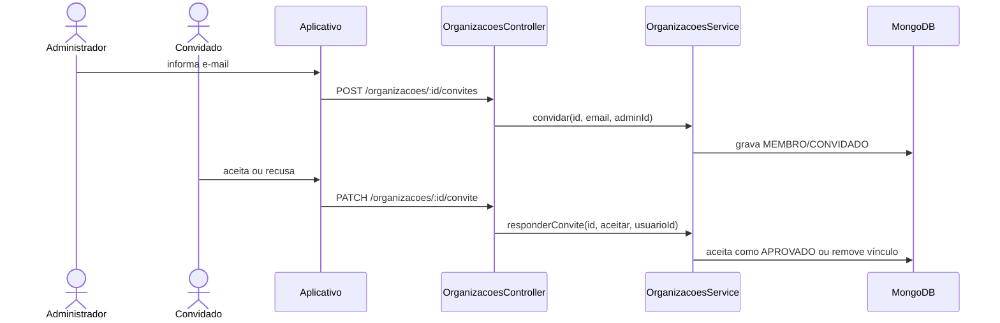
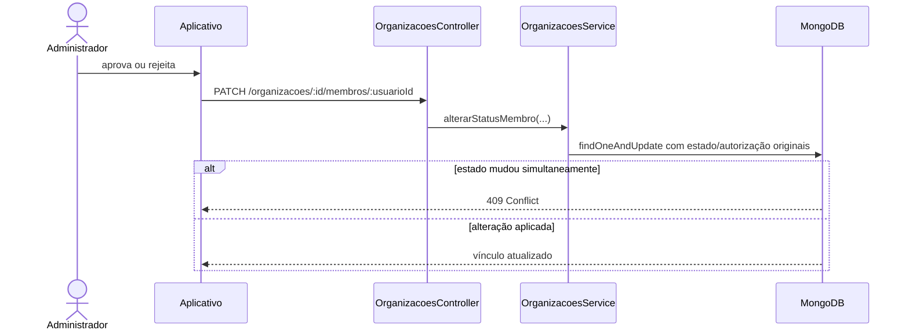
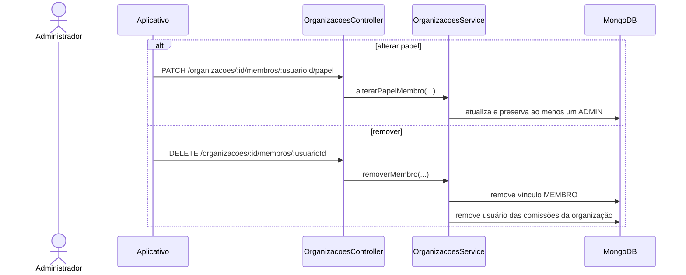

# Diagramas de sequência — Cadastro de usuário

> Padrão do Incremento 1 · Módulo USR

## Resumo

Mostra os fluxos entre telas, controllers, services, MongoDB, Google e serviço de e-mail.

Os nomes correspondem ao código auditado. Toda chamada passa pelo `ApiKeyGuard`; rotas privadas também usam `JwtAuthGuard` e `UsuarioComumGuard`.

## SD-USR-01 — Cadastro local e confirmação

## SD-USR-02 — Login local

## SD-USR-03 — Login Google

## SD-USR-04 — Entrar por código

## SD-USR-05 — Convidar e responder

## SD-USR-06 — Analisar solicitação

## SD-USR-07 — Alterar papel ou remover membro

