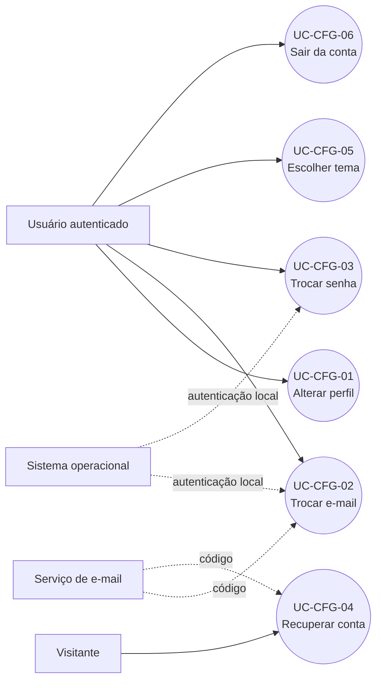

# Casos de uso — Configurações de usuário

> Padrão do Incremento 1 · Fontes: FRONTEND `792fab4` e BACKEND `6f2ffc4`

## Resumo

Este documento descreve a alteração de perfil, e-mail, senha e tema, a recuperação de conta por código e o encerramento local da sessão. O fluxo de recuperação não utiliza links, `localhost` nem IP do computador.

## Diagrama geral

## Resumo dos casos de uso

| ID        | Nome            | Ator principal      | Resultado                               |
| --------- | --------------- | ------------------- | --------------------------------------- |
| UC-CFG-01 | Alterar perfil  | Usuário autenticado | Nome atualizado na mesma tela.          |
| UC-CFG-02 | Trocar e-mail   | Usuário autenticado | Novo e-mail confirmado por código.      |
| UC-CFG-03 | Trocar senha    | Usuário autenticado | Hash da senha alterado.                 |
| UC-CFG-04 | Recuperar conta | Visitante           | Nova senha definida por código e token. |
| UC-CFG-05 | Escolher tema   | Usuário autenticado | Tema aplicado e sincronizado.           |
| UC-CFG-06 | Sair da conta   | Usuário autenticado | Token local removido.                   |

## Especificações

### UC-CFG-01 — Alterar perfil

| Campo                       | Especificação                                                                                                                                                                                                                |
| --------------------------- | ---------------------------------------------------------------------------------------------------------------------------------------------------------------------------------------------------------------------------- |
| **Resumo**                  | Alterar o nome e refletir o resultado sem trocar de tela.                                                                                                                                                                    |
| **Ator principal**          | Usuário autenticado.                                                                                                                                                                                                         |
| **Gatilho**                 | Selecionar **Salvar** no perfil.                                                                                                                                                                                             |
| **Pré-condições**           | JWT válido; perfil carregado por `GET /usuarios/me`.                                                                                                                                                                         |
| **Fluxo principal**         | 1. A tela carrega nome e e-mail. 2. O usuário altera o nome. 3. `react-hook-form` valida. 4. O app envia `PATCH /usuarios/me`. 5. O backend grava e retorna o perfil. 6. A sessão é atualizada na mesma tela. |
| **Alternativas e exceções** | Entrada inválida não é enviada. Token inválido: 401 e sessão local limpa. Usuário ausente: 404.                                                                                                                              |
| **Pós-condições**           | `usuarios.nome` e `atualizado_em` alterados.                                                                                                                                                                                 |
| **Rastreabilidade**         | RF-CFG-01 · SD-CFG-01 · CT-CFG-01/02.                                                                                                                                                                                        |

### UC-CFG-02 — Trocar e-mail

| Campo                       | Especificação                                                                                                                                                                                                                                                                                                       |
| --------------------------- | ------------------------------------------------------------------------------------------------------------------------------------------------------------------------------------------------------------------------------------------------------------------------------------------------------------------- |
| **Resumo**                  | Alterar endereço somente após confirmar código no novo e-mail.                                                                                                                                                                                                                                                      |
| **Ator principal**          | Usuário autenticado.                                                                                                                                                                                                                                                                                                |
| **Atores secundários**      | Sistema operacional e serviço de e-mail.                                                                                                                                                                                                                                                                            |
| **Gatilho**                 | Abrir **E-mail** nas configurações.                                                                                                                                                                                                                                                                                 |
| **Pré-condições**           | JWT válido; endereço diferente e disponível.                                                                                                                                                                                                                                                                        |
| **Fluxo principal**         | 1. O app solicita autenticação local quando disponível. 2. Envia `POST /usuarios/me/email/solicitar`. 3. O backend grava hash SHA-256 do código e expiração e envia o e-mail. 4. O usuário informa o código. 5. `POST /usuarios/me/email/confirmar` altera o e-mail. 6. A sessão recarrega o perfil. |
| **Alternativas e exceções** | Sem biometria configurada, o app continua. E-mail atual/duplicado ou código inválido/expirado: 400. Falha SMTP: erro informado.                                                                                                                                                                                     |
| **Pós-condições**           | E-mail normalizado e campos pendentes removidos.                                                                                                                                                                                                                                                                    |
| **Rastreabilidade**         | RF-CFG-02 · SD-CFG-02 · CT-CFG-03/04.                                                                                                                                                                                                                                                                               |

### UC-CFG-03 — Trocar senha

| Campo                       | Especificação                                                                                                                                                                                                                                         |
| --------------------------- | ----------------------------------------------------------------------------------------------------------------------------------------------------------------------------------------------------------------------------------------------------- |
| **Resumo**                  | Trocar senha de conta local mediante senha atual.                                                                                                                                                                                                     |
| **Ator principal**          | Usuário autenticado com senha local.                                                                                                                                                                                                                  |
| **Atores secundários**      | Sistema operacional, quando há autenticação local disponível.                                                                                                                                                                                         |
| **Gatilho**                 | Abrir **Senha** e salvar.                                                                                                                                                                                                                             |
| **Pré-condições**           | JWT válido e `senha_hash` existente.                                                                                                                                                                                                                  |
| **Fluxo principal**         | 1. O usuário informa senha atual, nova e confirmação. 2. O app valida mínimo de oito e igualdade. 3. Envia `PATCH /usuarios/me/senha`. 4. O backend compara a atual, impede repetição e grava bcrypt custo 10. 5. A tela informa sucesso. |
| **Alternativas e exceções** | Conta só Google orienta recuperação. Senha atual errada ou nova igual: 400.                                                                                                                                                                           |
| **Pós-condições**           | Novo hash persistido; JWT atual continua válido.                                                                                                                                                                                                      |
| **Rastreabilidade**         | RF-CFG-03 · SD-CFG-03 · CT-CFG-05/06.                                                                                                                                                                                                                 |

### UC-CFG-04 — Recuperar conta

| Campo                       | Especificação                                                                                                                                                                                                                                                                                                           |
| --------------------------- | ----------------------------------------------------------------------------------------------------------------------------------------------------------------------------------------------------------------------------------------------------------------------------------------------------------------------- |
| **Resumo**                  | Redefinir senha com código digitado no aplicativo, sem link externo.                                                                                                                                                                                                                                                    |
| **Ator principal**          | Visitante.                                                                                                                                                                                                                                                                                                              |
| **Atores secundários**      | Serviço de e-mail.                                                                                                                                                                                                                                                                                                      |
| **Gatilho**                 | Selecionar **Esqueci minha senha**.                                                                                                                                                                                                                                                                                     |
| **Pré-condições**           | Acesso à caixa postal da conta.                                                                                                                                                                                                                                                                                         |
| **Fluxo principal**         | 1. Informa e-mail em `POST /auth/recuperar-conta`. 2. Recebe código de sete caracteres válido por 30 minutos. 3. Envia código a `POST /auth/verificar-recuperacao` e recebe token de uso único. 4. Informa nova senha. 5. `POST /auth/redefinir-senha` valida o token e grava bcrypt. 6. Volta ao login. |
| **Alternativas e exceções** | E-mail inexistente recebe resposta genérica. Código ou token inválido/expirado: 400.                                                                                                                                                                                                                                    |
| **Pós-condições**           | Código e token inutilizados; nova senha persistida.                                                                                                                                                                                                                                                                     |
| **Rastreabilidade**         | RF-CFG-04 · SD-CFG-04 · CT-CFG-07/08/14.                                                                                                                                                                                                                                                                                |

### UC-CFG-05 — Escolher tema

| Campo                       | Especificação                                                                                                                                                           |
| --------------------------- | ----------------------------------------------------------------------------------------------------------------------------------------------------------------------- |
| **Resumo**                  | Aplicar `sistema`, `claro` ou `escuro` e sincronizar a preferência.                                                                                                     |
| **Ator principal**          | Usuário autenticado.                                                                                                                                                    |
| **Gatilho**                 | Selecionar uma opção de tema.                                                                                                                                           |
| **Pré-condições**           | Perfil carregado.                                                                                                                                                       |
| **Fluxo principal**         | 1. A interface aplica a opção imediatamente. 2. Salva no SecureStore/localStorage. 3. Envia `PATCH /usuarios/me` com `tema`. 4. Mantém a escolha após sucesso. |
| **Alternativas e exceções** | Se a API falhar, restaura o tema anterior e informa o erro.                                                                                                             |
| **Pós-condições**           | Preferência local e `usuarios.tema` sincronizados.                                                                                                                      |
| **Rastreabilidade**         | RF-CFG-05 · SD-CFG-05 · CT-CFG-09/10.                                                                                                                                   |

### UC-CFG-06 — Sair da conta

| Campo                       | Especificação                                                                                                                                                                                 |
| --------------------------- | --------------------------------------------------------------------------------------------------------------------------------------------------------------------------------------------- |
| **Resumo**                  | Encerrar a sessão no aparelho.                                                                                                                                                                |
| **Ator principal**          | Usuário autenticado.                                                                                                                                                                          |
| **Gatilho**                 | Selecionar **Sair da conta**.                                                                                                                                                                 |
| **Pré-condições**           | Sessão local existente.                                                                                                                                                                       |
| **Fluxo principal**         | 1. `SessaoContext.sair()` remove o JWT do SecureStore/localStorage. 2. Limpa o usuário em memória. 3. O roteamento protegido deixa de ser renderizado. 4. A tela de login é exibida. |
| **Alternativas e exceções** | Falha de remoção local deve limpar ao menos o estado em memória e impedir acesso protegido.                                                                                                   |
| **Pós-condições**           | Sem token local; JWT do servidor expira naturalmente em uma hora.                                                                                                                             |
| **Rastreabilidade**         | RF-CFG-06 · SD-CFG-06 · CT-CFG-11.                                                                                                                                                            |
