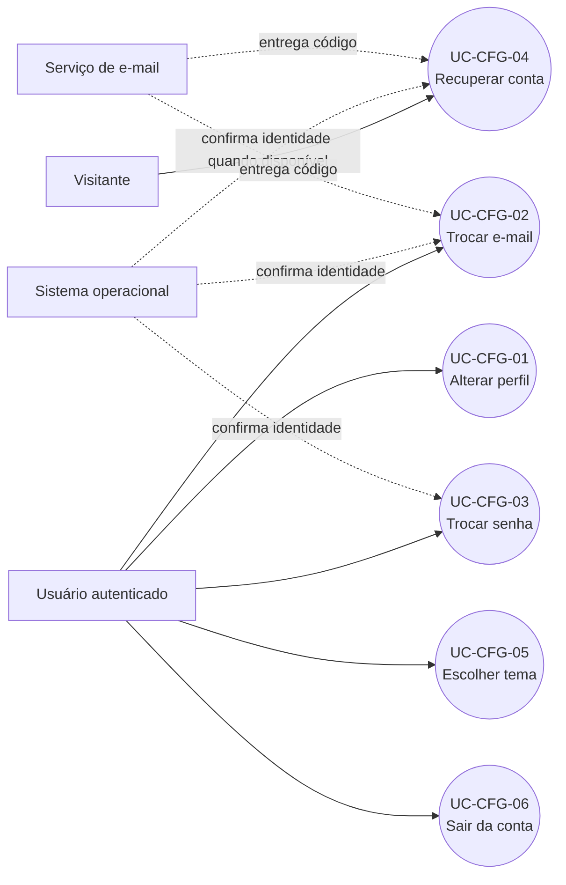

# Casos de uso — Configurações de usuário

## UC-CFG-01 — Alterar nome do perfil

| Campo | Especificação |
|---|---|
| Ator principal | Usuário autenticado |
| Gatilho | Selecionar **Perfil** e alterar o nome |
| Pré-condições | JWT válido; conta ativa; perfil carregado por `GET /usuarios/me` |
| Fluxo principal | 1. `TelaPerfil` exibe nome e e-mail. 2. O usuário altera o nome. 3. `react-hook-form` valida ao menos 3 caracteres na interface. 4. A tela envia `PATCH /usuarios/me` com `{nome}`. 5. O backend aceita ao menos 2 caracteres, grava `usuarios.nome` e retorna o perfil. 6. A sessão é atualizada sem trocar de tela. |
| Alternativas | Entrada inválida: formulário não envia. JWT inválido: `401` e sessão local removida. Conta inexistente: `404`. |
| Pós-condições | `usuarios.nome` e `atualizado_em` alterados; cabeçalhos que usam a sessão exibem o novo nome. |

## UC-CFG-02 — Trocar e-mail

| Campo | Especificação |
|---|---|
| Ator principal | Usuário autenticado |
| Atores secundários | Sistema operacional e serviço de e-mail |
| Pré-condições | JWT válido; novo e-mail diferente e ainda não usado |
| Fluxo principal | 1. Ao abrir a opção E-mail, o app solicita autenticação local quando disponível. 2. O usuário informa o novo endereço. 3. `POST /usuarios/me/email/solicitar` gera código de 7 caracteres, guarda apenas SHA-256 e envia ao novo endereço. 4. O usuário informa o código. 5. `POST /usuarios/me/email/confirmar` valida e altera `usuarios.email`. 6. A sessão recarrega o perfil. |
| Alternativas | E-mail atual ou duplicado: `400`. Código incorreto/expirado: `400`. Envio SMTP falha: a API devolve erro. |
| Pós-condições | E-mail normalizado e confirmado; campos pendentes removidos. |

## UC-CFG-03 — Trocar senha autenticada

| Campo | Especificação |
|---|---|
| Ator principal | Usuário autenticado com senha local |
| Pré-condições | JWT válido; autenticação local concluída quando disponível; senha local existente |
| Fluxo principal | 1. O usuário informa senha atual, nova senha e confirmação. 2. O app valida mínimo de 8 caracteres e igualdade da confirmação. 3. Envia `PATCH /usuarios/me/senha`. 4. O serviço compara a atual e impede repetição. 5. Grava novo hash bcrypt com custo 10. |
| Alternativas | Conta somente Google: orienta usar recuperação. Senha atual errada ou nova igual: `400`. |
| Pós-condições | `usuarios.senha_hash` e `atualizado_em` alterados. A sessão atual permanece ativa. |

## UC-CFG-04 — Recuperar conta

| Campo | Especificação |
|---|---|
| Ator principal | Visitante |
| Atores secundários | Serviço de e-mail e sistema operacional |
| Pré-condições | Acesso à tela pública e à caixa postal da conta |
| Fluxo principal | 1. O visitante informa o e-mail. 2. `POST /auth/recuperar-conta` gera e envia código de 7 caracteres válido por 30 minutos. 3. `POST /auth/verificar-recuperacao` troca o código correto por token aleatório de 32 bytes. 4. O app solicita autenticação local quando disponível. 5. O visitante informa e confirma nova senha. 6. `POST /auth/redefinir-senha` valida o hash do token e grava bcrypt. |
| Alternativas | E-mail inexistente recebe a mesma mensagem genérica. Código/token inválido ou expirado: `400`. |
| Pós-condições | Código e token inutilizados; nova senha persistida. O usuário ainda precisa entrar. |

## UC-CFG-05 — Escolher tema

| Campo | Especificação |
|---|---|
| Ator principal | Usuário autenticado |
| Pré-condições | Perfil carregado |
| Fluxo principal | 1. Usuário escolhe `sistema`, `claro` ou `escuro`. 2. A interface aplica a escolha imediatamente e grava no SecureStore/localStorage. 3. Envia `PATCH /usuarios/me` com `{tema}`. 4. Em sucesso, mantém a escolha. |
| Alternativa | Se a API falhar, a tela restaura a preferência anterior e informa o erro. |
| Pós-condições | Preferência sincronizada entre armazenamento local e `usuarios.tema`. |

## UC-CFG-06 — Sair da conta

| Campo | Especificação |
|---|---|
| Ator principal | Usuário autenticado |
| Fluxo principal | 1. Usuário seleciona **Sair da conta**. 2. `SessaoContext.sair()` remove o JWT do SecureStore/localStorage e limpa o usuário em memória. 3. As rotas protegidas deixam de existir na pilha e o login é exibido. |
| Pós-condições | Não há token local. O JWT emitido não é revogado no servidor e expira naturalmente em 1 hora. |

