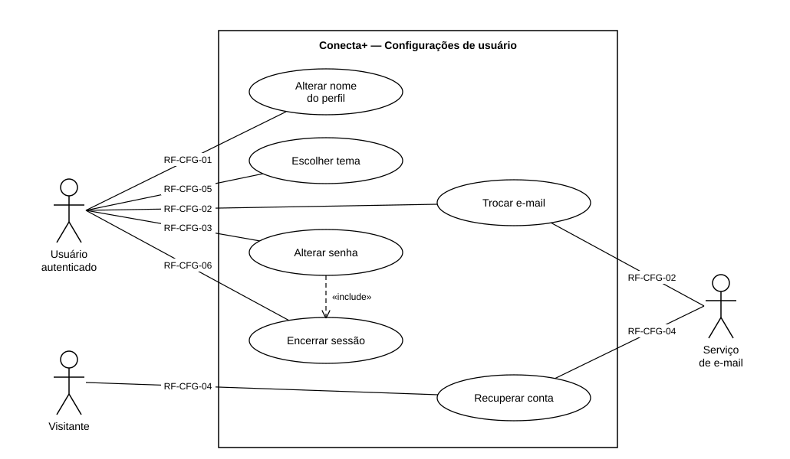

# Casos de uso — Configurações de usuário

> Padrão da disciplina · Módulo CFG · Revisado em 26/11/2026

## Resumo

Este documento mostra quem usa as configurações da conta e o que cada pessoa pode fazer. Cada caso de uso é descrito em detalhe, como requisito funcional no formulário padrão, em [Requisitos funcionais](2%20-%20requisitos-funcionais-configuracoes-usuario.md).

## Diagrama de casos de uso

Figura 1 — Diagrama de casos de uso das configurações de usuário. Fonte: equipe Conecta+.

Cada linha entre um ator e um caso de uso leva o código do requisito funcional que o descreve.

## Atores

**Usuário autenticado.** É qualquer pessoa com a sessão aberta no aparelho, seja um usuário comum ou o administrador do sistema. Pela tela "Perfil", pode alterar o próprio nome, escolher o tema, trocar o e-mail, trocar a senha e sair da conta. Só altera a própria conta: o servidor identifica a conta pelo token da sessão, e nenhuma tela deste módulo recebe o identificador de outra pessoa. Para trocar o e-mail ou a senha, precisa confirmar a identidade no aparelho (biometria, Face ID ou PIN), quando o aparelho tem bloqueio de tela. Não pode trocar o e-mail sem o código enviado ao novo endereço nem trocar a senha sem informar a atual. Não usa a recuperação de conta, que só aparece na tela de login.

**Visitante.** É a pessoa sem sessão aberta no aparelho, na tela de login. Pode recuperar a conta: recebe um código no e-mail, digita o código no aplicativo e define uma nova senha. Não precisa saber a senha antiga, mas precisa ter acesso à caixa de entrada do e-mail da conta, e a conta precisa estar ativa. Não altera nenhum outro dado da conta.

**Serviço de e-mail.** É o servidor SMTP configurado no servidor da API. É um ator secundário: não inicia nenhum caso de uso, apenas recebe da API as mensagens com o código da troca de e-mail e o código da recuperação e as entrega na caixa de entrada. A API não espera esse serviço terminar o envio para responder ao aplicativo.

Visitante e usuário autenticado podem ser a mesma pessoa em momentos diferentes; não há generalização entre eles, porque um não faz o que o outro faz: o aplicativo só oferece a recuperação a quem está sem sessão, e só oferece o perfil a quem está com sessão.

## Relacionamentos entre casos de uso

- **«include» de Alterar senha para Encerrar sessão:** toda troca de senha concluída encerra a sessão no aparelho, com a mesma função usada por "Sair da conta", e leva ao login com o aviso "Senha alterada. Entre novamente com a nova senha.".

## Requisitos funcionais de usuário

| Caso de uso | Requisito | Nome                   | Ator principal      |
| ----------- | --------- | ---------------------- | ------------------- |
| UC-CFG-01   | RF-CFG-01 | Alterar nome do perfil | Usuário autenticado |
| UC-CFG-02   | RF-CFG-02 | Trocar e-mail          | Usuário autenticado |
| UC-CFG-03   | RF-CFG-03 | Alterar senha          | Usuário autenticado |
| UC-CFG-04   | RF-CFG-04 | Recuperar conta        | Visitante           |
| UC-CFG-05   | RF-CFG-05 | Escolher tema          | Usuário autenticado |
| UC-CFG-06   | RF-CFG-06 | Encerrar sessão        | Usuário autenticado |

**Requisito RF-CFG-01 — Alterar nome do perfil.** O sistema deve permitir ao usuário autenticado ver o próprio nome e e-mail na tela "Perfil" e alterar o nome, vendo o novo nome na mesma tela, sem precisar sair dela.

**Requisito RF-CFG-02 — Trocar e-mail.** O sistema deve permitir ao usuário autenticado trocar o e-mail da conta, desde que confirme a troca digitando no aplicativo o código enviado ao novo endereço, em até 30 minutos.

**Requisito RF-CFG-03 — Alterar senha.** O sistema deve permitir ao usuário autenticado trocar a senha, informando a senha atual e uma nova senha forte, e deve encerrar a sessão em todos os aparelhos em que a conta estiver aberta.

**Requisito RF-CFG-04 — Recuperar conta.** O sistema deve permitir ao visitante que esqueceu a senha definir uma nova, digitando no aplicativo o código enviado ao e-mail da conta, sem abrir link.

**Requisito RF-CFG-05 — Escolher tema.** O sistema deve permitir ao usuário autenticado escolher o tema do aplicativo entre Sistema, Claro e Escuro, aplicando a escolha na hora e guardando-a para os próximos acessos.

**Requisito RF-CFG-06 — Encerrar sessão.** O sistema deve permitir ao usuário autenticado sair da conta no aparelho, depois de confirmar, voltando à tela de login.

Não implementado: pré-visualizar o tema sem salvar (RF-CFG-05) e confirmar a identidade antes de alterar o nome (RF-CFG-01). Ver a seção "Melhorias não implementadas" de [Requisitos funcionais](2%20-%20requisitos-funcionais-configuracoes-usuario.md).
