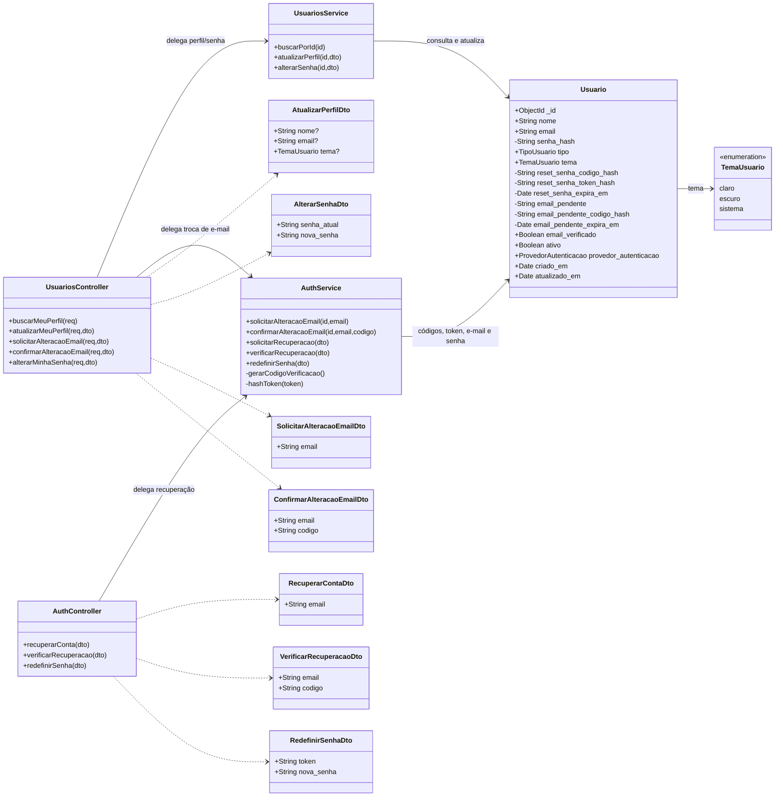

# Diagrama de classes — Configurações de usuário

> Padrão do Incremento 1 · Módulo CFG

## Resumo

Representa as telas, contexts, controllers, services e entidade `Usuario` envolvidos nas configurações.

O diagrama representa classes reais do backend. `Usuario` é persistente; DTOs validam entradas; controllers delegam regras aos services.

## Relações importantes

- `UsuariosController` usa `UsuariosService` para perfil/senha e `AuthService` para troca confirmada de e-mail.
- `AuthController` expõe o fluxo público de recuperação.
- Hashes e campos temporários usam `select: false`; não aparecem em consultas comuns nem nas respostas da API.
- `AtualizarPerfilDto.email` existe para validação defensiva, porém `UsuariosService.atualizarPerfil()` recusa alteração direta.
