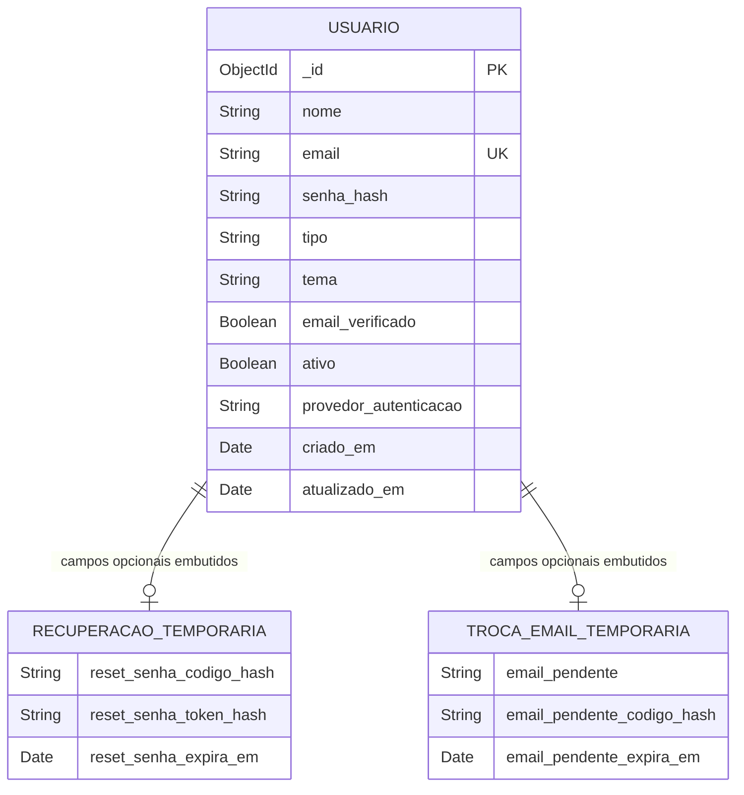

# Diagrama relacional — Configurações de usuário

O MongoDB armazena todo o módulo em um único documento da coleção `usuarios`. O diagrama abaixo separa grupos lógicos de campos apenas para leitura; não existem tabelas físicas de recuperação ou troca de e-mail.

## Decisões

- O e-mail tem índice único criado pelo schema Mongoose.
- Códigos e tokens em texto não são persistidos; somente SHA-256.
- A senha é persistida apenas como bcrypt.
- Os grupos temporários são apagados após uso; não representam histórico.

