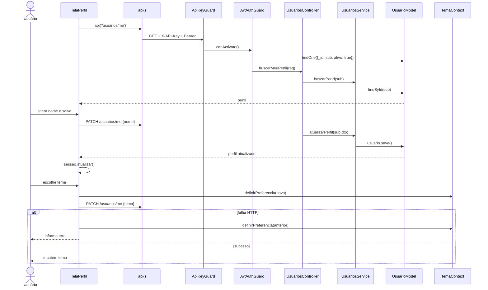
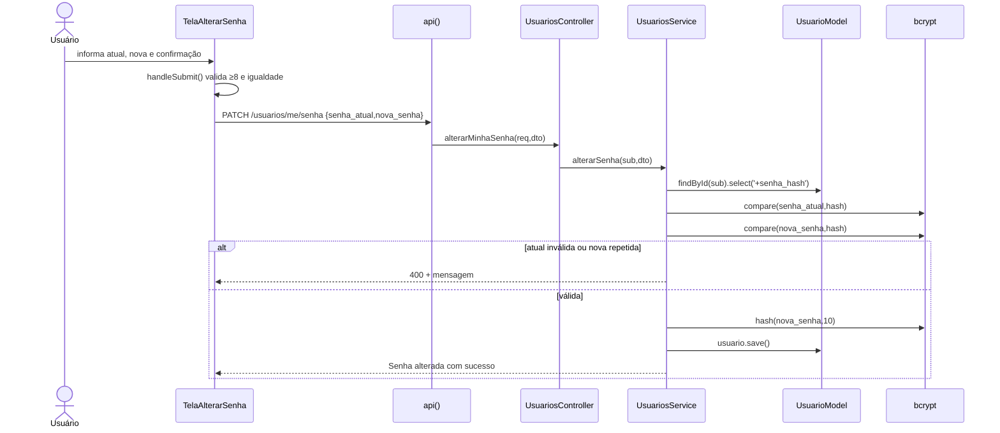
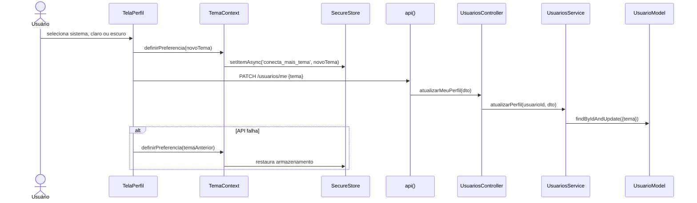
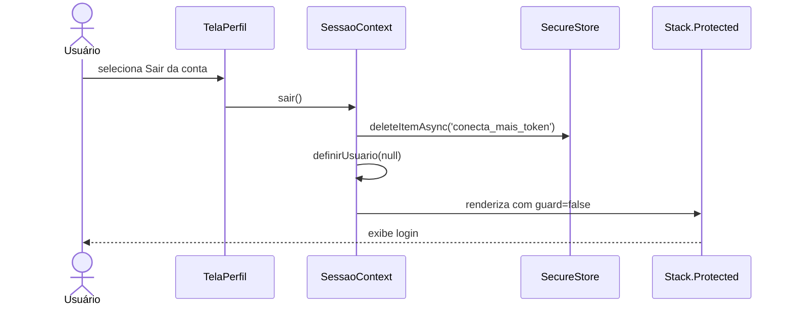

# Diagramas de sequência — Configurações de usuário

> Padrão do Incremento 1 · Módulo CFG

## Resumo

Mostra os fluxos entre telas Expo, contexts, controllers, services, MongoDB e e-mail.

Os participantes abaixo correspondem a componentes e métodos existentes.

## SD-CFG-01 — Alterar perfil



## SD-CFG-02 — Trocar e-mail

```mermaid
sequenceDiagram
    actor U as Usuário
    participant P as TelaPerfil
    participant L as autenticarComDispositivo()
    participant T as TelaTrocarEmail
    participant A as api()
    participant C as UsuariosController
    participant S as AuthService
    participant M as UsuarioModel
    participant E as Nodemailer

    U->>P: seleciona E-mail
    P->>L: autenticarComDispositivo()
    alt cancelado
        L-->>P: false
    else confirmado ou indisponível
        L-->>P: true
        P->>T: navega
        U->>T: informa novo e-mail
        T->>A: POST /usuarios/me/email/solicitar {email}
        A->>C: solicitarAlteracaoEmail(req,dto)
        C->>S: solicitarAlteracaoEmail(sub,email)
        S->>M: verificar unicidade; save(campos pendentes)
        S->>E: sendMail(código)
        U->>T: informa código
        T->>A: POST /usuarios/me/email/confirmar {email,codigo}
        A->>C: confirmarAlteracaoEmail(req,dto)
        C->>S: confirmarAlteracaoEmail(sub,email,codigo)
        S->>M: findById(+campos pendentes)
        S->>M: save(email; unset pendentes)
        T->>T: sessao.atualizar()
    end
```

## SD-CFG-03 — Trocar senha autenticada



## SD-CFG-04 — Recuperar conta

```mermaid
sequenceDiagram
    actor V as Visitante
    participant T as TelaRecuperarConta
    participant A as api()
    participant C as AuthController
    participant S as AuthService
    participant M as UsuarioModel
    participant E as Nodemailer
    participant L as autenticarComDispositivo()
    participant B as bcrypt

    V->>T: informa e-mail
    T->>A: POST /auth/recuperar-conta {email}
    A->>C: recuperarConta(dto)
    C->>S: solicitarRecuperacao(dto)
    S->>M: findOne({email,ativo:true})
    opt conta existente
        S->>M: save(hash do código, expiração)
        S->>E: sendMail(código)
    end
    S-->>T: mensagem genérica
    V->>T: informa código
    T->>A: POST /auth/verificar-recuperacao {email,codigo}
    C->>S: verificarRecuperacao(dto)
    S->>M: findOne(+código + expiração)
    S->>M: save(hash do token; unset código)
    S-->>T: token temporário
    V->>T: informa nova senha e confirmação
    T->>L: autenticarComDispositivo()
    L-->>T: resultado
    T->>A: POST /auth/redefinir-senha {token,nova_senha}
    C->>S: redefinirSenha(dto)
    S->>M: findOne({token_hash,expiração,ativo:true})
    S->>B: hash(nova_senha,10)
    S->>M: save(senha; unset token/expiração)
    S-->>T: sucesso
```

## SD-CFG-05 — Escolher tema



## SD-CFG-06 — Encerrar sessão


