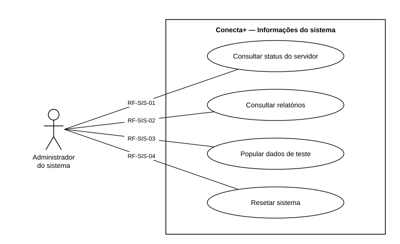

# Casos de uso — Informações do sistema

> Padrão da disciplina · Módulo SIS · Revisado em 26/11/2026

## Resumo

Este documento mostra quem usa as informações do sistema e o que essa pessoa pode fazer. Cada caso de uso é descrito em detalhe, como requisito funcional no formulário padrão, em [Requisitos funcionais](2%20-%20requisitos-funcionais-informacao-sistemas.md).

## Diagrama de casos de uso

Figura 1 — Diagrama de casos de uso das informações do sistema. Fonte: equipe Conecta+.

Cada linha entre o ator e um caso de uso leva o código do requisito funcional que o descreve.

## Atores

**Administrador do sistema.** É a conta ativa cujo campo `tipo` vale `ADMIN_SISTEMA`. A primeira conta desse tipo é criada pela própria API ao iniciar, a partir da configuração do servidor, quando ainda não existe nenhum administrador do sistema; outras contas podem receber esse tipo pela edição de usuários, descrita em [Cadastro de usuário](../cadastro-usuario/README.md). Só ele vê o item "Sistema" na tela inicial e abre a tela "Sistema". Pode consultar o status do servidor e os relatórios, criar os dados de teste e resetar o sistema; para resetar, precisa digitar "RESETAR" e, quando o aparelho tem biometria ou PIN cadastrado, confirmar a identidade nele. Não pode escolher o que o reset apaga, não pode desfazer o reset e não pode reiniciar partes do sistema, porque essa função não existe. O administrador do sistema também não cria nem participa de organizações, comissões e reuniões: essas rotas o recusam.

O usuário comum não é ator deste módulo: o aplicativo não mostra a tela para ele, e a API recusa as rotas com a mensagem "Apenas administradores do sistema podem realizar esta operação".

## Relacionamentos entre casos de uso

Não há `«include»`, `«extend»` nem generalização neste módulo. Os quatro casos de uso são independentes e têm um único ator. Depois de popular os dados de teste ou de resetar o sistema, a tela consulta de novo o status e os relatórios para mostrar os números atualizados; isso é uma atualização da tela, não um caso de uso incluído.

## Requisitos funcionais de usuário

| Caso de uso | Requisito | Nome                         | Ator principal           |
| ----------- | --------- | ---------------------------- | ------------------------ |
| UC-SIS-01   | RF-SIS-01 | Consultar status do servidor | Administrador do sistema |
| UC-SIS-02   | RF-SIS-02 | Consultar relatórios         | Administrador do sistema |
| UC-SIS-03   | RF-SIS-03 | Popular dados de teste       | Administrador do sistema |
| UC-SIS-04   | RF-SIS-04 | Resetar sistema              | Administrador do sistema |

**Requisito RF-SIS-01 — Consultar status do servidor.** O sistema deve permitir ao administrador do sistema ver a memória em uso, a carga da CPU e o tempo ligado do computador onde a API roda, e saber se o banco de dados respondeu.

**Requisito RF-SIS-02 — Consultar relatórios.** O sistema deve permitir ao administrador do sistema ver quantos usuários existem e quantos estão ativos, quantas organizações existem e quantas estão aprovadas ou pendentes, e quantas comissões existem e quantas estão ativas.

**Requisito RF-SIS-03 — Popular dados de teste.** O sistema deve permitir ao administrador do sistema, depois de confirmar, criar três contas de teste, uma organização aprovada e uma comissão, para demonstrar o aplicativo.

**Requisito RF-SIS-04 — Resetar sistema.** O sistema deve permitir ao administrador do sistema, depois de digitar a palavra "RESETAR" e confirmar a identidade no aparelho, apagar os usuários comuns, as organizações, as comissões, as reuniões com seus anexos, a numeração das atas e as notificações, mantendo as contas de administrador do sistema.

## Funções não implementadas

- **Reiniciar subsistemas.** A descrição do item "Sistema" na tela inicial diz "Status, relatórios, reinício de subsistemas e reset.", mas essa função não existe no aplicativo nem na API. Por isso ela não aparece no diagrama.
