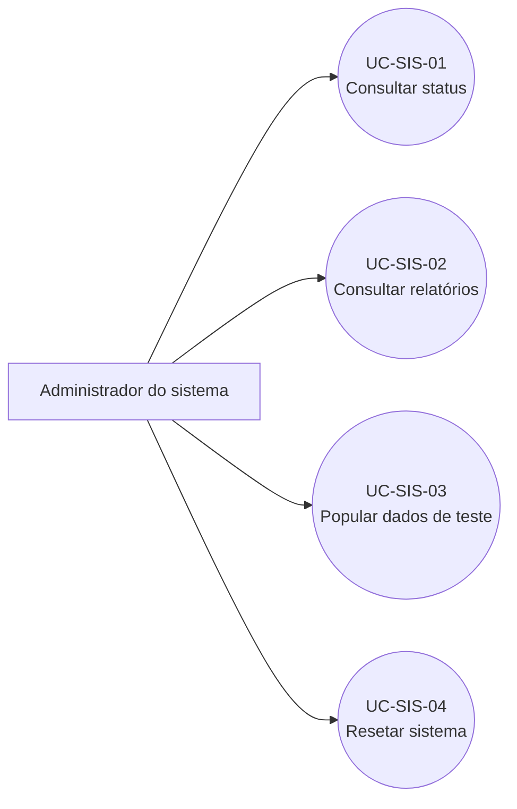

# Casos de uso — Informações do sistema

> Padrão do Incremento 1 · Fonte: FRONTEND `homolog` (`792fab4`) e BACKEND `homolog` (`6f2ffc4`)

## Resumo

Este documento descreve as funções administrativas de monitoramento, relatório, criação de dados de demonstração e reset. O sistema monitorado é o backend; não há reinicialização de subsistemas porque a aplicação NestJS executa como um único processo.

## Diagrama geral

## Resumo dos casos de uso

| ID        | Nome                   | Ator principal           | Resultado                                          |
| --------- | ---------------------- | ------------------------ | -------------------------------------------------- |
| UC-SIS-01 | Consultar status       | Administrador do sistema | Métricas e estado do banco exibidos.               |
| UC-SIS-02 | Consultar relatórios   | Administrador do sistema | Contagens consolidadas exibidas.                   |
| UC-SIS-03 | Popular dados de teste | Administrador do sistema | Cenário de demonstração criado.                    |
| UC-SIS-04 | Resetar sistema        | Administrador do sistema | Dados operacionais removidos e admins preservados. |

## Especificações

### UC-SIS-01 — Consultar status

| Campo                       | Especificação                                                                                                                                                                         |
| --------------------------- | ------------------------------------------------------------------------------------------------------------------------------------------------------------------------------------- |
| **Resumo**                  | Consultar CPU, memória, tempo ativo e disponibilidade do banco do backend.                                                                                                            |
| **Ator principal**          | Administrador do sistema.                                                                                                                                                             |
| **Gatilho**                 | Abrir a tela Sistema.                                                                                                                                                                 |
| **Pré-condições**           | `X-API-Key`, JWT válido, conta ativa e tipo `ADMIN_SISTEMA`.                                                                                                                          |
| **Fluxo principal**         | 1. O app envia `GET /sistema/status`. 2. Guards validam credenciais e tipo. 3. `SistemaService.status()` lê o módulo `os` e consulta o MongoDB. 4. A tela exibe as métricas. |
| **Alternativas e exceções** | Chave/JWT ausente: 401. Usuário comum: 403. Banco indisponível: resposta sinaliza falha.                                                                                              |
| **Pós-condições**           | Nenhum dado alterado.                                                                                                                                                                 |
| **Rastreabilidade**         | RF-SIS-01 · SD-SIS-01 · CT-SIS-01/02/03.                                                                                                                                              |

### UC-SIS-02 — Consultar relatórios

| Campo                       | Especificação                                                                                                                                                  |
| --------------------------- | -------------------------------------------------------------------------------------------------------------------------------------------------------------- |
| **Resumo**                  | Exibir totais de usuários, organizações e comissões por situação.                                                                                              |
| **Ator principal**          | Administrador do sistema.                                                                                                                                      |
| **Gatilho**                 | Acessar a seção de relatórios.                                                                                                                                 |
| **Pré-condições**           | Credenciais válidas de `ADMIN_SISTEMA`.                                                                                                                        |
| **Fluxo principal**         | 1. O app envia `GET /sistema/relatorios`. 2. O service executa `countDocuments()` com filtros. 3. Retorna totais. 4. A tela apresenta os indicadores. |
| **Alternativas e exceções** | Falha no banco: erro de serviço informado. Sem permissão: 403.                                                                                                 |
| **Pós-condições**           | Nenhum dado alterado.                                                                                                                                          |
| **Rastreabilidade**         | RF-SIS-02 · SD-SIS-02 · CT-SIS-02.                                                                                                                             |

### UC-SIS-03 — Popular dados de teste

| Campo                       | Especificação                                                                                                                                                                                                          |
| --------------------------- | ---------------------------------------------------------------------------------------------------------------------------------------------------------------------------------------------------------------------- |
| **Resumo**                  | Criar dados controlados para demonstração.                                                                                                                                                                             |
| **Ator principal**          | Administrador do sistema.                                                                                                                                                                                              |
| **Gatilho**                 | Confirmar **Popular dados de teste**.                                                                                                                                                                                  |
| **Pré-condições**           | Credenciais válidas e confirmação explícita.                                                                                                                                                                           |
| **Fluxo principal**         | 1. A interface pede confirmação. 2. Envia `POST /sistema/popular-teste`. 3. O service cria três usuários, uma organização aprovada e uma comissão. 4. Retorna os dados criados. 5. A tela informa sucesso. |
| **Alternativas e exceções** | Cancelamento não envia chamada. Falha de persistência informa erro.                                                                                                                                                    |
| **Pós-condições**           | Cenários sem vínculo, admin de organização e membro/comissão disponíveis; admin global preservado.                                                                                                                     |
| **Rastreabilidade**         | RF-SIS-03 · SD-SIS-03 · CT-SIS-04.                                                                                                                                                                                     |

### UC-SIS-04 — Resetar sistema

| Campo                       | Especificação                                                                                                                                                                                                                                               |
| --------------------------- | ----------------------------------------------------------------------------------------------------------------------------------------------------------------------------------------------------------------------------------------------------------- |
| **Resumo**                  | Remover dados operacionais e usuários comuns sem apagar administradores do sistema.                                                                                                                                                                         |
| **Ator principal**          | Administrador do sistema.                                                                                                                                                                                                                                   |
| **Gatilho**                 | Confirmar **Resetar sistema**.                                                                                                                                                                                                                              |
| **Pré-condições**           | Credenciais válidas e confirmação destrutiva explícita.                                                                                                                                                                                                     |
| **Fluxo principal**         | 1. A interface explica o impacto e solicita confirmação. 2. Envia `POST /sistema/reset`. 3. O service remove reuniões, comissões e organizações. 4. Remove usuários cujo tipo não seja `ADMIN_SISTEMA`. 5. Retorna `sistema_resetado` e a data. |
| **Alternativas e exceções** | Cancelamento mantém tudo. Usuário comum: 403. Falha parcial deve ser tratada como erro e exige conferência administrativa.                                                                                                                                  |
| **Pós-condições**           | Dados operacionais zerados; administradores globais continuam aptos a entrar.                                                                                                                                                                               |
| **Rastreabilidade**         | RF-SIS-04 · SD-SIS-04 · CT-SIS-05/06.                                                                                                                                                                                                                       |
