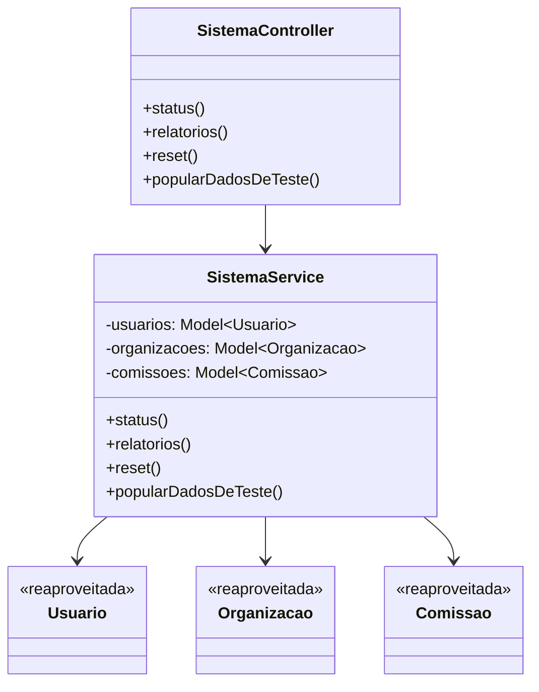

# Diagrama de classes — Informações do sistema

> Padrão do Incremento 1 · Módulo SIS

## Resumo

Representa `SistemaController`, `SistemaService` e as coleções reutilizadas pelo módulo.

O módulo não cria nenhuma classe/entidade nova de banco — reaproveita `Usuario`, `Organizacao` e `Comissao` já existentes no projeto.
