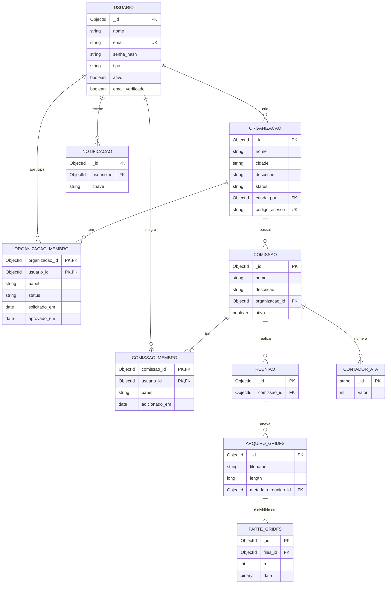

# Diagrama relacional — Informações do sistema

> Padrão da disciplina · Módulo SIS · Visão lógica dos documentos MongoDB · Revisado em 26/11/2026

## Resumo

O banco é o MongoDB, que não tem tabelas. Este módulo não tem coleção própria: ele conta, cria e apaga documentos das coleções dos outros módulos. O diagrama abaixo é uma **visão lógica** dessas coleções: os membros de organizações e comissões, que ficam dentro dos documentos, aparecem como entidades separadas para deixar claras as chaves e as cardinalidades. Só entram os campos que este módulo lê, grava ou usa como filtro. A entidade `NOTIFICACAO` aparece porque o reset também apaga essa coleção.

## Diagrama

Figura 3 — Visão lógica relacional das coleções usadas pelas informações do sistema. Fonte: equipe Conecta+.

## Como as entidades lógicas viram documentos

| Entidade lógica      | Onde fica de verdade              | O que este módulo faz                                                                    |
| -------------------- | --------------------------------- | ---------------------------------------------------------------------------------------- |
| `USUARIO`            | coleção `usuarios`                | Conta (todos e ativos), cria as três contas de teste e apaga as que não são `ADMIN_SISTEMA`. |
| `ORGANIZACAO`        | coleção `organizacoes`            | Conta (todas, pendentes e aprovadas), cria a organização de teste e apaga todas.          |
| `ORGANIZACAO_MEMBRO` | `organizacoes.membros[]`          | Grava os dois membros da organização de teste; some junto com a organização.             |
| `COMISSAO`           | coleção `comissoes`               | Conta (todas e ativas), cria a comissão de teste e apaga todas.                           |
| `COMISSAO_MEMBRO`    | `comissoes.membros[]`             | Grava o responsável da comissão de teste; some junto com a comissão.                      |
| `REUNIAO`            | coleção `reunioes`                | Apaga todas, com tudo o que está dentro delas (ata, votações, presenças e dados de anexos). |
| `ARQUIVO_GRIDFS`     | coleção `anexos.files`            | Apaga todos os documentos.                                                                |
| `PARTE_GRIDFS`       | coleção `anexos.chunks`           | Apaga todos os documentos.                                                                |
| `CONTADOR_ATA`       | coleção `contadores`              | Apaga todos os documentos.                                                                |
| `NOTIFICACAO`        | coleção `notificacoes`            | Apaga todos os documentos, inclusive os das contas de administrador do sistema.           |

Em `ORGANIZACAO_MEMBRO` e `COMISSAO_MEMBRO`, o identificador da organização ou da comissão aparece como parte da chave, mas não é um campo gravado: ele vem do documento que contém a lista. Em `ARQUIVO_GRIDFS`, `metadata_reuniao_id` representa o campo `metadata.reuniao_id`; o mesmo identificador do arquivo também fica gravado em `reunioes.anexos[]._id`. Em `CONTADOR_ATA`, a comissão e o ano não são campos: estão dentro do `_id`, no formato `atas:<id da comissão>:<ano>`.

## Regras de integridade

- o reset preserva toda conta cujo `tipo` é `ADMIN_SISTEMA`; qualquer outro valor, ou a falta do campo, leva a conta à exclusão;
- o reset apaga organizações, comissões e reuniões inteiras, por isso não sobram membros, atas ou anexos sem o documento que os contém;
- o reset apaga as duas coleções do GridFS por completo, sem conferir a que reunião cada arquivo pertence, porque todas as reuniões também são apagadas;
- o reset apaga todas as `NOTIFICACAO`, sem filtro: não sobra notificação ligada a uma conta apagada, e as contas de administrador do sistema, que continuam, também perdem as suas;
- as exclusões não estão numa transação: uma falha no meio pode deixar parte das coleções apagada e parte não;
- os dados de teste passam pelas regras do schema e dos índices, como qualquer gravação: `USUARIO.email` é único (índice do MongoDB), e a comissão de teste precisa ter exatamente um membro com papel `RESPONSAVEL` (validação do Mongoose). As validações de formulário do cadastro, como o formato do e-mail e a regra de senha, não se aplicam.

## Rastreabilidade

RF-SIS-01 a RF-SIS-04; detalhado em [Dicionário relacional](4%20-%20dicionario-dados-relacional-informacao-sistemas.md).
