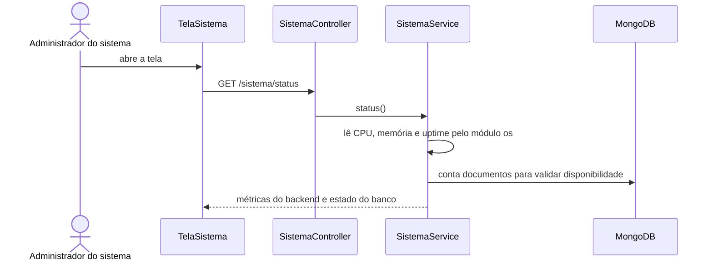
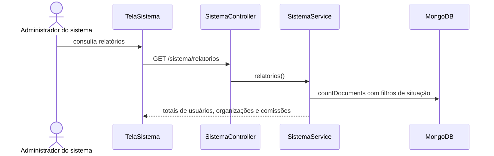
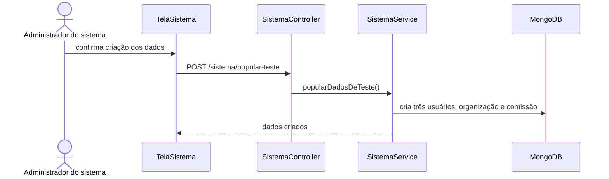
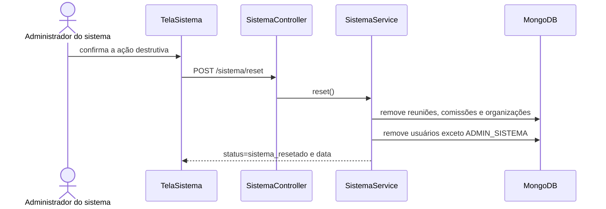

# Diagramas de sequência — Informações do sistema

> Padrão do Incremento 1 · Módulo SIS

## Resumo

Mostra a ordem entre tela, guards, `SistemaController`, `SistemaService` e MongoDB.

Todos os fluxos passam por `ApiKeyGuard`, `JwtAuthGuard` e `AdminSistemaGuard` antes de chegar ao controller.

## SD-SIS-01 — Status

## SD-SIS-02 — Relatórios

## SD-SIS-03 — Popular dados de teste

## SD-SIS-04 — Reset

