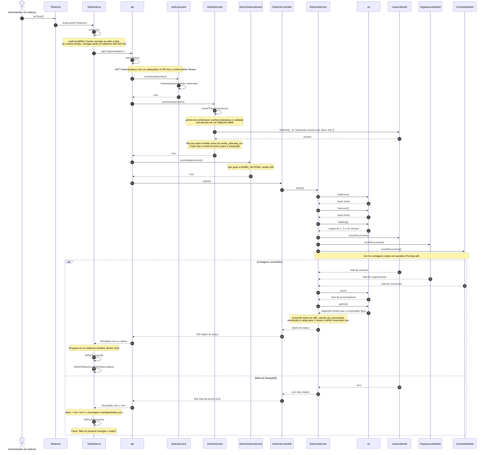
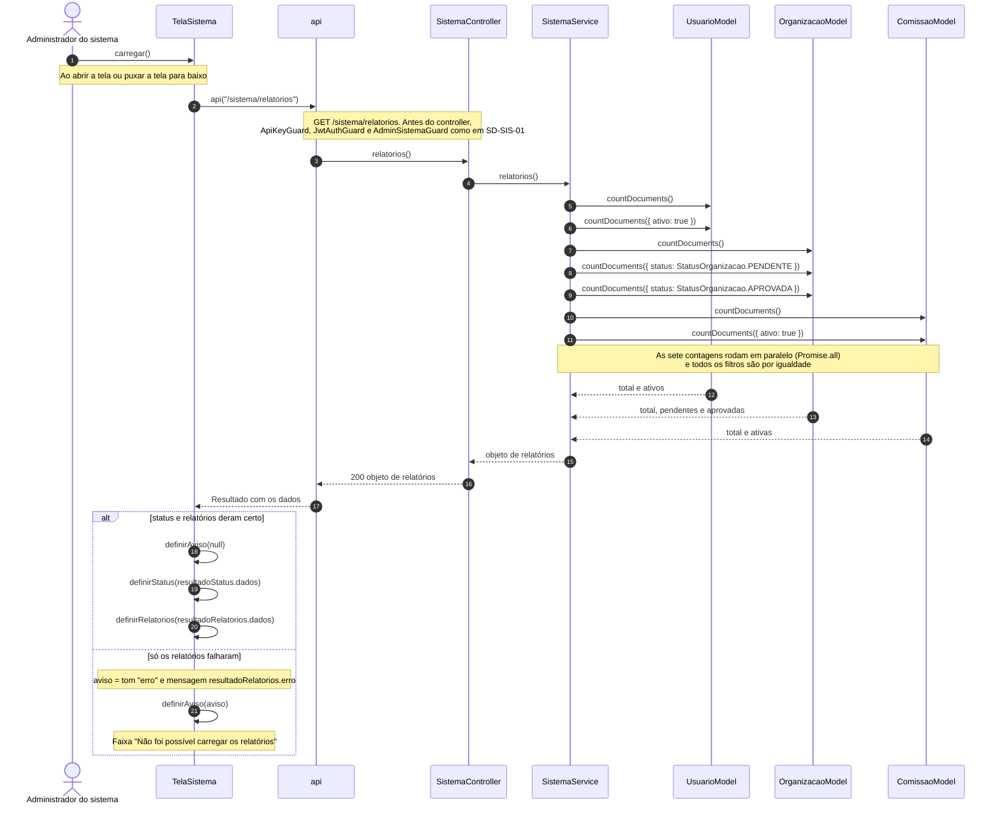
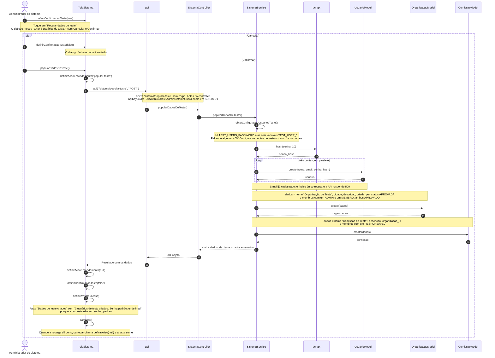
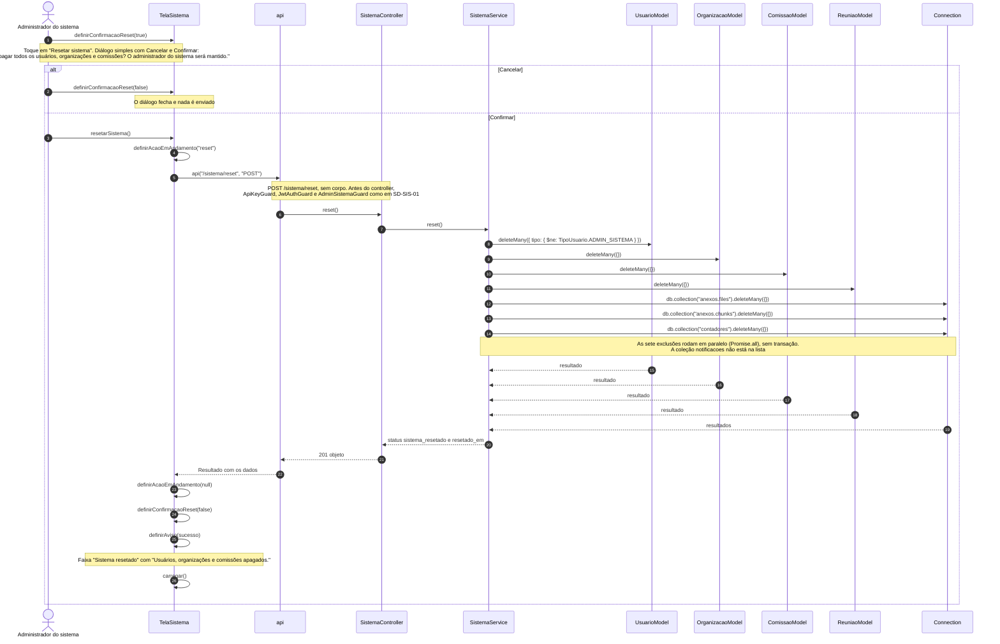

# Diagramas de sequência — Informações do sistema

> Padrão da disciplina · Módulo SIS · Revisado em 26/11/2026

## Resumo

Há um diagrama para cada requisito de [Requisitos funcionais](2%20-%20requisitos-funcionais-informacao-sistemas.md), com o mesmo número. As linhas de vida são classes e módulos que existem no código: as telas do aplicativo, o módulo `api`, os guards, o `SistemaController`, o `SistemaService`, o módulo `os` do Node.js e os models do Mongoose. Toda mensagem é a chamada de um método existente, com seus parâmetros, e as mensagens são numeradas na ordem em que acontecem. Regras que não são métodos, como a comparação do tipo da conta, e as rotas HTTP aparecem em notas.

O SD-SIS-01 mostra as três verificações que o NestJS executa antes do controller (`ApiKeyGuard`, `JwtAuthGuard` e `AdminSistemaGuard`), cada uma pelo seu método `canActivate`. Nos outros diagramas, essas verificações acontecem da mesma forma e estão resumidas numa nota.

## SD-SIS-01 — Consultar status do servidor

Se uma das verificações recusa a requisição, o controller não é chamado e o guard devolve 401, 403 ou 503; a tela mostra a mensagem na mesma faixa vermelha (ver RF-SIS-01).

## SD-SIS-02 — Consultar relatórios

## SD-SIS-03 — Popular dados de teste

## SD-SIS-04 — Resetar sistema

Se uma das exclusões falhar, a API responde 500 "Internal server error", a tela mostra a faixa "Não foi possível resetar" e as exclusões que já terminaram não são desfeitas (ver RF-SIS-04 e RNF-SIS-04).

## Rastreabilidade

SD-SIS-01 a SD-SIS-04 correspondem, na mesma ordem, a UC-SIS-01 a UC-SIS-04 e a RF-SIS-01 a RF-SIS-04.
