# Diagrama de classes — Reuniões

> Padrão da disciplina · Módulo REU · Revisado em 26/11/2026

## Resumo

O diagrama mostra as classes que participam das reuniões, agrupadas em três pacotes, um por camada do sistema: **Aplicativo** (telas, componentes e módulos do aplicativo), **API** (controllers, services e objetos de entrada) e **Dados** (documentos guardados no MongoDB e o armazenamento de arquivos). Cada atributo traz o seu tipo, e cada método traz o tipo dos parâmetros e do retorno. Toda classe e todo método do diagrama existem no código, e são os mesmos chamados nos [Diagramas de sequência](6%20-%20diagramas-sequencia-reunioes.md).

Para que nenhuma linha passe por cima de uma classe, o diagrama está dividido em duas partes. A primeira mostra o agendamento, a agenda, o convite, a presença marcada na tela da reunião e na tela inicial, a lista de presença e os anexos. A segunda mostra o link de presença, a correção de horários e o histórico. As classes que aparecem nas duas partes estão completas na primeira e, na segunda, só com os membros que ela usa. A ata e as votações, que também ficam dentro de `Reuniao`, estão nos diagramas de classes das [atas](../../4%20-%20Incremento%203/atas/3%20-%20diagrama-classes-atas.md) e da [votação](../../4%20-%20Incremento%203/votacao/3%20-%20diagrama-classes-votacao.md).

## Diagrama

### 1. Reunião, convite, presença, lista e anexos

```mermaid
classDiagram
    direction LR

    namespace Aplicativo {
        class TelaAgenda {
            -reunioes: Reuniao[]
            -podeAgendar: boolean
            +carregar(continuar: Function) Promise~void~
            +responder(reuniao: Reuniao, aceito: boolean) Promise~void~
            +escolherDia(dia: Date) void
        }
        class TelaInicio {
            -reunioes: Reuniao[]
            -aviso: Aviso
            -ocupado: string
            +marcarEntrada(reuniao: Reuniao) Promise~void~
            +responder(convite: Convite, aceito: boolean) Promise~void~
        }
        class FormularioReuniao {
            -reuniao: Reuniao
            -anexos: ArquivoEscolhido[]
            +salvar() Promise~void~
            +calcularHorario(dados: DadosReuniao) Horario
            +alternarDiaInteiro() void
            +alternarConvidado(pessoaId: string) void
            +adicionarAnexos() Promise~void~
        }
        class TelaNovaReuniao {
            +aoSalvar(envio: EnvioReuniao) Promise~string~
        }
        class TelaEditarReuniao {
            -reuniao: Reuniao
            +aoSalvar(envio: EnvioReuniao) Promise~string~
            +aoConcluir() void
        }
        class TelaReuniao {
            -reuniao: Reuniao
            -salvando: string
            -confirmacao: Pendente
            +buscar() Promise~void~
            +executar(chave: string, acao: Function, mensagem: string) Promise~boolean~
            +recusarConvite() void
            +registrar(chave: string) Promise~void~
            +marcarPresenca(pessoa: Pessoa, situacao: string) void
            +adicionarAnexos() Promise~void~
            +abrir(item: ItemAnexo) Promise~void~
            +confirmarRemocao(item: ItemAnexo) void
        }
        class TelaRegistrosReuniao {
            -lista: ListaPresenca
            -gerandoPdf: boolean
            +carregarLista() Promise~void~
            +baixarLista() Promise~void~
        }
        class pdfListaPresenca {
            <<module>>
            +htmlDaLista(reuniao: Reuniao, lista: ListaPresenca) string
            +gerarPdfLista(reuniao: Reuniao, lista: ListaPresenca) Promise~void~
            -escapar(texto: string) string
        }
        class pdf {
            <<module>>
            +entregarPdf(html: string, nome: string) Promise~void~
            +pdfPelaImpressao() boolean
            -imprimirNaWeb(html: string) void
            -nomearPdf(gerado: File, nome: string) string
        }
        class autenticacaoLocal {
            <<module>>
            +autenticarComDispositivo() Promise~boolean~
            +dispositivoProtegido() Promise~boolean~
        }
        class api {
            <<module>>
            +api(caminho: string, metodo: string, corpo: unknown) Promise~Resultado~
            +acessoAutenticado(caminho: string) Promise~Acesso~
        }
        class anexos {
            <<module>>
            +escolherArquivos() Promise~ArquivoEscolhido[]~
            +validarArquivos(novos: ArquivoEscolhido[], jaAnexados: number) string
            +enviarAnexo(reuniaoId: string, arquivo: ArquivoEscolhido) Promise~Resultado~
            +abrirAnexo(reuniaoId: string, anexo: Anexo) Promise~string~
            +removerAnexo(reuniaoId: string, anexoId: string) Promise~Resultado~
        }
    }

    namespace API {
        class ReunioesController {
            -reunioesService: ReunioesService
            +listar(req: RequisicaoAutenticada, de: string, ate: string, comissaoId: string) Promise~Reuniao[]~
            +criar(dto: CreateReuniaoDto, req: RequisicaoAutenticada) Promise~Reuniao~
            +buscarPorId(id: string, req: RequisicaoAutenticada) Promise~Reuniao~
            +atualizar(id: string, dto: UpdateReuniaoDto, req: RequisicaoAutenticada) Promise~Reuniao~
            +responderConvite(id: string, dto: ResponderConviteReuniaoDto, req: RequisicaoAutenticada) Promise~Reuniao~
            +marcarEntrada(id: string, req: RequisicaoAutenticada) Promise~Reuniao~
            +marcarSaida(id: string, req: RequisicaoAutenticada) Promise~Reuniao~
            +atualizarPresenca(id: string, usuarioId: string, dto: AtualizarPresencaDto, req: RequisicaoAutenticada) Promise~Reuniao~
            +gerarListaPresenca(id: string, req: RequisicaoAutenticada) Promise~ListaPresenca~
            +adicionarAnexo(id: string, arquivo: ArquivoRecebido, req: RequisicaoAutenticada) Promise~Reuniao~
            +baixarAnexo(id: string, anexoId: string, req: RequisicaoAutenticada) Promise~StreamableFile~
            +removerAnexo(id: string, anexoId: string, req: RequisicaoAutenticada) Promise~Reuniao~
        }
        class ReunioesService {
            -reuniaoModel: Model~Reuniao~
            -comissaoModel: Model~Comissao~
            -organizacaoModel: Model~Organizacao~
            -usuarioModel: Model~Usuario~
            -conexao: Connection
            +listar(usuarioId: string, filtros: FiltrosReuniao) Promise~Reuniao[]~
            +criar(dto: CreateReuniaoDto, usuarioId: string) Promise~Reuniao~
            +buscarPorId(id: string, usuarioId: string) Promise~Reuniao~
            +atualizar(id: string, dto: UpdateReuniaoDto, usuarioId: string) Promise~Reuniao~
            +responderConvite(id: string, aceito: boolean, usuarioId: string) Promise~Reuniao~
            +marcarEntrada(id: string, usuarioId: string) Promise~Reuniao~
            +marcarSaida(id: string, usuarioId: string) Promise~Reuniao~
            +atualizarPresenca(id: string, participanteId: string, situacao: SituacaoPresenca, usuarioId: string) Promise~Reuniao~
            +gerarListaPresenca(id: string, usuarioId: string) Promise~ListaPresenca~
            +adicionarAnexo(id: string, arquivo: ArquivoRecebido, usuarioId: string) Promise~Reuniao~
            +abrirAnexo(id: string, anexoId: string, usuarioId: string) Promise~AnexoAberto~
            +removerAnexo(id: string, anexoId: string, usuarioId: string) Promise~Reuniao~
            +onApplicationBootstrap() Promise~void~
            +onModuleDestroy() void
            +registrarSaidasAutomaticas(agora: Date) Promise~number~
            -executarRotinas() Promise~void~
            -editar(id: string, dto: UpdateReuniaoDto, usuarioId: string) Promise~Reuniao~
            -cancelar(id: string, usuarioId: string) Promise~Reuniao~
            -carregar(id: string, usuarioId: string) Promise~Carga~
            -carregarComoDono(id: string, usuarioId: string) Promise~Carga~
            -autorizarResponsavel(comissaoId: string, usuarioId: string, acao: string) Promise~Comissao~
            -validarId(id: string) void
            -validarUsuario(usuarioId: string) Promise~void~
            -lerData(valor: string, mensagem: string) Date
            -validarHorario(inicio: Date, fim: Date) void
            -exigirAgendada(reuniao: Reuniao) void
            -exigirAnexosAbertos(reuniao: Reuniao) void
            -buscarAnexo(reuniao: Reuniao, anexoId: string) Anexo
            -popular(reuniao: Reuniao) Promise~Reuniao~
            -apresentar(reuniao: Reuniao, usuarioId: string) Reuniao
            -responder(reuniao: Reuniao, usuarioId: string, conflito: string) Promise~Reuniao~
            -arquivos() GridFSBucket
        }
        class CreateReuniaoDto {
            +comissao_id: string
            +titulo: string
            +local: string
            +inicio: string
            +fim: string
            +dia_inteiro: boolean
            +pauta: string
            +convidados_ids: string[]
        }
        class UpdateReuniaoDto {
            +situacao: SituacaoReuniao
            +titulo: string
            +local: string
            +inicio: string
            +fim: string
            +dia_inteiro: boolean
            +pauta: string
            +convidados_ids: string[]
        }
        class ResponderConviteReuniaoDto {
            +aceito: boolean
        }
        class AtualizarPresencaDto {
            +situacao: SituacaoPresenca
        }
    }

    namespace Dados {
        class Reuniao {
            +_id: ObjectId
            +comissao_id: ObjectId
            +titulo: string
            +local: string
            +inicio: Date
            +fim: Date
            +dia_inteiro: boolean
            +horario_alterado_em: Date
            +pauta: string
            +anexos: Anexo[]
            +criada_por: ObjectId
            +situacao: SituacaoReuniao
            +participantes: Participante[]
            +presencas_revisao: number
            +acesso_presenca: AcessoPresenca
            +historico_presencas: RegistroCorrecao[]
            +criado_em: Date
            +atualizado_em: Date
        }
        class Participante {
            +usuario_id: ObjectId
            +convite: RespostaConvite
            +presenca: Presenca
        }
        class Presenca {
            +entrada: Date
            +saida: Date
            +saida_automatica: boolean
            +situacao: SituacaoPresenca
            +marcada_por: OrigemPresenca
        }
        class Anexo {
            +_id: ObjectId
            +nome: string
            +tipo: string
            +tamanho: number
            +enviado_em: Date
        }
        class Comissao {
            +_id: ObjectId
            +organizacao_id: ObjectId
            +ativo: boolean
            +membros: MembroComissao[]
        }
        class Usuario {
            +_id: ObjectId
            +nome: string
            +email: string
            +ativo: boolean
        }
        class GridFSBucket {
            <<MongoDB>>
            +openUploadStream(nome: string, opcoes: object) GridFSBucketWriteStream
            +openDownloadStream(id: ObjectId) GridFSBucketReadStream
            +delete(id: ObjectId) Promise~void~
        }
        class SituacaoReuniao {
            <<enumeration>>
            AGENDADA
            CANCELADA
        }
        class RespostaConvite {
            <<enumeration>>
            PENDENTE
            ACEITO
            RECUSADO
        }
        class SituacaoPresenca {
            <<enumeration>>
            AGUARDANDO
            CONFIRMADA
            RECUSADA
        }
        class OrigemPresenca {
            <<enumeration>>
            LINK
            PROPRIO
            RESPONSAVEL
        }
    }

    TelaNovaReuniao ..> FormularioReuniao : usa
    TelaEditarReuniao ..> FormularioReuniao : usa
    TelaAgenda ..> api : usa
    TelaInicio ..> api : usa
    TelaInicio ..> autenticacaoLocal : usa
    TelaNovaReuniao ..> api : usa
    TelaNovaReuniao ..> anexos : envia os anexos
    TelaEditarReuniao ..> api : usa
    TelaReuniao ..> api : usa
    TelaReuniao ..> anexos : usa
    TelaReuniao ..> autenticacaoLocal : usa
    TelaRegistrosReuniao ..> api : usa
    TelaRegistrosReuniao ..> pdfListaPresenca : usa
    pdfListaPresenca ..> pdf : usa
    FormularioReuniao ..> anexos : usa
    anexos ..> api : usa
    api ..> ReunioesController : requisição HTTP

    ReunioesController --> "1" ReunioesService : reunioesService
    ReunioesController ..> CreateReuniaoDto : recebe
    ReunioesController ..> UpdateReuniaoDto : recebe
    ReunioesController ..> ResponderConviteReuniaoDto : recebe
    ReunioesController ..> AtualizarPresencaDto : recebe
    ReunioesService ..> Reuniao : lê e grava
    ReunioesService ..> Comissao : confere o presidente
    ReunioesService ..> Usuario : confere a conta
    ReunioesService ..> GridFSBucket : grava e lê arquivos

    Reuniao "1" *-- "1..*" Participante : participantes
    Participante "1" *-- "0..1" Presenca : presenca
    Reuniao "1" *-- "0..10" Anexo : anexos
    Reuniao "0..*" --> "1" Comissao : comissao_id
    Reuniao "0..*" --> "1" Usuario : criada_por
    Participante "0..*" --> "1" Usuario : usuario_id
    Anexo "1" --> "1" GridFSBucket : conteúdo, pelo mesmo _id
    Reuniao ..> SituacaoReuniao : situacao
    Participante ..> RespostaConvite : convite
    Presenca ..> SituacaoPresenca : situacao
    Presenca ..> OrigemPresenca : marcada_por
```

Figura 2 — Diagrama de classes das reuniões, parte 1. Fonte: equipe Conecta+.

### 2. Link de presença, correção e histórico

```mermaid
classDiagram
    direction LR

    namespace Aplicativo {
        class AcessoPresidente {
            -permitido: boolean
            +AcessoPresidente(reuniaoId: string) Element
        }
        class TelaGestaoPresenca {
            -link: LinkPresenca
            -ativo: boolean
            -revisao: number
            -historico: RegistroCorrecao[]
            -alvo: Participante
            -motivo: string
            +carregar(continuar: Function) Promise~void~
            +agir(acao: Function) Promise~void~
            +gerar() Promise~void~
            +revogar() Promise~void~
            +enviar(canal: string) Promise~void~
            +corrigir() Promise~void~
        }
        class TelaPresencaLink {
            -dados: DadosAcesso
            +carregar(ativa: Function) Promise~void~
            +registrar(acao: string) Promise~void~
            +abrirApp() void
        }
        class retornoPresenca {
            <<module>>
            +guardarRetornoPresenca(id: string, codigo: string) Promise~void~
            +consumirRetornoPresenca() Promise~RetornoPresenca~
        }
        class TelaReuniao {
            -reuniao: Reuniao
        }
        class api {
            <<module>>
            +api(caminho: string, metodo: string, corpo: unknown) Promise~Resultado~
        }
        class autenticacaoLocal {
            <<module>>
            +autenticarComDispositivo() Promise~boolean~
        }
    }

    namespace API {
        class PresencasController {
            -s: PresencasService
            +gestao(id: string, req: RequisicaoAutenticada) Promise~Gestao~
            +gerar(id: string, req: RequisicaoAutenticada) Promise~LinkPresenca~
            +revogar(id: string, req: RequisicaoAutenticada) Promise~Mensagem~
            +consultar(id: string, dto: CodigoAcessoDto, req: RequisicaoAutenticada) Promise~DadosAcesso~
            +registrar(id: string, dto: RegistrarAcessoDto, req: RequisicaoAutenticada) Promise~Mensagem~
            +enviar(id: string, dto: EnviarAcessoDto, req: RequisicaoAutenticada) Promise~Mensagem~
            +corrigir(id: string, alvo: string, dto: CorrigirHorarioDto, req: RequisicaoAutenticada) Promise~Mensagem~
            +historico(id: string, req: RequisicaoAutenticada) Promise~RegistroCorrecao[]~
        }
        class PresencasService {
            -reunioes: Model~Reuniao~
            -comissoes: Model~Comissao~
            -organizacoes: Model~Organizacao~
            -usuarios: Model~Usuario~
            -notificacoes: NotificacoesService
            -config: ConfigService
            +gestao(id: string, usuarioId: string) Promise~Gestao~
            +gerar(id: string, usuarioId: string) Promise~LinkPresenca~
            +revogar(id: string, usuarioId: string) Promise~Mensagem~
            +consultar(id: string, codigo: string, usuarioId: string) Promise~DadosAcesso~
            +registrar(id: string, dto: RegistrarAcessoDto, usuarioId: string) Promise~Mensagem~
            +enviar(id: string, dto: EnviarAcessoDto, usuarioId: string) Promise~Mensagem~
            +corrigir(id: string, alvoId: string, dto: CorrigirHorarioDto, usuarioId: string) Promise~Mensagem~
            +historico(id: string, usuarioId: string) Promise~RegistroCorrecao[]~
            -hash(codigo: string) string
            -carregar(id: string, usuarioId: string, presidente: boolean) Promise~CargaPresenca~
            -editavel(r: Reuniao) void
            -filtro(r: Reuniao) object
            -validarLink(r: Reuniao, c: Comissao, codigo: string) void
            -url(id: string, codigo: string) string
        }
        class NotificacoesService {
            -notificacoes: Model~Notificacao~
            +criar(usuarioId: string, dados: DadosNotificacao) Promise~void~
            +invalidarPresenca(reuniaoId: string) Promise~void~
        }
        class CodigoAcessoDto {
            +codigo: string
        }
        class RegistrarAcessoDto {
            +acao: string
        }
        class EnviarAcessoDto {
            +canal: string
        }
        class CorrigirHorarioDto {
            +revisao: number
            +entrada: string
            +saida: string
            +motivo: string
        }
    }

    namespace Dados {
        class Reuniao {
            +acesso_presenca: AcessoPresenca
            +historico_presencas: RegistroCorrecao[]
            +presencas_revisao: number
        }
        class AcessoPresenca {
            <<tipo>>
            +hash: string
            +inicio: Date
            +fim: Date
            +responsavel_id: string
            +criado_em: Date
        }
        class RegistroCorrecao {
            <<tipo>>
            +participante_id: string
            +responsavel_id: string
            +alterada_em: Date
            +motivo: string
            +antes: Presenca
            +depois: Presenca
        }
        class Notificacao {
            +_id: ObjectId
            +usuario_id: ObjectId
            +chave: string
            +titulo: string
            +mensagem: string
            +destino: string
            +tipo: string
            +lida_em: Date
            +expira_em: Date
            +criada_em: Date
        }
        class Presenca {
            +entrada: Date
            +saida: Date
            +situacao: SituacaoPresenca
            +marcada_por: OrigemPresenca
        }
        class Comissao {
            +_id: ObjectId
            +membros: MembroComissao[]
        }
        class Usuario {
            +_id: ObjectId
            +email: string
        }
    }

    TelaReuniao ..> AcessoPresidente : mostra
    AcessoPresidente ..> api : usa
    TelaGestaoPresenca ..> api : usa
    TelaGestaoPresenca ..> autenticacaoLocal : usa
    TelaPresencaLink ..> api : usa
    TelaPresencaLink ..> autenticacaoLocal : usa
    TelaPresencaLink ..> retornoPresenca : usa
    api ..> PresencasController : requisição HTTP

    PresencasController --> "1" PresencasService : s
    PresencasController ..> CodigoAcessoDto : recebe
    PresencasController ..> RegistrarAcessoDto : recebe
    PresencasController ..> EnviarAcessoDto : recebe
    PresencasController ..> CorrigirHorarioDto : recebe
    CodigoAcessoDto <|-- RegistrarAcessoDto
    CodigoAcessoDto <|-- EnviarAcessoDto
    PresencasService --> "1" NotificacoesService : notificacoes
    PresencasService ..> Reuniao : lê e grava
    PresencasService ..> Comissao : confere o responsável
    PresencasService ..> Usuario : busca os e-mails
    NotificacoesService ..> Notificacao : grava

    Reuniao "1" *-- "0..1" AcessoPresenca : acesso_presenca
    Reuniao "1" *-- "0..*" RegistroCorrecao : historico_presencas
    RegistroCorrecao "1" *-- "0..1" Presenca : antes
    RegistroCorrecao "1" *-- "1" Presenca : depois
    AcessoPresenca "0..*" --> "1" Usuario : responsavel_id
    RegistroCorrecao "0..*" --> "1" Usuario : participante_id
    RegistroCorrecao "0..*" --> "1" Usuario : responsavel_id
    Notificacao "0..*" --> "1" Usuario : usuario_id
```

Figura 3 — Diagrama de classes das reuniões, parte 2. Fonte: equipe Conecta+.

## Como ler as ligações

| Ligação                      | Significado                                                             | Exemplo no diagrama                                                                                          |
| ---------------------------- | ----------------------------------------------------------------------- | ------------------------------------------------------------------------------------------------------------ |
| Losango cheio (composição)   | A parte só existe dentro do todo e é apagada junto com ele.             | `Reuniao *-- Participante`: o participante é gravado dentro do documento da reunião.                         |
| Seta cheia (associação)      | Uma classe guarda uma referência a outra, que existe por conta própria. | `Participante --> Usuario`: `usuario_id` guarda o identificador de um documento de `usuarios`.               |
| Triângulo vazio (herança)    | A classe filha tem tudo o que a mãe tem.                                | `RegistrarAcessoDto` e `EnviarAcessoDto` herdam o campo `codigo` de `CodigoAcessoDto`.                       |
| Seta tracejada (dependência) | Uma classe usa a outra em uma chamada, sem guardá-la como atributo.     | `ReunioesService ..> Comissao`: o serviço lê a comissão para conferir o presidente.                          |

Os números nas pontas são as multiplicidades. Por exemplo, uma `Reuniao` tem ao menos um `Participante` (`1..*`), que é quem a agendou, de zero a dez anexos (`0..10`), no máximo um link de presença ativo (`0..1`) e qualquer quantidade de registros de correção (`0..*`).

`AcessoPresenca` e `RegistroCorrecao` estão marcados como `<<tipo>>` porque não são classes de schema do Mongoose: `acesso_presenca` é declarado em `Reuniao` com um tipo de objeto escrito no próprio campo, e cada item de `historico_presencas` é o objeto montado por `PresencasService.corrigir`. Os dois campos são gravados com `select: false`, então só aparecem quando a consulta os pede.

No código, os atributos opcionais são `horario_alterado_em` e `acesso_presenca`, em `Reuniao`; `presenca`, em `Participante`; `saida` e `saida_automatica`, em `Presenca`; `saida`, em `CorrigirHorarioDto`; e `lida_em` e `expira_em`, em `Notificacao`. Nos objetos de entrada, só `comissao_id`, `titulo`, `inicio` e `fim` são obrigatórios em `CreateReuniaoDto`, e todos os campos de `UpdateReuniaoDto` são opcionais. A obrigatoriedade de cada atributo está no [dicionário de classes](3%20-%20dicionario-dados-classes-reunioes.md).

## Rotas atendidas pelos controllers

As rotas HTTP não são métodos; por isso ficam nesta tabela, e não no diagrama.

| Método do controller                   | Rota HTTP                                   |
| -------------------------------------- | ------------------------------------------- |
| `ReunioesController.listar`            | `GET /reunioes`                             |
| `ReunioesController.criar`             | `POST /reunioes`                            |
| `ReunioesController.buscarPorId`       | `GET /reunioes/:id`                         |
| `ReunioesController.atualizar`         | `PATCH /reunioes/:id`                       |
| `ReunioesController.responderConvite`  | `PATCH /reunioes/:id/convite`               |
| `ReunioesController.marcarEntrada`     | `POST /reunioes/:id/entrada`                |
| `ReunioesController.marcarSaida`       | `POST /reunioes/:id/saida`                  |
| `ReunioesController.atualizarPresenca` | `PATCH /reunioes/:id/presencas/:usuarioId`  |
| `ReunioesController.gerarListaPresenca`| `GET /reunioes/:id/lista-presenca`          |
| `ReunioesController.adicionarAnexo`    | `POST /reunioes/:id/anexos`                 |
| `ReunioesController.baixarAnexo`       | `GET /reunioes/:id/anexos/:anexoId`         |
| `ReunioesController.removerAnexo`      | `DELETE /reunioes/:id/anexos/:anexoId`      |
| `PresencasController.gestao`           | `GET /presencas/:id/gestao`                 |
| `PresencasController.gerar`            | `POST /presencas/:id/link`                  |
| `PresencasController.revogar`          | `DELETE /presencas/:id/link`                |
| `PresencasController.consultar`        | `GET /presencas/:id/acesso?codigo=`         |
| `PresencasController.registrar`        | `POST /presencas/:id/acesso`                |
| `PresencasController.enviar`           | `POST /presencas/:id/enviar`                |
| `PresencasController.corrigir`         | `PATCH /presencas/:id/horarios/:usuarioId`  |
| `PresencasController.historico`        | `GET /presencas/:id/historico`              |

## Regras representadas

- `Participante`, `Presenca`, `Anexo`, `AcessoPresenca` e `RegistroCorrecao` são gravados dentro do documento de `Reuniao`, por isso a composição;
- `Anexo` guarda só a identificação do arquivo; o conteúdo fica no `GridFSBucket`, com o mesmo identificador;
- `Usuario`, `Comissao` e `Notificacao` ficam em coleções próprias, por isso as associações são feitas por identificador;
- quem agendou a reunião é identificado por `criada_por`; o responsável que gerou o link, por `AcessoPresenca.responsavel_id`;
- o link guarda só o resumo do código (`hash`), nunca o código;
- `FormularioReuniao` é o mesmo componente nas telas de criar e de editar;
- o aplicativo nunca decide se a presença vale: ele mostra o que a API devolve.

## Rastreabilidade

RF-REU-01 a RF-REU-09 e RF-REU-13 a RF-REU-22; complementado por [Dicionário de classes](3%20-%20dicionario-dados-classes-reunioes.md) e [Diagramas de sequência](6%20-%20diagramas-sequencia-reunioes.md).
