# Diagrama de classes — Reuniões

> Padrão da disciplina · Módulo REU · Revisado em 27/11/2026

## Resumo

O diagrama mostra as classes que participam das reuniões, agrupadas em três pacotes, um por camada do sistema: **Aplicativo** (telas, componentes e módulos do aplicativo), **API** (controllers, services e objetos de entrada) e **Dados** (documentos guardados no MongoDB e o armazenamento de arquivos). Cada atributo traz o seu tipo, e cada método traz o tipo dos parâmetros e do retorno. Toda classe e todo método do diagrama existem no código, e são os mesmos chamados nos [Diagramas de sequência](6%20-%20diagramas-sequencia-reunioes.md).

Para ficar legível na largura da página, o diagrama está dividido em 25 partes pequenas, desenhadas de cima para baixo. O título de cada parte indica o pacote: as partes 1 a 11 mostram o aplicativo (a parte 7 também mostra o controller e o serviço das notificações), as partes 12 a 18 mostram a API, e as partes 19 a 25, os dados e os models do Mongoose. Cada classe aparece completa, com todos os atributos e métodos, em uma única parte. Quando uma ligação chega a uma classe completa em outra parte, essa classe aparece só com o nome, e a frase abaixo da figura diz em que parte ela está completa. Toda linha de vida e todo método dos diagramas de sequência estão em uma das partes, inclusive os atualizadores de estado das telas (`definir*`). A ata e as votações, que também ficam dentro de `Reuniao`, estão nos diagramas de classes das [atas](../../4%20-%20Incremento%203/atas/3%20-%20diagrama-classes-atas.md) e da [votação](../../4%20-%20Incremento%203/votacao/3%20-%20diagrama-classes-votacao.md).

## Diagrama

### 1. Aplicativo: agenda e tela inicial

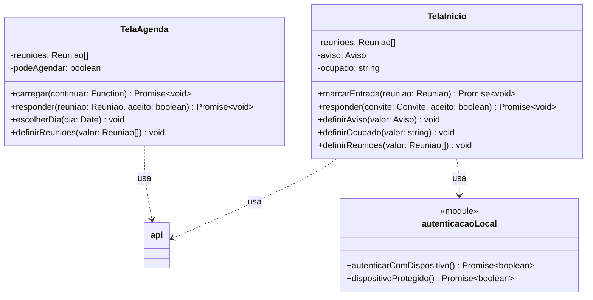

Figura 2 — Diagrama de classes das reuniões, parte 1: agenda e tela inicial. Fonte: equipe Conecta+.

Só com o nome nesta parte: `api` (parte 8).

### 2. Aplicativo: agendar e editar

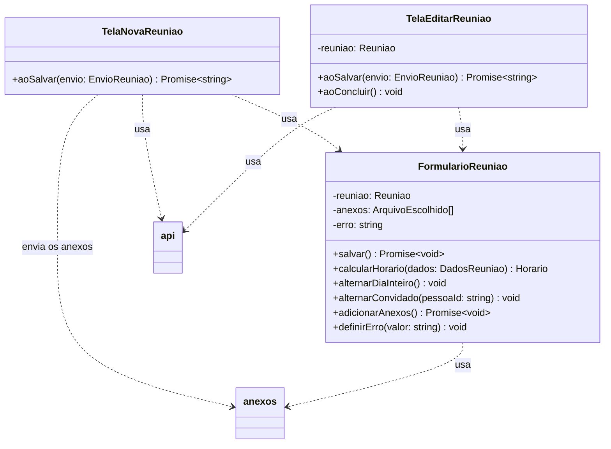

Figura 2 — Diagrama de classes das reuniões, parte 2: agendamento e edição. Fonte: equipe Conecta+.

Só com o nome nesta parte: `api` e `anexos` (parte 8).

### 3. Aplicativo: tela da reunião

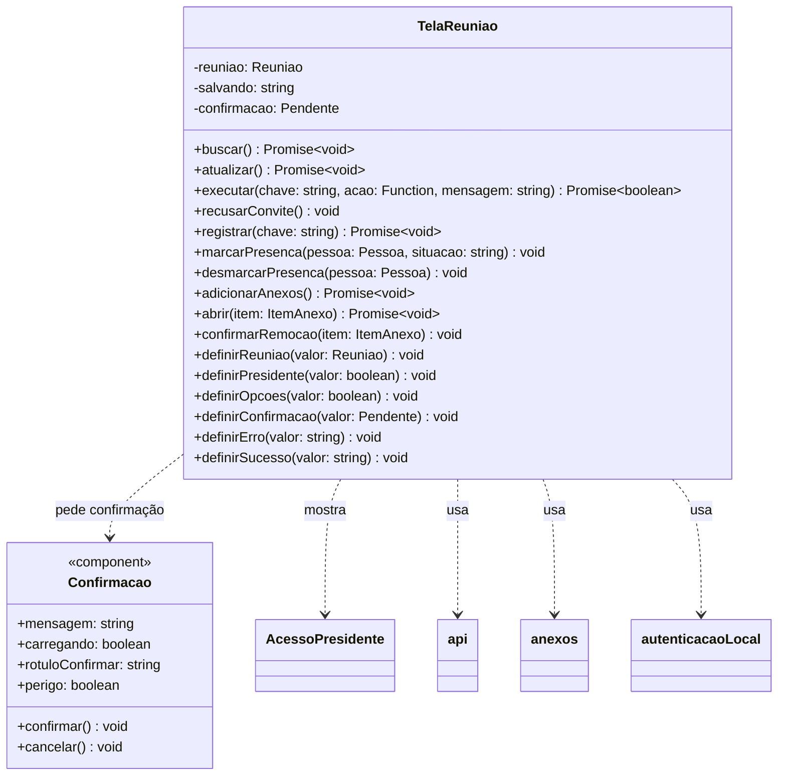

Figura 2 — Diagrama de classes das reuniões, parte 3: tela da reunião. Fonte: equipe Conecta+.

Só com o nome nesta parte: `autenticacaoLocal` (parte 1), `AcessoPresidente` (parte 5) e `api` e `anexos` (parte 8).

### 4. Aplicativo: registros e PDF da lista

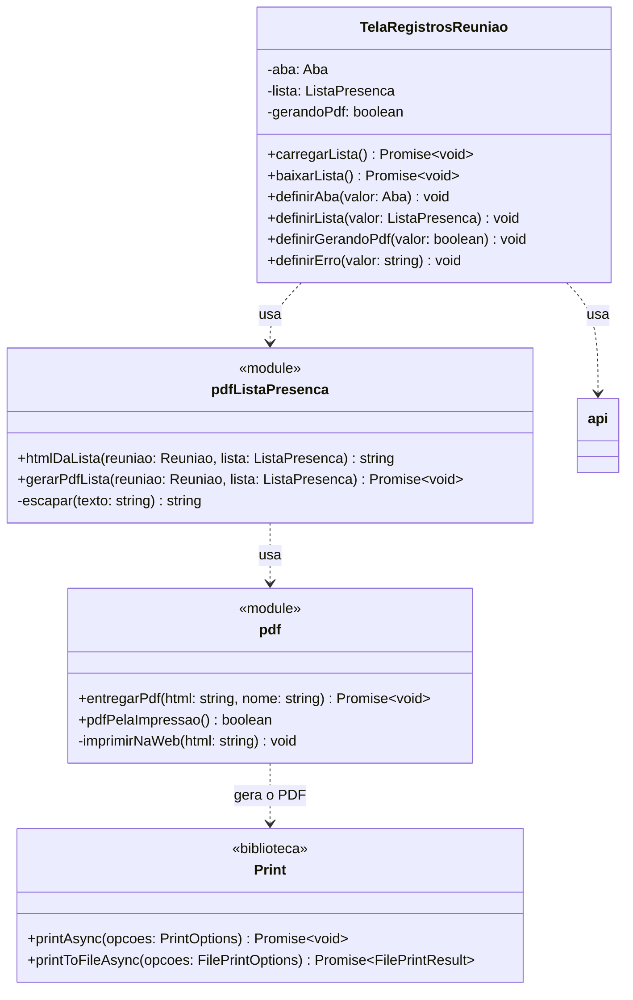

Figura 2 — Diagrama de classes das reuniões, parte 4: registros e PDF da lista de presença. Fonte: equipe Conecta+.

Só com o nome nesta parte: `api` (parte 8).

### 5. Aplicativo: gestão de presença

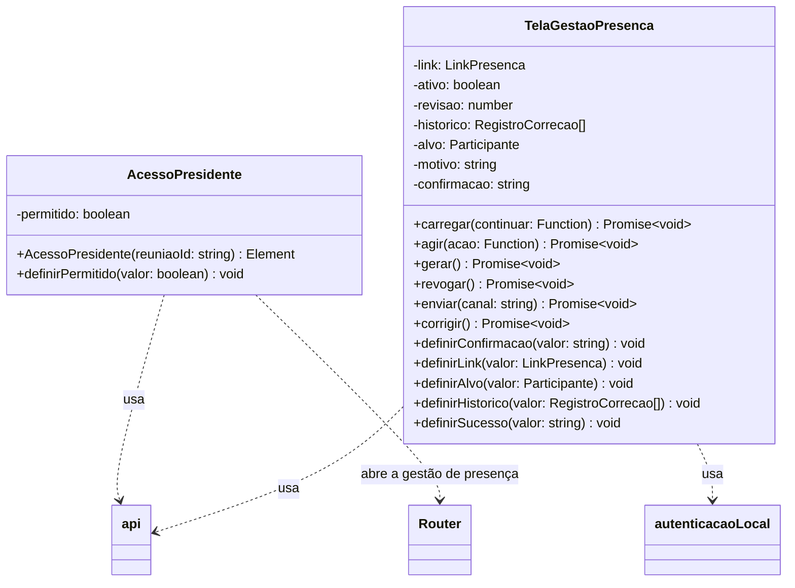

Figura 2 — Diagrama de classes das reuniões, parte 5: gestão de presença. Fonte: equipe Conecta+.

Só com o nome nesta parte: `autenticacaoLocal` (parte 1), `api` (parte 8) e `Router` (parte 10).

### 6. Aplicativo: presença pelo link

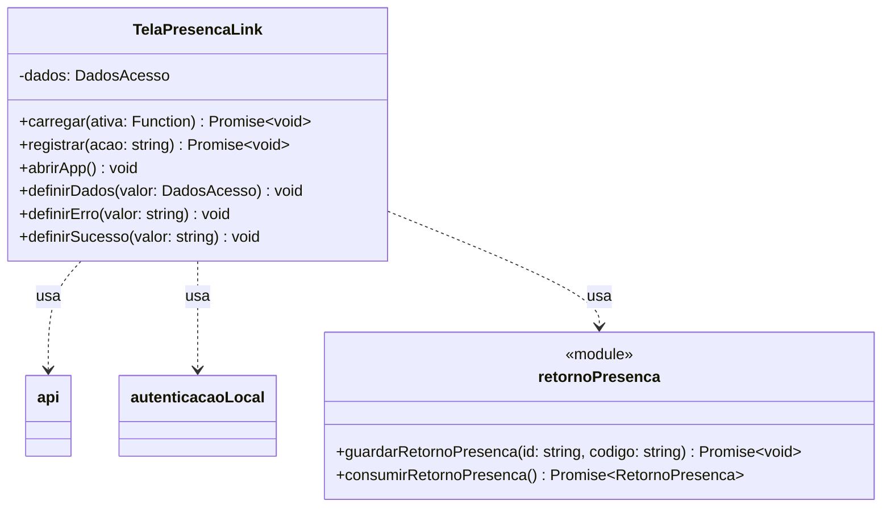

Figura 2 — Diagrama de classes das reuniões, parte 6: presença pelo link. Fonte: equipe Conecta+.

Só com o nome nesta parte: `autenticacaoLocal` (parte 1) e `api` (parte 8).

### 7. Aplicativo e API: notificações

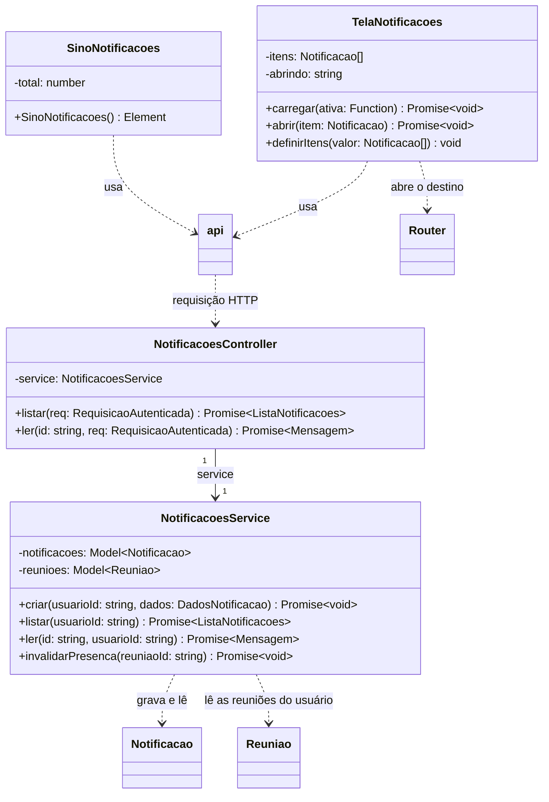

Figura 2 — Diagrama de classes das reuniões, parte 7: notificações. Fonte: equipe Conecta+.

Só com o nome nesta parte: `api` (parte 8), `Router` (parte 10), `Reuniao` (parte 19) e `Notificacao` (parte 25).

### 8. Aplicativo: comunicação com a API e anexos

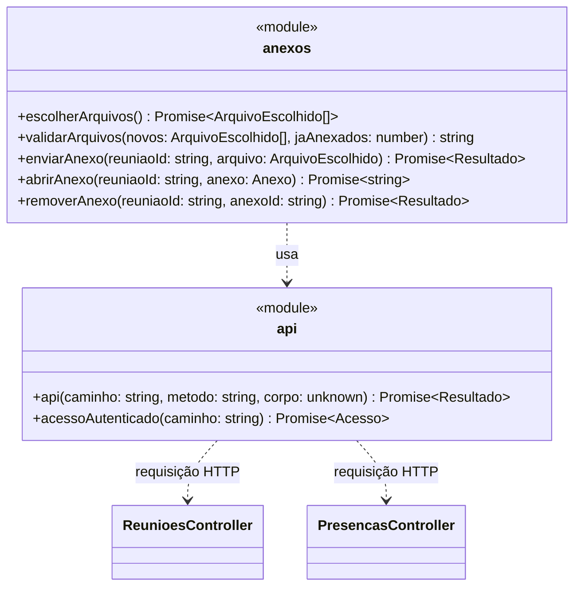

Figura 2 — Diagrama de classes das reuniões, parte 8: comunicação com a API e anexos. Fonte: equipe Conecta+.

Só com o nome nesta parte: `ReunioesController` (parte 12) e `PresencasController` (parte 15).

### 9. Aplicativo: arquivos dos anexos

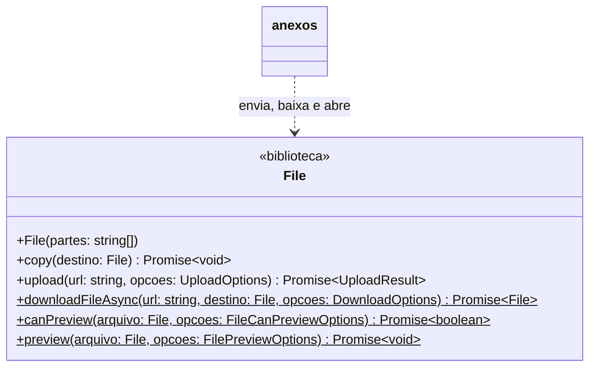

Figura 2 — Diagrama de classes das reuniões, parte 9: arquivos dos anexos. Fonte: equipe Conecta+.

Só com o nome nesta parte: `anexos` (parte 8).

### 10. Aplicativo: navegação e avisos

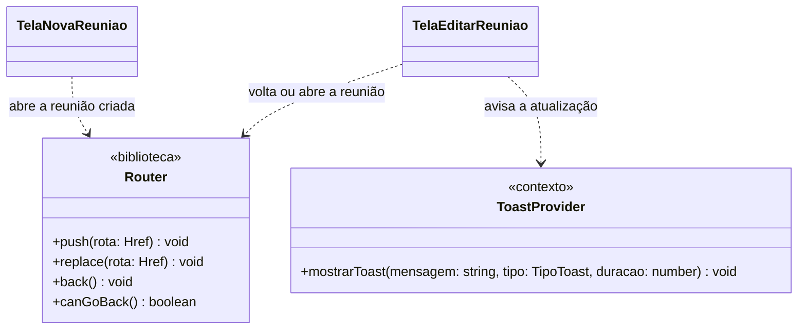

Figura 2 — Diagrama de classes das reuniões, parte 10: navegação e avisos. Fonte: equipe Conecta+.

Só com o nome nesta parte: `TelaNovaReuniao` e `TelaEditarReuniao` (parte 2).

### 11. Aplicativo: compartilhamento e área de transferência

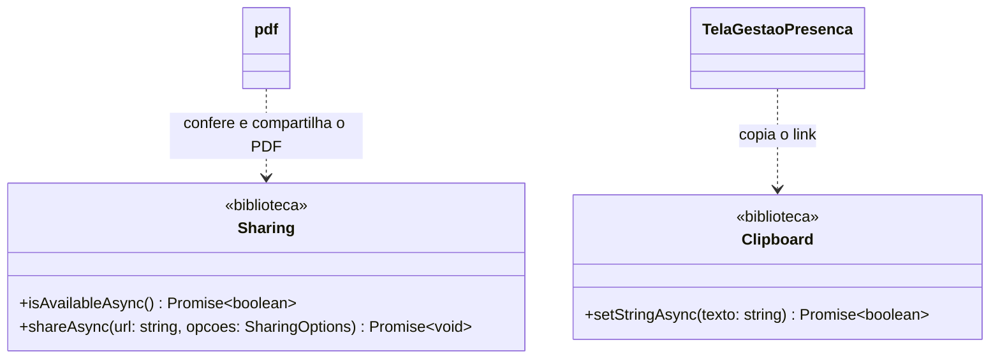

Figura 2 — Diagrama de classes das reuniões, parte 11: compartilhamento e área de transferência. Fonte: equipe Conecta+.

Só com o nome nesta parte: `pdf` (parte 4) e `TelaGestaoPresenca` (parte 5).

### 12. API: controller das reuniões

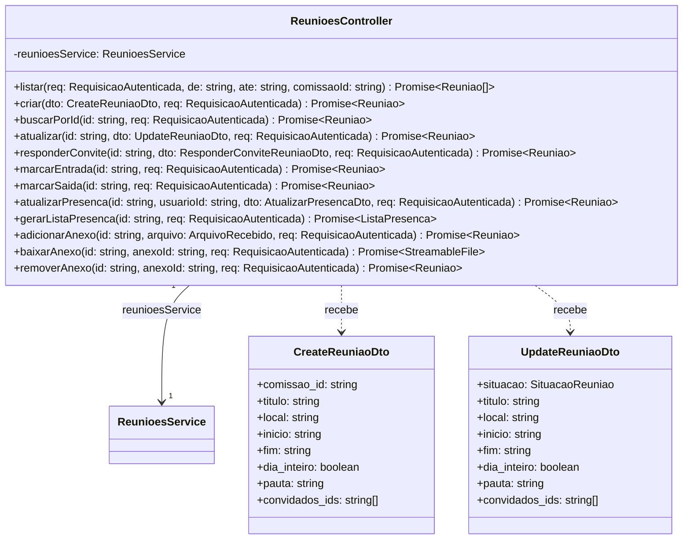

Figura 2 — Diagrama de classes das reuniões, parte 12: controller das reuniões. Fonte: equipe Conecta+.

Só com o nome nesta parte: `ReunioesService` (parte 14).

### 13. API: objetos de entrada do convite e da presença

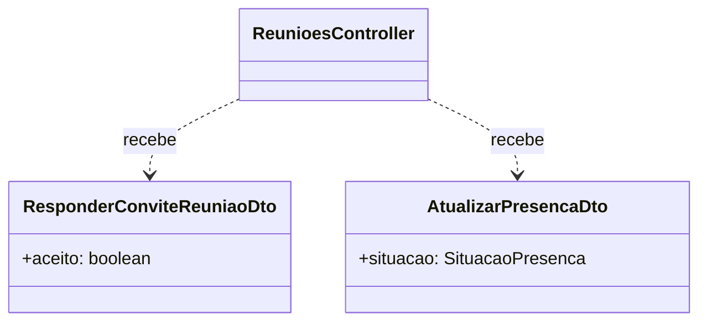

Figura 2 — Diagrama de classes das reuniões, parte 13: objetos de entrada do convite e da presença. Fonte: equipe Conecta+.

Só com o nome nesta parte: `ReunioesController` (parte 12).

### 14. API: serviço das reuniões

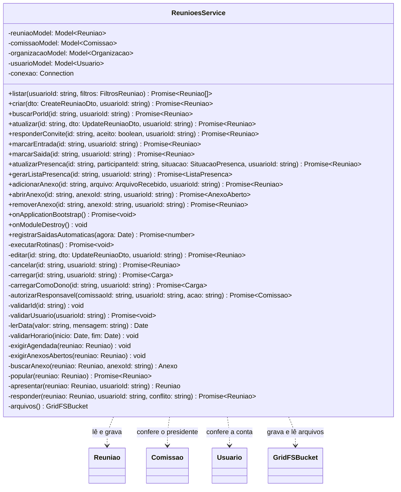

Figura 2 — Diagrama de classes das reuniões, parte 14: serviço das reuniões. Fonte: equipe Conecta+.

Só com o nome nesta parte: `Reuniao` (parte 19), `GridFSBucket` (parte 20), `Comissao` (parte 23) e `Usuario` (parte 24).

### 15. API: controller e objetos de entrada da presença

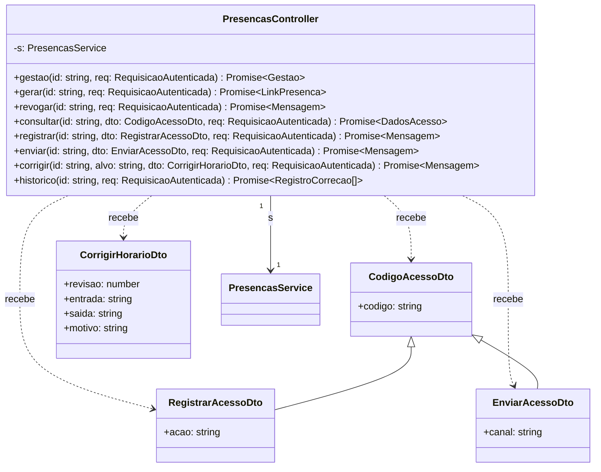

Figura 2 — Diagrama de classes das reuniões, parte 15: controller e objetos de entrada da presença. Fonte: equipe Conecta+.

Só com o nome nesta parte: `PresencasService` (parte 16).

### 16. API: serviço de presença

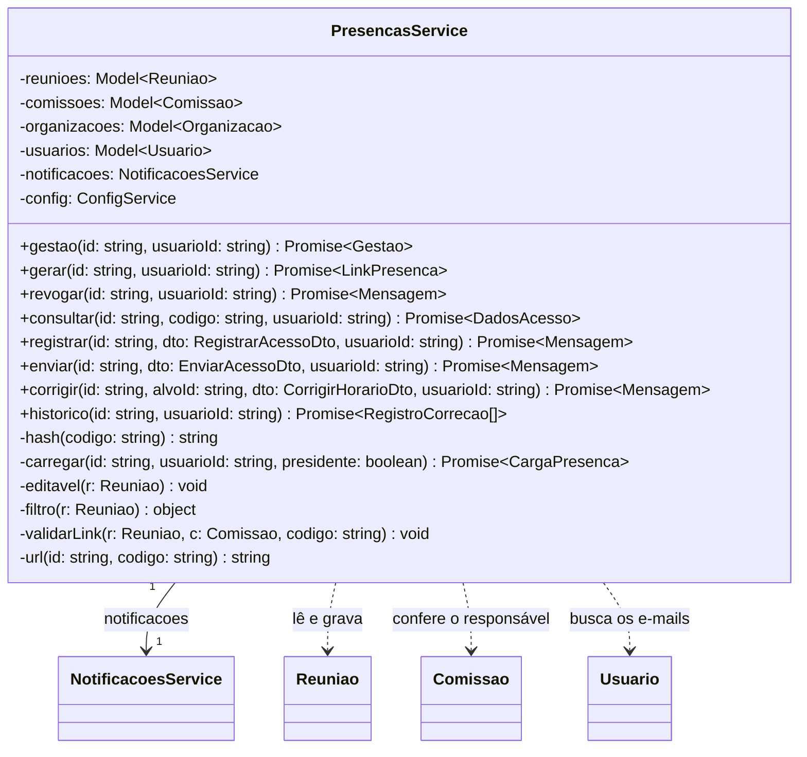

Figura 2 — Diagrama de classes das reuniões, parte 16: serviço de presença. Fonte: equipe Conecta+.

Só com o nome nesta parte: `NotificacoesService` (parte 7), `Reuniao` (parte 19), `Comissao` (parte 23) e `Usuario` (parte 24).

### 17. API: bibliotecas dos services

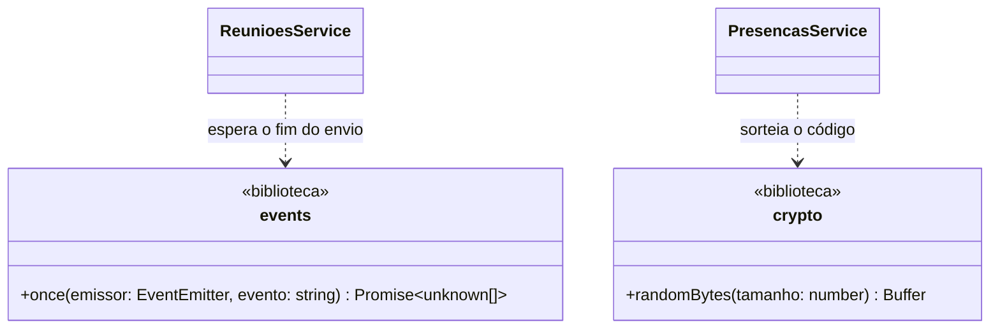

Figura 2 — Diagrama de classes das reuniões, parte 17: bibliotecas dos services. Fonte: equipe Conecta+.

Só com o nome nesta parte: `ReunioesService` (parte 14) e `PresencasService` (parte 16).

### 18. API: envio de e-mails

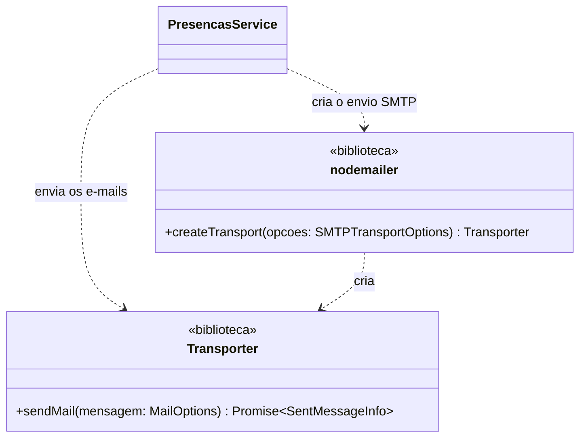

Figura 2 — Diagrama de classes das reuniões, parte 18: envio de e-mails. Fonte: equipe Conecta+.

Só com o nome nesta parte: `PresencasService` (parte 16).

### 19. Dados: reunião, participantes e anexos

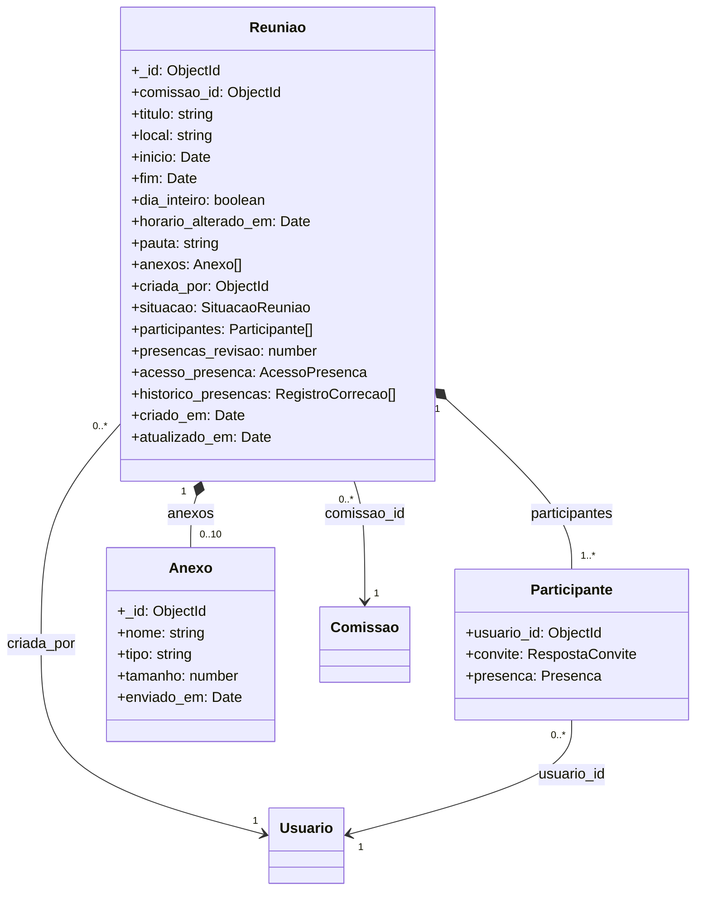

Figura 2 — Diagrama de classes das reuniões, parte 19: reunião, participantes e anexos. Fonte: equipe Conecta+.

Só com o nome nesta parte: `Comissao` (parte 23) e `Usuario` (parte 24).

### 20. Dados: arquivos no GridFS

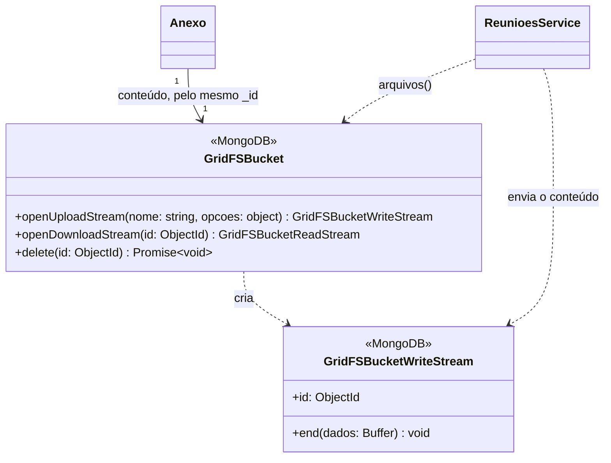

Figura 2 — Diagrama de classes das reuniões, parte 20: arquivos no GridFS. Fonte: equipe Conecta+.

Só com o nome nesta parte: `ReunioesService` (parte 14) e `Anexo` (parte 19).

### 21. Dados: presença, link, correções e enumerações

```mermaid
classDiagram
    direction TB

    class Presenca {
        +entrada: Date
        +saida: Date
        +saida_automatica: boolean
        +situacao: SituacaoPresenca
        +marcada_por: OrigemPresenca
    }
    class AcessoPresenca {
        <<tipo>>
        +hash: string
        +inicio: Date
        +fim: Date
        +responsavel_id: string
        +criado_em: Date
    }
    class RegistroCorrecao {
        <<tipo>>
        +participante_id: string
        +responsavel_id: string
        +alterada_em: Date
        +motivo: string
        +antes: Presenca
        +depois: Presenca
    }
    class SituacaoReuniao {
        <<enumeration>>
        AGENDADA
        CANCELADA
    }
    class RespostaConvite {
        <<enumeration>>
        PENDENTE
        ACEITO
        RECUSADO
    }
    class SituacaoPresenca {
        <<enumeration>>
        AGUARDANDO
        CONFIRMADA
        RECUSADA
    }
    class OrigemPresenca {
        <<enumeration>>
        LINK
        PROPRIO
        RESPONSAVEL
    }
    class Reuniao
    class Participante
    class Usuario

    Participante "1" *-- "0..1" Presenca : presenca
    Reuniao "1" *-- "0..1" AcessoPresenca : acesso_presenca
    Reuniao "1" *-- "0..*" RegistroCorrecao : historico_presencas
    RegistroCorrecao "1" *-- "0..1" Presenca : antes
    RegistroCorrecao "1" *-- "1" Presenca : depois
    AcessoPresenca "0..*" --> "1" Usuario : responsavel_id
    RegistroCorrecao "0..*" --> "1" Usuario : participante_id
    RegistroCorrecao "0..*" --> "1" Usuario : responsavel_id
    Reuniao ..> SituacaoReuniao : situacao
    Participante ..> RespostaConvite : convite
    Presenca ..> SituacaoPresenca : situacao
    Presenca ..> OrigemPresenca : marcada_por
```

Figura 2 — Diagrama de classes das reuniões, parte 21: presença, link, correções e enumerações. Fonte: equipe Conecta+.

Só com o nome nesta parte: `Reuniao` e `Participante` (parte 19) e `Usuario` (parte 24).

### 22. Dados: model das reuniões

```mermaid
classDiagram
    direction TB

    class ReuniaoModel {
        <<Model Mongoose>>
        +create(dados: object) Promise~Reuniao~
        +find(filtro: object) Query~Reuniao[]~
        +findById(id: string) Query~Reuniao~
        +findOneAndUpdate(filtro: object, alteracao: object, opcoes: object) Query~Reuniao~
        +updateOne(filtro: object, alteracao: object, opcoes: object) Query~UpdateResult~
        +select(campos: string) Query
        +populate(caminho: string, campos: string) Query
        +sort(ordem: object) Query
        +lean() Query
        +exec() Promise~unknown~
    }
    class ReunioesService
    class PresencasService
    class NotificacoesService
    class Reuniao

    ReunioesService "1" --> "1" ReuniaoModel : reuniaoModel
    PresencasService "1" --> "1" ReuniaoModel : reunioes
    NotificacoesService "1" --> "1" ReuniaoModel : reunioes
    ReuniaoModel ..> Reuniao : lê e grava
```

Figura 2 — Diagrama de classes das reuniões, parte 22: model das reuniões. Fonte: equipe Conecta+.

Só com o nome nesta parte: `NotificacoesService` (parte 7), `ReunioesService` (parte 14), `PresencasService` (parte 16) e `Reuniao` (parte 19).

### 23. Dados: comissões e organizações

```mermaid
classDiagram
    direction TB

    class ComissaoModel {
        <<Model Mongoose>>
        +findById(id: string) Query~Comissao~
    }
    class OrganizacaoModel {
        <<Model Mongoose>>
        +findById(id: string) Query~Organizacao~
    }
    class Comissao {
        +_id: ObjectId
        +organizacao_id: ObjectId
        +ativo: boolean
        +membros: MembroComissao[]
    }
    class Organizacao
    class ReunioesService
    class PresencasService

    ReunioesService "1" --> "1" ComissaoModel : comissaoModel
    ReunioesService "1" --> "1" OrganizacaoModel : organizacaoModel
    PresencasService "1" --> "1" ComissaoModel : comissoes
    PresencasService "1" --> "1" OrganizacaoModel : organizacoes
    ComissaoModel ..> Comissao : lê
    OrganizacaoModel ..> Organizacao : lê
```

Figura 2 — Diagrama de classes das reuniões, parte 23: comissões e organizações. Fonte: equipe Conecta+.

Só com o nome nesta parte: `ReunioesService` (parte 14) e `PresencasService` (parte 16); `Organizacao` não tem membros usados neste módulo e está no [diagrama de classes do cadastro de organização](../../2%20-%20Incremento%201/cadastro-organizacao/3%20-%20diagrama-classes-cadastro-organizacao.md).

### 24. Dados: usuários

```mermaid
classDiagram
    direction TB

    class UsuarioModel {
        <<Model Mongoose>>
        +find(filtro: object) Query~Usuario[]~
        +findById(id: string) Query~Usuario~
        +select(campos: string) Query
        +exec() Promise~unknown~
    }
    class Usuario {
        +_id: ObjectId
        +nome: string
        +email: string
        +ativo: boolean
    }
    class ReunioesService
    class PresencasService

    ReunioesService "1" --> "1" UsuarioModel : usuarioModel
    PresencasService "1" --> "1" UsuarioModel : usuarios
    UsuarioModel ..> Usuario : lê
```

Figura 2 — Diagrama de classes das reuniões, parte 24: usuários. Fonte: equipe Conecta+.

Só com o nome nesta parte: `ReunioesService` (parte 14) e `PresencasService` (parte 16).

### 25. Dados: notificações

```mermaid
classDiagram
    direction TB

    class NotificacaoModel {
        <<Model Mongoose>>
        +find(filtro: object) Query~Notificacao[]~
        +findOne(filtro: object) Query~Notificacao~
        +updateOne(filtro: object, alteracao: object, opcoes: object) Query~UpdateResult~
        +updateMany(filtro: object, alteracao: object) Query~UpdateResult~
        +select(campos: string) Query
        +sort(ordem: object) Query
        +limit(quantidade: number) Query
        +lean() Query
        +exec() Promise~unknown~
    }
    class Notificacao {
        +_id: ObjectId
        +usuario_id: ObjectId
        +chave: string
        +titulo: string
        +mensagem: string
        +destino: string
        +tipo: string
        +lida_em: Date
        +expira_em: Date
        +criada_em: Date
        +atualizada_em: Date
    }
    class NotificacoesService
    class Usuario

    NotificacoesService "1" --> "1" NotificacaoModel : notificacoes
    NotificacaoModel ..> Notificacao : lê e grava
    Notificacao "0..*" --> "1" Usuario : usuario_id
```

Figura 2 — Diagrama de classes das reuniões, parte 25: notificações guardadas. Fonte: equipe Conecta+.

Só com o nome nesta parte: `NotificacoesService` (parte 7) e `Usuario` (parte 24).

## Como ler as ligações

| Ligação                      | Significado                                                             | Exemplo no diagrama                                                                                          |
| ---------------------------- | ----------------------------------------------------------------------- | ------------------------------------------------------------------------------------------------------------ |
| Losango cheio (composição)   | A parte só existe dentro do todo e é apagada junto com ele.             | `Reuniao *-- Participante`: o participante é gravado dentro do documento da reunião.                         |
| Seta cheia (associação)      | Uma classe guarda uma referência a outra, que existe por conta própria. | `Participante --> Usuario`: `usuario_id` guarda o identificador de um documento de `usuarios`.               |
| Triângulo vazio (herança)    | A classe filha tem tudo o que a mãe tem.                                | `RegistrarAcessoDto` e `EnviarAcessoDto` herdam o campo `codigo` de `CodigoAcessoDto`.                       |
| Seta tracejada (dependência) | Uma classe usa a outra em uma chamada, sem guardá-la como atributo.     | `ReunioesService ..> Comissao`: o serviço lê a comissão para conferir o presidente.                          |

Os números nas pontas são as multiplicidades. Por exemplo, uma `Reuniao` tem ao menos um `Participante` (`1..*`), que é quem a agendou, de zero a dez anexos (`0..10`), no máximo um link de presença ativo (`0..1`) e qualquer quantidade de registros de correção (`0..*`).

`AcessoPresenca` e `RegistroCorrecao` estão marcados como `<<tipo>>` porque não são classes de schema do Mongoose: `acesso_presenca` é declarado em `Reuniao` com um tipo de objeto escrito no próprio campo, e cada item de `historico_presencas` é o objeto montado por `PresencasService.corrigir`. Os dois campos são gravados com `select: false`, então só aparecem quando a consulta os pede.

Os estereótipos indicam de onde vem cada classe. `<<Model Mongoose>>` é o `Model` que o NestJS injeta em cada service com `@InjectModel`: é o atributo do service, como `reuniaoModel` em `ReunioesService` e `reunioes` em `PresencasService`, e as duas apontam para o mesmo `ReuniaoModel`. `select`, `populate`, `sort`, `lean`, `limit` e `exec` são da `Query` que `find`, `findById`, `findOne`, `findOneAndUpdate`, `updateOne` e `updateMany` devolvem; estão na classe do model porque os diagramas de sequência os chamam na linha de vida dele, na ordem do encadeamento do código. `<<biblioteca>>` marca as bibliotecas externas, só com os membros chamados; `<<MongoDB>>`, as classes do driver do MongoDB; `<<contexto>>`, o provedor de contexto do React; e `<<component>>`, um componente visual. O `$` no fim de um método de `File` indica método estático, chamado na própria classe, como `File.downloadFileAsync`. As dependências `ReunioesService ..> Reuniao` e `PresencasService ..> Reuniao`, das partes 14 e 16, passam, no código, pelo `ReuniaoModel` da parte 22.

No código, os atributos opcionais são `horario_alterado_em` e `acesso_presenca`, em `Reuniao`; `presenca`, em `Participante`; `saida` e `saida_automatica`, em `Presenca`; `saida`, em `CorrigirHorarioDto`; e `lida_em` e `expira_em`, em `Notificacao`. Nos objetos de entrada, só `comissao_id`, `titulo`, `inicio` e `fim` são obrigatórios em `CreateReuniaoDto`, e todos os campos de `UpdateReuniaoDto` são opcionais. A obrigatoriedade de cada atributo está no [dicionário de classes](3%20-%20dicionario-dados-classes-reunioes.md).

## Rotas atendidas pelos controllers

As rotas HTTP não são métodos; por isso ficam nesta tabela, e não no diagrama.

| Método do controller                   | Rota HTTP                                   |
| -------------------------------------- | ------------------------------------------- |
| `ReunioesController.listar`            | `GET /reunioes`                             |
| `ReunioesController.criar`             | `POST /reunioes`                            |
| `ReunioesController.buscarPorId`       | `GET /reunioes/:id`                         |
| `ReunioesController.atualizar`         | `PATCH /reunioes/:id`                       |
| `ReunioesController.responderConvite`  | `PATCH /reunioes/:id/convite`               |
| `ReunioesController.marcarEntrada`     | `POST /reunioes/:id/entrada`                |
| `ReunioesController.marcarSaida`       | `POST /reunioes/:id/saida`                  |
| `ReunioesController.atualizarPresenca` | `PATCH /reunioes/:id/presencas/:usuarioId`  |
| `ReunioesController.gerarListaPresenca`| `GET /reunioes/:id/lista-presenca`          |
| `ReunioesController.adicionarAnexo`    | `POST /reunioes/:id/anexos`                 |
| `ReunioesController.baixarAnexo`       | `GET /reunioes/:id/anexos/:anexoId`         |
| `ReunioesController.removerAnexo`      | `DELETE /reunioes/:id/anexos/:anexoId`      |
| `PresencasController.gestao`           | `GET /presencas/:id/gestao`                 |
| `PresencasController.gerar`            | `POST /presencas/:id/link`                  |
| `PresencasController.revogar`          | `DELETE /presencas/:id/link`                |
| `PresencasController.consultar`        | `GET /presencas/:id/acesso?codigo=`         |
| `PresencasController.registrar`        | `POST /presencas/:id/acesso`                |
| `PresencasController.enviar`           | `POST /presencas/:id/enviar`                |
| `PresencasController.corrigir`         | `PATCH /presencas/:id/horarios/:usuarioId`  |
| `PresencasController.historico`        | `GET /presencas/:id/historico`              |
| `NotificacoesController.listar`        | `GET /notificacoes`                         |
| `NotificacoesController.ler`           | `PATCH /notificacoes/:id/lida`              |

## Regras representadas

- `Participante`, `Presenca`, `Anexo`, `AcessoPresenca` e `RegistroCorrecao` são gravados dentro do documento de `Reuniao`, por isso a composição;
- `Anexo` guarda só a identificação do arquivo; o conteúdo fica no `GridFSBucket`, com o mesmo identificador;
- `Usuario`, `Comissao` e `Notificacao` ficam em coleções próprias, por isso as associações são feitas por identificador;
- quem agendou a reunião é identificado por `criada_por`; o responsável que gerou o link, por `AcessoPresenca.responsavel_id`;
- o link guarda só o resumo do código (`hash`), nunca o código;
- os avisos de convite, horário, cancelamento e ata não são gravados no momento do fato: `NotificacoesService.listar` os cria quando o usuário consulta as notificações;
- `FormularioReuniao` é o mesmo componente nas telas de criar e de editar;
- o aplicativo nunca decide se a presença vale: ele mostra o que a API devolve.

## Rastreabilidade

RF-REU-01 a RF-REU-09 e RF-REU-13 a RF-REU-22; complementado por [Dicionário de classes](3%20-%20dicionario-dados-classes-reunioes.md) e [Diagramas de sequência](6%20-%20diagramas-sequencia-reunioes.md).
