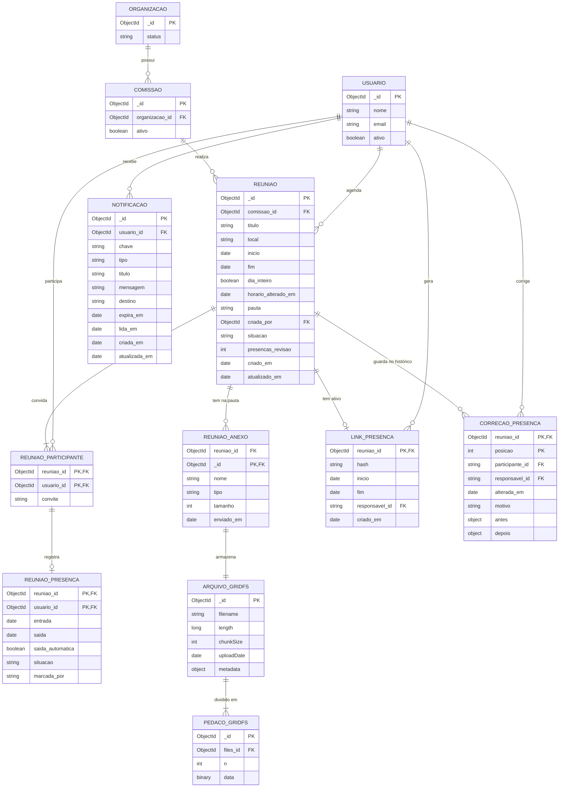

# Diagrama relacional — Reuniões

> Padrão da disciplina · Módulo REU · Visão lógica dos documentos MongoDB · Revisado em 27/11/2026

## Resumo

O banco é o MongoDB, que não tem tabelas: participantes, presenças, anexos, link de presença e correções ficam dentro do documento da reunião, na coleção `reunioes`. O diagrama abaixo é uma **visão lógica**: ele separa esses dados em entidades para deixar claras as chaves, as cardinalidades e as restrições. Além de `reunioes`, o módulo usa três coleções: as duas do GridFS, que guardam o conteúdo dos anexos, e `notificacoes`, que recebe os avisos das reuniões: pedido de presença, convite, mudança de horário, cancelamento e ata a avaliar.

O documento da reunião também guarda a ata (`ata` e `atas_canceladas`) e as votações (`votacoes`). Essas partes estão nos diagramas relacionais das [atas](../../4%20-%20Incremento%203/atas/4%20-%20diagrama-relacional-atas.md) e da [votação](../../4%20-%20Incremento%203/votacao/4%20-%20diagrama-relacional-votacao.md).

## Diagrama

Figura 3 — Visão lógica relacional das reuniões. Fonte: equipe Conecta+.

## Como as entidades lógicas viram documentos

| Entidade lógica        | Onde fica de verdade                                  | Observação                                                                                         |
| ---------------------- | ----------------------------------------------------- | -------------------------------------------------------------------------------------------------- |
| `REUNIAO`              | coleção `reunioes`                                    | Documento principal.                                                                               |
| `REUNIAO_PARTICIPANTE` | `reunioes.participantes[]`                            | Subdocumento; a chave lógica é a reunião mais o usuário.                                           |
| `REUNIAO_PRESENCA`     | `reunioes.participantes[].presenca`                   | Subdocumento de um participante; só existe depois da entrada.                                      |
| `REUNIAO_ANEXO`        | `reunioes.anexos[]`                                   | Subdocumento; o `_id` é o mesmo do arquivo no GridFS.                                              |
| `ARQUIVO_GRIDFS`       | coleção `anexos.files`                                | Criada e mantida pelo GridFS; uma linha por arquivo.                                               |
| `PEDACO_GRIDFS`        | coleção `anexos.chunks`                               | Criada e mantida pelo GridFS; o conteúdo dividido em pedaços de 255 KB.                            |
| `LINK_PRESENCA`        | `reunioes.acesso_presenca`                            | Objeto embutido; no máximo um por reunião. Não aparece nas consultas comuns.                       |
| `CORRECAO_PRESENCA`    | `reunioes.historico_presencas[]`                      | Item de lista; `posicao` não é gravada: é a posição do item na lista. Não aparece nas consultas comuns. |
| `NOTIFICACAO`          | coleção `notificacoes`                                | O aviso `PRESENCA` é gravado no envio do link; os de `CONVITE`, `HORARIO`, `CANCELAMENTO` e `ATA`, quando o usuário consulta as notificações. A reunião só aparece no texto de `chave` e de `destino`, sem chave estrangeira. |
| `COMISSAO`, `ORGANIZACAO`, `USUARIO` | coleções `comissoes`, `organizacoes` e `usuarios` | Descritas nos módulos do Incremento 1; aqui só os campos usados.                       |

Nas entidades guardadas dentro da reunião, `reuniao_id` aparece no diagrama como parte da chave, mas não existe como campo gravado: ele vem do documento que as contém. O aplicativo nunca acessa as coleções do GridFS diretamente: o servidor lê e grava por meio do `GridFSBucket`.

## Regras de integridade

- um usuário aparece uma única vez em `REUNIAO_PARTICIPANTE` de cada reunião, e quem agendou sempre está na lista;
- todo participante é integrante da comissão da reunião no momento em que é convidado;
- `REUNIAO_PRESENCA` tem no máximo uma linha por participante, e a saída nunca passa do término da reunião;
- uma reunião tem no máximo 10 `REUNIAO_ANEXO`, e cada um corresponde a exatamente um `ARQUIVO_GRIDFS` com o mesmo identificador;
- `LINK_PRESENCA` só vale enquanto o início e o término da reunião forem os mesmos da geração, enquanto `responsavel_id` for o responsável da comissão e antes do término;
- `CORRECAO_PRESENCA` só cresce: nenhum registro é alterado ou apagado;
- `NOTIFICACAO` não se repete para o mesmo usuário e a mesma `chave`;
- depois que a reunião é cancelada ou a ata é enviada, nenhuma presença muda, nenhuma correção é registrada e nenhum link é gerado; o link existente ainda pode ser revogado.

## Rastreabilidade

RF-REU-01 a RF-REU-09 e RF-REU-13 a RF-REU-22; detalhado em [Dicionário relacional](4%20-%20dicionario-dados-relacional-reunioes.md).
