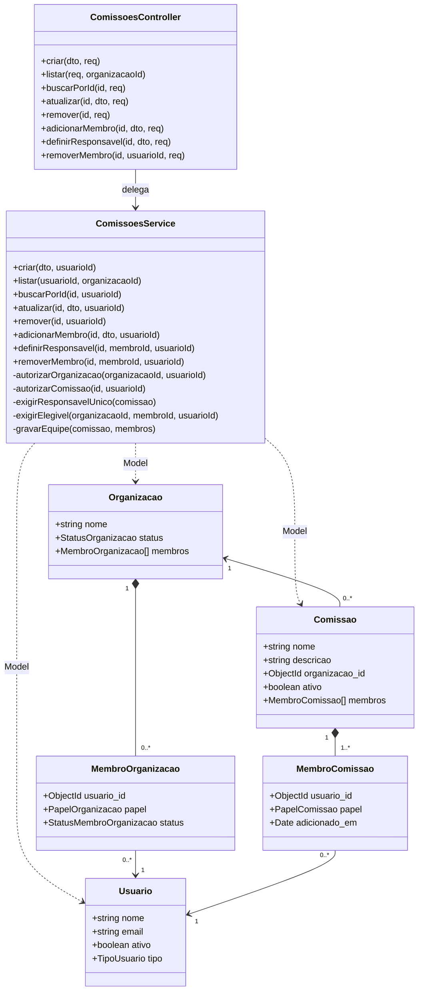
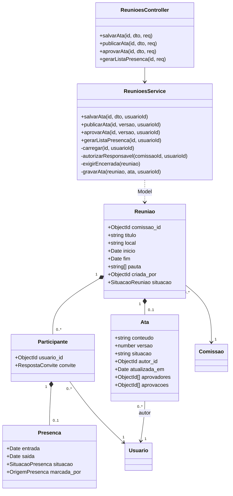

# Classes e dicionário

As classes abaixo existem no backend TypeScript/NestJS. Os componentes React são funções, não classes fictícias chamadas Frontend/Backend. Model é o tipo de repositório fornecido pelo Mongoose. Atributos gerados `_id` e timestamps pertencem ao documento hidratado.

Cardinalidade 1..* de equipe representa a regra após regularização: exatamente um desses vínculos é RESPONSAVEL. Dados antigos podem violá-la. Usuário e organização são recortes: exibem somente atributos necessários a comissões, sem reproduzir dados de autenticação e outros requisitos.

## Dicionário de classes

|Classe/tipo|O que representa e responsabilidade|Fonte em BACKEND/src|
|---|---|---|
|ComissoesController|Adaptador HTTP; extrai DTO/parâmetros e sub autenticado; delega sem implementar regra de equipe|comissoes/comissoes.controller.ts|
|ComissoesService|Autoriza ações e mantém as invariantes da equipe; usa os três models injetados|comissoes/comissoes.service.ts|
|Comissao|Grupo de trabalho de uma organização; agregado persistido com equipe embutida|comissoes/schemas/comissao.schema.ts|
|MembroComissao|Vínculo da pessoa com comissão, papel e data de inclusão; não é outro cadastro de usuário|mesmo arquivo|
|Organizacao/MembroOrganizacao|Organização e vínculo de acesso; fonte de ADMIN/APROVADO|organizacoes/schemas/organizacao.schema.ts|
|Usuario|Identidade reutilizada; atividade e tipo de conta; nome/e-mail apresentados|usuarios/schemas/usuario.schema.ts|
|ReunioesController|Adaptador HTTP das reuniões e dos registros adicionados|reunioes/reunioes.controller.ts|
|ReunioesService|Autoriza participante/responsável, registra ata por versão e calcula lista|reunioes/reunioes.service.ts|
|Reuniao|Encontro de uma comissão; conserva participantes da convocação e ata opcional|reunioes/schemas/reuniao.schema.ts|
|Participante|Convite e possível presença de um usuário nessa reunião|mesmo arquivo|
|Presenca|Entrada, saída e validação da participação; ausência do subdocumento significa sem registro|mesmo arquivo|
|Ata|Texto vigente, versão de edição e aprovação coletiva; não representa documento assinado digitalmente|mesmo arquivo|
|CreateComissaoDto|Contrato de entrada com nome/descrição/organização/responsável|comissoes/dto/create-comissao.dto.ts|
|UpdateComissaoDto|Campos opcionais editáveis nome/descricao/ativo|comissoes/dto/update-comissao.dto.ts|
|AddMembroComissaoDto|ID do candidato e papel opcional; serviço restringe inclusão a MEMBRO|comissoes/dto/add-membro-comissao.dto.ts|
|DefinirResponsavelDto|ID da pessoa escolhida para transferência|comissoes/dto/definir-responsavel.dto.ts|
|UpdateMembroComissaoDto|Papel para rota de compatibilidade; não permite retirar único responsável|comissoes/dto/update-membro-comissao.dto.ts|
|VersaoAtaDto|Inteiro >=0 informado pelo cliente|reunioes/dto/ata.dto.ts|
|SalvarAtaDto|Herda versão e acrescenta conteúdo 20–20000|mesmo arquivo|
|JwtAuthGuard/UsuarioComumGuard|Autenticação e restrição de tipo de conta; compartilhados, preexistentes|auth/|

## Componentes funcionais do aplicativo

`TelaNovaComissao`, `TelaComissoes` e o componente de detalhes em `src/app/comissoes/[id].tsx` mantêm formulário/listas/estado e chamam `api(caminho,metodo,corpo)`. `SeletorPessoaComissao` oferece busca/páginas para escolher ID. `TelaRegistrosReuniao` usa `carregar()`, `gravar(caminho,metodo,corpo)` e `gerarLista()`. Os campos usam react-hook-form. `FolhaInferior` aceita `acompanharTeclado` opcional; `Confirmacao` apresenta aprovação explícita das ações sensíveis. Não são representados como classes TypeScript.

Os tipos, significados, nulabilidade e restrições de cada atributo persistido estão no dicionário de dados seguinte. Esse vínculo evita duas definições conflitantes para o mesmo atributo.
