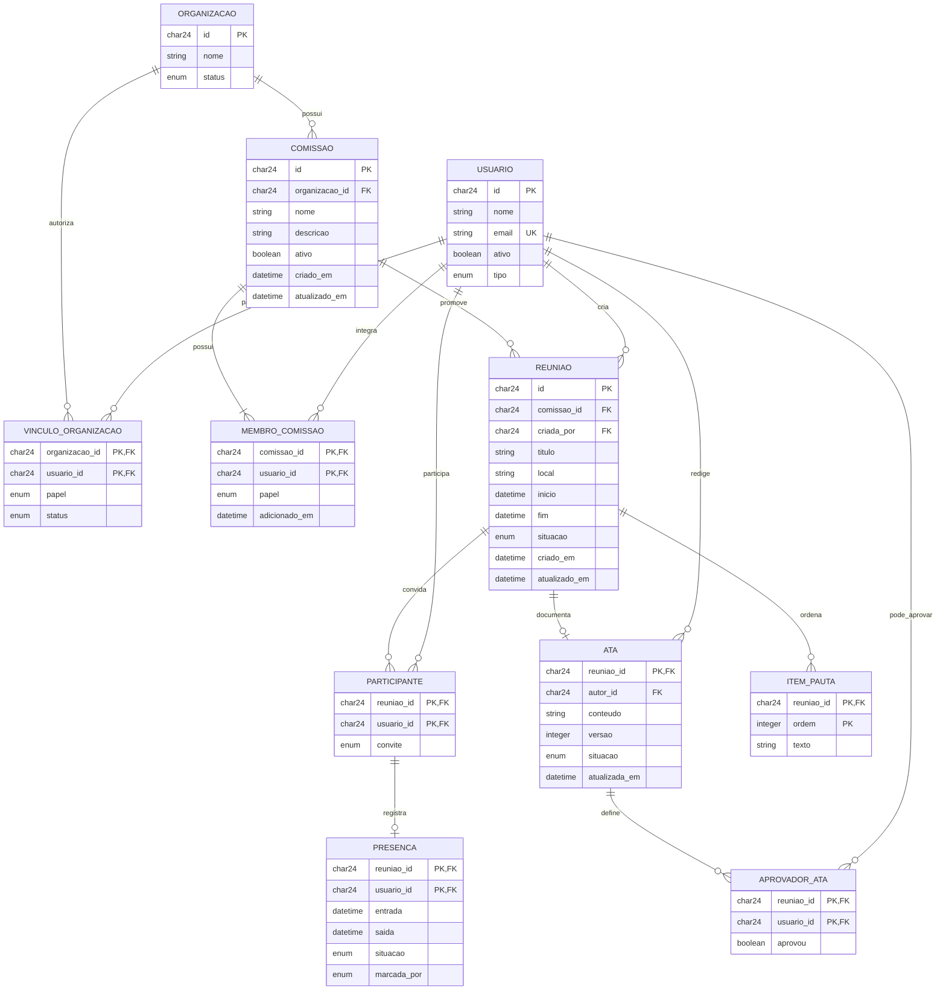

# Dados — modelo implementado e representação relacional

## Banco real

O projeto usa **MongoDB**, via Mongoose. As coleções reais deste recorte são `comissoes`, `reunioes`, `usuarios` e `organizacoes`. Equipe, participantes, presença e ata são subdocumentos/arrays; **não são tabelas físicas independentes**. `ref` permite populate, mas não cria chave estrangeira nem cascata no MongoDB. A integridade entre coleções é conferida nos serviços. Escritas externas que ignoram os serviços podem quebrar essas regras.

“Recorte” significa mostrar apenas os campos de outra área necessários ao requisito. Não significa cortar dados do banco. Aqui Usuario/Organizacao são recortes explícitos, evitando atribuir toda a documentação de login e organizações à parte de comissão.

## Diagrama relacional lógico (acadêmico)

Esta normalização é uma representação para explicar cardinalidades e chaves. Não foi executada migração SQL. Nomes sem acentos facilitam correspondência com código; ObjectId é representado como string de 24 caracteres hexadecimais no modelo lógico.

No modelo lógico, FK dupla de PRESENCA aponta para PARTICIPANTE(reuniao_id,usuario_id). APROVADOR_ATA aponta para ATA e USUARIO; aprovou representa pertinência ao array aprovacoes. ITEM_PAUTA corresponde à posição de cada string no array pauta. Tais chaves compostas não existem como índices SQL no MongoDB.

## Dicionário das relações lógicas e correspondência

|Relação lógica|O que representa|Correspondência física e chaves|
|---|---|---|
|ORGANIZACAO|Entidade que mantém comissões|organizacoes; id corresponde a _id; nome/status descritos no recorte|
|USUARIO|Pessoa identificada no sistema|usuarios; id corresponde a _id; nome/email/ativo/tipo descritos no recorte|
|VINCULO_ORGANIZACAO|Autorização da pessoa na organização|organizacoes.membros; organizacao_id vem do documento pai; usuario_id/papel/status do subdocumento|
|COMISSAO|Grupo de trabalho com situação e organização dona|comissoes; id=_id; demais atributos têm os mesmos nomes; descricao é opcional|
|MEMBRO_COMISSAO|Participação e papel na comissão|comissoes.membros; comissao_id vem do pai; usuario_id/papel/adicionado_em do subdocumento; chave composta impede repetir pessoa no modelo lógico|
|REUNIAO|Encontro convocado por uma comissão|reunioes; id=_id; campos escalares mapeados diretamente; pauta é desmembrada em ITEM_PAUTA|
|ITEM_PAUTA|Tópico em uma posição da pauta|reunioes.pauta; reuniao_id vem do pai, ordem é índice >=0 no array, texto é a string nessa posição; ordem/texto obrigatórios no modelo lógico|
|PARTICIPANTE|Convite de uma pessoa para reunião|reunioes.participantes; reuniao_id do pai; usuario_id e convite do subdocumento|
|PRESENCA|Registro opcional da participação|participantes.presenca; chave dupla herdada de PARTICIPANTE; saída opcional; demais campos obrigatórios quando registro existe|
|ATA|Texto vigente e situação de aprovação|reunioes.ata; reuniao_id do pai é PK/FK, uma ata por reunião; conteúdo/versão/autor/data/situação obrigatórios quando ata existe|
|APROVADOR_ATA|Pessoa habilitada a aprovar e indicação do voto|Uma linha por ID em ata.aprovadores; aprovou=true se também consta em ata.aprovacoes, false caso contrário. Booleano derivado, não armazenado assim no MongoDB|

PK/FK são obrigatórias nas relações lógicas. Campos com o mesmo nome herdam tipos, significado e domínio dos dicionários físicos abaixo; nome de ID sem subdocumento não implica referência populada persistida.

## Dicionário físico: comissoes

|Campo|Tipo / obrigatório / padrão|Significado e restrição implementada|
|---|---|---|
|_id|ObjectId; gerado|Identidade única do documento; índice primário automático do MongoDB|
|nome|String; obrigatório|Nome do grupo; trim; DTO 2–100; não possui índice único|
|descricao|String; opcional|Finalidade do grupo; trim no DTO, até 1000; string vazia permitida|
|organizacao_id|ObjectId; obrigatório; ref Organizacao|Organização dona; elegibilidade verificada no serviço; não editável por UpdateComissaoDto|
|ativo|Boolean; padrão true|Permite distinguir grupo ativo/desativado; não exclui histórico|
|membros|MembroComissao[]; padrão técnico []|Equipe embutida; validador exige exatamente um RESPONSAVEL e IDs únicos. O default [] isoladamente não passa no validador ao criar pela API/model|
|membros.usuario_id|ObjectId; obrigatório; ref Usuario|Pessoa vinculada; serviço exige ativo/APROVADO na inclusão/transferência|
|membros.papel|String enum obrigatório|RESPONSAVEL ou MEMBRO; um único RESPONSAVEL por array válido|
|membros.adicionado_em|Date; padrão Date.now|Instante da inclusão; preservado na troca de papel|
|criado_em|Date; timestamp automático|Criação do documento|
|atualizado_em|Date; timestamp automático|Última atualização do documento|

MembroComissao não tem `_id` próprio. Comissao usa `versionKey:false`, portanto não possui `__v`. Controle de concorrência da equipe compara o array anterior, não um __v. O validador Mongoose atua sobre o array completo nas escritas implementadas; não é uma constraint nativa do servidor MongoDB e não faz migração retroativa. Não existe índice que imponha “exatamente um responsável”.

## Dicionário físico: reunioes

|Campo|Tipo / obrigatório / padrão|Significado/restrição|
|---|---|---|
|_id|ObjectId gerado|Identidade da reunião|
|comissao_id|ObjectId obrigatório; ref Comissao|Comissão convocadora|
|titulo|String obrigatória; trim|Título; DTO 3–120 caracteres|
|local|String obrigatória; trim|Local informado; DTO 2–120; não gera link de videoconferência|
|inicio|Date obrigatória|Início; entrada ISO-8601 no DTO|
|fim|Date obrigatória|Término maior que início e que agora ao agendar/alterar horário|
|pauta|String[]; padrão []|Tópicos ordenados; DTO até 30 itens, cada até 200, trim e remoção de vazios|
|criada_por|ObjectId obrigatório|Usuário que agendou; permanece após troca de responsável; controla edição e validação de presença existentes|
|situacao|Enum; padrão AGENDADA|AGENDADA ou CANCELADA. Encerramento é calculado por fim, não há valor ENCERRADA|
|participantes|Participante[]; padrão []|Snapshot dos participantes selecionados ao criar reunião (ou equipe completa em clientes antigos sem convidados_ids)|
|participantes.usuario_id|ObjectId obrigatório; ref Usuario|Identidade convidada|
|participantes.convite|Enum; padrão PENDENTE|PENDENTE, ACEITO ou RECUSADO|
|participantes.presenca|Presenca opcional|Ausente significa sem marcação; não significa presença recusada|
|presenca.entrada|Date obrigatória se subdocumento existe|Horário registrado pelo servidor; lançamento do responsável sem entrada usa inicio|
|presenca.saida|Date opcional|Saída registrada, limitada ao fim; ausência produz minutos=null no relatório|
|presenca.situacao|Enum obrigatório|AGUARDANDO, CONFIRMADA ou RECUSADA|
|presenca.marcada_por|Enum obrigatório|PROPRIO ou RESPONSAVEL; origem da criação do registro, não ID do validador|
|ata|Ata opcional|Registro vigente de conteúdo e aprovação|
|ata.conteudo|String obrigatória se ata existe|20–20000; trim no DTO|
|ata.versao|Number obrigatório >=1 no schema|Inteiro gerado por incremento do serviço; DTO aceita inteiro >=0 como versão esperada|
|ata.situacao|String enum obrigatório|RASCUNHO, EM_APROVACAO ou APROVADA|
|ata.autor_id|ObjectId obrigatório; ref Usuario|Autor da última edição do rascunho; não necessariamente criador da reunião|
|ata.atualizada_em|Date obrigatória|Última edição, publicação ou aprovação; não substitui data individual de voto|
|ata.aprovadores|ObjectId[]; padrão []|Conjunto de presenças confirmadas fixado na publicação; ainda sem votos automáticos|
|ata.aprovacoes|ObjectId[]; padrão []|IDs que aprovaram; inclusão única controlada no serviço|
|criado_em / atualizado_em|Date automáticas|Criação/atualização do documento raiz|

Ata, Participante e Presenca não possuem `_id` próprio. Reuniao tem `versionKey:false`. Índices reais: `_id`; `{comissao_id:1,inicio:1}`; `{'participantes.usuario_id':1,inicio:1}`, sem unicidade nestes dois últimos. As regras de aprovação pertencem ao serviço, não a índices únicos dos arrays.

## Dicionário dos recortes de dependências

|Coleção/campo|Tipo|Significado usado neste módulo|
|---|---|---|
|usuarios._id|ObjectId|Referência da pessoa, gerada automaticamente|
|usuarios.nome|String obrigatória, trim|Nome apresentado na equipe/lista|
|usuarios.email|String obrigatória, lowercase/trim, índice único|Identificador de contato e termo de busca; senha não retornada|
|usuarios.ativo|Boolean, padrão true|Conta apta a acessar e ser escolhida|
|usuarios.tipo|Enum USUARIO/ADMIN_SISTEMA, padrão USUARIO|Restringe acesso de administrador do sistema aos módulos comuns|
|organizacoes._id|ObjectId|Identidade da organização|
|organizacoes.nome|String obrigatória, trim|Nome apresentado e pesquisável na lista de comissões|
|organizacoes.status|Enum PENDENTE/APROVADA/REVOGADA, padrão PENDENTE|Apenas APROVADA habilita acesso atual de comissões|
|organizacoes.membros.usuario_id|ObjectId obrigatório|Pessoa vinculada à organização|
|organizacoes.membros.papel|Enum ADMIN/MEMBRO obrigatório|ADMIN autoriza gestão de comissões|
|organizacoes.membros.status|Enum PENDENTE/APROVADO/REJEITADO/CONVIDADO, padrão PENDENTE|APROVADO habilita vínculo usado na autorização|

Os outros atributos dessas duas coleções pertencem à documentação dos respectivos requisitos. Ausência neste desenho não significa ausência no banco.

## Restrições e conservação de dados

- Exatamente um responsável e IDs de integrantes únicos são regras de equipe; não confundir com unicidade do nome da comissão (não existe).
- Uma PK composta em MEMBRO_COMISSAO impediria duplicidade numa futura implementação SQL. Índice parcial do papel RESPONSAVEL garantiria no máximo um; garantir pelo menos um exigiria transação/trigger adicional. Nada disso foi aplicado ao banco atual.
- Exclusão da comissão é lógica. Não há ON DELETE CASCADE. Transferência preserva membros e datas, inclusive em regularização.
- Relações externas podem mudar entre leitura e gravação: não há transação entre usuarios, organizacoes e comissoes. A escrita atômica protege o array de equipe dentro do documento, não todas as mudanças organizacionais simultâneas.
- Snapshots de reunião/aprovadores conservam histórico. A remoção de integrante não apaga participação passada. Revogação organizacional não está revalidada em todas as operações herdadas de reunião; alinhar essa política com o grupo antes de produção.
