# Diagramas de sequência

Os lifelines C e S são instâncias das classes reais Controller e Service. M é uma instância de Model do Mongoose, não uma classe chamada Backend. Ator/Tela representa interação do usuário; os componentes React são funções. HTTP aparece em nota, não como nome de método. Cada diagrama corresponde a um RF e herda seu contrato de pré/pós-condições e erros.

## Autenticação comum a todas as rotas

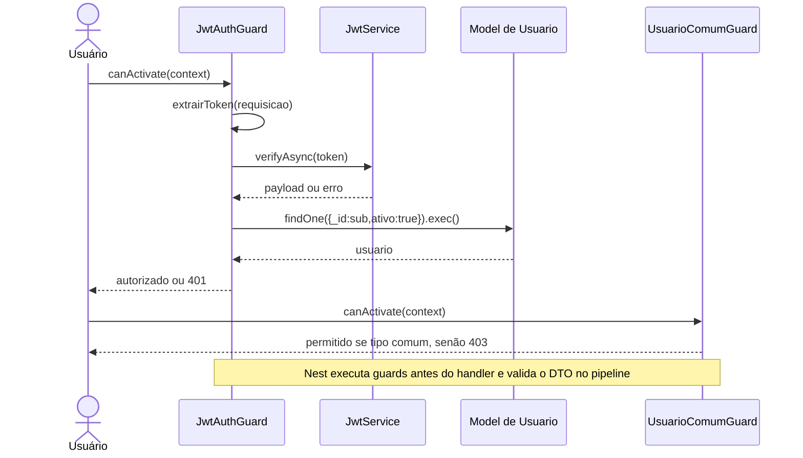

## RF-COM-01 — Consultar comissões

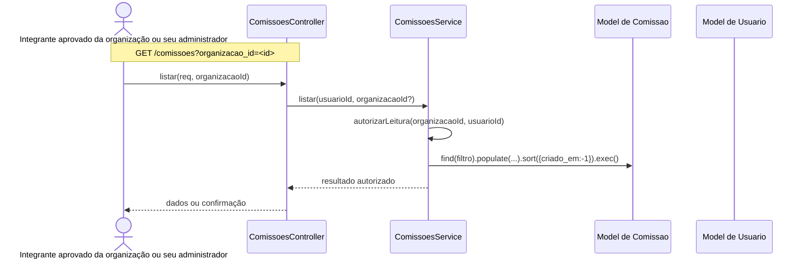

Sem organizacao_id, listar usa validarUsuario e organizacaoModel.find com vínculo APROVADO, separa administradas/participantes e consulta o $or descrito no RF. Não chama autorizarLeitura nessa alternativa.

## RF-COM-02 — Consultar detalhes da comissão

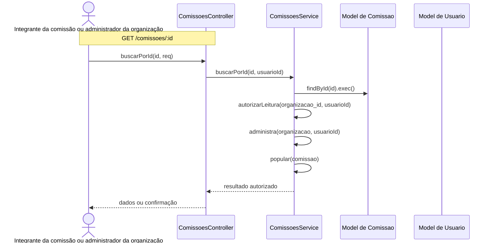

## RF-COM-03 — Cadastrar comissão com responsável

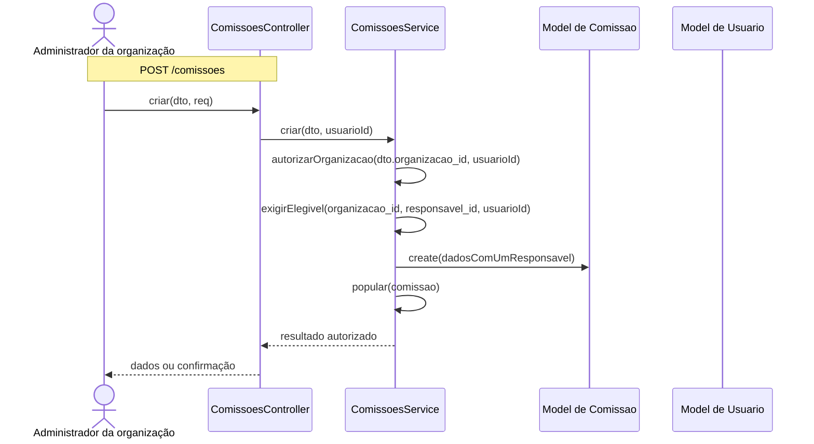

## RF-COM-04 — Editar dados da comissão

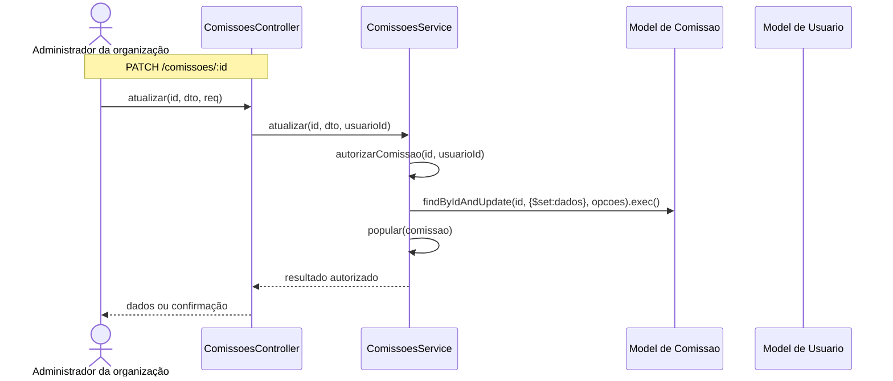

## RF-COM-05 — Desativar comissão

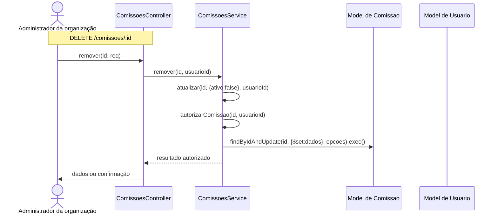

## RF-COM-06 — Reativar comissão

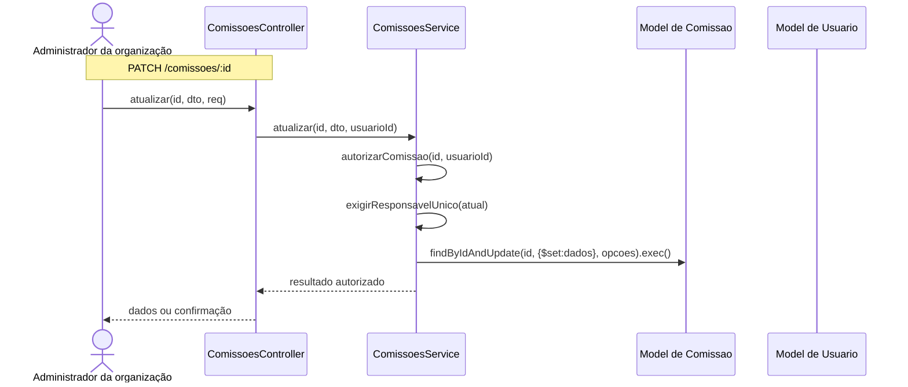

## RF-COM-07 — Adicionar integrante

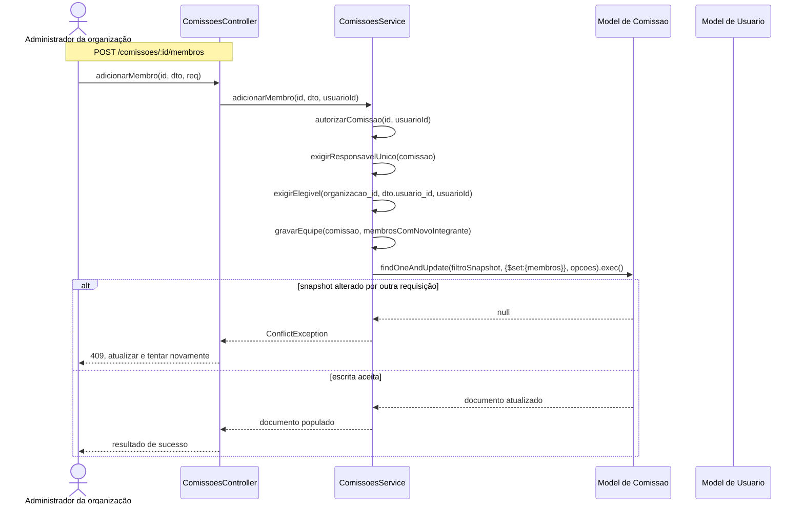

## RF-COM-08 — Definir ou substituir responsável

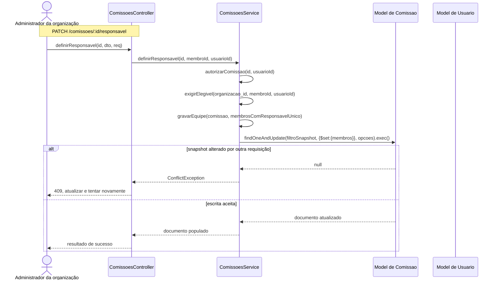

## RF-COM-09 — Remover integrante

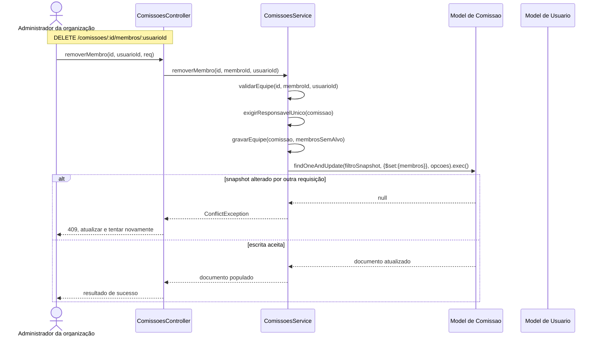

## RF-ATA-01 — Salvar rascunho de ata

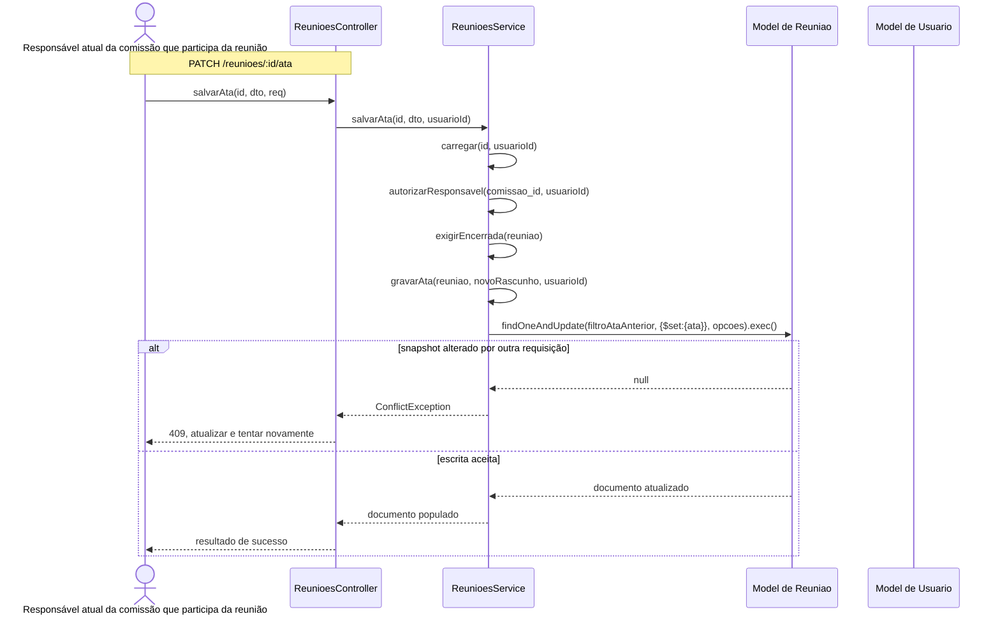

## RF-ATA-02 — Enviar ata para aprovação

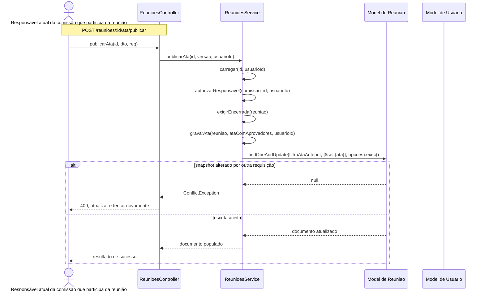

## RF-ATA-03 — Aprovar ata

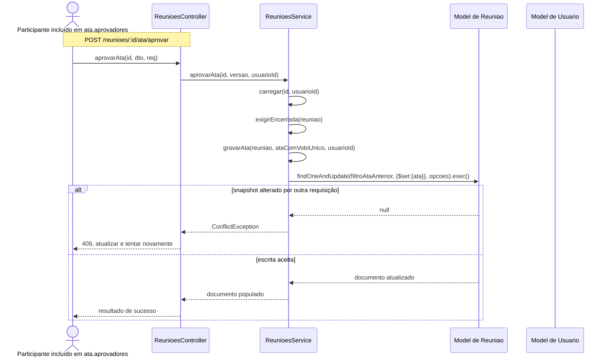

Antes de gravarAta, o serviço compara versão, exige presença em aprovadores e verifica voto existente. Voto repetido chama buscarPorId(id,usuarioId), retornando sem escrever. Falta de autorização: 403; estado inválido: 400; versão divergente: 409.

## RF-PRE-01 — Gerar e compartilhar lista de presença

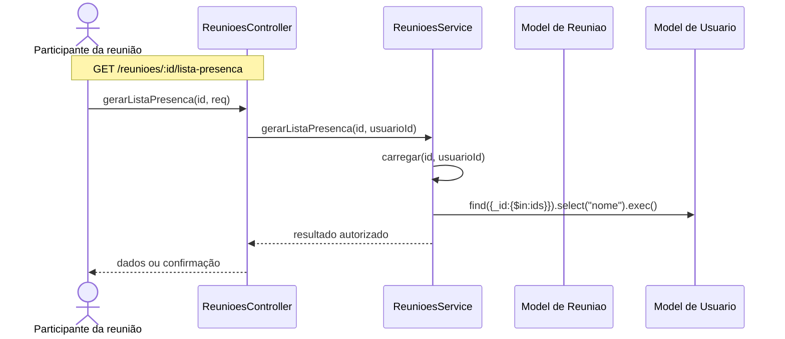

## Detalhamento das colaborações internas

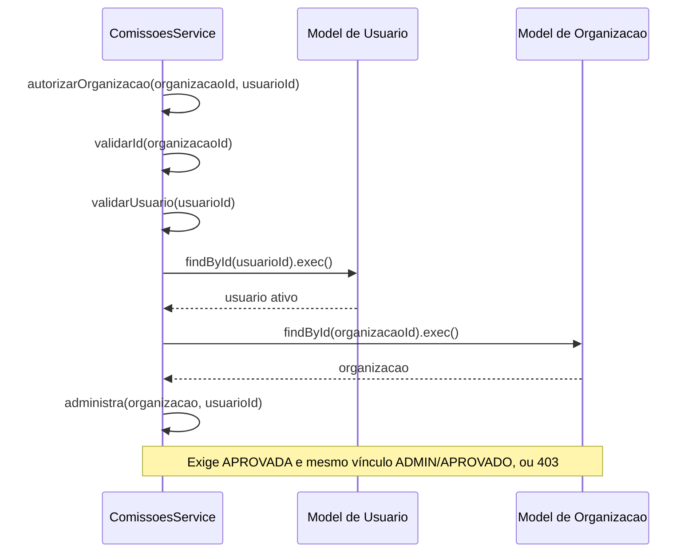

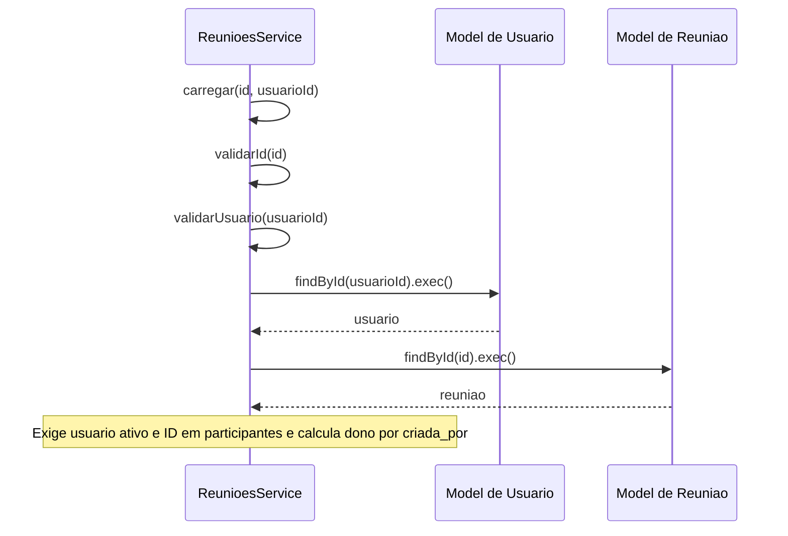

Os nomes novoRascunho, filtroSnapshot e ataComVotoUnico são argumentos descritivos, não métodos inventados. Definições exatas estão nos RF e em gravarEquipe/gravarAta. Falhas de autenticação, DTO e autorização interrompem o fluxo antes da escrita. Retornos de consultas internas foram abreviados nos diagramas principais para legibilidade. As sequências de reuniões já existentes permanecem sob responsabilidade do respectivo módulo; os treze requisitos próprios desta revisão têm diagrama acima.
