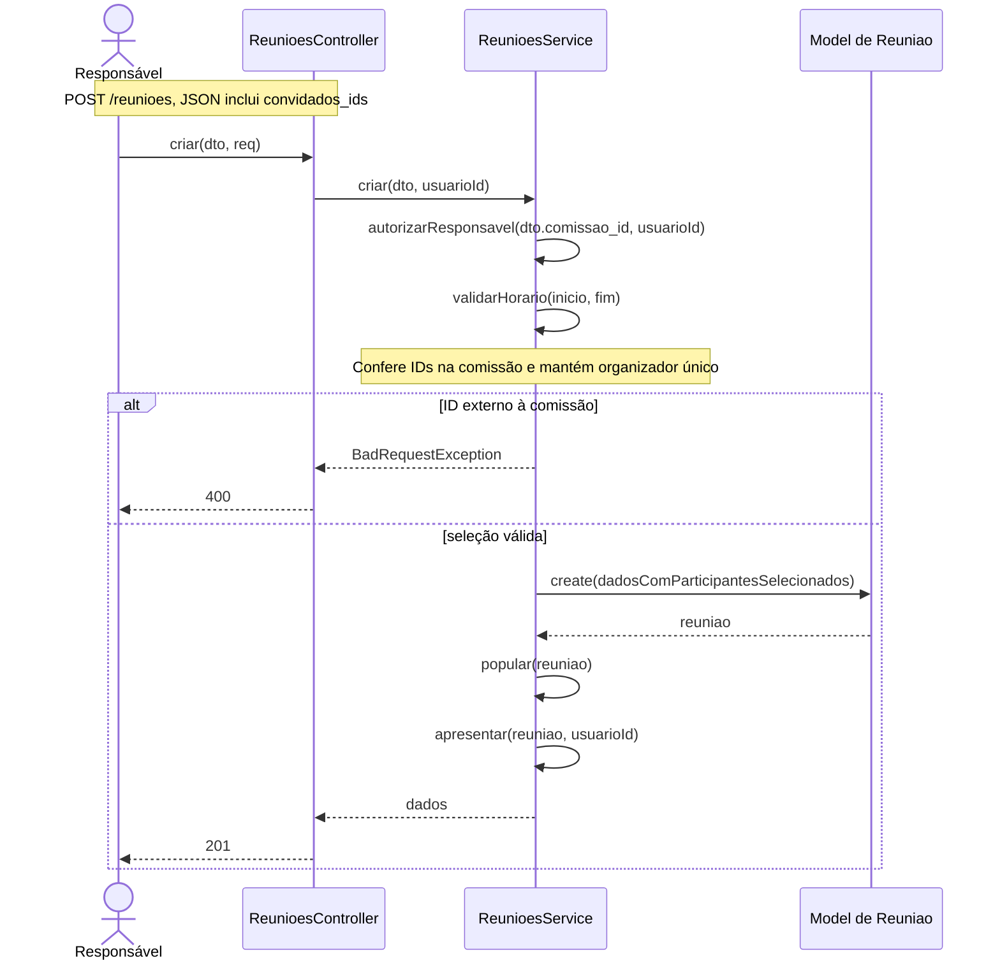

# Complemento de agendamento — 20/10/2026

Solicitação de Rafaela durante a demonstração: sugestões editáveis de início/término, seleção de convidados e conferência de atualização por gesto.

## RF-REU-COM-01 — Escolher participantes ao agendar

**Descrição:** Permitir que o responsável escolha quais integrantes da comissão participarão da nova reunião.

**Entradas:** Campos de CreateReuniaoDto já documentados e `convidados_ids`, array de ObjectIds únicos. A tela sempre envia o array, inicialmente com o organizador. É possível selecionar todos, desmarcar ou pesquisar por nome/e-mail, em páginas de oito.

**Origem:** Responsável atual da comissão, autenticado.

**Saída:** Reunião criada com organizador ACEITO e demais selecionados PENDENTE; erros 400/401/403 conforme validação/autorização.

**Destino:** Detalhes da reunião.

**Ação:** POST /reunioes → ReunioesController.criar(dto,req) → ReunioesService.criar(dto,usuarioId). Depois de autorizarResponsavel e validarHorario, o serviço verifica se cada ID pertence a comissao.membros. Acrescenta o organizador e elimina duplicidade via Set. Model de Reuniao.create grava participantes somente com esses IDs. O DTO recusa null, valor não array, ID inválido e IDs repetidos. ID de pessoa externa à comissão gera 400 antes da escrita.

**Pré-condição:** Comissão ativa, organização aprovada e responsável com vínculo aprovado; regras de título, local e horários preservadas.

**Pós-condição:** Somente as pessoas selecionadas e o organizador constam em reunioes.participantes e podem consultar essa reunião conforme a autorização existente.

**Efeitos colaterais:** Não altera a equipe da comissão nem participantes de reuniões anteriores. Array vazio significa somente o organizador. Para compatibilidade com clientes anteriores, omitir convidados_ids mantém o convite de toda a comissão. Esta revisão acrescenta seleção na criação, não edição posterior de convites já emitidos.

## Sugestões de horário

`sugerirHorarios(dia,agora,inicio?)`, em FRONTEND/src/utils/sugestoes-horario.ts, é uma função pura. Para hoje, sugere os próximos seis intervalos de meia hora ainda no mesmo dia. Para data futura, sugere 08h, 09h, 10h, 11h, 14h, 15h, 16h, 17h e 18h. Para término com início válido, acrescenta durações de 30, 60, 90, 120 e 180 minutos, excluindo resultados a partir de 24h. Sem sugestão válida, orienta digitar ou trocar a data.

Os botões Sugerir início/Sugerir término abrem uma folha com duas abas. Escolher chama setValue do react-hook-form e dispara validação; o campo HH:mm continua editável. Não consulta disponibilidade dos convidados nem detecta conflitos com outras reuniões. Não cria novo campo persistido.

## Atualização ao puxar para baixo

Já existia RefreshControl em início, agenda, organizações, comissões e detalhes da reunião. Acrescentado ao novo agendamento e à tela Ata e lista de presença. No agendamento, atualiza comissões disponíveis mantendo título, horários, pauta e seleção por comissão; pessoas removidas da equipe deixam de constar entre os convidados enviados. Nos registros, atualiza reunião e lista já aberta; se há texto não salvo, pede confirmação antes de descartá-lo. Durante gravação, não executa atualização concorrente.

TelaComCabecalho usa KeyboardAwareScrollView com RefreshControl; `alwaysBounceVertical` permite o gesto no iOS mesmo com conteúdo curto. Não é recarga integral do aplicativo e não equivale a F5 do navegador. Ensaio do gesto em aparelho Android/iOS ainda pendente.

## Testes desta revisão

- Backend: 161 testes aprovados (157 anteriores + 4 cenários de convidados), build e lint aprovados.
- Frontend: typecheck e lint sem erros, com os mesmos dois avisos anteriores; nove testes aprovados (cinco de sessão + quatro de horários).
- Integração HTTP/MongoDB em banco temporário: nova reunião gravada com somente dois IDs escolhidos, sem incluir outro integrante da comissão.
- Interface web: sugestão preenchida, horário alterado manualmente, inclusão de Ana/Bruno e retirada de Bruno conferidas; contador passa de um para três e depois dois participantes. Não foi criada reunião nesse ensaio visual.
- Teste de toque/teclado/atualização em Android e iOS permanece pendente.
