# Comissões — incremento 2

Revisão técnica: 20/10/2026. Responsável pela apresentação: Rafaela. Escopo: comissões e complementos de atas/lista de presença vinculados às reuniões. Os cadastros de usuários e organizações são dependências, não entregas desta parte.

## Documentos

1. [Casos de uso e atores](01-casos-de-uso.md)
2. [Requisitos funcionais no formulário adotado pelo grupo](02-requisitos-funcionais.md)
3. [Classes e dicionário](03-classes.md)
4. [Modelo relacional e dicionário, com correspondência MongoDB](04-dados.md)
5. [Requisitos não funcionais verificáveis](05-nao-funcionais.md)
6. [Sequências de todos os casos de uso deste escopo](06-sequencias.md)
7. [Pesquisa de mercado e decisões](07-pesquisa-e-decisoes.md)
8. [Testes, rastreabilidade e pendências](08-testes.md)
9. [Execução e roteiro de apresentação](09-execucao.md)
10. [Galeria das 21 imagens](10-imagens.md)

## Base e autoria das alterações

Código consultado na organização Conecta-IFSP: BACKEND/homolog `6614dab`, FRONTEND/homolog `18bde43`; DOCUMENTATION/main `549f6cf85f69d26a0b094478ba087e84ce223fe8`. Usou-se homolog porque contém as alterações recentes de reuniões e interface que não estavam em main. Alterações preparadas na branch local `codex/comissoes-incremento-2`, sem publicação.

Já existiam: agendamento/edição/cancelamento de reuniões, convite dentro do app, aceite/recusa, entrada/saída, validação de presença, calendário, react-hook-form, controle de teclado e substituição da biblioteca de ícones. Foram preservados. Acrescentados nesta revisão: responsável obrigatório e único, transferência atômica, regularização de dados antigos, listas curtas com busca, ata versionada com aprovação e relatório textual de presença.

Não houve entrevista ou homologação com a comunidade nesta revisão. As regras de aprovação de ata e os limites de campos são decisões implementadas que precisam dessa validação. Não são apresentados como exigências confirmadas pelo professor. O arquivo de slides fornecido exige continuidade coerente entre código/documentação e validação dos campos com a comunidade.

Os diagramas de classes, relacionamento e sequência usam Mermaid, visualizável no GitHub. O diagrama de casos de uso é uma imagem SVG com atores, limite do sistema e elipses UML. Não é um projeto exportado pelo Astah.


---

# Casos de uso

Um caso de uso descreve o objetivo do ator, não nomes de telas, tabelas, endpoints ou validações. Autenticação é pré-condição, não um include artificial em todos os casos.

## Atores

- **Administrador da organização:** usuário comum com vínculo ADMIN/APROVADO em organização APROVADA. Gerencia comissões.
- **Integrante autorizado:** usuário comum ativo, APROVADO na organização e integrante da comissão. Consulta suas comissões. Administrador consulta também as que não integra.
- **Responsável participante:** único RESPONSAVEL atual da comissão, com acesso à organização, também participante da reunião; prepara e publica ata.
- **Participante da reunião:** usuário ativo cujo ID pertence ao snapshot de participantes; consulta registros. Para aprovar, também deve pertencer ao conjunto ata.aprovadores.

O mesmo usuário pode desempenhar vários atores. ADMIN_SISTEMA não é administrador de organização e é barrado por UsuarioComumGuard. A atribuição RESPONSAVEL não concede automaticamente administração da organização.

## Diagramas

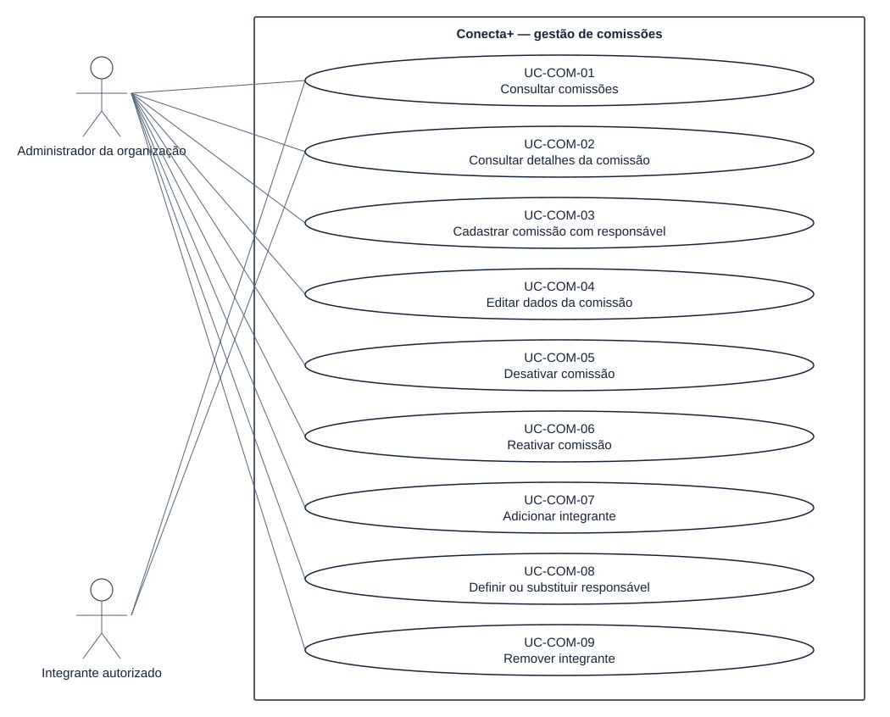

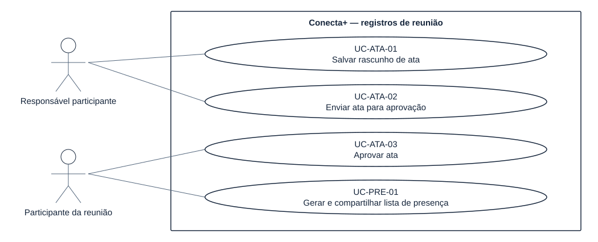

## Rastreabilidade

|Caso de uso|Objetivo|Ator|Requisito|
|---|---|---|---|
|UC-COM-01|Consultar comissões|Integrante aprovado da organização ou seu administrador|RF-COM-01|
|UC-COM-02|Consultar detalhes da comissão|Integrante da comissão ou administrador da organização|RF-COM-02|
|UC-COM-03|Cadastrar comissão com responsável|Administrador da organização|RF-COM-03|
|UC-COM-04|Editar dados da comissão|Administrador da organização|RF-COM-04|
|UC-COM-05|Desativar comissão|Administrador da organização|RF-COM-05|
|UC-COM-06|Reativar comissão|Administrador da organização|RF-COM-06|
|UC-COM-07|Adicionar integrante|Administrador da organização|RF-COM-07|
|UC-COM-08|Definir ou substituir responsável|Administrador da organização|RF-COM-08|
|UC-COM-09|Remover integrante|Administrador da organização|RF-COM-09|
|UC-ATA-01|Salvar rascunho de ata|Responsável atual da comissão que participa da reunião|RF-ATA-01|
|UC-ATA-02|Enviar ata para aprovação|Responsável atual da comissão que participa da reunião|RF-ATA-02|
|UC-ATA-03|Aprovar ata|Participante incluído em ata.aprovadores|RF-ATA-03|
|UC-PRE-01|Gerar e compartilhar lista de presença|Participante da reunião|RF-PRE-01|

As pré/pós-condições e alternativas de cada UC estão no RF correspondente, sem duplicação divergente de regras. Não há relação include/extend obrigatória entre os objetivos: por exemplo, transferir responsável pode ser executado sem remover o anterior.


---

# Requisitos funcionais — comissões e complementos

## Contrato comum

URL-base: variável `EXPO_PUBLIC_API_URL` no app; desenvolvimento usual `http://localhost:3000`. Não há prefixo `/api` no servidor. Os caminhos abaixo são relativos a essa base, não apontam para uma API pública externa.

Todos os endpoints usam `JwtAuthGuard.canActivate(context)` e `UsuarioComumGuard.canActivate(context)`. O primeiro extrai `Authorization: Bearer <JWT>`, verifica assinatura/expiração via JwtService.verifyAsync, consulta usuarios por `_id=sub, ativo=true` e atualiza tipo/e-mail a partir do banco. O segundo impede ADMIN_SISTEMA nestes módulos. O identificador do solicitante vem de `req.usuario.sub`, nunca de um campo de autor enviado no JSON. ADMIN da organização e RESPONSAVEL da comissão são papéis diferentes.

`ValidationPipe({whitelist:true,transform:true})` transforma DTOs e remove campos não declarados; não rejeita todos os campos extras. Respostas normais do Nest: GET/PATCH/DELETE 200, POST 201. Erros: 400 dados/regra inválida; 401 token ausente/inválido/expirado ou conta inativa; 403 falta de autorização; 404 recurso inexistente; 409 conflito. Corpo de erro contém `message` (string ou array), `statusCode` e usualmente `error`. Falha de rede é tratada pelo helper api do app; nenhum sucesso é exibido antes da resposta.

Objeto de comissão retornado: `_id,nome,descricao?,organizacao_id,membros,ativo,criado_em,atualizado_em`. Organização populada: `_id,nome,status`; cada membro: `usuario_id` populado com `_id,nome,email,ativo`, `papel,adicionado_em`. Não inclui hash de senha. IDs são serializados como strings; datas como ISO-8601. Referências apagadas externamente podem resultar em null. O módulo não implementa exclusão física.

Objeto de reunião: campos do dicionário de Reuniao, com `comissao_id` populado (`_id,nome,organizacao_id`), `participantes.usuario_id` populado (`_id,nome,email`), `sou_dono` calculado pela comparação com criada_por e `ata` opcional. Campos ata.autor_id/aprovadores/aprovacoes permanecem IDs.

Formulário adotado: os nove campos do exemplo informado pela aluna. O ator é explicitado em Origem. Não foi disponibilizado formulário oficial adicional pelo professor.

## RF-COM-01 — Consultar comissões

**Descrição:** Permitir consultar comissões.

**Entradas:** Filtro opcional organizacao_id (ObjectId); texto e situação Todas/Ativas/Inativas na tela.

**Origem:** Integrante aprovado da organização ou seu administrador.

**Saída:** Resultado descrito na pós-condição ou erro do contrato comum.

**Destino:** Tela de comissões/equipe para COM; tela Ata e lista de presença para ATA/PRE.

**Ação:** `GET /comissoes?organizacao_id=<id>` → `listar(usuarioId, organizacaoId?)`. ComissoesService.listar consulta organizacoes para identificar vínculos. Administrador vê todas da organização; outros veem apenas documentos de comissoes com seu ID em membros.usuario_id. consultar executa find(filtro), populate organizacao_id (nome,status) e membros.usuario_id (nome,email,ativo), sort criado_em decrescente. A tela filtra nome da comissão ou organização sem diferenciar maiúsculas e mostra oito resultados por página. A paginação é local: a API não recebe page/limit.

**Pré-condição:** Usuário ativo, organização APROVADA e vínculo APROVADO.

**Pós-condição:** Lista autorizada exibida, inclusive inativas conforme filtro.

**Efeitos colaterais:** Nenhuma gravação. Sem resultados: lista vazia. Filtro de organização sem permissão: 403.

## RF-COM-02 — Consultar detalhes da comissão

**Descrição:** Permitir consultar detalhes da comissão.

**Entradas:** id da comissão.

**Origem:** Integrante da comissão ou administrador da organização.

**Saída:** Resultado descrito na pós-condição ou erro do contrato comum.

**Destino:** Tela de comissões/equipe para COM; tela Ata e lista de presença para ATA/PRE.

**Ação:** `GET /comissoes/:id` → `buscarPorId(id, usuarioId)`. buscarPorId lê comissoes por _id, autorizarLeitura verifica organizacoes.status e membros.status; verifica administra ou naEquipe. popular resolve organização e integrantes com as projeções de COM-01. A tela divide equipe e reuniões em abas; equipe possui busca e páginas de oito.

**Pré-condição:** Mesmas condições de COM-01; não administrador deve estar em membros da comissão.

**Pós-condição:** Nome, descrição, situação, organização e equipe disponíveis.

**Efeitos colaterais:** Sem gravação. ID inexistente: 404; acesso a comissão alheia: 403.

## RF-COM-03 — Cadastrar comissão com responsável

**Descrição:** Permitir cadastrar comissão com responsável.

**Entradas:** nome string 2–100 após trim; descricao opcional até 1000 após trim; organizacao_id e responsavel_id ObjectId.

**Origem:** Administrador da organização.

**Saída:** Resultado descrito na pós-condição ou erro do contrato comum.

**Destino:** Tela de comissões/equipe para COM; tela Ata e lista de presença para ATA/PRE.

**Ação:** `POST /comissoes` → `criar(dto, usuarioId)`. CreateComissaoDto valida corpo. autorizarOrganizacao confere administrador. exigirElegivel consulta membros aprovados e usuarios ativos. create grava comissoes: nome, descricao, organizacao_id, ativo=true e membros contendo somente {usuario_id:responsavel_id,papel:RESPONSAVEL,adicionado_em:agora}. Timestamps são criados pelo Mongoose.

**Pré-condição:** Organização APROVADA; solicitante ativo com vínculo ADMIN/APROVADO; responsável ativo e APROVADO na mesma organização.

**Pós-condição:** Documento criado com exatamente um responsável; retorna objeto populado e abre seus detalhes.

**Efeitos colaterais:** Novo documento. Campo ausente/inválido ou responsável inelegível: 400; sem autorização: 403. Não há unicidade de nome.

## RF-COM-04 — Editar dados da comissão

**Descrição:** Permitir editar dados da comissão.

**Entradas:** nome opcional 2–100; descricao opcional até 1000.

**Origem:** Administrador da organização.

**Saída:** Resultado descrito na pós-condição ou erro do contrato comum.

**Destino:** Tela de comissões/equipe para COM; tela Ata e lista de presença para ATA/PRE.

**Ação:** `PATCH /comissoes/:id` → `atualizar(id, dto, usuarioId)`. UpdateComissaoDto valida os campos fornecidos. autorizarComissao lê comissão e autoriza organização. findByIdAndUpdate(_id,{$set:dados},{returnDocument:"after",runValidators:true}) altera apenas campos permitidos. organizacao_id e membros não fazem parte desse DTO.

**Pré-condição:** Administrador ADMIN/APROVADO de organização APROVADA; comissão existente.

**Pós-condição:** Dados atualizados retornados e aplicados à tela sem exigir sair e entrar.

**Efeitos colaterais:** Grava campos e atualizado_em. Nome repetido permitido; edição de dados é permitida em comissão inativa. Atualizações simultâneas de nome usam a última escrita, sem controle de versão.

## RF-COM-05 — Desativar comissão

**Descrição:** Permitir desativar comissão.

**Entradas:** id e confirmação explícita no app.

**Origem:** Administrador da organização.

**Saída:** Resultado descrito na pós-condição ou erro do contrato comum.

**Destino:** Tela de comissões/equipe para COM; tela Ata e lista de presença para ATA/PRE.

**Ação:** `DELETE /comissoes/:id` → `remover(id, usuarioId)`. remover chama atualizar(id,{ativo:false},usuarioId). A operação usa $set em comissoes.ativo, preservando equipe e histórico. Retorna {mensagem,comissao}.

**Pré-condição:** Administrador autorizado; comissão existente.

**Pós-condição:** Comissão permanece cadastrada, marcada inativa.

**Efeitos colaterais:** Não apaga documentos nem cancela automaticamente reuniões já marcadas. Nova inclusão/remoção de equipe e novo agendamento ficam bloqueados pelas respectivas regras. Cancelar a confirmação não envia a requisição.

## RF-COM-06 — Reativar comissão

**Descrição:** Permitir reativar comissão.

**Entradas:** ativo=true booleano.

**Origem:** Administrador da organização.

**Saída:** Resultado descrito na pós-condição ou erro do contrato comum.

**Destino:** Tela de comissões/equipe para COM; tela Ata e lista de presença para ATA/PRE.

**Ação:** `PATCH /comissoes/:id` → `atualizar(id, dto, usuarioId)`. atualizar chama exigirResponsavelUnico antes de gravar comissoes.ativo=true. Se dados antigos tiverem zero ou vários responsáveis, exige regularização por COM-08.

**Pré-condição:** Administrador autorizado; exatamente um membro com papel RESPONSAVEL.

**Pós-condição:** Comissão ativa retornada à tela.

**Efeitos colaterais:** Não modifica reuniões existentes. A reativação verifica quantidade de responsáveis; não revalida automaticamente a elegibilidade de todos os integrantes antigos.

## RF-COM-07 — Adicionar integrante

**Descrição:** Permitir adicionar integrante.

**Entradas:** usuario_id ObjectId; papel omitido ou MEMBRO.

**Origem:** Administrador da organização.

**Saída:** Resultado descrito na pós-condição ou erro do contrato comum.

**Destino:** Tela de comissões/equipe para COM; tela Ata e lista de presença para ATA/PRE.

**Ação:** `POST /comissoes/:id/membros` → `adicionarMembro(id, dto, usuarioId)`. autorizarComissao, exigirResponsavelUnico e exigirElegivel são executados. Duplica ID: 409. Papel RESPONSAVEL: 400, orientando transferência. gravarEquipe substitui o array anterior por cópia acrescida de MEMBRO em uma escrita condicionada ao array e ativo lidos.

**Pré-condição:** Comissão ativa, exatamente um responsável, solicitante administrador; candidato ativo/APROVADO na organização e ainda fora da comissão.

**Pós-condição:** Novo integrante na equipe sem alterar responsável.

**Efeitos colaterais:** Conflito concorrente: 409, atualizar tela e repetir. A busca de candidatos é por nome/e-mail e não envia convite por e-mail.

## RF-COM-08 — Definir ou substituir responsável

**Descrição:** Permitir definir ou substituir responsável.

**Entradas:** usuario_id ObjectId do novo responsável; confirmação no app.

**Origem:** Administrador da organização.

**Saída:** Resultado descrito na pós-condição ou erro do contrato comum.

**Destino:** Tela de comissões/equipe para COM; tela Ata e lista de presença para ATA/PRE.

**Ação:** `PATCH /comissoes/:id/responsavel` → `definirResponsavel(id, membroId, usuarioId)`. DefinirResponsavelDto valida. definirResponsavel lê a equipe e valida o alvo. Mapeia todos os outros para MEMBRO e o alvo para RESPONSAVEL; se ausente, inclui-o. gravarEquipe usa findOneAndUpdate({_id,ativo:valorLido,membros:arrayLido},{$set:{membros:novoArray}},{returnDocument:"after",runValidators:true}). Zero documentos alterados retorna 409.

**Pré-condição:** Administrador autorizado; alvo ativo/APROVADO na organização. Comissão pode estar inativa ou possuir dados antigos inconsistentes.

**Pós-condição:** Exatamente um responsável; antigos responsáveis permanecem integrantes; situação ativo não é alterada.

**Efeitos colaterais:** Não escolhe uma pessoa automaticamente. PATCH /:id/membros/:usuarioId com papel RESPONSAVEL é compatibilidade para integrante já cadastrado em comissão ativa e delega a definirResponsavel. Não transfere autoria criada_por das reuniões antigas.

## RF-COM-09 — Remover integrante

**Descrição:** Permitir remover integrante.

**Entradas:** id da comissão, usuarioId do integrante e confirmação.

**Origem:** Administrador da organização.

**Saída:** Resultado descrito na pós-condição ou erro do contrato comum.

**Destino:** Tela de comissões/equipe para COM; tela Ata e lista de presença para ATA/PRE.

**Ação:** `DELETE /comissoes/:id/membros/:usuarioId` → `removerMembro(id, membroId, usuarioId)`. validarEquipe verifica existência e atividade. removerMembro recusa alvo RESPONSAVEL (400); remove somente alvo do novo array e chama gravarEquipe com comparação do array anterior.

**Pré-condição:** Comissão ativa, responsável único, solicitante administrador e alvo MEMBRO existente.

**Pós-condição:** Integrante removido; responsável preservado.

**Efeitos colaterais:** Reuniões antigas conservam seu snapshot de participantes. Alvo inexistente: 404. Conflito de equipe: 409. Cancelar confirmação não altera nada.

## RF-ATA-01 — Salvar rascunho de ata

**Descrição:** Permitir salvar rascunho de ata.

**Entradas:** conteudo string 20–20000 após trim; versao inteiro >=0 (0 para primeira gravação).

**Origem:** Responsável atual da comissão que participa da reunião.

**Saída:** Resultado descrito na pós-condição ou erro do contrato comum.

**Destino:** Tela de comissões/equipe para COM; tela Ata e lista de presença para ATA/PRE.

**Ação:** `PATCH /reunioes/:id/ata` → `salvarAta(id, dto, usuarioId)`. carregar busca reunioes e participante. autorizarResponsavel consulta comissoes e organizacoes. exigirEncerrada verifica término. Compara versao enviada com ata.versao (ou 0). gravarAta grava subdocumento ata com versao+1, conteudo, autor_id, atualizada_em, situacao=RASCUNHO e arrays vazios de aprovadores/aprovacoes. A escrita exige ata igual ao snapshot lido ou ausente.

**Pré-condição:** Usuário ativo e participante; comissão ativa e organização aprovada com vínculo aprovado; reunião não cancelada, fim <= horário do servidor; ata ausente ou RASCUNHO.

**Pós-condição:** Rascunho salvo, versão incrementada, retornado no objeto da reunião.

**Efeitos colaterais:** Versão antiga ou disputa: 409. Ata já enviada: 400. Não é mantido histórico de textos anteriores: versao é controle de concorrência, não arquivo de versões.

## RF-ATA-02 — Enviar ata para aprovação

**Descrição:** Permitir enviar ata para aprovação.

**Entradas:** versao inteiro >=0; confirmação da publicação.

**Origem:** Responsável atual da comissão que participa da reunião.

**Saída:** Resultado descrito na pós-condição ou erro do contrato comum.

**Destino:** Tela de comissões/equipe para COM; tela Ata e lista de presença para ATA/PRE.

**Ação:** `POST /reunioes/:id/ata/publicar` → `publicarAta(id, versao, usuarioId)`. publicarAta fixa ata.aprovadores com os IDs dos participantes cuja presenca.situacao é CONFIRMADA naquele instante. Mantém conteúdo/versão/autor; define EM_APROVACAO, atualizada_em e aprovacoes=[]. gravarAta condiciona escrita ao snapshot anterior.

**Pré-condição:** Mesma autorização de ATA-01; rascunho existente na versão enviada; pelo menos uma presença CONFIRMADA.

**Pós-condição:** Texto bloqueado e conjunto de aprovadores fixado.

**Efeitos colaterais:** Não aprova automaticamente pelo autor, não dispara e-mail/push. Alterações posteriores de presença não mudam o conjunto congelado. Não há correção, rejeição ou reabertura após publicação nesta versão.

## RF-ATA-03 — Aprovar ata

**Descrição:** Permitir aprovar ata.

**Entradas:** versao inteiro >=0 e confirmação de leitura/aprovação.

**Origem:** Participante incluído em ata.aprovadores.

**Saída:** Resultado descrito na pós-condição ou erro do contrato comum.

**Destino:** Tela de comissões/equipe para COM; tela Ata e lista de presença para ATA/PRE.

**Ação:** `POST /reunioes/:id/ata/aprovar` → `aprovarAta(id, versao, usuarioId)`. aprovarAta valida versão e autorização. Se ID já consta em aprovacoes, retorna reunião sem novo voto. Caso contrário, acrescenta-o, mantém EM_APROVACAO enquanto faltarem IDs e marca APROVADA quando as quantidades coincidem. gravarAta compara snapshot anterior para evitar perda de voto concorrente.

**Pré-condição:** Usuário ativo, participante da reunião encerrada/não cancelada, incluído no conjunto de aprovadores; ata EM_APROVACAO na mesma versão.

**Pós-condição:** Uma aprovação por usuário; aprovação final exige todos os aprovadores fixados.

**Efeitos colaterais:** Conflito 409 exige atualizar e repetir. Não é assinatura digital/certificado. Não há data individual de voto, apenas atualizada_em da ata. A participação histórica é suficiente para leitura/voto: a política herdada não reconsulta vínculo organizacional nessas duas operações.

## RF-PRE-01 — Gerar e compartilhar lista de presença

**Descrição:** Permitir gerar e compartilhar lista de presença.

**Entradas:** id da reunião; compartilhar é ação local opcional.

**Origem:** Participante da reunião.

**Saída:** Resultado descrito na pós-condição ou erro do contrato comum.

**Destino:** Tela de comissões/equipe para COM; tela Ata e lista de presença para ATA/PRE.

**Ação:** `GET /reunioes/:id/lista-presenca` → `gerarListaPresenca(id, usuarioId)`. carregar autoriza. usuarioModel.find({_id:{$in:idsParticipantes}}).select(nome) resolve nomes. Retorna reuniao_id,titulo,inicio,fim,gerada_em e participantes: usuario_id,nome,convite,situacao,entrada,saida,minutos. Ausência de presença vira SEM_REGISTRO e datas/minutos null; minutos=floor((saida-entrada)/60000), mínimo 0, somente se há saída. Tela mostra oito por página e Share.share gera texto por ação do usuário.

**Pré-condição:** Usuário ativo e participante; não exige reunião encerrada.

**Pós-condição:** Relatório consultado/compartilhável, indicando que apenas CONFIRMADA é presença validada.

**Efeitos colaterais:** Não grava presença nem cria arquivo no servidor. Pode incluir reunião cancelada ou em curso como fotografia dos registros. Nome indisponível recebe rótulo Usuário indisponível. Compartilhamento depende do sistema operacional.

## Consultas auxiliares (passos dos casos de uso, não objetivos independentes)

- `GET /comissoes/organizacoes` → listarOrganizacoes(usuarioId): busca organizacoes com status APROVADA e `$elemMatch` do mesmo integrante ADMIN/APROVADO; retorna `_id,nome`, ordem nome crescente. Apoia COM-01/03.
- `GET /comissoes/organizacoes/:id/membros` → listarMembrosDisponiveis(id,usuarioId): autoriza ADMIN, obtém vínculos APROVADO, consulta usuarios `_id in ids, ativo:true`, seleciona `_id,nome,email`, ordem nome crescente. Apoia COM-03/07/08.
- `GET /comissoes/minhas/:organizacaoId` → listarMinhas: exige vínculo APROVADO em organização APROVADA, busca comissoes por organizacao_id e membros.usuario_id. Retorna organizacao:{_id,nome} e comissoes:[{_id,nome,descricao,ativo,meu_papel}], ordem nome crescente. É outra apresentação de COM-01.
- `GET /reunioes/:id` → buscarPorId: carrega a reunião e ata para participante ativo. Apoia ATA-01/02/03 e PRE-01.

## Integrações existentes preservadas

O agendamento existente (`POST /reunioes`, criar) aceita comissao_id, titulo 3–120, local 2–120, inicio/fim ISO-8601, pauta opcional de até 30 strings de até 200 caracteres. Exige responsável e fim maior que início e que agora. Aceita convidados_ids opcional: array de ObjectIds únicos de integrantes da comissão. Quando informado, grava somente os selecionados e inclui sempre o organizador; array vazio significa somente o organizador. Por compatibilidade, clientes antigos que omitem o campo ainda convidam toda a comissão. Autor inicia ACEITO, demais PENDENTE. No app atualizado o campo é sempre enviado, inicialmente somente com o organizador. Convites são registros internos, não integração com Google/Teams ou envio automático de e-mail.

`PATCH /reunioes/:id` (atualizar) permite edição/cancelamento ao criador. `PATCH /:id/convite` (responderConvite) recebe aceito booleano. `POST /:id/entrada` (marcarEntrada) registra entrada durante a reunião: criador CONFIRMADA, demais AGUARDANDO. `POST /:id/saida` (marcarSaida) registra saída limitada ao fim. `PATCH /:id/presencas/:usuarioId` (atualizarPresenca) permite ao criador CONFIRMADA/RECUSADA; sem entrada, confirmar cria entrada igual ao início e origem RESPONSAVEL. Essa hora é um lançamento administrativo, não medição real de chegada. O criador e o responsável atual podem divergir após COM-08. Esses requisitos pertencem ao módulo de reuniões já existente; não são atribuídos como implementação nova de Rafaela.


---

# Classes e dicionário

As classes abaixo existem no backend TypeScript/NestJS. Os componentes React são funções, não classes fictícias chamadas Frontend/Backend. Model é o tipo de repositório fornecido pelo Mongoose. Atributos gerados `_id` e timestamps pertencem ao documento hidratado.

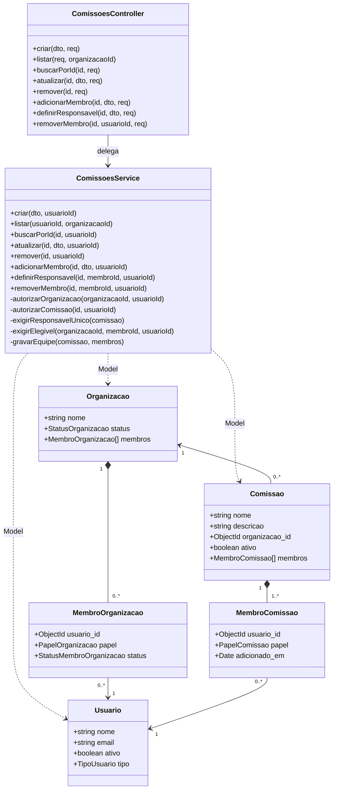

Cardinalidade 1..* de equipe representa a regra após regularização: exatamente um desses vínculos é RESPONSAVEL. Dados antigos podem violá-la. Usuário e organização são recortes: exibem somente atributos necessários a comissões, sem reproduzir dados de autenticação e outros requisitos.

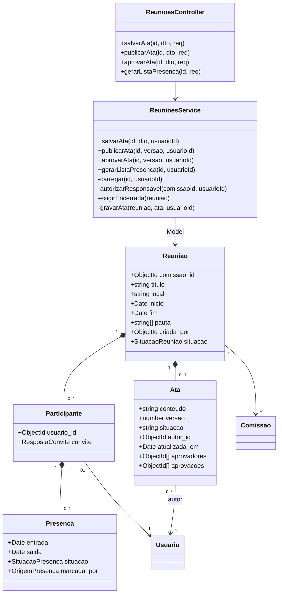

## Dicionário de classes

|Classe/tipo|O que representa e responsabilidade|Fonte em BACKEND/src|
|---|---|---|
|ComissoesController|Adaptador HTTP; extrai DTO/parâmetros e sub autenticado; delega sem implementar regra de equipe|comissoes/comissoes.controller.ts|
|ComissoesService|Autoriza ações e mantém as invariantes da equipe; usa os três models injetados|comissoes/comissoes.service.ts|
|Comissao|Grupo de trabalho de uma organização; agregado persistido com equipe embutida|comissoes/schemas/comissao.schema.ts|
|MembroComissao|Vínculo da pessoa com comissão, papel e data de inclusão; não é outro cadastro de usuário|mesmo arquivo|
|Organizacao/MembroOrganizacao|Organização e vínculo de acesso; fonte de ADMIN/APROVADO|organizacoes/schemas/organizacao.schema.ts|
|Usuario|Identidade reutilizada; atividade e tipo de conta; nome/e-mail apresentados|usuarios/schemas/usuario.schema.ts|
|ReunioesController|Adaptador HTTP das reuniões e dos registros adicionados|reunioes/reunioes.controller.ts|
|ReunioesService|Autoriza participante/responsável, registra ata por versão e calcula lista|reunioes/reunioes.service.ts|
|Reuniao|Encontro de uma comissão; conserva participantes da convocação e ata opcional|reunioes/schemas/reuniao.schema.ts|
|Participante|Convite e possível presença de um usuário nessa reunião|mesmo arquivo|
|Presenca|Entrada, saída e validação da participação; ausência do subdocumento significa sem registro|mesmo arquivo|
|Ata|Texto vigente, versão de edição e aprovação coletiva; não representa documento assinado digitalmente|mesmo arquivo|
|CreateComissaoDto|Contrato de entrada com nome/descrição/organização/responsável|comissoes/dto/create-comissao.dto.ts|
|UpdateComissaoDto|Campos opcionais editáveis nome/descricao/ativo|comissoes/dto/update-comissao.dto.ts|
|AddMembroComissaoDto|ID do candidato e papel opcional; serviço restringe inclusão a MEMBRO|comissoes/dto/add-membro-comissao.dto.ts|
|DefinirResponsavelDto|ID da pessoa escolhida para transferência|comissoes/dto/definir-responsavel.dto.ts|
|UpdateMembroComissaoDto|Papel para rota de compatibilidade; não permite retirar único responsável|comissoes/dto/update-membro-comissao.dto.ts|
|VersaoAtaDto|Inteiro >=0 informado pelo cliente|reunioes/dto/ata.dto.ts|
|SalvarAtaDto|Herda versão e acrescenta conteúdo 20–20000|mesmo arquivo|
|JwtAuthGuard/UsuarioComumGuard|Autenticação e restrição de tipo de conta; compartilhados, preexistentes|auth/|

## Componentes funcionais do aplicativo

`TelaNovaComissao`, `TelaComissoes` e o componente de detalhes em `src/app/comissoes/[id].tsx` mantêm formulário/listas/estado e chamam `api(caminho,metodo,corpo)`. `SeletorPessoaComissao` oferece busca/páginas para escolher ID. `TelaRegistrosReuniao` usa `carregar()`, `gravar(caminho,metodo,corpo)` e `gerarLista()`. Os campos usam react-hook-form. `FolhaInferior` aceita `acompanharTeclado` opcional; `Confirmacao` apresenta aprovação explícita das ações sensíveis. Não são representados como classes TypeScript.

Os tipos, significados, nulabilidade e restrições de cada atributo persistido estão no dicionário de dados seguinte. Esse vínculo evita duas definições conflitantes para o mesmo atributo.


---

# Dados — modelo implementado e representação relacional

## Banco real

O projeto usa **MongoDB**, via Mongoose. As coleções reais deste recorte são `comissoes`, `reunioes`, `usuarios` e `organizacoes`. Equipe, participantes, presença e ata são subdocumentos/arrays; **não são tabelas físicas independentes**. `ref` permite populate, mas não cria chave estrangeira nem cascata no MongoDB. A integridade entre coleções é conferida nos serviços. Escritas externas que ignoram os serviços podem quebrar essas regras.

“Recorte” significa mostrar apenas os campos de outra área necessários ao requisito. Não significa cortar dados do banco. Aqui Usuario/Organizacao são recortes explícitos, evitando atribuir toda a documentação de login e organizações à parte de comissão.

## Diagrama relacional lógico (acadêmico)

Esta normalização é uma representação para explicar cardinalidades e chaves. Não foi executada migração SQL. Nomes sem acentos facilitam correspondência com código; ObjectId é representado como string de 24 caracteres hexadecimais no modelo lógico.

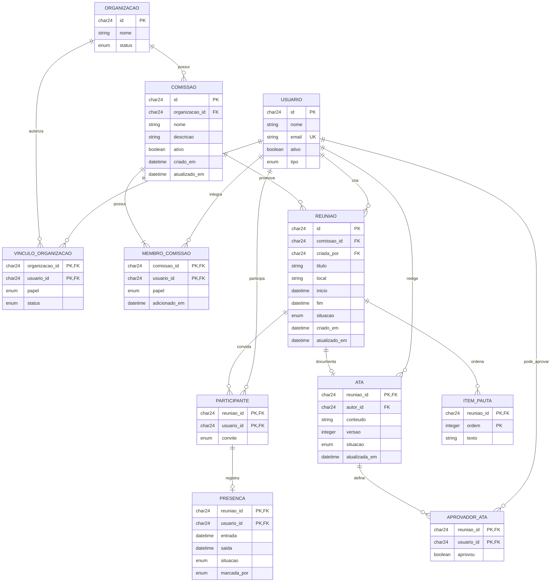

No modelo lógico, FK dupla de PRESENCA aponta para PARTICIPANTE(reuniao_id,usuario_id). APROVADOR_ATA aponta para ATA e USUARIO; aprovou representa pertinência ao array aprovacoes. ITEM_PAUTA corresponde à posição de cada string no array pauta. Tais chaves compostas não existem como índices SQL no MongoDB.

## Dicionário das relações lógicas e correspondência

|Relação lógica|O que representa|Correspondência física e chaves|
|---|---|---|
|ORGANIZACAO|Entidade que mantém comissões|organizacoes; id corresponde a _id; nome/status descritos no recorte|
|USUARIO|Pessoa identificada no sistema|usuarios; id corresponde a _id; nome/email/ativo/tipo descritos no recorte|
|VINCULO_ORGANIZACAO|Autorização da pessoa na organização|organizacoes.membros; organizacao_id vem do documento pai; usuario_id/papel/status do subdocumento|
|COMISSAO|Grupo de trabalho com situação e organização dona|comissoes; id=_id; demais atributos têm os mesmos nomes; descricao é opcional|
|MEMBRO_COMISSAO|Participação e papel na comissão|comissoes.membros; comissao_id vem do pai; usuario_id/papel/adicionado_em do subdocumento; chave composta impede repetir pessoa no modelo lógico|
|REUNIAO|Encontro convocado por uma comissão|reunioes; id=_id; campos escalares mapeados diretamente; pauta é desmembrada em ITEM_PAUTA|
|ITEM_PAUTA|Tópico em uma posição da pauta|reunioes.pauta; reuniao_id vem do pai, ordem é índice >=0 no array, texto é a string nessa posição; ordem/texto obrigatórios no modelo lógico|
|PARTICIPANTE|Convite de uma pessoa para reunião|reunioes.participantes; reuniao_id do pai; usuario_id e convite do subdocumento|
|PRESENCA|Registro opcional da participação|participantes.presenca; chave dupla herdada de PARTICIPANTE; saída opcional; demais campos obrigatórios quando registro existe|
|ATA|Texto vigente e situação de aprovação|reunioes.ata; reuniao_id do pai é PK/FK, uma ata por reunião; conteúdo/versão/autor/data/situação obrigatórios quando ata existe|
|APROVADOR_ATA|Pessoa habilitada a aprovar e indicação do voto|Uma linha por ID em ata.aprovadores; aprovou=true se também consta em ata.aprovacoes, false caso contrário. Booleano derivado, não armazenado assim no MongoDB|

PK/FK são obrigatórias nas relações lógicas. Campos com o mesmo nome herdam tipos, significado e domínio dos dicionários físicos abaixo; nome de ID sem subdocumento não implica referência populada persistida.

## Dicionário físico: comissoes

|Campo|Tipo / obrigatório / padrão|Significado e restrição implementada|
|---|---|---|
|_id|ObjectId; gerado|Identidade única do documento; índice primário automático do MongoDB|
|nome|String; obrigatório|Nome do grupo; trim; DTO 2–100; não possui índice único|
|descricao|String; opcional|Finalidade do grupo; trim no DTO, até 1000; string vazia permitida|
|organizacao_id|ObjectId; obrigatório; ref Organizacao|Organização dona; elegibilidade verificada no serviço; não editável por UpdateComissaoDto|
|ativo|Boolean; padrão true|Permite distinguir grupo ativo/desativado; não exclui histórico|
|membros|MembroComissao[]; padrão técnico []|Equipe embutida; validador exige exatamente um RESPONSAVEL e IDs únicos. O default [] isoladamente não passa no validador ao criar pela API/model|
|membros.usuario_id|ObjectId; obrigatório; ref Usuario|Pessoa vinculada; serviço exige ativo/APROVADO na inclusão/transferência|
|membros.papel|String enum obrigatório|RESPONSAVEL ou MEMBRO; um único RESPONSAVEL por array válido|
|membros.adicionado_em|Date; padrão Date.now|Instante da inclusão; preservado na troca de papel|
|criado_em|Date; timestamp automático|Criação do documento|
|atualizado_em|Date; timestamp automático|Última atualização do documento|

MembroComissao não tem `_id` próprio. Comissao usa `versionKey:false`, portanto não possui `__v`. Controle de concorrência da equipe compara o array anterior, não um __v. O validador Mongoose atua sobre o array completo nas escritas implementadas; não é uma constraint nativa do servidor MongoDB e não faz migração retroativa. Não existe índice que imponha “exatamente um responsável”.

## Dicionário físico: reunioes

|Campo|Tipo / obrigatório / padrão|Significado/restrição|
|---|---|---|
|_id|ObjectId gerado|Identidade da reunião|
|comissao_id|ObjectId obrigatório; ref Comissao|Comissão convocadora|
|titulo|String obrigatória; trim|Título; DTO 3–120 caracteres|
|local|String obrigatória; trim|Local informado; DTO 2–120; não gera link de videoconferência|
|inicio|Date obrigatória|Início; entrada ISO-8601 no DTO|
|fim|Date obrigatória|Término maior que início e que agora ao agendar/alterar horário|
|pauta|String[]; padrão []|Tópicos ordenados; DTO até 30 itens, cada até 200, trim e remoção de vazios|
|criada_por|ObjectId obrigatório|Usuário que agendou; permanece após troca de responsável; controla edição e validação de presença existentes|
|situacao|Enum; padrão AGENDADA|AGENDADA ou CANCELADA. Encerramento é calculado por fim, não há valor ENCERRADA|
|participantes|Participante[]; padrão []|Snapshot dos participantes selecionados ao criar reunião (ou equipe completa em clientes antigos sem convidados_ids)|
|participantes.usuario_id|ObjectId obrigatório; ref Usuario|Identidade convidada|
|participantes.convite|Enum; padrão PENDENTE|PENDENTE, ACEITO ou RECUSADO|
|participantes.presenca|Presenca opcional|Ausente significa sem marcação; não significa presença recusada|
|presenca.entrada|Date obrigatória se subdocumento existe|Horário registrado pelo servidor; lançamento do responsável sem entrada usa inicio|
|presenca.saida|Date opcional|Saída registrada, limitada ao fim; ausência produz minutos=null no relatório|
|presenca.situacao|Enum obrigatório|AGUARDANDO, CONFIRMADA ou RECUSADA|
|presenca.marcada_por|Enum obrigatório|PROPRIO ou RESPONSAVEL; origem da criação do registro, não ID do validador|
|ata|Ata opcional|Registro vigente de conteúdo e aprovação|
|ata.conteudo|String obrigatória se ata existe|20–20000; trim no DTO|
|ata.versao|Number obrigatório >=1 no schema|Inteiro gerado por incremento do serviço; DTO aceita inteiro >=0 como versão esperada|
|ata.situacao|String enum obrigatório|RASCUNHO, EM_APROVACAO ou APROVADA|
|ata.autor_id|ObjectId obrigatório; ref Usuario|Autor da última edição do rascunho; não necessariamente criador da reunião|
|ata.atualizada_em|Date obrigatória|Última edição, publicação ou aprovação; não substitui data individual de voto|
|ata.aprovadores|ObjectId[]; padrão []|Conjunto de presenças confirmadas fixado na publicação; ainda sem votos automáticos|
|ata.aprovacoes|ObjectId[]; padrão []|IDs que aprovaram; inclusão única controlada no serviço|
|criado_em / atualizado_em|Date automáticas|Criação/atualização do documento raiz|

Ata, Participante e Presenca não possuem `_id` próprio. Reuniao tem `versionKey:false`. Índices reais: `_id`; `{comissao_id:1,inicio:1}`; `{'participantes.usuario_id':1,inicio:1}`, sem unicidade nestes dois últimos. As regras de aprovação pertencem ao serviço, não a índices únicos dos arrays.

## Dicionário dos recortes de dependências

|Coleção/campo|Tipo|Significado usado neste módulo|
|---|---|---|
|usuarios._id|ObjectId|Referência da pessoa, gerada automaticamente|
|usuarios.nome|String obrigatória, trim|Nome apresentado na equipe/lista|
|usuarios.email|String obrigatória, lowercase/trim, índice único|Identificador de contato e termo de busca; senha não retornada|
|usuarios.ativo|Boolean, padrão true|Conta apta a acessar e ser escolhida|
|usuarios.tipo|Enum USUARIO/ADMIN_SISTEMA, padrão USUARIO|Restringe acesso de administrador do sistema aos módulos comuns|
|organizacoes._id|ObjectId|Identidade da organização|
|organizacoes.nome|String obrigatória, trim|Nome apresentado e pesquisável na lista de comissões|
|organizacoes.status|Enum PENDENTE/APROVADA/REVOGADA, padrão PENDENTE|Apenas APROVADA habilita acesso atual de comissões|
|organizacoes.membros.usuario_id|ObjectId obrigatório|Pessoa vinculada à organização|
|organizacoes.membros.papel|Enum ADMIN/MEMBRO obrigatório|ADMIN autoriza gestão de comissões|
|organizacoes.membros.status|Enum PENDENTE/APROVADO/REJEITADO/CONVIDADO, padrão PENDENTE|APROVADO habilita vínculo usado na autorização|

Os outros atributos dessas duas coleções pertencem à documentação dos respectivos requisitos. Ausência neste desenho não significa ausência no banco.

## Restrições e conservação de dados

- Exatamente um responsável e IDs de integrantes únicos são regras de equipe; não confundir com unicidade do nome da comissão (não existe).
- Uma PK composta em MEMBRO_COMISSAO impediria duplicidade numa futura implementação SQL. Índice parcial do papel RESPONSAVEL garantiria no máximo um; garantir pelo menos um exigiria transação/trigger adicional. Nada disso foi aplicado ao banco atual.
- Exclusão da comissão é lógica. Não há ON DELETE CASCADE. Transferência preserva membros e datas, inclusive em regularização.
- Relações externas podem mudar entre leitura e gravação: não há transação entre usuarios, organizacoes e comissoes. A escrita atômica protege o array de equipe dentro do documento, não todas as mudanças organizacionais simultâneas.
- Snapshots de reunião/aprovadores conservam histórico. A remoção de integrante não apaga participação passada. Revogação organizacional não está revalidada em todas as operações herdadas de reunião; alinhar essa política com o grupo antes de produção.


---

# Requisitos não funcionais

IDs exclusivos deste módulo: RNF-COM-xx. Regras como exigir responsável, validar nome e aprovar ata pertencem aos RF. Os critérios abaixo são verificáveis; um requisito proposto não deve ser apresentado como teste executado.

|ID|Qualidade e critério de aceitação|Método/condição de verificação|Estado desta revisão|
|---|---|---|---|
|RNF-COM-01|Integridade concorrente: duas gravações de equipe originadas da mesma fotografia, ambas alterando o array, não podem sobrescrever silenciosamente uma à outra; uma deve falhar com conflito|Duas chamadas concorrentes a gravarEquipe, mesma comissão em MongoDB local, arrays finais diferentes; contar sucessos/erros e responsável final|Verificado pelo teste local com MongoDB|
|RNF-COM-02|Controle de acesso: nenhuma rota de comissão ou registro novo deve aceitar requisição sem JWT válido; nenhuma mutação de equipe deve aceitar integrante sem ADMIN/APROVADO|Testes de guard/serviço + roteiro HTTP com sem token, token inválido, usuário comum, admin de outra organização|Guard/serviços automatizados e amostra HTTP real verificados; matriz HTTP completa pendente|
|RNF-COM-03|Usabilidade móvel: em telas 360x800 e 390x844, escala de fonte 1 e 1,3, campos de comissão e ações de salvar devem permanecer alcançáveis por rolagem com teclado aberto; nomes de 100 caracteres não podem impedir ações|Android e iOS físicos/emuladores, selecionar organização/pessoa, buscar, editar e confirmar; registrar modelo/OS/capturas|Critério de aceite proposto, ensaio nativo pendente; build web não comprova|
|RNF-COM-04|Manutenibilidade: TypeScript sem erros e lint sem erros nos módulos alterados; rotinas de autorização e gravação compartilhadas, sem repetição da regra de responsável nas telas como única proteção|npm run build no backend; npm run typecheck e npm run lint no app; revisão de serviço|Verificado; dois avisos de lint preexistentes no app|
|RNF-COM-05|Recuperação de conflito: diante de 409, app mantém documento recebido por último, informa erro e permite atualizar antes de repetir, sem apresentar sucesso falso|Forçar versão antiga de ata e fotografia antiga de equipe; observar erro retornado e executar Atualizar|Backend verificado; interação visual nativa pendente|

Não foi especificado prazo de resposta genérico “em condições normais”. Para adotar meta de desempenho, o grupo deve primeiro fixar hardware, rede, quantidade de comissões/integrantes, concorrência e percentil (por exemplo p95), medir e acordar limiar. Paginação visual em oito itens é decisão de interface; não comprova redução de tráfego nem paginação do servidor.

A API já usa JWT individual. Não foi embutida chave secreta estática no aplicativo para simular segurança. Caso o professor exija também identificação da aplicação em gateway, o grupo precisa definir esse contrato e infraestrutura separadamente; isso permanece pendente e não é afirmado como resolvido. JWT autentica usuário; chave de aplicação é outra finalidade.


---

# Diagramas de sequência

Os lifelines C e S são instâncias das classes reais Controller e Service. M é uma instância de Model do Mongoose, não uma classe chamada Backend. Ator/Tela representa interação do usuário; os componentes React são funções. HTTP aparece em nota, não como nome de método. Cada diagrama corresponde a um RF e herda seu contrato de pré/pós-condições e erros.

## Autenticação comum a todas as rotas

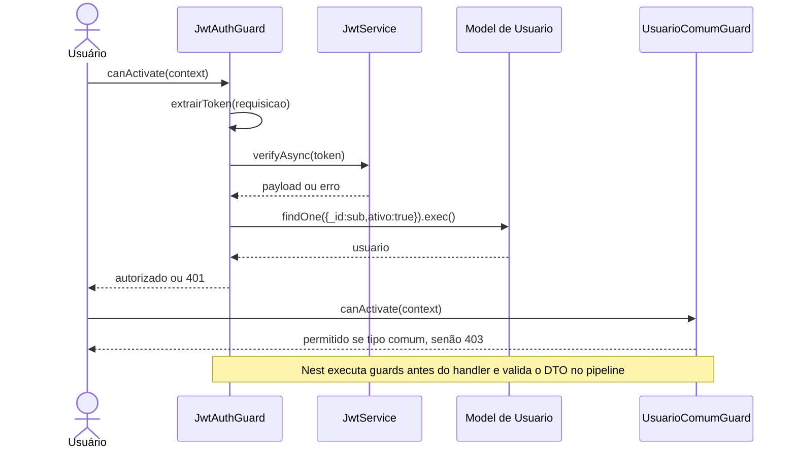

## RF-COM-01 — Consultar comissões

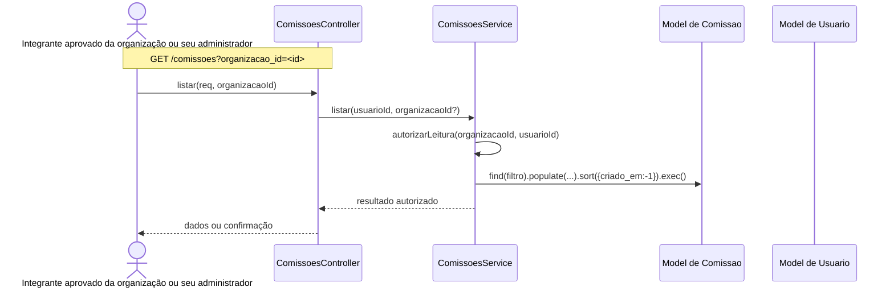

Sem organizacao_id, listar usa validarUsuario e organizacaoModel.find com vínculo APROVADO, separa administradas/participantes e consulta o $or descrito no RF. Não chama autorizarLeitura nessa alternativa.

## RF-COM-02 — Consultar detalhes da comissão

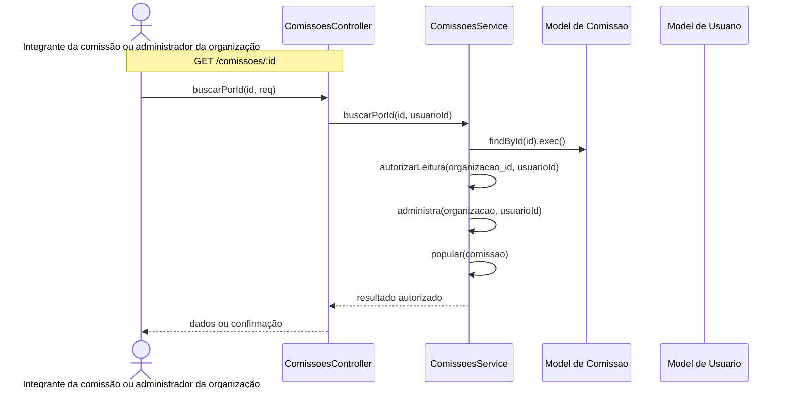

## RF-COM-03 — Cadastrar comissão com responsável

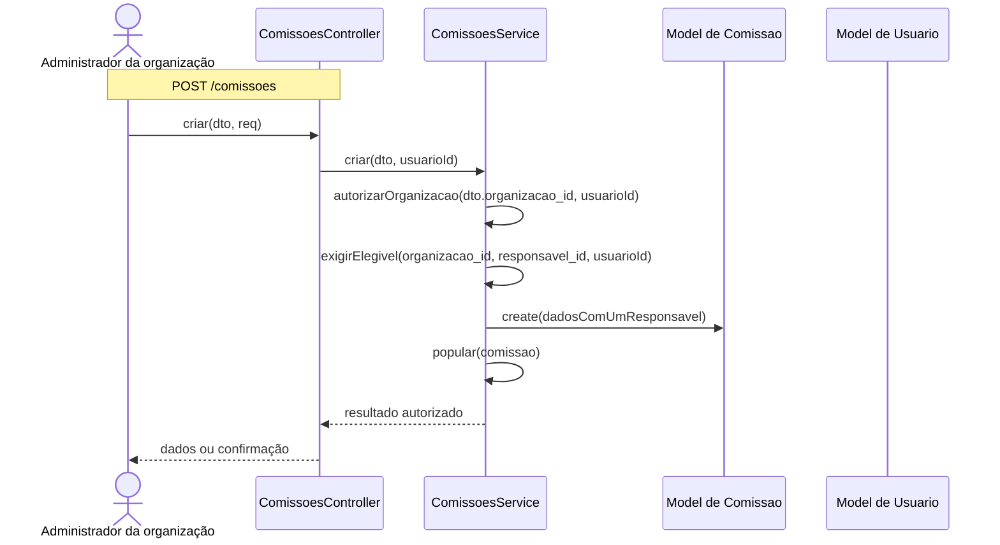

## RF-COM-04 — Editar dados da comissão

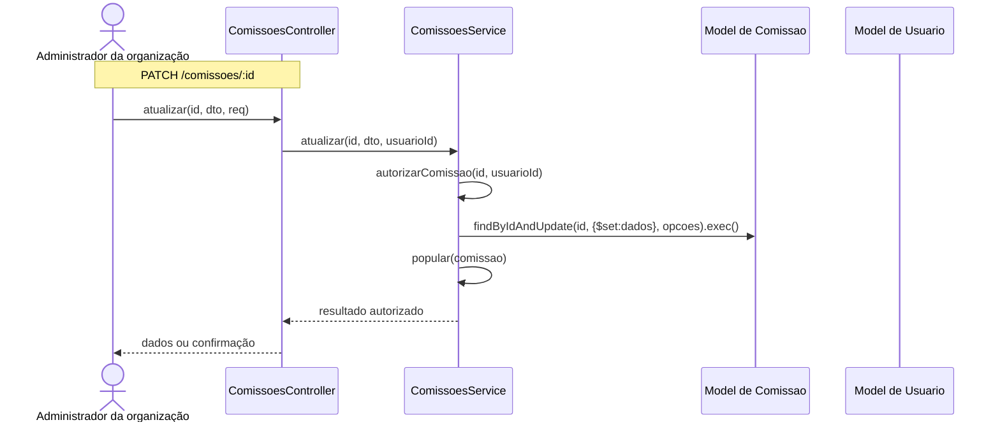

## RF-COM-05 — Desativar comissão

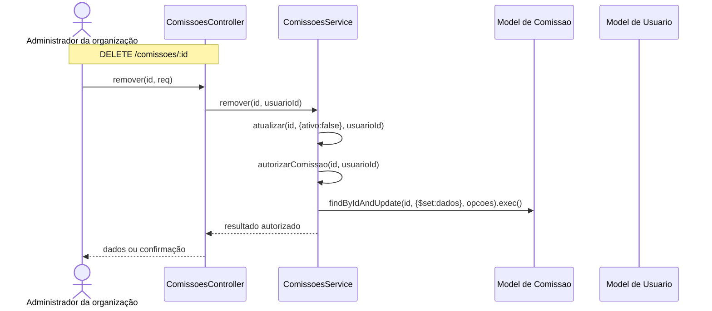

## RF-COM-06 — Reativar comissão

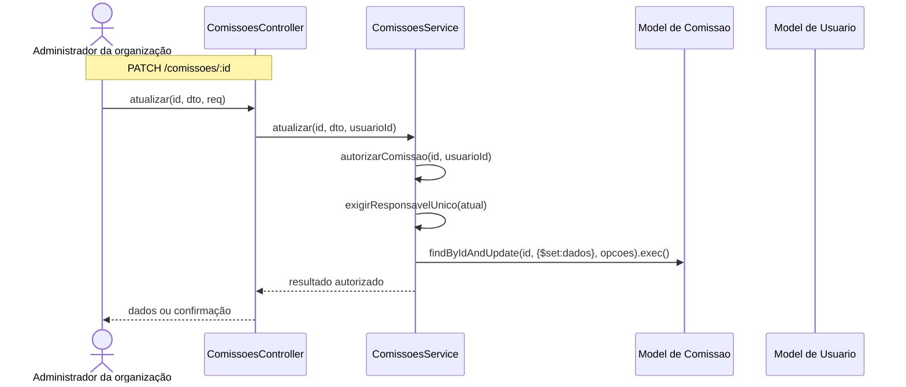

## RF-COM-07 — Adicionar integrante

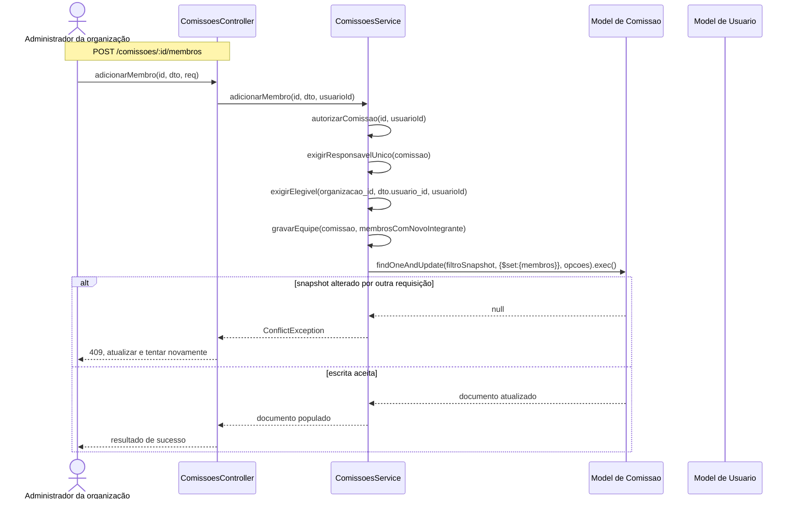

## RF-COM-08 — Definir ou substituir responsável

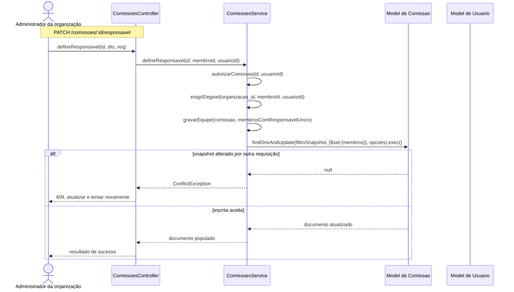

## RF-COM-09 — Remover integrante

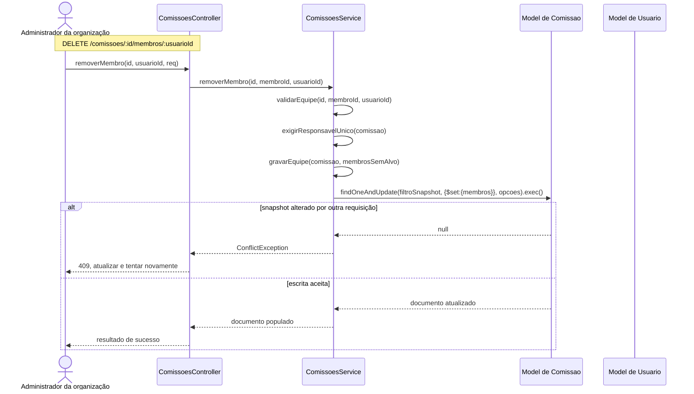

## RF-ATA-01 — Salvar rascunho de ata

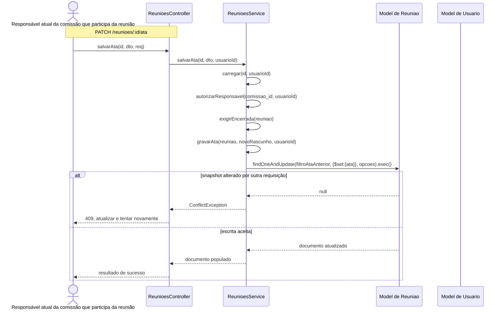

## RF-ATA-02 — Enviar ata para aprovação

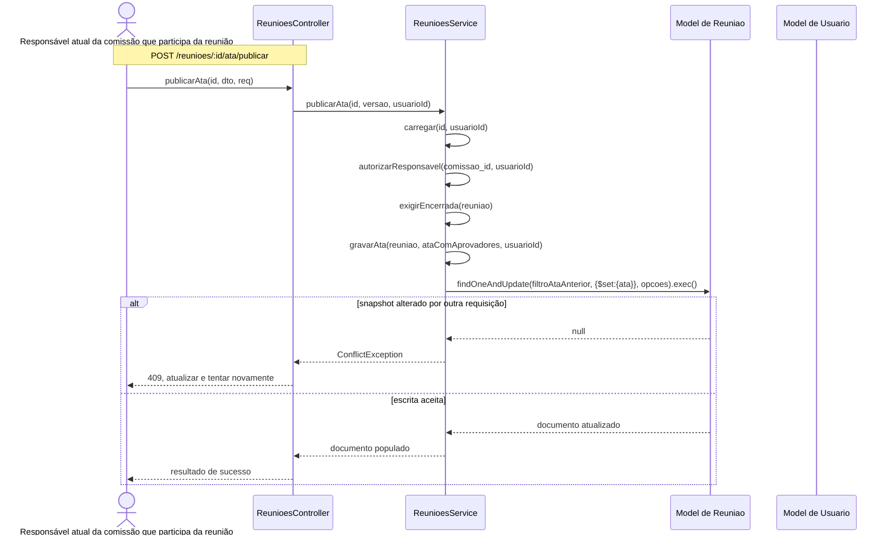

## RF-ATA-03 — Aprovar ata

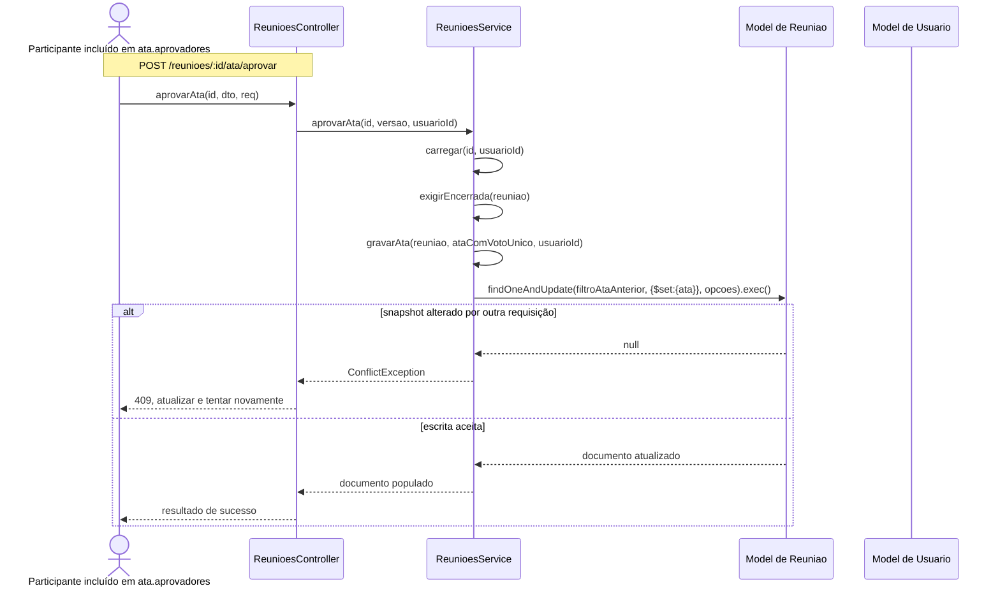

Antes de gravarAta, o serviço compara versão, exige presença em aprovadores e verifica voto existente. Voto repetido chama buscarPorId(id,usuarioId), retornando sem escrever. Falta de autorização: 403; estado inválido: 400; versão divergente: 409.

## RF-PRE-01 — Gerar e compartilhar lista de presença

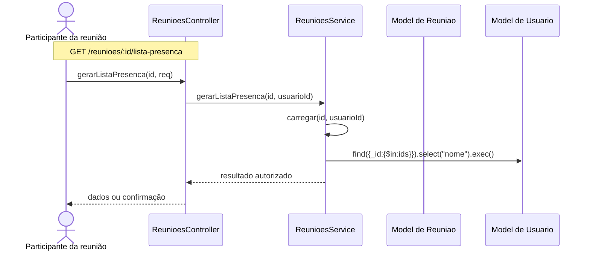

## Detalhamento das colaborações internas

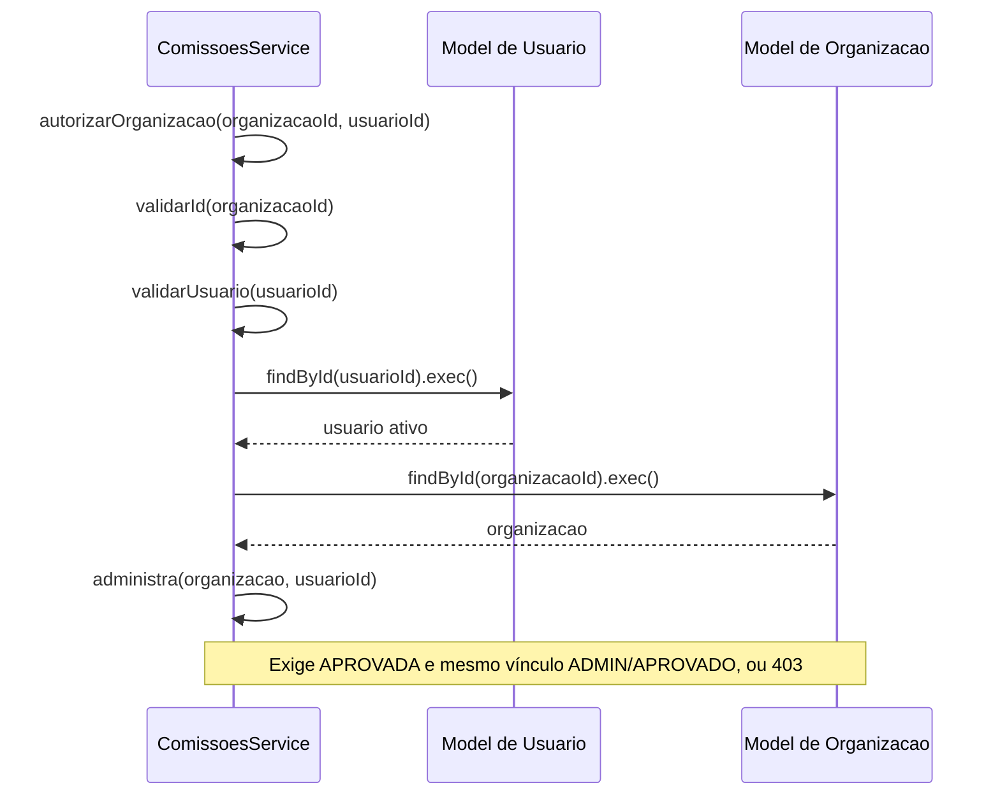

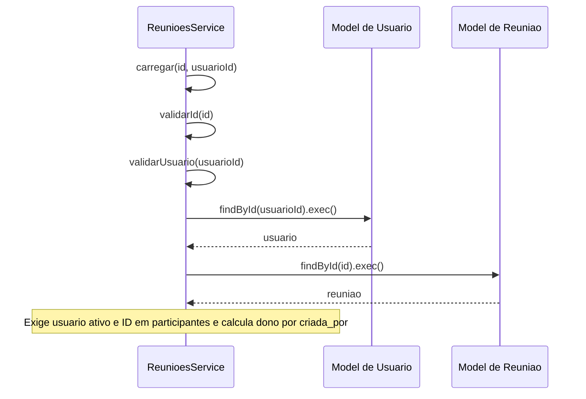

Os nomes novoRascunho, filtroSnapshot e ataComVotoUnico são argumentos descritivos, não métodos inventados. Definições exatas estão nos RF e em gravarEquipe/gravarAta. Falhas de autenticação, DTO e autorização interrompem o fluxo antes da escrita. Retornos de consultas internas foram abreviados nos diagramas principais para legibilidade. As sequências de reuniões já existentes permanecem sob responsabilidade do respectivo módulo; os treze requisitos próprios desta revisão têm diagrama acima.


---

# Pesquisa de mercado e decisões

## Método e limite da pesquisa

Fonte inicial do grupo: [Avaliação de Utilização Atual e Softwares Equivalentes no Mercado](https://github.com/rafaelaszro/Projeto-Conecta---Homologa-o/blob/main/PropostaInicial/Avalia%C3%A7%C3%A3o%20de%20Utiliza%C3%A7%C3%A3o%20Atual%20e%20Softwares%20Equivalentes%20no%20Mercado.docx), também presente em `1 - PropostaInicial` no repositório de documentação. Aplicativos citados: Google Calendar, Google Meet, Microsoft Teams, Notion Calendar, Calendly e Fellow.

Nesta revisão, o documento do grupo foi confrontado com páginas oficiais de funcionalidades, consultadas em 19/10/2026. É pesquisa documental; não foi realizado experimento de usabilidade com participantes. Não se afirma que os concorrentes possuem os mesmos erros observados pelo professor no Conecta+. “Complexidade” e “fragmentação” são hipóteses/percepções do grupo que precisam ser medidas em tarefas reais.

## Comparação orientada ao requisito

|Referência|Evidência/fonte|Aproveitar no Conecta+|Risco a evitar / decisão rastreável|
|---|---|---|---|
|Google Calendar|Permite responder convites e acompanhar respostas: [ajuda de convites](https://support.google.com/calendar/answer/37135?hl=en-7), [respostas dos convidados](https://support.google.com/calendar/answer/16713792?hl=en-7)|Manter aceite/recusa visíveis no encontro, já implementados pelo grupo|Não confundir ACEITO com presença CONFIRMADA; PRE-01 distingue estados|
|Microsoft Teams|Diferencia permissões de proprietário, membro e convidado: [capacidades por papel](https://support.microsoft.com/en-us/teams/teams-channels/team-owner-member-and-guest-capabilities-in-microsoft-teams)|Papéis com operações explícitas, adotados em COM-01 a COM-09|Evitar controles habilitados por rótulo visual sem verificação no servidor; não inferir que Teams exige exatamente um proprietário|
|Fellow|Notas organizam agenda, registros e encaminhamentos: [estrutura da nota](https://help.fellow.ai/en/articles/8619527-basics-of-a-fellow-meeting-note)|Vincular a ata à reunião, com orientação sobre decisões e encaminhamentos; ATA-01|Evitar guardar texto sem identificação do encontro ou aprovação rastreável; ATA-02/03|
|Notion Calendar|Integra eventos e páginas/notas: [Calendar com Notion](https://www.notion.com/en-us/help/use-notion-calendar-with-notion)|Abrir registros pelo detalhe da reunião; acesso contextual|Não obrigar usuário a procurar documento em outro sistema; não foi integrada API Notion|
|Calendly|Organiza disponibilidade a partir de horários e calendários: [availability](https://calendly.com/help/availability-overview)|Referência para evolução de agendamento, fora da alteração de comissão|Não afirmar que Conecta+ detecta conflitos de disponibilidade: não foi implementado|
|Google Meet|O documento inicial do grupo o avalia como ferramenta de videoconferência integrada ao ecossistema Google|Preservar campo local da reunião para informar modalidade/local; videoconferência não é objetivo desta entrega|Não prometer geração automática de links ou presença capturada de chamadas; não há integração Meet no código. Esta linha registra o levantamento do grupo, não um novo teste de produto|

## Problemas do próprio Conecta+ e correções

- Tela extensa: pesquisa de pessoas por nome/e-mail, páginas de oito itens para comissão/equipe/candidatos e remoção da listagem duplicada de membros da organização na gestão de comissões. As listas ainda são recebidas integralmente da API; escala de rede permanece trabalho futuro.
- Zero ou vários responsáveis: campo obrigatório no cadastro; inclusão comum não aceita RESPONSAVEL; substituição única e atômica; bloqueio de remoção/rebaixamento do responsável; regularização explícita de legado. Não atribuir essa regra aos concorrentes: é exigência do professor para este domínio.
- Ações destrutivas: confirmação antes de desativar/remover; confirmação também para trocar responsável e publicar/aprovar ata. Cancelamento não envia a escrita.
- Atualização: mantém o resultado retornado na mesma tela; lista tem atualização por gesto/foco; registros têm botão Atualizar e gesto de puxar para baixo. Novo agendamento atualiza comissões/convidados sem limpar os campos já preenchidos. Descartar rascunho não salvo exige confirmação.
- Teclado e formulários: uso da biblioteca de formulário já adotada e folha com ajuste de teclado; transferência usa seletor embutido para evitar modal dentro de modal. Teste nativo ainda necessário.

## Decisões que precisam da comunidade

1. “Responsável” corresponde ao presidente usado nos slides? É suficiente uma pessoa ou há necessidade de substituto temporário?
2. Ata deve exigir unanimidade dos presentes confirmados, maioria ou somente presidente? A versão implementada exige unanimidade e congela aprovadores ao enviar.
3. Como corrigir uma ata publicada incorreta? Nesta versão não há reabertura/rejeição; definir processo antes do uso real.
4. Pessoa removida da organização deve conservar acesso às reuniões passadas? A política herdada permite consulta a participante ativo; não foi feita mudança transversal silenciosa.
5. O novo responsável pode administrar reuniões criadas pelo anterior? Hoje a autoria de reunião permanece; preparar ata exige também ser participante. Isso precisa ser alinhado entre os módulos.
6. Confirmar tamanho máximo de campos, necessidade de anexo/PDF, quórum, assinatura e exportação. Nenhum deles é deduzido como requisito já validado.

Registrar data, participantes, tarefa, decisão e concordância da comunidade em ata de validação. Não preencher resultados fictícios.


---

# Testes e rastreabilidade — execução iniciada em 19/10/2026, revisão em 20/10/2026

## Ambiente e evidências

Windows, Node.js 24.14.0; dependências instaladas por `npm ci` a partir dos lockfiles de homolog. Houve aviso de engine de ferramenta Angular/Nest esperando versão mais recente de Node; os comandos abaixo concluíram. Nenhuma dependência de produção foi adicionada. Banco de integração: MongoDB em 127.0.0.1:27017, banco com prefixo `conecta_teste_comissoes_` e UUID exclusivo por execução; removido pelo próprio teste ao final. Não usou dados de produção.

|Verificação|Comando (na pasta correspondente)|Resultado|
|---|---|---|
|Backend, suíte completa|npm test|157 testes aprovados, 13 arquivos|
|Backend, recorte comissões/reuniões|npm test -- src/comissoes src/reunioes|65 testes aprovados, 5 arquivos (subconjunto dos 157, não somar)|
|Backend, compilação|npm run build|Aprovado|
|Backend, análise estática|npm run lint|Aprovado|
|MongoDB real, serviço + persistência|node test/comissoes-mongo.mjs, após build|Aprovado: fluxo de equipe, disputa de escrita, ata e lista; amostra HTTP com guards e DTO reais|
|Frontend, tipos|npm run typecheck|Aprovado|
|Frontend, lint|npm run lint|Sem erros; dois avisos preexistentes: nome MinhasComissoes redeclarado e import CampoTexto não utilizado em verificar-cadastro|
|Frontend, sessão HTTP simulada|node --test tests/*.test.cjs|5 testes aprovados; são testes preexistentes do helper, não testes visuais dos novos formulários|
|Frontend, empacotamento web|npx expo export --platform web|Aprovado; rota /reunioes/registros incluída|

Vitest usa models simulados na suíte unitária. O script `test/comissoes-mongo.mjs` usa schemas e serviços compilados com MongoDB real e também inicia aplicação Nest de teste com ComissoesController/ReunioesController, guards reais e ValidationPipe. A amostra HTTP verifica 401 sem token/token inválido, 400 para DTO inválido, 403 para não administrador e ADMIN_SISTEMA, transferência autenticada e leitura da lista. Não cobre todas as combinações HTTP das treze operações. O teste real de concorrência dispara duas escritas diferentes com a mesma fotografia e exige exatamente um sucesso e um erro.

## Casos cobertos e correspondência

|Grupo|Cenário/resultado esperado|Evidência|
|---|---|---|
|COM-01/02|Leitura autorizada; bloquear usuário alheio, vínculo não aprovado e organização não aprovada|comissoes.regras.spec.ts|
|COM-03|Responsável obrigatório/elegível; exatamente um vínculo inicial; limites de nome e ID|comissoes.regras.spec.ts + MongoDB|
|COM-04/05|Atualização permitida somente ao admin; exclusão lógica preserva comissão|comissoes.regras.spec.ts|
|COM-06/08|Legado com zero/dois responsáveis não pode ser reativado sem regularizar; transferência conserva situação inativa|comissoes.regras.spec.ts|
|COM-07|Inclusão única de MEMBRO, recusa papel RESPONSAVEL e duplicação|comissoes.regras.spec.ts + MongoDB|
|COM-08/09|Substituição deixa um responsável; antigo vira membro; remoção/rebaixamento do responsável bloqueados|comissoes.regras.spec.ts + MongoDB|
|RNF-COM-01|Snapshot antigo não sobrescreve equipe concorrente|comissoes.regras.spec.ts + test/comissoes-mongo.mjs|
|ATA-01|Bloquear antes do fim/cancelada/não responsável/versão antiga; salvar incremento de versão|reunioes/atas-presencas.spec.ts + MongoDB|
|ATA-02|Exigir presença confirmada e congelar aprovadores; impedir edição após envio|atas-presencas.spec.ts + MongoDB|
|ATA-03|Unanimidade, voto único/idempotente, negar fora do conjunto, conflito 409|atas-presencas.spec.ts + MongoDB|
|PRE-01|Nomes e estados corretos; minutos só com saída; não inventar presença ausente|atas-presencas.spec.ts + MongoDB|

## Roteiro manual ainda a executar com o grupo

Registrar aparelho, versão Android/iOS, dimensões, escala de fonte, data, executor, resultado e captura. Não preencher “aprovado” sem executar.

1. Em Android e iOS, cadastrar comissão escolhendo responsável; tentar enviar sem pessoa. Esperado: erro de campo/servidor, sem comissão vazia.
2. Cadastrar 17 candidatos fictícios; buscar pelo nome/e-mail; navegar páginas; abrir teclado; confirmar que botão de seleção/salvar permanece alcançável.
3. Alterar responsável; cancelar confirmação e conferir ausência de mudança; confirmar e verificar que antigo permanece MEMBRO.
4. Tentar excluir responsável, inclusive via cliente HTTP independente. Esperado: 400 e manutenção da equipe.
5. Abrir mesma comissão em duas sessões; realizar alterações concorrentes. Esperado: conflito, atualização da tela e repetição consciente.
6. Com reunião encerrada, confirmar presenças, salvar ata, enviar, votar com todas as pessoas. Conferir contador, bloqueio de edição e estado APROVADA.
7. Repetir voto, tentar votar sem permissão e usar versão antiga. Esperado: sem duplicidade / 403 / 409.
8. Gerar lista com convidado sem presença, entrada sem saída, presença recusada e confirmada. Conferir SEM_REGISTRO, null e duração. Abrir compartilhamento e cancelar.
9. Simular rede indisponível: formulário deve informar falha, conservar texto e permitir tentativa; não exibir confirmação de sucesso falsa.

## Limites e pendências da entrega

Não foram feitos teste de carga, auditoria de segurança, homologação comunitária, teste de loja/build nativo ou ensaio com teclado físico Android/iOS. Lista de reuniões e organizações ainda segue a interface herdada. A paginação de comissões é visual, não no banco. Dados antigos não são alterados automaticamente: o admin deve regularizar comissão por comissão. A aprovação da ata é unanimidade do conjunto congelado; desativação de conta pode impedir completar essa aprovação e requer decisão de produto sobre reabertura/substituição.

O feedback global sobre chave de API depende de definição de infraestrutura do grupo; os problemas de cadastro de usuário, sistema e organização não foram reescritos nesta parte. O texto deste documento não certifica atendimento integral do incremento 2 nem substitui o aceite do professor.


---

# Execução e roteiro de apresentação

## Pastas locais

As cópias editadas estão em `C:\Users\Rafaela\Documents\ChatGPT\Conecta+\incremento-2`:

- BACKEND: API NestJS, TypeScript e MongoDB.
- FRONTEND: aplicativo React Native/Expo, TypeScript/TSX.
- DOCUMENTATION: documentação; este pacote está em `3 - Incremento2/comissoes`.

Cada pasta é seu próprio repositório. Não copiar `.git` entre elas. As mudanças não foram commitadas nem enviadas ao GitHub nesta revisão.

## Preparar ambiente

Backend precisa de `.env` local com `MONGODB_URI` apontando para banco de desenvolvimento e `JWT_SECRET` exclusivo do ambiente. Não usar banco de produção para demonstração. Não publicar o segredo. Verificar configurações de e-mail do módulo de autenticação com o responsável dessa parte antes de testar cadastro/recuperação; não são requisitos da comissão.

Na pasta BACKEND:

```powershell
npm.cmd ci
npm.cmd run start:dev
```

No FRONTEND, criar `.env` local com `EXPO_PUBLIC_API_URL=http://localhost:3000` para web. No aparelho, usar IP acessível do computador e verificar rede/firewall; o helper existente tenta substituir localhost pelo host do Expo em ambiente nativo. URL pública não é segredo. Em outro terminal:

```powershell
npm.cmd ci
npm.cmd start
```

Usar usuário comum ativo, membro ADMIN/APROVADO de organização APROVADA e ao menos outro integrante ativo/APROVADO. ADMIN_SISTEMA não deve ser usado como administrador da organização nessa demonstração. Nesta revisão não foram geradas credenciais reais nem alteradas contas existentes.

## Explicar ao professor

- **Qual linguagem?** TypeScript. TSX combina TypeScript e marcação JSX nas telas React Native. NestJS organiza a API; Mongoose define documentos e consultas MongoDB.
- **Qual API externa?** Nenhuma para comissões/atas. O app chama a API do próprio grupo via fetch. Bibliotecas não são serviços externos de dados. A pesquisa de mercado não significa integração com APIs dos concorrentes.
- **Por que validar também no servidor?** Uma pessoa pode chamar a rota sem usar a tela. DTO valida formato; serviço valida autorização e regra de negócio; schema reforça estrutura do documento.
- **Por que não usar dois booleans de responsável?** A equipe tem papel por integrante, mas a regra exige contagem igual a um. Transferência troca todos os papéis em uma única escrita; não desmarca primeiro e marca depois.
- **O que impede concorrência?** O filtro da atualização inclui o array que foi lido. Se alguém mudar antes, o filtro não encontra o mesmo estado e o serviço responde 409. Não existe transação entre todas as coleções.
- **Por que DELETE não apaga?** A comissão vira ativo=false para preservar referências e histórico. O nome da operação HTTP não exige exclusão física.
- **O responsável pode administrar toda a organização?** Não. ADMIN/APROVADO é vínculo de organização; RESPONSAVEL é papel na comissão.
- **O que é ObjectId?** Identificador BSON do MongoDB; no JSON aparece como string hexadecimal de 24 caracteres. Não é senha nem prova de autorização.
- **Para que serve populate?** Substitui referências pelos campos selecionados, como nome/e-mail. Não é uma tabela SQL nem cria foreign key.
- **A versão da ata guarda todas as versões?** Não. Apenas o texto atual é persistido, com contador para detectar edição desatualizada.
- **Aceitar convite é comprovar presença?** Não. São campos diferentes. A lista pode mostrar ACEITO e SEM_REGISTRO.
- **A ata é assinada digitalmente?** Não. Há aprovação autenticada por ID de usuário; não certificado criptográfico e nem timestamp individual de cada voto.
- **O que ainda falta validar?** Regras de aprovação/reabertura com a comunidade, fluxo após troca de responsável e testes nativos Android/iOS.

## Publicação posterior

Revisar `git diff` em cada repositório, decidir a branch de destino com o grupo e executar os testes antes de commit/push. Este pacote não executa publicação automaticamente. Não incluir `.env`, node_modules, dist ou dados locais no commit.


---

# Complemento de agendamento — 20/10/2026

Solicitação de Rafaela durante a demonstração: sugestões editáveis de início/término, seleção de convidados e conferência de atualização por gesto.

## RF-REU-COM-01 — Escolher participantes ao agendar

**Descrição:** Permitir que o responsável escolha quais integrantes da comissão participarão da nova reunião.

**Entradas:** Campos de CreateReuniaoDto já documentados e `convidados_ids`, array de ObjectIds únicos. A tela sempre envia o array, inicialmente com o organizador. É possível selecionar todos, desmarcar ou pesquisar por nome/e-mail, em páginas de oito.

**Origem:** Responsável atual da comissão, autenticado.

**Saída:** Reunião criada com organizador ACEITO e demais selecionados PENDENTE; erros 400/401/403 conforme validação/autorização.

**Destino:** Detalhes da reunião.

**Ação:** POST /reunioes → ReunioesController.criar(dto,req) → ReunioesService.criar(dto,usuarioId). Depois de autorizarResponsavel e validarHorario, o serviço verifica se cada ID pertence a comissao.membros. Acrescenta o organizador e elimina duplicidade via Set. Model de Reuniao.create grava participantes somente com esses IDs. O DTO recusa null, valor não array, ID inválido e IDs repetidos. ID de pessoa externa à comissão gera 400 antes da escrita.

**Pré-condição:** Comissão ativa, organização aprovada e responsável com vínculo aprovado; regras de título, local e horários preservadas.

**Pós-condição:** Somente as pessoas selecionadas e o organizador constam em reunioes.participantes e podem consultar essa reunião conforme a autorização existente.

**Efeitos colaterais:** Não altera a equipe da comissão nem participantes de reuniões anteriores. Array vazio significa somente o organizador. Para compatibilidade com clientes anteriores, omitir convidados_ids mantém o convite de toda a comissão. Esta revisão acrescenta seleção na criação, não edição posterior de convites já emitidos.

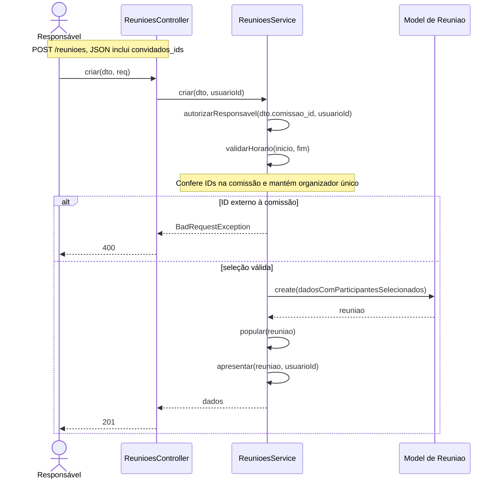

## Sugestões de horário

`sugerirHorarios(dia,agora,inicio?)`, em FRONTEND/src/utils/sugestoes-horario.ts, é uma função pura. Para hoje, sugere os próximos seis intervalos de meia hora ainda no mesmo dia. Para data futura, sugere 08h, 09h, 10h, 11h, 14h, 15h, 16h, 17h e 18h. Para término com início válido, acrescenta durações de 30, 60, 90, 120 e 180 minutos, excluindo resultados a partir de 24h. Sem sugestão válida, orienta digitar ou trocar a data.

Os botões Sugerir início/Sugerir término abrem uma folha com duas abas. Escolher chama setValue do react-hook-form e dispara validação; o campo HH:mm continua editável. Não consulta disponibilidade dos convidados nem detecta conflitos com outras reuniões. Não cria novo campo persistido.

## Atualização ao puxar para baixo

Já existia RefreshControl em início, agenda, organizações, comissões e detalhes da reunião. Acrescentado ao novo agendamento e à tela Ata e lista de presença. No agendamento, atualiza comissões disponíveis mantendo título, horários, pauta e seleção por comissão; pessoas removidas da equipe deixam de constar entre os convidados enviados. Nos registros, atualiza reunião e lista já aberta; se há texto não salvo, pede confirmação antes de descartá-lo. Durante gravação, não executa atualização concorrente.

TelaComCabecalho usa KeyboardAwareScrollView com RefreshControl; `alwaysBounceVertical` permite o gesto no iOS mesmo com conteúdo curto. Não é recarga integral do aplicativo e não equivale a F5 do navegador. Ensaio do gesto em aparelho Android/iOS ainda pendente.

## Testes desta revisão

- Backend: 161 testes aprovados (157 anteriores + 4 cenários de convidados), build e lint aprovados.
- Frontend: typecheck e lint sem erros, com os mesmos dois avisos anteriores; nove testes aprovados (cinco de sessão + quatro de horários).
- Integração HTTP/MongoDB em banco temporário: nova reunião gravada com somente dois IDs escolhidos, sem incluir outro integrante da comissão.
- Interface web: sugestão preenchida, horário alterado manualmente, inclusão de Ana/Bruno e retirada de Bruno conferidas; contador passa de um para três e depois dois participantes. Não foi criada reunião nesse ensaio visual.
- Teste de toque/teclado/atualização em Android e iOS permanece pendente.
